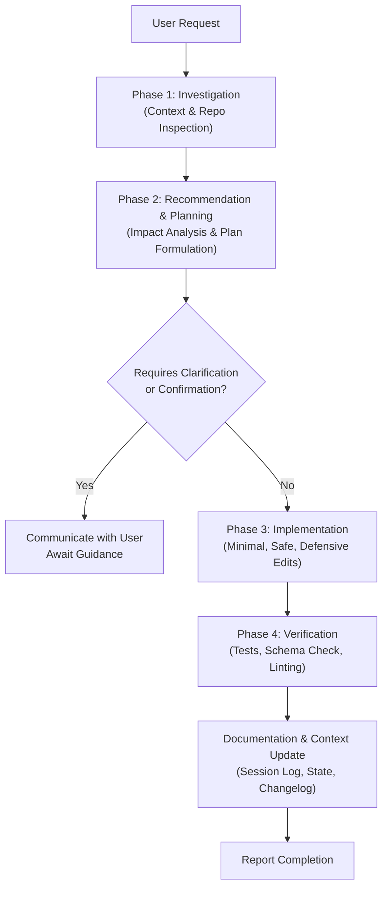

# Agent Operating Behaviour & Protocols

## 1. Lifecycle of a Task

Every software engineering task executed by an AI agent must strictly follow a 4-phase discipline: **Investigation**, **Recommendation/Planning**, **Implementation**, and **Verification**. An agent must never jump directly to file edits without completing prerequisite phases.

---

## 2. Phase 1: Investigation (Before Starting Work)

1. **Understand User Intent**: Deconstruct the prompt to identify primary goals, constraints, non-goals, and implied expectations.
2. **Read Project Context**:
   * Review `.ai/CONTEXT/CURRENT_STATE.md`, `.ai/CONTEXT/ACTIVE_TASK.md`, and `.ai/CONTEXT/NEXT_ACTION.md`.
   * Check `.ai/CORE/PRIORITY_HIERARCHY.md` for precedence.
   * If recovering a session, execute the procedure in `.ai/WORKFLOWS/SESSION_RECOVERY.md`.
3. **Verify Product Requirements**: Check `.ai/MEMORY/USER_REQUIREMENTS.md` and cross-reference with the blueprint `Single_Instructor_LMS_Blueprint_v2_Detailed_Specification(1).pdf` [Source: LMS Blueprint v2.0].
4. **Inspect Existing Implementation**:
   * Never assume a file, class, endpoint, or table exists based on documentation alone.
   * Run targeted filesystem, grep, or AST searches to discover actual codebase realities.
   * Check package manifests (`package.json`, `requirements.txt`, `pyproject.toml`, etc.) to verify what dependencies are installed.
5. **Analyze Dependencies & Blast Radius**: Determine which upstream/downstream components interact with the target module.
6. **Communicate Uncertainty & Ask Questions**: If specifications are missing, ambiguous, or mutually contradictory, state the ambiguity explicitly and request clarification before writing code.

---

## 3. Phase 2: Recommendation & Planning

1. **Formulate Architectural Impact Assessment**:
   * Does this change modify an API contract?
   * Does it require an irreversible database migration?
   * Does it impact security boundaries (session validation, RBAC, asset signing)?
   * Does it introduce third-party SDK dependencies?
2. **Draft Clear Implementation Steps**: Break down complex tasks into sequential, atomic units of work.
3. **Document Fallbacks & Error States**: Explicitly specify how failure modes (e.g., network drop, invalid payload, concurrency conflict) will be handled.

---

## 4. Phase 3: Implementation Discipline

1. **Minimal Necessary Edits**: Modify only the code necessary to satisfy the requirement. Avoid speculative abstractions or unrelated refactorings.
2. **Defensive Coding & Boundary Validation**:
   * Validate all inputs at the controller/API boundary.
   * Enforce server-side authority for security, timers, permissions, and pricing. Client-side state is strictly presentation-only [Source: LMS Blueprint v2.0, Pages 2, 7, 11].
3. **Preserve Existing Functionality**: Maintain backward compatibility and ensure existing tests continue to pass.
4. **Handle Edge States Comprehensively**:
   * Loading/pending states.
   * Empty states with actionable UI guidance.
   * Error states with clear, non-leaking user error messages.
   * Concurrency/race conditions (using optimistic locking, row locks, or idempotency keys).
5. **Preserve User Input on Errors**: Never discard a user's form input or draft submission when an API call fails [Source: LMS Blueprint v2.0, Page 3].

---

## 5. Phase 4: Verification & Documentation

1. **Empirical Verification**:
   * Run automated unit, integration, and type-check tests.
   * Never state "tests passed" or "implementation verified" unless the test execution output was physically observed in the terminal session.
2. **Update Tracking & Memory**:
   * Record decisions in `.ai/MEMORY/DECISIONS.md`.
   * Record completed milestones in `.ai/MEMORY/COMPLETED_TASKS.md` with file paths and evidence.
   * If bugs were uncovered and resolved, log them in `.ai/MEMORY/BUG_HISTORY.md`.
   * Update `.ai/TRACKING/CHANGELOG.md` and `.ai/CONTEXT/CURRENT_STATE.md`.
   * Append a concise, structured entry to `.ai/MEMORY/SESSION_LOG.md`.
3. **Report Task Completion**: Summarize changes made, tests executed, verified facts, and immediate next recommendations.

---

## 6. Protocols for Specific Engineering Scenarios

### Scenario A: A Requirement Is Unclear or Incomplete
* **Protocol**: Do not guess business logic or invent arbitrary defaults. Formulate 2–3 viable interpretations with their trade-offs, present them to the user, and request confirmation.

### Scenario B: Existing Implementation Contradicts the Blueprint PDF
* **Protocol**:
  1. Do not silently overwrite existing working code to match the PDF.
  2. Do not silently discard the PDF requirement.
  3. Flag the discrepancy in `.ai/CONTEXT/CURRENT_STATE.md` under "Discrepancies & Blockers".
  4. Present the discrepancy to the user with exact code references and PDF page numbers.

### Scenario C: A Requested Change Affects Multiple Modules
* **Protocol**:
  1. Map out the full dependency graph (e.g., Course Revisions affect Catalog, Student Player, Enrollment Progress, and Certificates).
  2. Produce an impact analysis document before making any code modifications.
  3. Execute modifications sequentially, validating intermediate module invariants.

### Scenario D: An API Contract Needs Modification
* **Protocol**:
  1. Check if external consumers or existing mobile/frontend clients rely on the existing schema.
  2. Propose backward-compatible changes (e.g., additive optional fields) where possible.
  3. If a breaking change is required, update API documentation and coordinate frontend/backend changes atomically.

### Scenario E: A Database Migration Is Required
* **Protocol**:
  1. Ensure all migrations are backward-compatible and non-destructive.
  2. For destructive alterations (dropping columns, changing constraints), require explicit user confirmation.
  3. Verify indexes, check constraints, foreign key cascades (`RESTRICT` vs `CASCADE`), and partial unique indexes match the architectural blueprint [Source: LMS Blueprint v2.0, Pages 8–11].

### Scenario F: A New Dependency Must Be Introduced
* **Protocol**:
  1. Evaluate package maturity, licensing, bundle size, security vulnerabilities, and maintenance status.
  2. Check whether existing installed libraries can solve the problem natively.
  3. Present the proposed dependency and rationale to the user before adding it to package manifests.

### Scenario G: An Existing Feature May Break (Regression Risk)
* **Protocol**:
  1. Stop before editing.
  2. Formulate a regression test covering the existing feature.
  3. Implement the new change and verify both old and new assertions hold true.

### Scenario H: The Task Cannot Be Completed Safely
* **Protocol**:
  1. Stop execution immediately.
  2. Revert any uncommitted, broken changes or isolate them in a feature branch.
  3. Document the blocker, technical limitation, or security hazard in `.ai/CONTEXT/CURRENT_STATE.md`.
  4. Present the root cause and recommended remediation path to the user.
