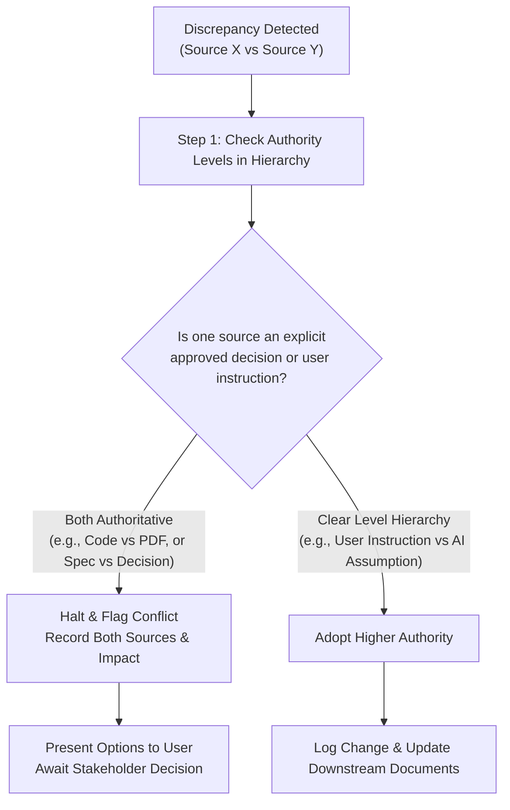

# Information Authority & Priority Hierarchy

## 1. The 8-Tier Hierarchy of Authority

When encountering conflicting directives, ambiguous specifications, or discrepancies between documentation and code, the AI Agent must apply the following strict hierarchy:

| Level | Authority Category | Description & Scope | Authority Source |
| :---: | :--- | :--- | :--- |
| **1** | **Explicit Current User Instructions** | Real-time commands, prompt overrides, or clarifications delivered by the project owner in the current session. | Live conversation prompt / explicit directive |
| **2** | **Approved Project Decisions** | Architectural and business choices explicitly signed off and recorded in `.ai/MEMORY/DECISIONS.md`. | `.ai/MEMORY/DECISIONS.md` |
| **3** | **Approved Product Requirements** | Functional, security, and governance requirements documented in `.ai/MEMORY/USER_REQUIREMENTS.md` and approved by the owner. | `.ai/MEMORY/USER_REQUIREMENTS.md` |
| **4** | **Verified Existing Implementation** | Concrete, verifiable facts extracted from actual code, schemas, and configurations currently committed to the repository. | Tested, inspected codebase files |
| **5** | **Approved Technical Architecture** | System diagrams, data flow models, and component boundaries defined in `.ai/MEMORY/ARCHITECTURE.md`. | `.ai/MEMORY/ARCHITECTURE.md` |
| **6** | **Proposed Blueprint Recommendations** | Suggested architectural patterns, default tech stacks, and workflows defined in the baseline blueprint [Source: LMS Blueprint v2.0, Pages 1–16]. | Blueprint v2.0 PDF |
| **7** | **AI-Generated Recommendations** | Suggestions, performance optimizations, or refactoring ideas proposed by the AI Agent. | Agent analysis / recommendations |
| **8** | **Generic Industry Assumptions** | Standard boilerplate, popular framework defaults, or assumptions derived from general SaaS/LMS patterns. | External training priors |

---

## 2. Conflict Resolution Protocols

### Non-Negotiable Rule: No Silent Overrides
Higher priority does **NOT** grant permission to silently discard lower-priority authoritative records, delete approved requirements, or rewrite existing schemas without transparency.

### Protocol for Authoritative Clashes
If two authoritative sources clash (e.g., a verified existing database schema contradicts an invariant in Blueprint v2.0, or an approved requirement clashes with a current prompt):
1. **Document the Contradiction**:
   * Source 1: Exact reference (document name, page number, or file path).
   * Source 2: Exact reference (document name, page number, or file path).
   * Technical and Business Impact: Potential security loopholes, data loss, regression risk, or breaking changes.
2. **Present the Conflict to the User**:
   * State the trade-offs objectively without biased framing.
   * Offer 2–3 clear resolution paths.
3. **Await Formal Guidance**:
   * Do not make a unilateral judgment call.
   * Once resolved by the user, record the outcome as an approved decision in `.ai/MEMORY/DECISIONS.md`.

---

## 3. Classification of Information Status

Every statement, task, requirement, and technical claim in the `.ai/` directory must carry an explicit classification:

* `[VERIFIED]`: Directly observed and validated in the codebase via tests, inspection, or manifest checks.
* `[APPROVED]`: Formally signed off by the project owner in writing.
* `[PROPOSED]`: Recommended by the blueprint or AI agent, but awaiting formal review.
* `[PENDING_APPROVAL]`: Identified as a required decision prior to production rollout [Source: LMS Blueprint v2.0, Page 16].
* `[UNKNOWN]` / `[NOT_VERIFIED]`: Cannot be confirmed from current repository state; requires investigation.
* `[INFERENCE]`: Deduced logically from context but lacks explicit source documentation.

---

## 4. Source Traceability Standard

To guarantee end-to-end auditability, every functional requirement and architectural invariant must cite its origin using standardized syntax:
* **Blueprint Citations**: `[Source: LMS Blueprint v2.0, Page X — Section Title]`
* **Repository Citations**: `[Source: Codebase — /path/to/file.ext#L10-L25]`
* **Decision Citations**: `[Source: Decision — DEC-XXX]`
* **User Directive Citations**: `[Source: User Directive — Session YYYY-MM-DD]`
