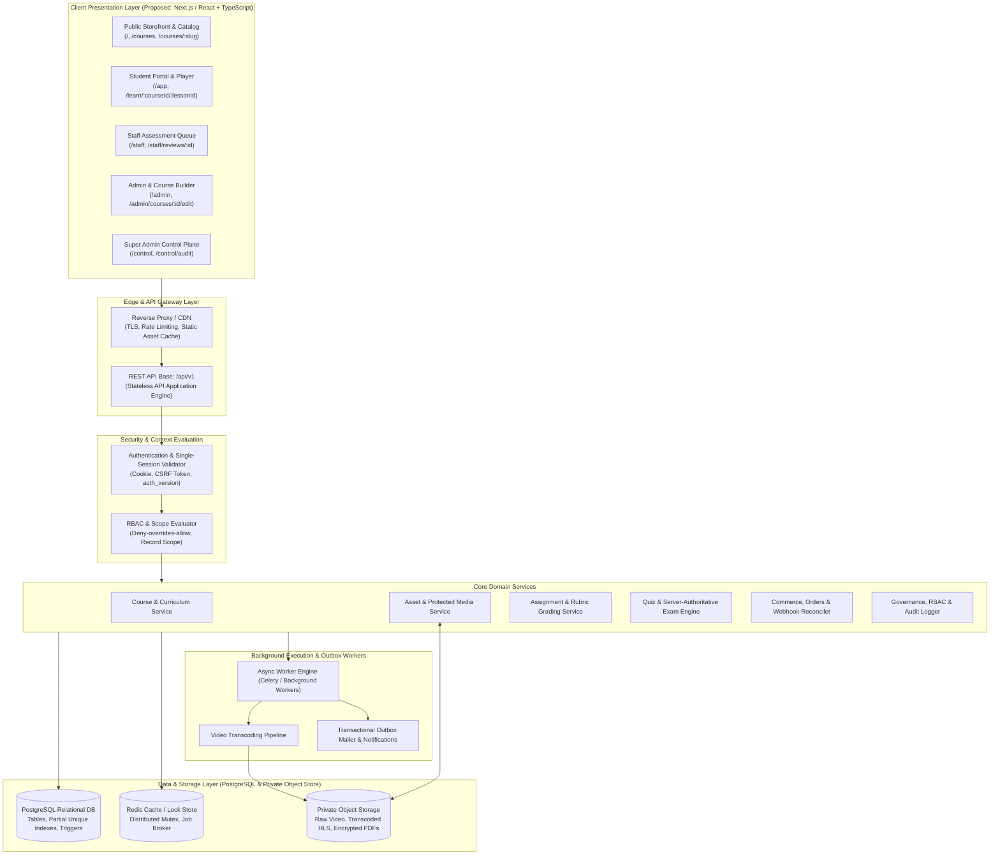
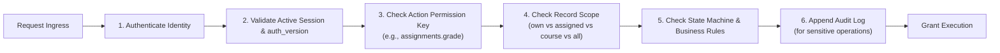
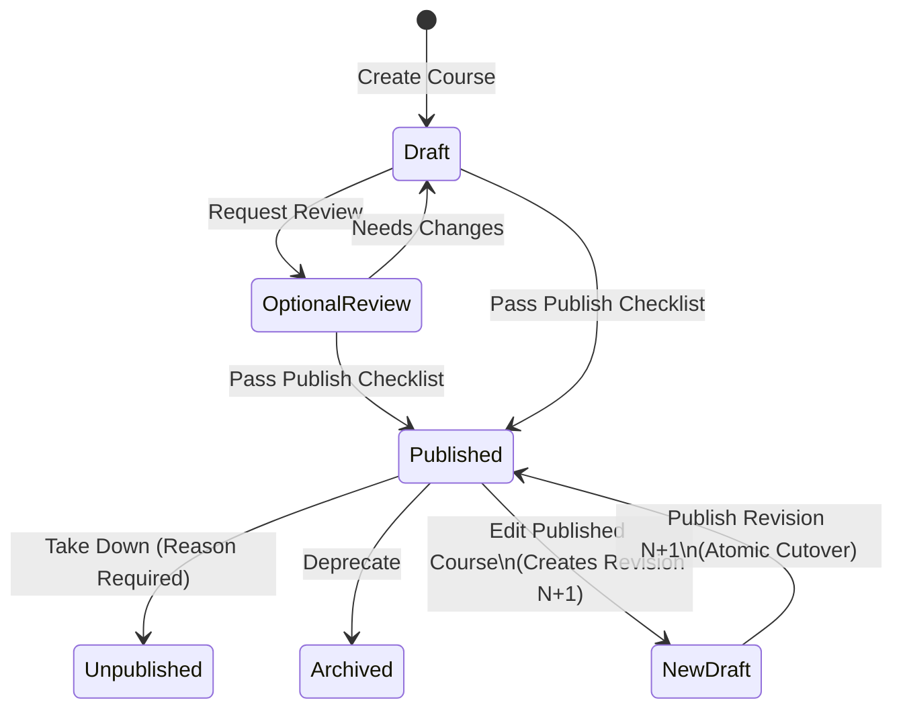
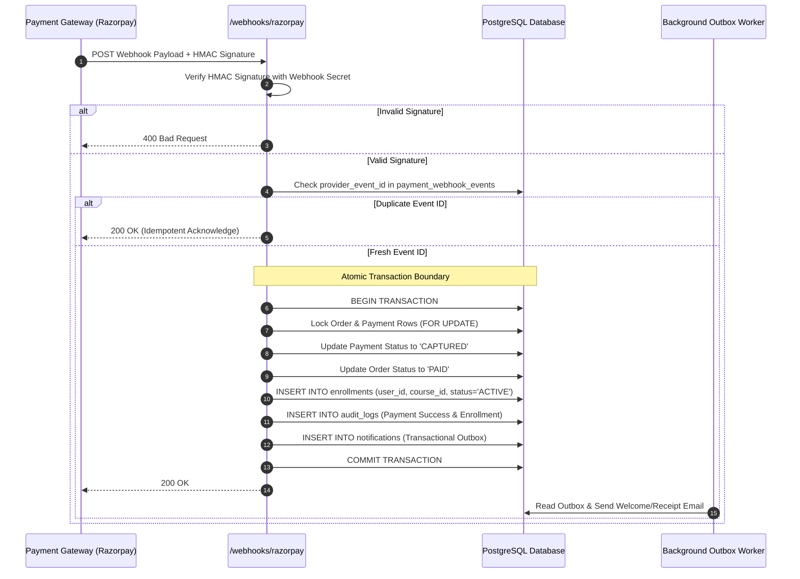

# System Architecture & Technical Design

This document details the complete system architecture for the Single-Instructor LMS based on `Single_Instructor_LMS_Blueprint_v2_Detailed_Specification(1).pdf` [Source: LMS Blueprint v2.0, Pages 1–16].

> **Implementation Reality Notice**:
> The architectural models, schemas, and data flows defined here represent the **Approved Product Architecture & Blueprint Baseline**.
> Detailed backend architecture design has been completed and documented across 24 files in `docs/backend/` (covering FastAPI, PostgreSQL 17, 35 relational tables, RESTful API catalog, and the 10-part roadmap).
> The physical repository is currently in **Phase 1: Backend Architecture Design (Completed) | Implementation Status: NOT STARTED**.
> Formal approval of the architecture design is required before application implementation begins.

---

## 1. High-Level Architectural Topology



---

## 2. Authentication & Session Architecture

### Atomic Single-Active-Session Enforcement
The platform enforces a strict security invariant: **At most one active session per user account across all devices** [Source: LMS Blueprint v2.0, Pages 2, 8].

#### Mechanism & Data Flow:
1. **Login Request**: User submits credentials or Google OIDC payload.
2. **Credential & MFA Validation**: Validate password hash / Google token and verify TOTP code if MFA is enabled.
3. **Atomic Transaction**:
   ```sql
   BEGIN;
   SELECT id FROM users WHERE id = :uid FOR UPDATE;
   -- Revoke any previously active session immediately
   UPDATE auth_sessions 
      SET status = 'REVOKED', 
          revoked_at = NOW(), 
          revoke_reason = 'NEW_LOGIN'
    WHERE user_id = :uid AND status = 'ACTIVE';
   -- Insert the newly authenticated session
   INSERT INTO auth_sessions (id, user_id, token_hash, status, created_at, last_seen_at, expires_at)
   VALUES (:sid, :uid, :hash, 'ACTIVE', NOW(), NOW(), :expiry);
   -- Increment user auth_version to invalidate bounded caches
   UPDATE users SET auth_version = auth_version + 1 WHERE id = :uid;
   COMMIT;
   ```
4. **Cookie Issuance**: Secure, HttpOnly cookie (`SameSite=Lax/Strict`, `Path=/`) is issued **strictly after** transaction commit [Source: LMS Blueprint v2.0, Page 8].
5. **Database Partial Index**:
   ```sql
   CREATE UNIQUE INDEX idx_unique_active_user_session 
       ON auth_sessions(user_id) 
    WHERE status = 'ACTIVE';
   ```
6. **Concurrent Login Handling**: Two simultaneous logins for the same account are serialized by the row lock (`FOR UPDATE`). The second committed login wins and revokes the first [Source: LMS Blueprint v2.0, Page 8].
7. **Displaced Device Notification**: The previous device's next API request returns `401 SESSION_REVOKED` and instructs the client to display: *"You signed in on another device"* [Source: LMS Blueprint v2.0, Page 8].

---

## 3. Authorization & RBAC Architecture

The access control engine operates on a multi-stage pipeline [Source: LMS Blueprint v2.0, Page 3]:



### Key Governance Policies
* **Deny-Overrides-Allow**: An explicit `DENY` override on a user record supersedes any role-level grant [Source: LMS Blueprint v2.0, Page 3].
* **No Client Privilege Elevation**: Public signup always generates a `Student` role; client requests attempting to inject privileged roles are rejected [Source: LMS Blueprint v2.0, Page 2].
* **Last Super Admin Invariant**: Database check constraints or service rules strictly prevent removing, demoting, or revoking the final active Super Admin account [Source: LMS Blueprint v2.0, Pages 2, 7, 9].

---

## 4. Course & Curriculum Revision Architecture

To protect paying students from experiencing broken curriculum or altered lesson requirements mid-study, courses use an **immutable revision model** [Source: LMS Blueprint v2.0, Page 5].



### Revision Rules
1. **Immutable Published Revision**: When Revision 1 is published, its sections, lessons, and asset attachments become frozen in a `snapshot` JSONB column [Source: LMS Blueprint v2.0, Pages 5, 9].
2. **Draft Branching**: Edits made while Revision 1 is published automatically instantiate Revision 2 in `Draft` status. Enrolled students continue consuming Revision 1.
3. **Atomic Curriculum Reordering**:
   * Curriculum reordering submits an optimistic order array alongside the current revision version [Source: LMS Blueprint v2.0, Page 5].
   * The API executes the order update within an atomic transaction.
   * If another administrator reordered concurrently, a `409 CURRICULUM_VERSION_CONFLICT` is returned, rolling back changes and requesting an editor reload [Source: LMS Blueprint v2.0, Pages 5, 14].

---

## 5. Protected Media & Asset Delivery Pipeline

Video and PDF intellectual property is safeguarded through private storage topologies and short-lived signed tokens [Source: LMS Blueprint v2.0, Pages 5, 14].

### Video Ingestion & Playback Flow
1. **Presigned Upload Intent**: Admin requests upload intent (`POST /admin/assets/upload-intents`). Server validates file metadata and returns a presigned S3/GCS PUT URL.
2. **Direct Client Upload**: Video binary is streamed directly from browser to private object storage without traversing application servers.
3. **Completion & Validation**: Client calls `/admin/assets/:id/complete`. Server verifies file signature (magic bytes), MIME type, and size caps.
4. **Asynchronous Transcoding**: Background worker transcodes raw video into adaptive bitrate HLS/DASH streams. On success, `processing_status` transitions to `READY`.
5. **Entitled Playback Request**:
   * Student requests video playback via `GET /student/lessons/:id/playback`.
   * Server checks: 1. Active session, 2. Valid enrollment entitlement for the course, 3. Lesson belongs to published revision.
   * Server generates a short-lived playback token / signed cookie with strict TTL (e.g., 60 seconds).
   * Player streams encrypted chunks from private storage/CDN. Raw storage keys are never exposed [Source: LMS Blueprint v2.0, Page 5].

### Protected PDF Architecture
* PDFs are checked for viruses and validated against strict file-type signatures.
* Downloads are disabled by default (`is_downloadable: false`).
* Rendering occurs via an embedded protected canvas/viewer or signed temporary stream.
* Modifications generate a new entry in `asset_versions`; assets are never overwritten in-place [Source: LMS Blueprint v2.0, Page 5].

---

## 6. Assessment Architecture: Assignments & Quizzes

### Assignment & Rubric Architecture
* **Snapshotted Rubrics**: When an assignment is published, its rubric criteria are frozen. When a student submits work, the submission captures the active `rubric_snapshot` JSONB to guarantee evaluation consistency [Source: LMS Blueprint v2.0, Pages 5, 10].
* **Two-Stage Grading**: Graders can save draft evaluations without alerting students. Grade release is an immutable event that timestamps the grade, records the rubric score breakdown, and enqueues a transactional outbox notification [Source: LMS Blueprint v2.0, Page 6].
* **Audited Overrides**: An existing grade cannot be edited in place. Any grade override requires the `assignments.override_grade` permission, records before/after scores, requires a mandatory justification reason, and writes an audit record [Source: LMS Blueprint v2.0, Page 6].

### Quiz Engine & Server-Authoritative Timer
* **Cheat-Resistant Timer**: The countdown timer is strictly server-authoritative (`started_at + duration_seconds`). The frontend timer is a cosmetic countdown. Any answer received after `expires_at` is rejected [Source: LMS Blueprint v2.0, Pages 7, 14].
* **Question & Option Randomization**: At attempt initialization, backend selects question IDs from fixed lists or topic pools and shuffles options using cryptographically secure randomness. The exact presentation order is snapshotted in `quiz_attempt_questions` [Source: LMS Blueprint v2.0, Page 7].
* **Answer Autosave & Idempotency**: Each student answer submission sends an idempotency key and revision number. Answers autosave transparently without creating duplicate revisions on network retry [Source: LMS Blueprint v2.0, Pages 7, 10].
* **Answer Secrecy**: Correct answers and question explanations are strictly redacted from API payloads until the official release date or manual result publication [Source: LMS Blueprint v2.0, Page 7].

---

## 7. Commerce, Webhook & Transaction Boundaries

Financial operations require ACID guarantees and idempotent webhook reconciliation [Source: LMS Blueprint v2.0, Pages 10, 11, 14].



### Critical Invariants in Commerce:
1. **Never Grant on Redirect**: Browser redirection after checkout never grants course enrollment. Enrollment is solely triggered by verified webhook execution [Source: LMS Blueprint v2.0, Pages 14, 15].
2. **Cumulative Refund Cap**: Cumulative refunds can never exceed the total captured payment amount [Source: LMS Blueprint v2.0, Page 11].
3. **Entitlement Revocation**: Approved refunds execute an immediate transactional revocation of the corresponding course enrollment [Source: LMS Blueprint v2.0, Pages 11, 14].

---

## 8. Relational Schema Blueprint (PostgreSQL Conventions)

All database entities adhere to production standards [Source: LMS Blueprint v2.0, Pages 8–11]:
* **Primary Keys**: UUID (`gen_random_uuid()`).
* **Timestamps**: `TIMESTAMPTZ` in UTC.
* **Monetary Values**: `BIGINT` in minor currency units (e.g., paise for INR: ₹499.00 = 49900).
* **Metadata**: `JSONB` for unstructured configuration, snapshot archives, or completion rules.
* **Integrity Constraints**: `RESTRICT` on financial and audit foreign keys; soft-delete or status flags on business entities.
* **Append-Only Auditing**: `audit_logs` has no `UPDATE` or `DELETE` grants at the database layer.

---

## 9. Error Handling & Operational Monitoring

### Standard API Error Envelope
All error responses adhere to a consistent contract across the entire API surface [Source: LMS Blueprint v2.0, Page 14]:
```json
{
  "error": {
    "code": "CURRICULUM_VERSION_CONFLICT",
    "message": "This course was changed by another editor.",
    "details": {
      "current_version": 14
    },
    "request_id": "req_01HXYZ987654321"
  }
}
```

### Operational Monitoring Metrics
* **Key Metrics**: Active sessions, login failure rates, payment/enrollment mismatches, webhook processing lag, background worker backlog, video transcode success/failure ratio [Source: LMS Blueprint v2.0, Page 15].
* **Alert Triggers**: Repeated login abuse (brute force), webhook signature verification failures, dead-letter queue growth, unhandled 5xx spikes, database connection pool saturation.
* **Recovery Runbooks**:
  1. Payment reconciliation & manual enrollment sync.
  2. Database point-in-time recovery & restore drills.
  3. API secret and webhook key rotation.
  4. Emergency owner break-glass recovery.
