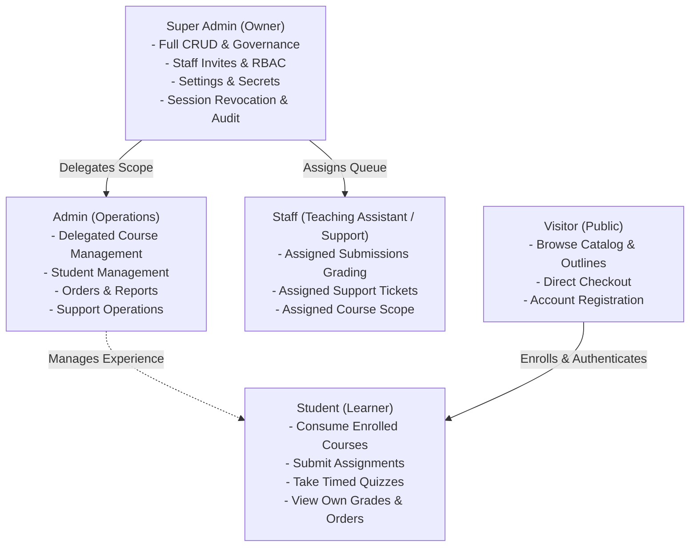

# Master Project Memory: Single-Instructor LMS

## 1. Executive Summary & Product Overview

* **Project Title**: Single-Instructor Learning Management System (LMS)
* **Specification Baseline**: `Single_Instructor_LMS_Blueprint_v2_Detailed_Specification(1).pdf` [Source: LMS Blueprint v2.0, Pages 1–16]
* **Product Archetype**: Proprietary Direct-to-Consumer / Direct-to-Student Educational Platform
* **Operational Formula**:
  $$\text{ONE INSTRUCTOR} \longrightarrow \text{ONE BRAND} \longrightarrow \text{MULTIPLE COURSES} \longrightarrow \text{MULTIPLE STUDENTS} \longrightarrow \text{DIRECT SALES}$$

The platform is designed to give an independent expert instructor total ownership over their brand, curriculum, pricing, student relationship, and intellectual property. Unlike multi-tenant platforms (e.g., Teachable, Thinkific) or open commercial marketplaces (e.g., Udemy), this system contains zero multi-vendor logic, zero marketplace fee splits, and zero multi-institute ERP overhead.

---

## 2. Strategic Product Objectives

1. **Brand Autonomy**: Deliver a modern, high-conversion direct sales portal and learning dashboard under a single cohesive brand identity.
2. **IP & Asset Security**: Prevent unauthorized ripping, URL scraping, and piracy through short-lived signed video playback URLs and watermarked/protected PDF streaming [Source: LMS Blueprint v2.0, Page 5].
3. **Account Integrity (One-Active-Session)**: Eliminate password sharing and credential pooling by strictly enforcing one active session per account via atomic database transactions and instant revocation of previous sessions [Source: LMS Blueprint v2.0, Page 8].
4. **Pedagogical Rigor**: Support diverse assessment paradigms:
   * **Assignments**: Multi-format submissions, deadline enforcement, rubric criterion scoring, versioned feedback, and formal override trails [Source: LMS Blueprint v2.0, Pages 5–6].
   * **Quizzes**: Server-authoritative countdown timers, secure question banks, question/option shuffling, and atomic attempt tracking [Source: LMS Blueprint v2.0, Pages 6–7].
5. **Audited Operational Delegation**: Enable the instructor (Super Admin) to safely delegate grading, teaching assistance, and customer support to Staff and Admins using scoped, auditable, and revocable permissions [Source: LMS Blueprint v2.0, Pages 2–3, 7].

---

## 3. Product Boundaries & Invariants

### Architectural Boundaries
* **Strictly Single-Instructor / Single-Brand**: All courses are published by the brand owner. There is no instructor onboarding or revenue split calculation.
* **No Multi-Institute Hierarchy**: No distinct schools, departments, or institutional sub-tenancy.
* **Direct Merchant Model**: Payments flow directly to the instructor's configured gateway account (e.g., Razorpay) [Source: LMS Blueprint v2.0, Page 2].

### Core System Invariants
1. **Public Signup Boundary**: Every public user registration assigns the `Student` role exclusively. Privileged roles (`Staff`, `Admin`, `Super Admin`) cannot be self-selected or submitted by clients [Source: LMS Blueprint v2.0, Page 2].
2. **Super Admin Governance**: Only a Super Admin can invite Staff/Admin, modify permission grants, or alter core integration settings. The final active Super Admin account cannot be removed or demoted [Source: LMS Blueprint v2.0, Pages 2, 7].
3. **Entitlement-Guarded Access**: Paid enrollment requires verified payment webhook success or an explicit, audited complimentary grant [Source: LMS Blueprint v2.0, Page 2].
4. **Single-Active-Session Rule**: At most one `ACTIVE` row exists per user in `auth_sessions`. A newly authenticated login atomically revokes any existing active session, sending a `401 SESSION_REVOKED` response to the prior device [Source: LMS Blueprint v2.0, Page 8].
5. **Course Revision Immutability**: Published course revisions cannot be modified in-place; edits create a new draft revision, preserving historical integrity for enrolled students [Source: LMS Blueprint v2.0, Page 5].
6. **Immutable Assessment History**:
   * Published rubrics are snapshotted onto submissions at grading time [Source: LMS Blueprint v2.0, Page 6].
   * Released grades are versioned; overrides never overwrite prior evaluation records [Source: LMS Blueprint v2.0, Page 6].
   * Quiz attempts snapshot questions/options at start; submitted answers cannot be modified [Source: LMS Blueprint v2.0, Page 7].
7. **Append-Only Auditing**: All security events, role changes, grade overrides, price changes, and refunds are permanently recorded in an append-only audit log [Source: LMS Blueprint v2.0, Pages 3, 11].

---

## 4. System Roles & Access Matrix Overview

[Source: LMS Blueprint v2.0, Pages 2–3 — Detailed Role & CRUD Permission Matrix]

---

## 5. Major Functional Modules

| Module ID | Module Name | Primary Responsibilities | Detailed Blueprint Reference |
| :--- | :--- | :--- | :--- |
| **MOD-01** | **Public Catalog & Storefront** | Marketing pages, course outcomes, syllabus preview, pricing display, search, and checkout initiation. | [Source: LMS Blueprint v2.0, Pages 3–4] |
| **MOD-02** | **Auth & Session Engine** | Email/password, Google OIDC, MFA enrollment/challenge, atomic single-session enforcement, CSRF defense. | [Source: LMS Blueprint v2.0, Pages 8, 11] |
| **MOD-03** | **Course Builder & Reorder** | Multi-section curriculum, video/PDF/text lessons, atomic reordering, versioned course drafts, publish checklists. | [Source: LMS Blueprint v2.0, Pages 4–5] |
| **MOD-04** | **Protected Media Pipeline** | Direct-to-storage upload intents, async transcoding, MIME/signature validation, short-lived playback tokens. | [Source: LMS Blueprint v2.0, Pages 5, 14] |
| **MOD-05** | **Student Learning Player** | Distraction-free video player, PDF viewer, progress tracking, personal notes, bookmarks, certificate issuance. | [Source: LMS Blueprint v2.0, Pages 4, 9] |
| **MOD-06** | **Assignment & Grading Engine**| Submissions, file scanning, rubric criterion scoring, grader feedback, draft grades, immutable grade release, overrides. | [Source: LMS Blueprint v2.0, Pages 5–6] |
| **MOD-07** | **Quiz & Assessment Engine** | Timed attempts, question bank, CSV bulk import, option randomization, autosaved answers, server-side grading. | [Source: LMS Blueprint v2.0, Pages 6–7] |
| **MOD-08** | **Commerce, Webhooks & Orders**| Razorpay integration, signature verification, idempotent webhook processing, automatic enrollment, refund workflows. | [Source: LMS Blueprint v2.0, Pages 10–11, 14] |
| **MOD-09** | **Super Admin Governance** | Staff invites, granular permission keys, session management, credential rotation, platform settings, audit logs. | [Source: LMS Blueprint v2.0, Pages 7, 13] |
| **MOD-10** | **Operational Infrastructure** | Transactional outbox notifications, structured logging, metric dashboards, health checks, automated backups. | [Source: LMS Blueprint v2.0, Pages 14–15] |

---

## 6. Current Project State & Maturity

* **Workspace Path**: `/Users/priyansh/lms`
* **Implementation Phase**: **Phase 0 — Project Intelligence & Context Initialization** [Source: LMS Blueprint v2.0, Page 15]
* **Verified Repository State**: The project repository is newly initialized. No application code, frontend/backend frameworks, database migrations, or third-party integrations currently exist in the filesystem.
* **Active Mission**: Establish the comprehensive `.ai/` documentation and memory infrastructure before starting application engineering.

---

## 7. Knowledge Architecture & Cross-References

For deep technical details, agents must navigate to the dedicated memory files:
* **Product Requirements**: [.ai/MEMORY/USER_REQUIREMENTS.md](file:///Users/priyansh/lms/.ai/MEMORY/USER_REQUIREMENTS.md)
* **Technical & System Architecture**: [.ai/MEMORY/ARCHITECTURE.md](file:///Users/priyansh/lms/.ai/MEMORY/ARCHITECTURE.md)
* **Technology Stack (Detected vs. Proposed)**: [.ai/MEMORY/TECH_STACK.md](file:///Users/priyansh/lms/.ai/MEMORY/TECH_STACK.md)
* **Permanent Decision Register**: [.ai/MEMORY/DECISIONS.md](file:///Users/priyansh/lms/.ai/MEMORY/DECISIONS.md)
* **Pending Task Backlog**: [.ai/MEMORY/PENDING_TASKS.md](file:///Users/priyansh/lms/.ai/MEMORY/PENDING_TASKS.md)
* **Completed Tasks**: [.ai/MEMORY/COMPLETED_TASKS.md](file:///Users/priyansh/lms/.ai/MEMORY/COMPLETED_TASKS.md)
* **Defect & Bug History**: [.ai/MEMORY/BUG_HISTORY.md](file:///Users/priyansh/lms/.ai/MEMORY/BUG_HISTORY.md)
* **Session Trajectory & Logs**: [.ai/MEMORY/SESSION_LOG.md](file:///Users/priyansh/lms/.ai/MEMORY/SESSION_LOG.md)
