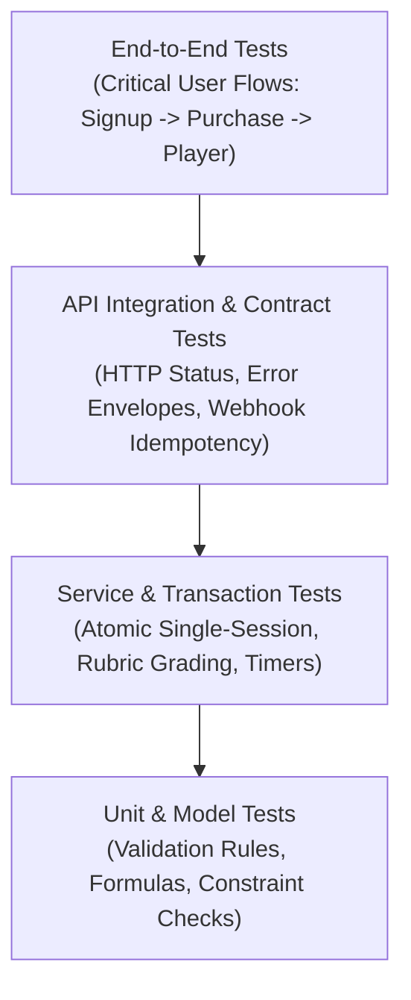

# Automated Testing, Quality Assurance & Verification Rules (TESTING_RULES)

## 1. Testing Philosophy & Non-Negotiable Integrity

This document establishes the mandatory standards for automated testing, test suites, regression verification, and QA reporting for the Single-Instructor LMS.

**The Absolute Testing Integrity Rule**:
* **NEVER** delete, comment out, or alter existing tests to hide test failures.
* **NEVER** disable application functionality or remove validation checks to make tests pass.
* **NEVER** fabricate, simulate, or assume test results.
* **NEVER** claim a test passed without empirical evidence physically executed in the terminal session.
* **NEVER** modify unrelated modules or functions just to force a passing assertion.

All testing activities must strictly adhere to the universal directives in [.ai/RULES/GLOBAL_RULES.md](file:///Users/priyansh/lms/.ai/RULES/GLOBAL_RULES.md) and QA matrices in [.ai/WORKFLOWS/TESTING.md](file:///Users/priyansh/lms/.ai/WORKFLOWS/TESTING.md).

---

## 2. Test Layer Standards & Boundaries

### 1. Unit & Model Tests
* Test pure business logic, calculations, date comparisons, and state transitions in complete isolation.
* Assert database constraints: UUID formats, non-negative prices, check constraints, and partial unique indexes.

### 2. Service & Transaction Tests
* Test multi-step business transactions against an isolated test PostgreSQL database.
* Simulate concurrent operations: parallel logins, simultaneous curriculum reordering, and double assignment submissions.

### 3. API Contract & Integration Tests
* Assert standard status codes (`200`, `201`, `400`, `401`, `403`, `404`, `409`, `422`).
* Validate that all error responses conform strictly to `{error: {code, message, details, request_id}}`.
* Verify that sensitive secrets and raw database exceptions are suppressed.

---

## 3. Mandatory Domain-Specific Test Suites

Every task affecting a core LMS module must execute its corresponding test suite [Source: LMS Blueprint v2.0, Page 15]:

| Domain Module | Mandatory Test Scenarios & Assertions |
| :--- | :--- |
| **Authentication & Sessions** | • 10 parallel simultaneous logins for one user: exactly one `ACTIVE` row remains in `auth_sessions`. • Displaced session receives `401 SESSION_REVOKED`. • Password change revokes all active sessions and bumps `auth_version`. |
| **Authorization & RBAC** | • Matrix test: Every Role $\times$ Action $\times$ [own, assigned, out-of-scope]. • Student cannot read another student's submission or grade (IDOR defense). • Public signup cannot submit or acquire privileged roles (`Staff`, `Admin`, `Super Admin`). |
| **Courses & Curriculum** | • Edits to published courses create new draft revisions; published snapshot remains unchanged. • Mismatched version on curriculum reorder returns `409 CURRICULUM_VERSION_CONFLICT`. • Course publishing blocked if referenced assets are in `PROCESSING` or `FAILED` state. |
| **Assignments & Rubrics** | • Submissions past due date flagged `is_late=true` based on server clock. • Exceeding `max_attempts` rejected at service boundary. • Rubric criterion scores sum validated against assignment max points. • Grade override requires `assignments.override_grade` and creates audit record. |
| **Quizzes & Timers** | • Server-authoritative timer: Answers received after `started_at + duration + 1s` rejected. • Question and option shuffle verified across different attempts. • Correct answers and explanations verified absent from active attempt payloads. |
| **Commerce & Webhooks** | • Tampered HMAC signature on `/webhooks/razorpay` returns `400 Bad Request`. • Duplicate webhook delivery with same `provider_event_id` returns `200 OK` without duplicating enrollments. • Cumulative refunds cannot exceed captured amount. • Browser redirect alone never creates an enrollment. |

---

## 4. Regression Testing Protocol

Whenever an existing function, model, or component is modified:
1. Run the existing test suite covering that specific module.
2. Run the test suites of all directly connected upstream and downstream modules.
3. If any test fails, **STOP**. Do not proceed to new features. Fix the regression or revert the change immediately.

---

## 5. Mandatory Test Reporting Format

Every task completion report must include an explicit **Verification & Test Section** containing:
1. **Tests Executed**: Exact test file names and test function names.
2. **Commands Executed**: Exact terminal command (e.g., `pytest tests/auth/test_sessions.py -v`).
3. **Actual Results**: Number of tests run, passed, failed, and skipped.
4. **Failures & Warnings**: Detailed summary of any anomalies observed.
5. **Tests Not Executed**: Explicitly document any tests that could not be run (e.g., missing third-party sandbox keys) and explain the remaining risk.
