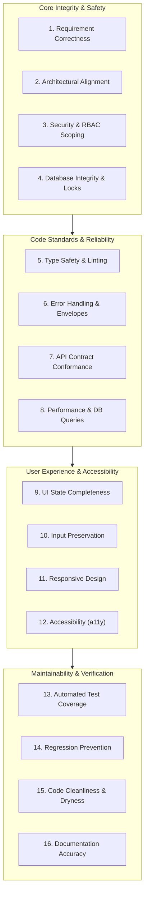

# Standard Operating Procedure: Code Review & Quality Audit

## 1. Quality Philosophy

A feature is **not** complete merely because its user interface appears visually correct in a browser. Every change submitted to the repository must undergo a rigorous code review across 16 core dimensions before merge or deployment.

---

## 2. The 16-Point Code Review Checklist

### Detailed Evaluation Criteria:

1. **Requirement Correctness**: Does the implementation satisfy all acceptance criteria defined in `.ai/MEMORY/USER_REQUIREMENTS.md` and the blueprint specification?
2. **Architectural Alignment**: Does it preserve system invariants (e.g., immutable published course revisions, single-active-session)?
3. **Security & RBAC**:
   * Is access checked server-side using exact permission keys [Source: LMS Blueprint v2.0, Page 3]?
   * Is record ownership (`user_id == auth.user_id`) validated to prevent IDOR?
   * Are sensitive operations recorded in `audit_logs`?
4. **Database Integrity**:
   * Are monetary values stored as `BIGINT` minor units?
   * Are foreign keys protected with `RESTRICT` on financial/audit tables?
   * Are concurrent state transitions protected by row locks (`FOR UPDATE`)?
5. **Type Safety**: Are all parameters, return types, and API payloads strongly typed with TypeScript or Python type annotations?
6. **Error Handling**: Does the API return the standard error envelope `{error: {code, message, details, request_id}}`? Are stack traces, database credentials, and raw SQL queries completely suppressed [Source: LMS Blueprint v2.0, Pages 11, 14]?
7. **API Contract Conformance**: Does the endpoint adhere strictly to the Route Inventory and API contracts [Source: LMS Blueprint v2.0, Pages 11–13]?
8. **Performance & Query Optimization**: Are N+1 query patterns eliminated via `select_related`/`prefetch_related` or SQL joins? Are necessary indexes present?
9. **UI State Completeness**: Are Loading, Empty, Success, and Error states implemented?
10. **Input Preservation**: Does the UI retain form inputs when validation or network errors occur [Source: LMS Blueprint v2.0, Page 3]?
11. **Responsive Behavior**: Does the UI render cleanly on Desktop (240px nav), Tablet (collapsible nav), and Mobile (bottom bar for students, drawer for admins) [Source: LMS Blueprint v2.0, Page 3]?
12. **Accessibility**: Are accessible labels, keyboard navigation, visible focus rings, and non-color status cues present [Source: LMS Blueprint v2.0, Page 3]?
13. **Test Coverage**: Do new or modified lines have automated unit or integration test coverage?
14. **Regression Risk**: Have adjacent workflows been tested for side effects?
15. **Code Cleanliness**: Is the code free of dead code, console logs, and hardcoded secrets?
16. **Documentation Synchronization**: Are `.ai/MEMORY/COMPLETED_TASKS.md`, `.ai/TRACKING/CHANGELOG.md`, and `.ai/CONTEXT/CURRENT_STATE.md` updated?

---

## 3. Code Review Disposition Protocol

* **APPROVED**: All 16 criteria satisfied. Ready for commit/merge.
* **CHANGES_REQUESTED**: Specific criteria failed. Provide actionable feedback and require remediation before proceeding.
* **REJECTED**: Architectural violation or unapproved dependency introduced. Revert changes immediately.
