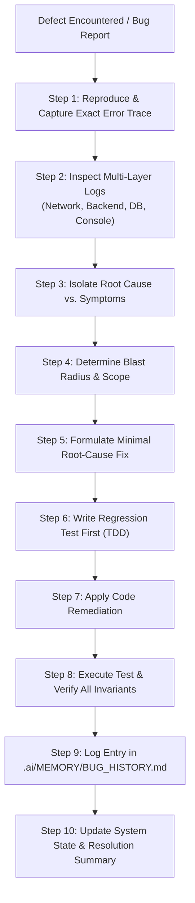

# Standard Operating Procedure: Systematic Debugging & Fault Remediation

## 1. Principles of Scientific Debugging

Debugging is an analytical, evidence-based investigation. The following practices are strictly prohibited:
1. **No "Trial-and-Error" Code Thrashing**: Never make random code changes hoping an error disappears without understanding why.
2. **No Silent Disabling of Features**: Never comment out authentication checks, remove permission guards, or drop validation logic to bypass an error.
3. **No Catch-and-Suppress**: Never wrap failing logic in a generic `except Exception: pass` block that conceals root causes.

---

## 2. The 10-Step Debugging Protocol

### Detailed Diagnostic Stages:

### Step 1: Deterministic Reproduction
* Replicate the exact execution sequence using unit test fixtures, API curl calls, or UI flows.
* Capture the full stack trace, HTTP status code, request headers, payload, and `request_id` [Source: LMS Blueprint v2.0, Page 14].

### Step 2: Multi-Layer Telemetry Inspection
1. **Client / Network Layer**: Inspect request headers (`Cookie`, `X-CSRF-Token`, `Idempotency-Key`), query params, and exact response envelope.
2. **Backend Application Layer**: Inspect structured JSON application logs for matching `correlation_id` or `request_id`.
3. **Database State Inspection**: Query PostgreSQL directly to observe affected rows, locks, constraint violations, or orphaned foreign keys.
4. **Third-Party Provider Logs**: Check gateway/transcoder responses (e.g., Razorpay webhook signatures, video transcode error diagnostics).

### Step 3: Root Cause Isolation (Root Cause vs. Symptom)
* Differentiate between the immediate crash (e.g., `NullPointerException` or `KeyError`) and the underlying flaw (e.g., unhandled `409 CURRICULUM_VERSION_CONFLICT` during simultaneous section reorder).

### Step 4: Blast Radius Assessment
* Determine whether the issue corrupts financial totals, active student sessions, released grades, or database relational integrity.
* If security or data corruption is active, immediately halt related operations.

### Step 5: Minimal Root-Cause Remediation
* Design a targeted code modification that directly addresses the root cause at its architectural boundary.
* Never expand scope or refactor unrelated files during a bug fix.

### Step 6: Regression Test Creation
* Write an automated test that reproduces the defect and fails on the unpatched codebase.
* Verify that the test passes once the fix is applied.

### Step 7: Verification & Cross-Workflow Sanity Check
* Verify that all existing test suites continue to pass without regressions.
* Test adjacent edge cases (e.g., empty strings, null timestamps, concurrency races).

### Step 8: Documentation & History Registration
* Append a complete entry to `.ai/MEMORY/BUG_HISTORY.md` using the standard bug template.
* Record the resolution in `.ai/TRACKING/CHANGELOG.md` under `Fixed`.
* Update `.ai/TRACKING/ERROR_LOG.md` if operational telemetry captured the exception.
