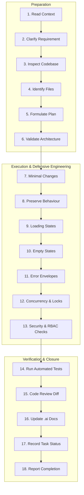

# Standard Operating Procedure: Implementation Lifecycle & Coding Standards

## 1. Core Implementation Principles

Implementation is the execution phase where technical plans are transformed into production-grade software. The following rules are non-negotiable:
1. **Preserve Existing Functionality**: Never modify, refactor, or delete working features unless directly required by an approved specification.
2. **Minimal Sufficient Delta**: Write only the code necessary to fulfill the immediate requirement. Avoid premature generalizations or speculative frameworks.
3. **Defensive by Default**: All business constraints, permissions, timers, and prices must be validated and enforced server-side. The frontend is strictly a presentation layer.

---

## 2. The 18-Step Implementation Discipline

### Detailed Execution Steps:
1. **Read Relevant Context**: Check `.ai/CONTEXT/CURRENT_STATE.md`, `.ai/CONTEXT/ACTIVE_TASK.md`, and `.ai/CORE/PRIORITY_HIERARCHY.md`.
2. **Understand Requirement**: Review the specific requirement ID in `.ai/MEMORY/USER_REQUIREMENTS.md` and related blueprint pages.
3. **Inspect Existing Implementation**: Verify actual files, models, and endpoints on the filesystem.
4. **Identify Affected Files**: Explicitly list all files to be created, modified, or migrated.
5. **Prepare Implementation Plan**: Document the exact sequence in `.ai/CONTEXT/ACTIVE_TASK.md`.
6. **Validate Architecture**: Ensure changes conform to PostgreSQL schema conventions, REST API guidelines, and system invariants in `.ai/MEMORY/ARCHITECTURE.md`.
7. **Implement Minimal Necessary Changes**: Write clean, idiomatic code adhering to project standards.
8. **Preserve Existing Behaviour**: Ensure backward compatibility across existing API endpoints and data models.
9. **Handle Loading States**: Frontend UI must display explicit skeleton loaders or progress indicators during asynchronous operations.
10. **Handle Empty States**: List views, review queues, and search results must display helpful, actionable empty state screens.
11. **Handle Error States & Input Preservation**:
    * Wrap API responses in the standard `{error: {code, message, details, request_id}}` envelope [Source: LMS Blueprint v2.0, Page 14].
    * Never discard user form input when an API call fails [Source: LMS Blueprint v2.0, Page 3].
12. **Handle Concurrency & Race Conditions**: Use row locks (`FOR UPDATE`), optimistic version checks (`409 CONFLICT`), and partial unique indexes for concurrent operations (e.g., login, quiz submit, curriculum reorder).
13. **Validate Security & Authorization**: Enforce authentication, active session validation, exact permission key, and record scope server-side.
14. **Run Relevant Tests**: Execute unit, integration, and contract tests. Verify output in terminal.
15. **Review Changes (Self-Audit)**: Run `git diff` to confirm zero unintended modifications or secrets in code.
16. **Update Documentation**: Synchronize `.ai/MEMORY/COMPLETED_TASKS.md`, `.ai/TRACKING/CHANGELOG.md`, and `.ai/CONTEXT/CURRENT_STATE.md`.
17. **Record Task Status**: Transition task status to `COMPLETED` in `.ai/MEMORY/PENDING_TASKS.md` or `.ai/TRACKING/TASK_HISTORY.md`.
18. **Report Completion**: Present a concise, evidence-based completion summary to the user.
