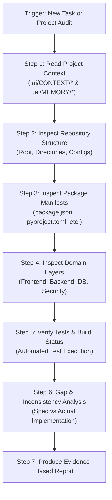

# Standard Operating Procedure: Project Investigation & Codebase Analysis

## 1. Overview & Objective

This procedure establishes the rigorous, evidence-based methodology that an AI engineering agent must follow when inspecting the repository, diagnosing technical state, or assessing implementation completeness.

**Fundamental Mandate**: No claim of existing functionality, installed dependency, active endpoint, or database table may be made without physical evidence (file paths, line numbers, or command outputs).

---

## 2. Multi-Stage Investigation Protocol



### Step 1: Read Project Context
1. Read `.ai/CORE/IDENTITY.md` and `.ai/CORE/PRIORITY_HIERARCHY.md` to establish constraints.
2. Read `.ai/CONTEXT/CURRENT_STATE.md` to identify the latest verified status.
3. Cross-reference the inquiry against `.ai/MEMORY/USER_REQUIREMENTS.md` and `Single_Instructor_LMS_Blueprint_v2_Detailed_Specification(1).pdf` [Source: LMS Blueprint v2.0].

### Step 2: Inspect Filesystem & Repository Root
1. Inspect root directory: Check for version control (`.git`), hidden configurations, and top-level directory layout.
2. Identify workspace structure: Separate frontend, backend, shared types, infrastructure, and documentation assets.

### Step 3: Inspect Package Manifests & Tooling
1. Locate package manifests (`package.json`, `pyproject.toml`, `requirements.txt`, `Cargo.toml`, etc.).
2. Document actual runtime versions and installed libraries.
3. Compare detected dependencies against the proposed blueprint stack in `.ai/MEMORY/TECH_STACK.md`.
4. If manifests are missing, report the layer as `UNINITIALIZED`.

### Step 4: Domain-Specific Code Inspection
* **Frontend Inspection**:
  * Check routing structure (App Router vs Pages Router).
  * Check component hierarchy, UI library integrations (e.g., Tailwind, Radix), and state management stores.
  * Verify whether route layouts match the Route Inventory [Source: LMS Blueprint v2.0, Page 4].
* **Backend & API Inspection**:
  * Check framework controllers, URL routing tables, and serialization schemas.
  * Verify API versioning (must map to `/api/v1/` per Blueprint Page 11).
  * Inspect error middleware for the standard error envelope `{error: {code, message, details, request_id}}` [Source: LMS Blueprint v2.0, Page 14].
* **Database & Migration Inspection**:
  * Check ORM models, migration directories, and raw SQL definitions.
  * Verify column types: UUID primary keys, `TIMESTAMPTZ` UTC, `BIGINT` minor currency units, and `JSONB` metadata [Source: LMS Blueprint v2.0, Page 8].
  * Check critical partial unique indexes (specifically `auth_sessions(user_id) WHERE status='ACTIVE'`).
* **Authentication & Security Inspection**:
  * Inspect session issuance and cookie attributes (`Secure`, `HttpOnly`, `SameSite`, `Path=/`).
  * Verify presence of CSRF defenses on state-changing requests.
  * Inspect RBAC middleware to ensure deny-overrides-allow and record scoping logic [Source: LMS Blueprint v2.0, Page 3].
* **Integration Inspection**:
  * Payment: Inspect Razorpay webhook signature verification and idempotency locks.
  * Video: Inspect presigned upload intent generators and short-lived playback token signers.
  * Storage: Inspect bucket access policies (must be private; no public bucket reads).

### Step 5: Verification & Test Infrastructure
1. Check test runners (`pytest`, `jest`, `vitest`, `playwright`).
2. Run test suites and inspect execution logs.
3. Never claim tests passed unless physical execution output was captured in the session.

---

## 3. Discrepancy & Technical Debt Identification

When analyzing the codebase, classify findings into three categories:
1. **Spec Inconsistency**: Where existing code explicitly contradicts a non-negotiable requirement in `Single_Instructor_LMS_Blueprint_v2_Detailed_Specification(1).pdf` (e.g., client-side role submission allowed, or session revocation not serialized).
2. **Missing Functionality**: Where a requirement exists in `.ai/MEMORY/USER_REQUIREMENTS.md` but has no corresponding codebase implementation.
3. **Technical Debt / Architectural Hazard**:
   * Storing floating-point currency instead of `BIGINT` minor units.
   * Storing bearer tokens in browser `localStorage`.
   * Unhandled race conditions during checkout or quiz submission.
   * Direct deletion of database rows that have audit or financial dependencies.

---

## 4. Evidence-Based Reporting Format

The agent must output investigation findings using this standard structure:

```markdown
# Codebase Investigation Report: [Target Module / Area]

## 1. Verified Facts (With Code References)
* Component X exists at `src/path/to/file.ts#L12-L45`.
* Database migration `0003_add_session_index.sql` contains partial unique index.

## 2. Unverified / Missing Components
* No webhook signature validator found in `src/api/webhooks/`.
* Background transcode worker not yet implemented (`NOT_STARTED`).

## 3. Discrepancies Against Blueprint v2.0
* Blueprint specifies `BIGINT` paise for course price (Page 5), but found `NUMERIC(10,2)` in `models/course.py`.

## 4. Proposed Remediation & Next Steps
* Update `models/course.py` via safe migration.
```
