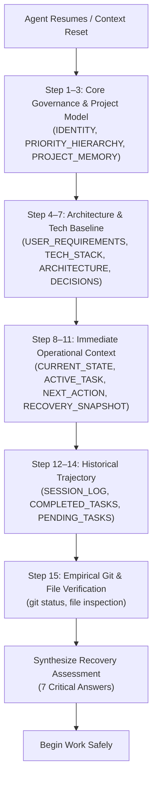

# Standard Operating Procedure: AI Session Recovery & Context Rehydration

## 1. Context Loss & Resumption Protocol

When an AI agent joins the project, resumes work after a conversation reset, or switches model instances, it experiences total short-term memory loss. 

To eliminate knowledge decay and prevent contradictory engineering decisions, every new session must execute the following **15-Step Recovery Sequence** before writing any code.

---

## 2. The 15-Step Strict Recovery Reading Order

1. **Read [.ai/CORE/IDENTITY.md](file:///Users/priyansh/lms/.ai/CORE/IDENTITY.md)**: Re-anchor product model (`ONE INSTRUCTOR -> ONE BRAND -> MULTIPLE COURSES -> MULTIPLE STUDENTS -> DIRECT SALES`) and operating boundaries.
2. **Read [.ai/CORE/PRIORITY_HIERARCHY.md](file:///Users/priyansh/lms/.ai/CORE/PRIORITY_HIERARCHY.md)**: Refresh the 8-tier conflict resolution hierarchy.
3. **Read [.ai/MEMORY/PROJECT_MEMORY.md](file:///Users/priyansh/lms/.ai/MEMORY/PROJECT_MEMORY.md)**: Review major modules, invariants, and business boundaries.
4. **Read [.ai/MEMORY/USER_REQUIREMENTS.md](file:///Users/priyansh/lms/.ai/MEMORY/USER_REQUIREMENTS.md)**: Review functional requirements and status taxonomy.
5. **Read [.ai/MEMORY/TECH_STACK.md](file:///Users/priyansh/lms/.ai/MEMORY/TECH_STACK.md)**: Differentiate verified installed stack from proposed blueprint stack.
6. **Read [.ai/MEMORY/ARCHITECTURE.md](file:///Users/priyansh/lms/.ai/MEMORY/ARCHITECTURE.md)**: Review database conventions, state machines, and transaction boundaries.
7. **Read [.ai/MEMORY/DECISIONS.md](file:///Users/priyansh/lms/.ai/MEMORY/DECISIONS.md)**: Check approved baseline decisions (`DEC-001` through `DEC-007`) and pending decisions.
8. **Read [.ai/CONTEXT/CURRENT_STATE.md](file:///Users/priyansh/lms/.ai/CONTEXT/CURRENT_STATE.md)**: Inspect the latest verified development status.
9. **Read [.ai/CONTEXT/ACTIVE_TASK.md](file:///Users/priyansh/lms/.ai/CONTEXT/ACTIVE_TASK.md)**: Determine what task was in-flight when the previous session ended.
10. **Read [.ai/CONTEXT/NEXT_ACTION.md](file:///Users/priyansh/lms/.ai/CONTEXT/NEXT_ACTION.md)**: Check immediate next recommended action.
11. **Read [.ai/CONTEXT/RECOVERY_SNAPSHOT.md](file:///Users/priyansh/lms/.ai/CONTEXT/RECOVERY_SNAPSHOT.md)**: Review the precise technical handoff state.
12. **Read latest entries in [.ai/MEMORY/SESSION_LOG.md](file:///Users/priyansh/lms/.ai/MEMORY/SESSION_LOG.md)**: Trace recent command outputs, errors, and agent trajectory.
13. **Read relevant [.ai/MEMORY/COMPLETED_TASKS.md](file:///Users/priyansh/lms/.ai/MEMORY/COMPLETED_TASKS.md)**: Check verified completed milestones.
14. **Read relevant [.ai/MEMORY/PENDING_TASKS.md](file:///Users/priyansh/lms/.ai/MEMORY/PENDING_TASKS.md)**: Identify backlog priorities and phase mapping.
15. **Inspect Actual Git & Filesystem State**: Run `git status` or inspect directory files to verify uncommitted changes. **Never assume code exists simply because a prior log claimed it was written.**

---

## 3. Post-Recovery State Assessment (The 7 Critical Inquiries)

Before taking any action, the recovering agent must internally establish clear answers to these seven questions:
1. **What is the product?** (Single-Instructor direct course sales LMS; not a multi-tenant ERP or marketplace).
2. **What was previously being done?** (Extracted from `ACTIVE_TASK.md` and `RECOVERY_SNAPSHOT.md`).
3. **What has actually been completed?** (Verified by checking physical files on disk against `COMPLETED_TASKS.md`).
4. **What remains incomplete?** (Identified in `PENDING_TASKS.md`).
5. **What technical decisions are approved vs pending?** (Verified in `DECISIONS.md`).
6. **What is currently blocked?** (Identified in `CURRENT_STATE.md`).
7. **What is the exact next step?** (Defined in `NEXT_ACTION.md`).

---

## 4. Safety Guardrail on Uncommitted Work

If the repository contains uncommitted edits or modified files upon recovery:
* **DO NOT** discard, reset (`git reset --hard`), or overwrite uncommitted changes without explicit user approval.
* Inspect the diff, verify if it belongs to an interrupted task from `ACTIVE_TASK.md`, and formulate a plan to either complete or safely isolate the work.
