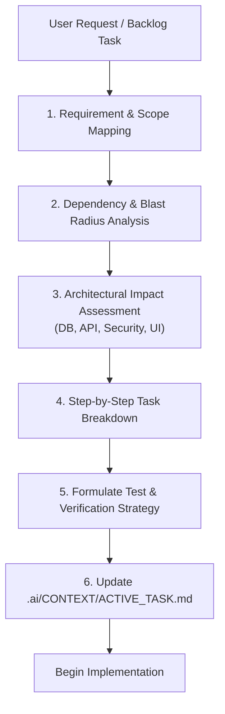

# Standard Operating Procedure: Task Planning & Impact Analysis

## 1. Principles of Planning

No non-trivial code modification, database migration, or architectural addition may begin without an explicit, structured plan. Planning protects the project from regression, accidental schema breaks, security vulnerabilities, and scope creep.

---

## 2. Planning Protocol Workflow

---

## 3. The 6-Step Task Planning Discipline

### Step 1: Requirement & Scope Mapping
* Map the task to its requirement ID in `.ai/MEMORY/USER_REQUIREMENTS.md`.
* Check relevant sections and page references in `Single_Instructor_LMS_Blueprint_v2_Detailed_Specification(1).pdf`.
* Define explicit **Goals** (what will be delivered) and **Non-Goals** (what will deliberately not be touched).

### Step 2: Dependency & Blast Radius Analysis
* Identify all upstream components that feed data to this module.
* Identify all downstream consumers that depend on this module.
* Check if changes impact the course revision lifecycle, single-active-session invariant, or transactional outbox.

### Step 3: Multi-Dimensional Impact Assessment
1. **Database Impact**:
   * Does this require a new table, column, index, or constraint?
   * Does it use UUID, `TIMESTAMPTZ`, `BIGINT`, or `JSONB` per conventions?
   * Are foreign keys protected with `RESTRICT` where audit/financial history is involved?
   * Is a lock (`FOR UPDATE`) or transaction boundary required?
2. **API & Contract Impact**:
   * Does this add or modify an endpoint under `/api/v1/`?
   * Is the change backward-compatible?
   * Are standard error envelopes and codes defined?
   * Is an `Idempotency-Key` header required for state-changing operations?
3. **Frontend & UX Impact**:
   * Which routes in the Route Inventory [Source: LMS Blueprint v2.0, Page 4] are affected?
   * Are loading, empty, and error states designed?
   * Does the UI preserve typed input upon validation failure [Source: LMS Blueprint v2.0, Page 3]?
4. **Security & RBAC Impact**:
   * What granular permission key guards this action?
   * Is the record scope (`own`, `assigned`, `all`) enforced server-side?
   * Does this action require an append-only entry in `audit_logs`?
5. **Regression Risk**:
   * Identify existing test suites that cover adjacent features.

### Step 4: Atomic Step-by-Step Breakdown
Break the task into discrete, sequentially executable steps:
1. Migration / Schema definition.
2. Data Access / Repository layer.
3. Domain Service / Business logic.
4. API Controller & Request validation.
5. Frontend UI Component & State binding.
6. Automated Unit & Integration tests.

### Step 5: Test & Verification Strategy
Define specific acceptance test scenarios:
* Happy path test.
* Validation failure / edge case test (e.g., negative points, expired timer).
* Concurrency / race condition test (e.g., duplicate submission, concurrent login).
* Security / unauthorized access test (e.g., non-enrolled user accessing playback).

### Step 6: Active Context Synchronization
Before writing code:
* Update `.ai/CONTEXT/ACTIVE_TASK.md` with the full implementation plan.
* Set `.ai/CONTEXT/CURRENT_STATE.md` to reflect active work.
