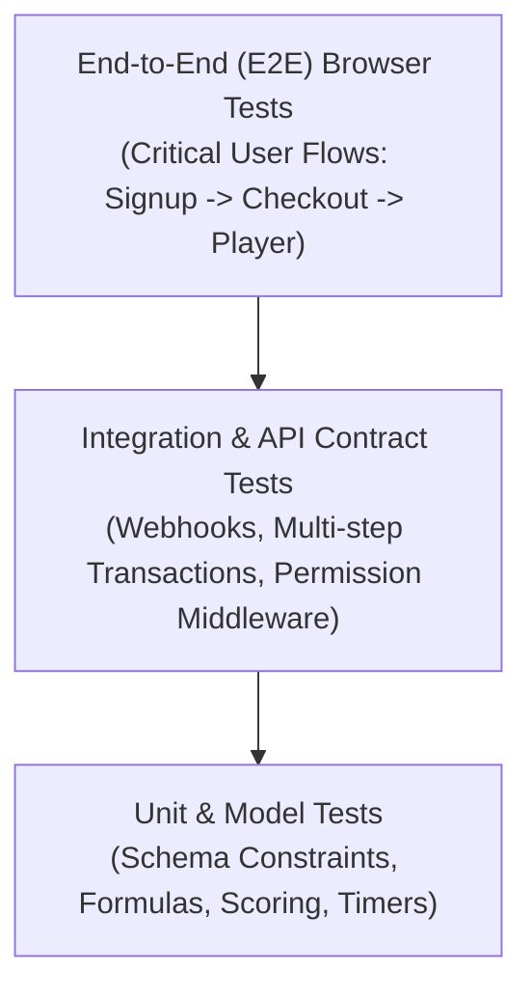

# Standard Operating Procedure: Testing Standards & Quality Assurance Matrix

## 1. Testing Philosophy & Non-Negotiable Standards

In the Single-Instructor LMS, software quality is enforced through automated, reproducible test suites.
1. **Zero Unverified Claims**: Never state "all tests pass" or "feature verified" unless the automated test suite was physically executed in the terminal and zero failures were reported.
2. **Deterministic & Isolated**: Unit and integration tests must run against isolated test databases and mock external network boundaries (payment gateways, mailers, video transcode APIs).
3. **Security by Default**: All permission rules, session boundaries, and transaction locks must be covered by automated regression tests.

---

## 2. Test Pyramid & Methodology

---

## 3. Minimum QA Test Matrix (Blueprint v2.0 Baseline)

The following test suites must be executed and validated prior to any release [Source: LMS Blueprint v2.0, Page 15]:

| Test Area | Required Test Scenarios & Assertions | Blueprint Reference |
| :--- | :--- | :--- |
| **RBAC & Authorization** | • Test every combination: $\text{Role} \times \text{Action} \times [\text{own}, \text{assigned}, \text{out-of-scope}]$. • Verify direct API calls to unassigned student or course endpoints return `403 FORBIDDEN` or `404 NOT_FOUND`. • Verify data export endpoints enforce `analytics.export` permission strictly. | [Source: LMS Blueprint v2.0, Pages 2–3, 15] |
| **Session & Concurrency** | • Parallel Login Stress Test: Execute 10 simultaneous login requests for the same user; assert exactly one `ACTIVE` session remains in `auth_sessions`. • Session Revocation Test: Verify displaced device receives `401 SESSION_REVOKED` on next request. • Password Reset Test: Verify changing password revokes all existing sessions and bumps `auth_version`. • Pending MFA Test: Verify pending challenge does not invalidate existing active session until complete. | [Source: LMS Blueprint v2.0, Pages 8, 15] |
| **Course & Curriculum** | • Revision Immutability Test: Verify direct updates to published revisions are rejected. • Reorder Concurrency Test: Simulate two editors submitting curriculum orders with mismatched versions; verify loser receives `409 CURRICULUM_VERSION_CONFLICT`. • Publish Checklist Test: Verify course cannot transition to `Published` if referenced video is not in `READY` status. | [Source: LMS Blueprint v2.0, Pages 5, 14, 15] |
| **Assignments & Grading** | • Deadline Boundary Test: Verify submissions after deadline are flagged `is_late=true` based on server clock. • Attempt Limit Test: Verify submission is blocked when `attempt_no > max_attempts`. • Rubric Snapshot Test: Verify editing an assignment rubric does not alter rubrics on historical submissions. • Concurrent Grader Test: Verify optimistic locking when two graders review the same submission. • Override Audit Test: Verify grade override requires `assignments.override_grade` and creates audit record. | [Source: LMS Blueprint v2.0, Pages 5–6, 15] |
| **Quizzes & Timers** | • Server-Authoritative Timer Test: Verify answer submitted at `started_at + duration + 1s` is rejected. • Answer Secrecy Test: Verify correct answers and explanations do not exist in attempt JSON payload. • Randomization Test: Verify distinct question ordering and option keys for different attempts. • Offline Queue & Flush Test: Verify replayed answer submissions with same revision do not duplicate rows. | [Source: LMS Blueprint v2.0, Pages 6–7, 15] |
| **Payments & Commerce** | • HMAC Signature Verification: Verify tampered webhook signature returns `400 BAD REQUEST`. • Idempotent Webhook Test: Send duplicate webhook payload; verify second call returns `200 OK` without creating duplicate enrollments. • Cumulative Refund Cap: Verify attempting to refund $101 on a $100 order is rejected. • Zero Trust Redirect Test: Verify navigating to checkout success URL without webhook creates zero enrollments. | [Source: LMS Blueprint v2.0, Pages 10–11, 14, 15] |
| **Security & Penetration** | • Insecure Direct Object References (IDOR): Student A requests Student B's submission/grade; assert `403/404`. • Cross-Site Scripting (XSS): Inject script tags into rich text instructions/notes; assert sanitized output. • Cross-Site Request Forgery (CSRF): State-changing POST without CSRF token is rejected. • SQL Injection: Verify parameterized ORM queries resist SQL injection strings. • Audit Immutability: Attempt `UPDATE` or `DELETE` on `audit_logs`; assert database permission denial. | [Source: LMS Blueprint v2.0, Pages 11, 14, 15] |

---

## 4. Test Execution & Reporting Protocol

When executing test suites, capture:
1. Command line executed (e.g., `pytest tests/test_sessions.py -v`).
2. Duration and timestamp.
3. Summary counts: Total tests, passed, failed, skipped.
4. If failures occur, immediately halt implementation and follow `.ai/WORKFLOWS/DEBUGGING.md`.
