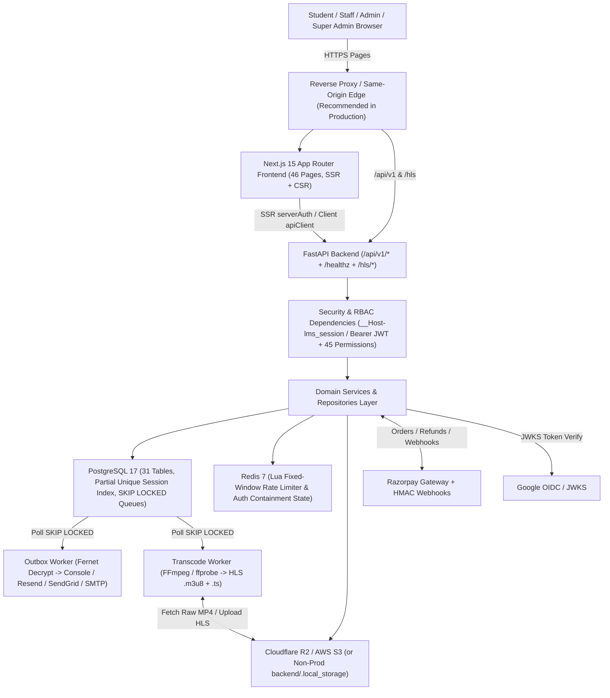
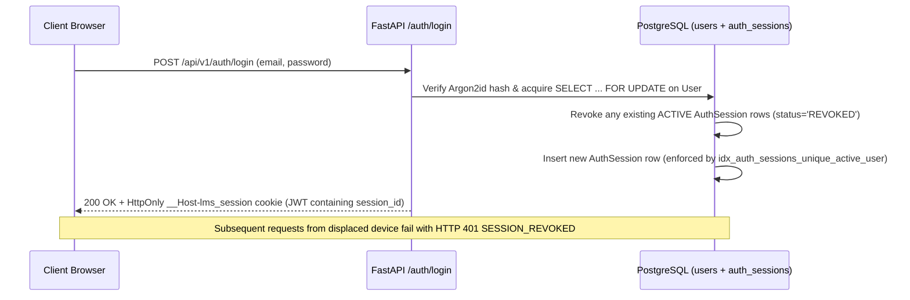
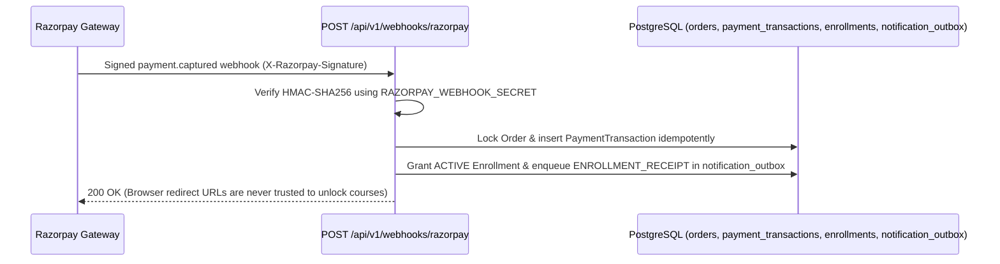
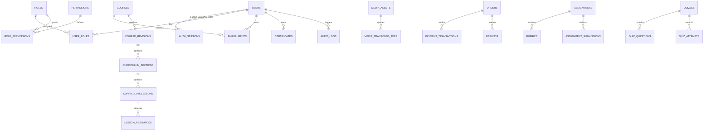
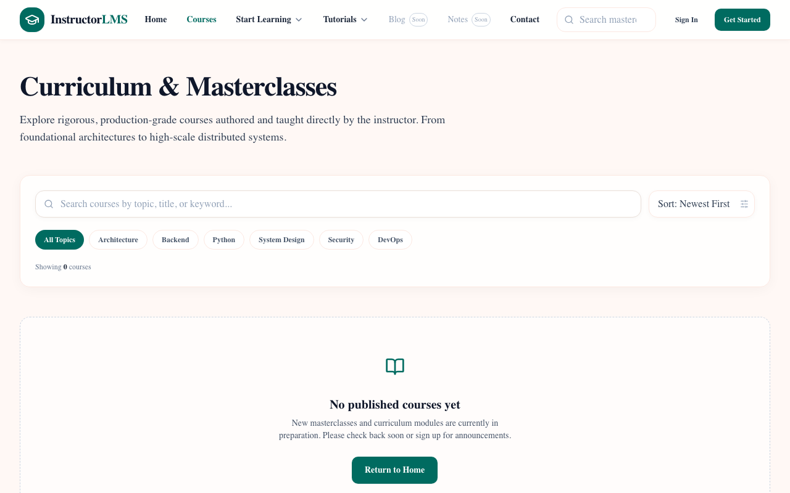
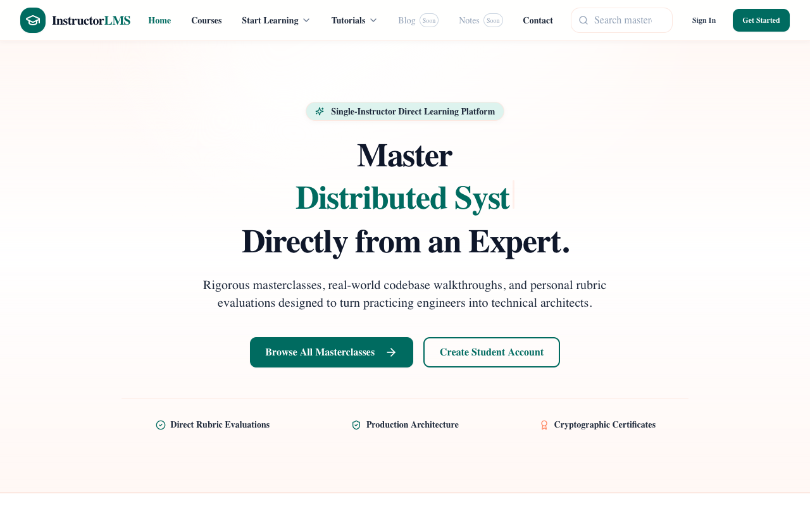
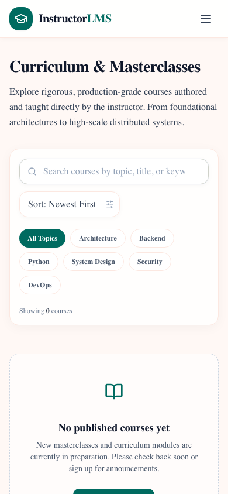
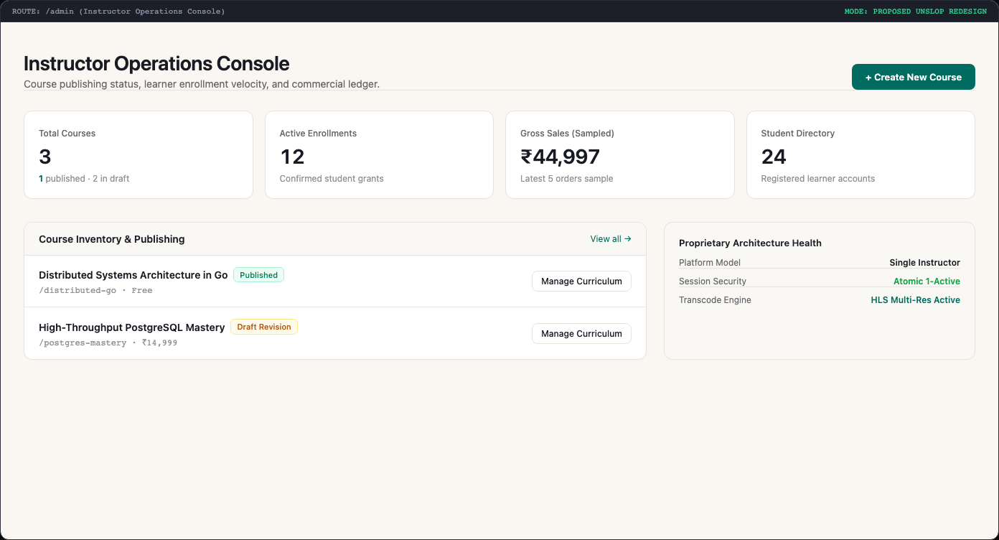

# Single-Instructor LMS

**A security-focused, proprietary direct-to-student Learning Management System engineered for a single expert instructor and brand.**


> **Project Status**: Active Development (Core Full-Stack Platform Implemented & Unit/Build-Verified; Pre-Production). See the [Feature Audit & Implementation Status](#feature-audit--implementation-status) and [Known Limitations](#known-limitations--architectural-notes) sections for exact verification boundaries.

**Navigation**: [Overview](#project-overview) · [Architecture](#system-architecture) · [Features](#key-features) · [Roles & RBAC](#user-roles-and-permissions) · [Database](#database-architecture) · [API Reference](#api-architecture) · [Audit Matrix](#feature-audit--implementation-status) · [Setup](#installation--local-setup) · [Testing](#testing--verification) · [Docs Index](docs/README.md)

---

## Project Overview

**Single-Instructor LMS** is a full-stack educational commerce and learning platform designed around a strict direct-to-student operating model:

```text
ONE INSTRUCTOR  ──>  ONE BRAND  ──>  MULTIPLE COURSES  ──>  MULTIPLE STUDENTS  ──>  DIRECT SALES
```

Unlike open course marketplaces (such as Udemy or Coursera) or multi-tenant school ERPs, this system gives an independent technical instructor full ownership over storefront branding, course revision history, adaptive HLS video delivery, watermarked PDF resources, rubric-graded capstone assignments, timed quizzes, QR-verifiable completion certificates, direct payment webhooks, and Super Admin security governance.

### Why This Architecture Exists
- **Zero Marketplace Dependency**: Students enroll directly under one brand without marketplace commissions, competing instructor recommendations, or algorithmic traffic throttling.
- **Hardened Educational IP Protection**: Combines an atomic single-active-session policy, short-lived IP-bound HLS video playback tokens, per-student dynamic PDF watermarking, and immutable course revisions.
- **Auditable Commerce & Grading**: Separates financial state transitions from client browser callbacks (enrollments unlock solely via cryptographic Razorpay webhooks) and logs sensitive actions to an immutable audit trail.

---

## Problem Statement

Independent educators selling technical masterclasses encounter recurring engineering and operational failures when stitching together generic tools:

1. **Account & Credential Sharing**: Unlimited concurrent logins allow a single paid seat to be shared across dozens of browsers.
2. **Broken Live Courses During Edits**: Editing modules or lessons in place corrupts syllabus continuity for already-enrolled students.
3. **Payment Spoofing on Client Redirects**: Granting course access on checkout redirect URLs invites forged enrollment requests and race conditions.
4. **Raw Media Leakage**: Serving static `.mp4` or `.pdf` files directly over predictable URLs makes course downloads trivial.
5. **Unstructured Assessments**: Plain numeric grades fail to enforce multi-criteria rubrics, grade override accountability, or server-authoritative quiz timers.

---

## Project Objectives

- **Enforce Single-Active-Session Security**: Guarantee at most one `ACTIVE` session per user at the database layer using row locking and a PostgreSQL partial unique index.
- **Maintain Immutable Published Snapshots**: Keep live student curricula stable on frozen `CourseRevision` snapshots while authors edit draft revisions safely.
- **Verify Payments Cryptographically**: Provision enrollments idempotently only after HMAC-SHA256 verification of Razorpay `payment.captured` webhooks.
- **Protect Video & Document Assets**: Transcode uploaded videos into multi-bitrate HLS playlists with FFmpeg, rewrite stream URLs with signed playback tokens, and dynamically watermark streamed PDFs per viewer.
- **Decouple Async Delivery & Media Jobs**: Offload email notifications and video transcoding to resumable PostgreSQL-backed workers using `FOR UPDATE SKIP LOCKED`.
- **Preserve Operational Accountability**: Enforce 45 canonical RBAC permissions across 5 roles and persist immutable JSON diff audit trails.

---

## Key Features

### Authentication & Session Security
- **Email/Password Registration & Verification** *(Verified)*: Argon2id password hashing (`argon2-cffi`, `m=65536, t=3, p=4`), complexity enforcement (`12–128` characters), and single-use SHA-256-hashed verification and password reset tokens queued through `NotificationOutbox`.
- **Single-Active-Session Displacement** *(Verified)*: Authenticating locks the user row and atomically revokes prior active `AuthSession` records (`SESSION_REVOKED`), backed by the PostgreSQL partial unique index `idx_auth_sessions_unique_active_user`.
- **Google OAuth 2.0 / OIDC Login** *(Verified)*: Verifies Google ID tokens against Google JWKS endpoints and maps authenticated identities into single-active-session records.
- **Staff Onboarding Invitations** *(Verified)*: Tokenized staff invite claims at `/onboarding/claim` (`POST /api/v1/auth/onboarding/claim`).
- **TOTP / Authenticator MFA** *(Not Implemented)*: Referenced in early requirements (`REQ-AUTH-005`), but no TOTP secrets or MFA challenges exist in the codebase.

### Course Catalog & Immutable Revisions
- **Draft / Live Revision Versioning** *(Verified)*: Creating or cloning a course creates editable draft `CourseRevision` trees while enrolled learners continue viewing the published revision snapshot (`course_revisions.is_published`).
- **Curriculum Builder & Pre-Flight Checklist** *(Verified)*: Section/lesson CRUD, drag-and-drop version-checked reordering (`PUT .../sections/reorder` and `PUT .../lessons/reorder`), lesson resources (`PDF`, external links), and pre-publish readiness validation (`GET /api/v1/courses/{id}/publish-checklist`).
- **Rich Course Metadata (Phase 1)** *(Verified / Partial UI)*: Backend schema (`20261126_2200_a3b4c5d6e7f8_add_course_metadata_fields.py`), `/courses/metadata-options`, `/courses/slug-available`, and `/admin/courses/[id]/edit` capture `category`, `difficulty_level`, `language`, `learning_outcomes`, `requirements`, `compare_at_price_inr`, `currency`, and `thumbnail_media_id`. Public `/courses` filters currently query `search` and `tag`, and public `CourseCard` / detail views do not yet display all Phase 1 metadata fields.

### Media Pipeline & Protected Playback
- **Presigned Upload Intents & Binary Validation** *(Verified)*: `POST /api/v1/media/upload-intent` issues SigV4 S3/R2 URLs (or local non-production storage endpoints under `backend/.local_storage`), followed by `POST /api/v1/media/{id}/confirm` performing magic-byte inspection, size enforcement, and image dimension checks. Anti-malware/ClamAV scanning *(Not Implemented)* is not yet wired.
- **FFmpeg HLS Video Transcoding Worker** *(Verified)*: Background `transcode_worker` claims `MediaTranscodeJob` rows via `FOR UPDATE SKIP LOCKED` and uses `ffmpeg`/`ffprobe` to produce HLS master playlists and `.ts` segments (`TRANSCODE_SEGMENT_DURATION_SECONDS=6`).
- **Protected HLS & Watermarked PDF Streaming** *(Verified — Requires Same-Origin / Reverse Proxy for Relative URLs)*: Issues short-lived IP-bound HMAC playback tokens (`POST /api/v1/media/{id}/playback-token`), rewrites `.m3u8` segment URLs dynamically (`/api/v1/media/{id}/hls/{file_path}` and `/hls/{id}/{file_path}`), and stamps learner email/ID watermarks onto PDFs via ReportLab (`GET /api/v1/media/{id}/protected-pdf`). Public thumbnails serve via `GET /api/v1/media/public/{id}`. Note that `mediaApi.getProtectedHlsStreamUrl` and `getProtectedPdfStreamUrl` return relative `/api/v1/media/...` paths while `next.config.ts` does not configure a Next.js rewrite proxy.

### Enrollments & Commerce
- **Course Orders & Webhook-Only Fulfillment** *(Backend Verified / Frontend Checkout UI Not Implemented)*: `POST /api/v1/orders` initiates Razorpay orders (with deterministic mock orders in `development`/`testing` when credentials are omitted), and `POST /api/v1/webhooks/razorpay` validates `X-Razorpay-Signature` HMAC-SHA256 before idempotently recording `PaymentTransaction` rows and provisioning `ACTIVE` enrollments. On the frontend, `src/lib/api/orders.ts` handles listing and refunds, while public course CTAs route to `/app` or `/signup` without an interactive Razorpay Checkout modal yet.
- **Manual Enrollment Grants & Revocation** *(Verified)*: Administrators can provision scholarship/manual access (`POST /api/v1/enrollments/grant-manual`) and revoke enrollments (`PATCH /api/v1/enrollments/{id}/revoke`), alongside order refunds (`POST /api/v1/orders/{id}/refund`).

### Assessments, Rubrics & Quizzes
- **Rubric-Based Assignments** *(Verified — Repaired in This Audit)*: Versioned multi-criteria rubrics, student project submissions (`/assignments/{id}/submissions`), student submission history (`/assignments/{id}/my-submissions`), staff rubric grading (`/submissions/{id}/grade`), and justification-required admin grade overrides (`/submissions/{id}/override-grade`).
- **Timed Quizzes & CSV Question Bank Import** *(Verified — Repaired in This Audit)*: Server-authoritative countdown timers (`QuizAttempt.started_at` / deadline checks), incremental answer autosave (`PATCH /api/v1/quiz-attempts/{id}/autosave`), `MCQ_SINGLE` / `MCQ_MULTI` / `TRUE_FALSE` / `TEXT_SHORT` scoring, and bulk CSV question import.
- **Student Lesson Notes & Bookmarks** *(Not Implemented)*: Planned learning workspace notes/bookmarks (`REQ-STU-004`) do not yet exist in backend models or UI.

### Progress Tracking, Certificates & Governance
- **Lesson Watch Telemetry & Completion Summaries** *(Verified)*: `POST /api/v1/progress/lessons/{lesson_id}` and `GET /api/v1/progress/courses/{course_id}` persist watch position seconds and completion percentages in `CourseProgressSummary`.
- **ReportLab QR Certificates & Public Verification** *(Verified)*: Eligible completers can generate/download PDF certificates (`/api/v1/certificates/{course_id}`, `/download`), verify hashes publicly via `GET /api/v1/certificates/verify/{verification_hash}` and `/verify/certificate/[hash]`, and administrators can revoke issued certificates.
- **Super Admin Control Plane (`/control/*`)** *(Verified — Content/Offer Storefront Consumers Pending)*: Overview analytics, session surveillance + emergency containment (`POST /api/v1/control/sessions/revoke-others`), course lifecycle governance, Blog CMS, Study Notes CMS, Promotional Offers CRUD, Payment transactions inspector, Platform Settings (`PUT /api/v1/control/settings`), User directory (`SA-02`), and Audit Log viewer (`/control/audit`). Public `/blog` and `/notes` pages do not exist yet, `PaymentService` does not yet apply `Offer` discount codes during order creation, `/control/permissions` renders a static matrix rather than an API-driven editor, and in-app notifications (`/api/v1/notifications`) have no frontend bell UI yet.

---

## User Roles and Permissions

Permissions are enforced server-side via `backend/app/core/permissions.py` across **45 canonical permission keys** and **5 system roles**:

| Role | Assigned Permissions | Portal Prefix | Core Responsibilities & Authorization Boundaries |
| :--- | :---: | :--- | :--- |
| **`VISITOR`** | `1` (`course:view_public`) | `/`, `/courses/*`, `/verify/certificate/*` | Browse published courses, read free preview lessons, and verify certificate hashes publicly. |
| **`STUDENT`** | `7` | `/app/*`, `/learn/*` | Self-register, view enrolled courses, play protected HLS/PDF lessons, track progress, take timed quizzes, submit assignments, view own submissions/orders/certificates. Strictly scoped to own resources. |
| **`STAFF`** | `5` | `/staff/*` | Upload/inspect media, list all assignment submissions (`assignment:view_all`), and evaluate submissions against active rubrics (`assignment:grade`). Cannot mutate courses, issue overrides, manage users, or refund orders. |
| **`ADMIN`** | `22` | `/admin/*` (+ `/staff/*`) | Author courses and draft revisions, publish immutable snapshots, upload/delete media, configure quizzes/rubrics, override grades with reason, grant/revoke enrollments, view orders, process refunds, and invite staff. |
| **`SUPER_ADMIN`** | `45` (All) | `/control/*` (+ `/admin/*`, `/staff/*`) | All platform permissions plus emergency session containment, user provisioning, role assignment (`roles:assign`), hard course deletion, security governance metrics, Blog/Notes/Offers CMS, and platform settings. |

> **Note**: In `src/app/(control)/control/permissions/page.tsx`, the Permissions page displays a read-only overview of 21 representative permission keys as a static matrix rather than dynamically querying all 45 keys from the backend.

---

## Technology Stack

### Frontend
| Technology | Verified Version | Purpose |
| :--- | :--- | :--- |
| **Next.js (App Router)** | `^15.1.7` (`15.5.29` built) | SSR auth boundary (`serverAuth`), hybrid server/client routing, SEO storefront pages |
| **React / React DOM** | `19.0.0` | Component rendering and interactive learning/admin portals |
| **TypeScript** | `^5.7.2` (strict mode) | Static contract typing aligned with Pydantic schemas |
| **Tailwind CSS** | `^3.4.17` | Utility-first styling, responsive layouts, custom theme tokens |
| **TanStack React Query** | `^5.62.8` | Server-state caching, mutations, and cache invalidation |
| **Zustand** | `^5.0.2` | Lightweight client authentication and UI store state |
| **React Hook Form + Zod** | `^7.54.2` / `^3.24.1` | Form orchestration and schema validation (`courseForm.ts`, auth forms) |
| **Radix UI + Lucide + Motion + Sonner** | Verified in `package.json` | Accessible primitives, icons, micro-animations, toast feedback |
| **Vitest + Playwright** | `^2.1.8` / `^1.49.1` | Fast unit/component test runner and multi-viewport E2E suite |

### Backend & Infrastructure
| Technology | Verified Version | Purpose |
| :--- | :--- | :--- |
| **Python** | `>=3.14` (`3.14.3` verified) | Core backend runtime |
| **FastAPI** | `0.141.1` | Async/sync REST API framework with automatic OpenAPI 3 generation |
| **Pydantic & pydantic-settings** | `2.13.4` / `2.15.0` | Request/response contracts and fail-fast production config validation |
| **SQLAlchemy + Alembic + psycopg** | `2.0.50` / `1.20.1` / `3.3.3` | ORM modeling, row locking (`FOR UPDATE`), and 17 PostgreSQL migrations |
| **argon2-cffi + PyJWT + cryptography** | `25.1.0` / `2.13.0` / `49.0.0` | Argon2id password hashing, HS256 JWTs, HKDF/Fernet outbox PII encryption |
| **ReportLab** | `5.0.1` | Dynamic learner-watermarked PDFs and QR-embedded certificate generation |
| **PostgreSQL** | `17` (configured target) | Primary ACID relational datastore and `SKIP LOCKED` job queues |
| **Redis** | `7` (configured target) | Auth fixed-window Lua rate limiting, audit suppression/alert state |
| **FFmpeg / ffprobe** | System binary (`/opt/homebrew/bin/ffmpeg`) | Adaptive HLS playlist segmentation (`transcode_worker`) |
| **Pytest + HTTPX** | `9.1.1` / `>=0.28.0` | Backend unit, security, API, and PostgreSQL concurrency tests |

---

## System Architecture

### Component Topology



### Key Runtime Request Flows

#### 1. Single-Active-Session Authentication Flow


#### 2. Zero-Trust Payment Webhook Enrollment Flow


---

## Project Folder Structure

```text
.
├── .env.example                     # Root Next.js + core backend env template
├── .gitignore                       # Secret, local storage, virtualenv, build & cache ignores
├── AGENTS.md / GEMINI.md            # Engineering agent directives & mandatory project invariants
├── next.config.ts                   # Next.js 15 config (strict mode, image remotePatterns)
├── package.json / tsconfig.json     # Frontend dependencies, scripts & strict TypeScript config
├── playwright.config.ts             # Multi-viewport Playwright E2E configuration (320px–1440px)
├── vitest.config.ts                 # Vitest + jsdom unit test setup
├── docs/                            # Organized specs, completion audits, screenshots & redesign previews
│   ├── README.md                    # Documentation index
│   ├── backend/                     # 25 backend architecture docs + security remediation report
│   ├── frontend/                    # 17 frontend specs/reports + 30 responsive screenshots
│   └── redesign_preview/            # UI/UX audit report + proposed redesign preview gallery & video
├── tests/e2e/                       # 11 Playwright end-to-end spec files
├── src/                             # Next.js App Router frontend
│   ├── app/
│   │   ├── (public)/                # Home (/), /courses, /courses/[slug], /verify/certificate/[hash]
│   │   ├── (auth)/                  # /login, /signup, /forgot-password, /reset-password, /verify-email, /onboarding/claim
│   │   ├── (student)/app/           # Student dashboard, courses, assignments, quizzes, orders, certificates, profile
│   │   ├── (staff)/staff/           # Staff dashboard & rubric grading queue / submission evaluator
│   │   ├── (admin)/admin/           # Instructor dashboard, courses & revision editor, media library, orders, students
│   │   ├── (control)/control/       # Super Admin console, sessions, users, admins, staff, CMS, offers, audit logs
│   │   └── learn/[courseId]/[lessonId]/ # Protected video/article/PDF/quiz learning workspace
│   ├── components/                  # UI components across admin, auth, control, courses, player, navigation
│   ├── lib/                         # SSR auth helper, fetch apiClient, 12 typed API modules, Zod validators
│   ├── tests/unit/                  # Vitest unit & RTL component test suites
│   └── types/                       # TypeScript request/response contract types
└── backend/                         # FastAPI Python backend
    ├── alembic.ini / pyproject.toml / requirements.txt
    ├── migrations/versions/         # 17 Alembic database migrations (head: a3b4c5d6e7f8)
    ├── tests/                       # Unit, security, and PostgreSQL integration concurrency tests
    └── app/
        ├── main.py                  # FastAPI factory, lifespan health checks, router mounts, /hls route
        ├── api/                     # Dependencies (cookie/Bearer auth, RBAC) + 16 API v1 routers
        ├── core/                    # Config, permissions, Argon2/JWT/Fernet security, Redis limiter, Razorpay
        ├── models/                  # 31 SQLAlchemy ORM models across 16 files
        ├── repositories/            # Data access layer & atomic locking queries
        ├── schemas/                 # Pydantic v2 request/response contracts
        ├── scripts/                 # bootstrap_super_admin.py CLI utility
        ├── services/                # Business logic layer (auth, courses, media, payments, grading, certs)
        └── workers/                 # outbox_worker.py (email dispatch) & transcode_worker.py (FFmpeg HLS)
```

---

## Database Architecture

The data layer targets **PostgreSQL 17** via **SQLAlchemy 2.0** (`psycopg` driver) and is managed by **17 sequential Alembic migrations** terminating at head revision `a3b4c5d6e7f8` (`add_course_metadata_fields`).

### Domain Schema Groups (31 ORM Models)

| Domain | SQLAlchemy Models (`backend/app/models/`) | Notable Integrity Mechanisms |
| :--- | :--- | :--- |
| **Identity & Sessions** | `User`, `Role`, `UserRole`, `Permission`, `RolePermission`, `AuthSession`, `AuthToken` | Partial unique index `idx_auth_sessions_unique_active_user` enforces single `ACTIVE` session per user. Single-use tokens stored as SHA-256 hashes. |
| **Courses & Revisions** | `Course`, `CourseRevision`, `CourseTag`, `CurriculumSection`, `CurriculumLesson`, `LessonResource` | Published `CourseRevision` snapshots are immutable; structural reorders check revision/version integrity; Phase 1 metadata columns included. |
| **Media & Transcoding** | `MediaAsset`, `MediaTranscodeJob` | Tracks S3/R2/local upload confirmation, binary metadata, HLS output paths, and retryable worker jobs (`FOR UPDATE SKIP LOCKED`). |
| **Commerce & Access** | `Order`, `PaymentTransaction`, `Refund`, `Enrollment` | Subunit pricing (`paise`), idempotent Razorpay payment capture linkage, refund tracking, and explicit `Enrollment` status transitions. |
| **Assessments** | `Assignment`, `AssignmentSubmission`, `Rubric`, `RubricCriteria`, `RubricScore`, `GradeOverride`, `Quiz`, `QuizQuestion`, `QuizQuestionOption`, `QuizAttempt`, `QuizAnswer` | Versioned rubrics preserved per graded submission, immutable grade override justification log, and server-side quiz attempt timers. |
| **Progress & Credentials** | `LessonProgress`, `CourseProgressSummary`, `Certificate` | Watch-second telemetry, course completion percentage aggregation, unique certificate numbers, and public verification hashes. |
| **Governance & Async** | `AuditLog`, `NotificationOutbox`, `Notification`, `BlogPost`, `Note`, `Offer`, `PlatformSetting` | Append-only audit events, HKDF+Fernet-encrypted outbox PII payloads, CMS tables, offers, and platform branding settings. |



---

## Authentication & Security

- **Password Cryptography**: Argon2id via `argon2-cffi` (`time_cost=3`, `memory_cost=65536` KiB, `parallelism=4`) with minimum length `12` and complexity checks (`backend/app/core/security.py`).
- **Session Transport & Revocation**: Login sets an HttpOnly cookie (`__Host-lms_session`, configurable `SESSION_COOKIE_SECURE` / `SameSite=lax`) storing an HS256 JWT that carries both `sub` and `session_id`. Every authenticated request verifies both JWT signature and `AuthSession.status == "ACTIVE"` (`backend/app/api/deps.py`), immediately returning `401 SESSION_REVOKED` when displaced or terminated.
- **Anti-Enumeration & CSRF/CORS**: Password reset and resend-verification routes always return generic `200`/`202` messages regardless of account existence; `CORS_ORIGINS` disallows wildcards in production.
- **Distributed Rate Limiting**: Fixed-window Lua script executed over stdlib RESP socket against Redis (`backend/app/core/rate_limit.py`). **Fails closed with HTTP 503** in `production` if Redis is unreachable, while skipping rate checks gracefully in local `development`/`testing` without Redis.
- **Outbox PII Protection**: Sensitive token URLs and recipient payloads in `notification_outbox` are encrypted at rest with HKDF-SHA256 + Fernet derived from `SECRET_KEY`.
- **Media Access Controls**: HLS playlists require short-lived HMAC playback tokens (`PLAYBACK_TOKEN_EXPIRE_MINUTES=120`) bound to client IP; protected PDFs are dynamically watermarked per student with ReportLab before streaming.
- **Security Gaps Not Yet Implemented**: Multi-factor authentication (TOTP) and automated antivirus/malware scanning on uploaded media files are not implemented.

---

## Frontend Portal Architecture

Built with **Next.js 15 App Router** and strictly typed React Query services across **8 layouts** and **46 routes (`page.tsx`)**:

- **Server-Side Auth Gate (`src/lib/auth/serverAuth.ts`)**: Reads session cookies server-side and forwards `Cookie` headers to `INTERNAL_API_URL` / `NEXT_PUBLIC_API_URL` `/api/v1/auth/me` to guard `(student)`, `(staff)`, `(admin)`, and `(control)` route trees before streaming protected UI. Supports `ENABLE_E2E_AUTH=true` strictly outside production (`NODE_ENV !== "production"`).
- **Client API Layer (`src/lib/api/client.ts`)**: Typed `fetch` wrapper with `credentials: "include"`, automatic `X-Idempotency-Key` generation on POST/PATCH/PUT requests when configured, `SESSION_REVOKED` handling that clears client auth store state, and typed `ApiRequestError` envelopes.

| Route Group | Key Pages (`src/app/`) | Purpose |
| :--- | :--- | :--- |
| `(public)` | `/`, `/courses`, `/courses/[slug]`, `/verify/certificate/[hash]` | Marketing landing page, catalog search/tags, syllabus preview, public QR certificate verification |
| `(auth)` | `/login`, `/signup`, `/forgot-password`, `/reset-password`, `/verify-email`, `/onboarding/claim` | Student/staff authentication, Google OIDC, email verification & password recovery |
| `(student)` | `/app`, `/app/courses`, `/app/courses/[id]`, `/app/assignments`, `/app/assignments/[id]`, `/app/quizzes`, `/app/quizzes/[id]`, `/app/orders`, `/app/certificates`, `/app/profile` | Enrolled course hub, submissions, timed quiz player, order history, certificate PDF downloads |
| `learn` | `/learn/[courseId]/[lessonId]` | Distraction-free player integrating `VideoPlayer` (HLS), `ArticleReader`, `ProtectedPdfViewer`, `CurriculumSidebar`, and quiz/assignment links |
| `(staff)` | `/staff`, `/staff/grading`, `/staff/grading/[submissionId]` | Pending submission queue and multi-criteria rubric evaluation workspace |
| `(admin)` | `/admin`, `/admin/courses`, `/admin/courses/new`, `/admin/courses/[id]/edit`, `/admin/media`, `/admin/enrollments`, `/admin/orders`, `/admin/students` | Course metadata & curriculum revision studio, media asset manager, enrollment overrides, order refunds |
| `(control)` | `/control`, `/control/sessions`, `/control/users`, `/control/users/[id]`, `/control/admins`, `/control/staff`, `/control/courses`, `/control/blog`, `/control/notes`, `/control/offers`, `/control/payments`, `/control/permissions`, `/control/audit`, `/control/settings` | Super Admin security telemetry, active session containment, user provisioning, CMS/offers/payments governance, audit trail viewer |

---

## API Architecture

FastAPI mounts **16 domain routers** under `API_V1_STR` (`/api/v1`), exposing **139 OpenAPI HTTP operations across 114 paths**, plus a shallow probe at `/healthz` and CDN-style stream route `/hls/{id}/{file_path}`:

| Domain Module | Prefix | Operations Summary |
| :--- | :--- | :--- |
| **Health** (`main.py`) | `/`, `/api/v1` | `GET /healthz`, `GET /api/v1/health` |
| **Authentication** (`auth.py`) | `/api/v1/auth` | `POST /register`, `/login`, `/logout`, `/refresh`, `/verify-email`, `/resend-verification`, `/password-reset/request`, `/password-reset/confirm`, `/oauth/google`, `/onboarding/claim`; `GET /me` |
| **Users** (`users.py`) | `/api/v1/users` | `GET /users`, `POST /users`, `GET /users/{id}`, `PATCH /users/{id}`, `GET /users/{id}/learning-records`, `PATCH /users/{id}/status`, `PATCH /users/{id}/roles`, `POST /users/staff/invite` |
| **Courses** (`courses.py`) | `/api/v1/courses` | `GET /courses`, `/courses/metadata-options`, `/courses/slug-available`, `/courses/manage`, `/courses/{id_or_slug}`, `/courses/{id}/publish-checklist`, `/courses/{id}/revisions/{rev_id}`; `POST /courses`, `/courses/{id}/revisions`, `/courses/{id}/revisions/{rev_id}/publish`, `/courses/{id}/revisions/{rev_id}/sections`; `PATCH /courses/{id}`; `PUT /courses/{id}/revisions/{rev_id}/sections/reorder`; `DELETE /courses/{id}` |
| **Sections & Lessons** (`sections.py`, `lessons.py`) | `/api/v1/sections`, `/api/v1/lessons`, `/api/v1/resources` | `PATCH/DELETE /sections/{id}`, `POST /sections/{id}/lessons`, `PUT /sections/{id}/lessons/reorder`; `GET/PATCH/DELETE /lessons/{id}`, `POST /lessons/{id}/resources`, `DELETE /resources/{id}` |
| **Media & HLS** (`media.py`) | `/api/v1/media`, `/hls` | `POST /upload-intent`, `/{id}/confirm`, `/{id}/retry-transcode`, `/{id}/playback-token`, `/{id}/verify-playback-token`; `GET /media`, `/media/{id}`, `/media/public/{id}`, `/{id}/transcode-job`, `/{id}/hls/{file_path}`, `/hls/{id}/{file_path}`, `/{id}/protected-pdf`, non-prod `/storage/download|upload/{file_key}`; `DELETE /media/{id}` |
| **Enrollments** (`enrollments.py`) | `/api/v1/enrollments` | `GET /enrollments`, `/enrollments/all`, `/enrollments/check/{course_id}`; `POST /enrollments/grant-manual`; `PATCH /enrollments/{id}/revoke` |
| **Orders & Webhooks** (`orders.py`, `webhooks.py`) | `/api/v1/orders`, `/api/v1/webhooks` | `POST /orders`, `GET /orders`, `GET /orders/{id}`, `POST /orders/{id}/refund`; `POST /webhooks/razorpay` |
| **Assignments** (`assignments.py`) | `/api/v1/lessons`, `/assignments`, `/submissions` | `GET/POST /lessons/{id}/assignment`; `GET/PATCH /assignments/{id}`, `POST /assignments/{id}/rubric`, `POST/GET /assignments/{id}/submissions`, `GET /assignments/{id}/my-submissions`; `GET /submissions/{id}`, `POST /submissions/{id}/grade`, `POST /submissions/{id}/override-grade` |
| **Quizzes** (`quizzes.py`) | `/api/v1/lessons`, `/quizzes`, `/quiz-attempts` | `GET/POST /lessons/{id}/quiz`; `GET/PATCH /quizzes/{id}`, `POST /quizzes/{id}/questions`, `/questions/bulk-csv`, `GET/POST /quizzes/{id}/attempts`; `GET /quiz-attempts`, `GET /quiz-attempts/{id}`, `PATCH /quiz-attempts/{id}/autosave`, `POST /quiz-attempts/{id}/submit` |
| **Progress & Certificates** (`progress.py`, `certificates.py`) | `/api/v1/progress`, `/api/v1/certificates` | `POST /progress/lessons/{lesson_id}`, `GET /progress/courses/{course_id}`; `GET /certificates/verify/{verification_hash}`, `GET /certificates/{course_id}`, `GET /certificates/{course_id}/download`, `POST /certificates/{certificate_id}/revoke` |
| **Notifications & Audit** (`notifications.py`, `audit.py`) | `/api/v1/notifications`, `/api/v1/audit-logs` | `GET /notifications`, `PATCH /notifications/{id}/read`, `POST /notifications/read-all`; `GET /audit-logs`, `GET /audit-logs/{id}` |
| **Super Admin Control** (`control.py`) | `/api/v1/control` | `/overview`, `/security/metrics`, `/sessions/*`, `/users/*`, `/courses/*`, `/blog/*` (7 routes), `/notes/*` (8 routes), `/offers/*` (6 routes), `/payments/*`, `/settings` |

Interactive Swagger documentation is available in non-production environments at `/api/v1/docs` (ReDoc at `/api/v1/redoc`).

---

## Background Workers & Media Pipeline

Both workers live under `backend/app/workers/` and run as standalone Python processes alongside the FastAPI web server:

1. **Video Transcoding Worker** (`backend/app/workers/transcode_worker.py`):
   - Polls pending `media_transcode_jobs` with PostgreSQL `FOR UPDATE SKIP LOCKED`, downloads the uploaded source file from S3/R2 or `.local_storage`, extracts metadata via `ffprobe`, encodes adaptive HLS streams/segments via `ffmpeg` (`TRANSCODE_SEGMENT_DURATION_SECONDS=6`, `TRANSCODE_TIMEOUT_SECONDS=600`), uploads generated playlists/segments, and marks the `MediaAsset` ready.
   - Run continuously or once:
     ```bash
     cd backend && .venv/bin/python -m app.workers.transcode_worker --once --batch-size 2 --poll-interval 3.0
     ```

2. **Transactional Outbox Worker** (`backend/app/workers/outbox_worker.py`):
   - Polls `notification_outbox` (`FOR UPDATE SKIP LOCKED`), decrypts Fernet-protected payloads, formats transactional emails (email verification, password reset, staff invites, payment receipt links to `/app`), dispatches via configured `EMAIL_PROVIDER` (`console`, `resend`, `sendgrid`, or `smtp`), and retries failures with exponential backoff up to `OUTBOX_MAX_RETRIES=5`.
   - Run continuously or once:
     ```bash
     cd backend && .venv/bin/python -m app.workers.outbox_worker --once --batch-size 50 --poll-interval 5.0
     ```

---

## Feature Audit & Implementation Status

Audit findings below come directly from source inspection, bug remediation, and executed checks rather than historical milestone checklists:

| Module / Feature | Implementation Evidence | Verification | Current Status |
| :--- | :--- | :--- | :--- |
| **Auth & Single-Active-Session** | `auth.py`, `auth_service.py`, `deps.py`, `(auth)/*` pages, `idx_auth_sessions_unique_active_user` | Backend pytest + Vitest (`AuthLoadingFlows`, `serverAuth`, `GoogleLoginButton`) | `VERIFIED` *(TOTP MFA Not Implemented)* |
| **RBAC & Governance (`SA-01`–`SA-03`)** | `permissions.py` (45 keys), `control.py`, `audit.py`, `/control/sessions`, `/control/users`, `/control/audit` | Backend pytest + Vitest (`controlApi`, `controlAudit`) | `VERIFIED` *(`/control/permissions` UI is static)* |
| **Course Authoring & Revisions** | `courses.py`, `sections.py`, `lessons.py`, `CurriculumBuilder.tsx`, `/admin/courses/[id]/edit`, Phase 1 migration `a3b4c5d6e7f8` | Backend pytest + Vitest + Next.js build | `VERIFIED` *(Public catalog filters use search/tags only)* |
| **Media Upload, HLS & PDF Watermarking (`VM-01`–`VM-03`)** | `media.py`, `transcode_worker.py`, `VideoPlayer.tsx`, `ProtectedPdfViewer.tsx` | Backend pytest + Vitest (`mediaApi`, `vm01..vm03`) | `VERIFIED` *(Requires same-origin/proxy for relative stream URLs; AV scan not implemented)* |
| **Assignments, Rubrics & Quizzes** | `assignments.py`, `quizzes.py`, `/staff/grading/*`, `/app/assignments/*`, `/app/quizzes/*`, `LessonEditorModal.tsx` | Backend pytest (`test_assignment_api.py`, `test_quiz_api.py`) + Vitest (`assignmentsApi.test.ts`, `adminApis.test.ts`) | `VERIFIED` *(4 contract/state bugs fixed in this release)* |
| **Progress & QR Certificates** | `progress.py`, `certificates.py`, `certificate_service.py`, `/app/certificates`, `/verify/certificate/[hash]` | Backend pytest + Vitest | `VERIFIED` *(QR payload links to API verify URL; frontend page lives at `/verify/certificate/[hash]`)* |
| **Orders, Refunds & Razorpay Webhooks** | `orders.py`, `webhooks.py`, `payment_service.py`, `razorpay.py`, `/app/orders`, `/admin/orders`, `/control/payments` | Backend pytest + Vitest (`controlPayments`) | `PARTIAL` *(Backend checkout/webhook verified; Frontend checkout initiation modal not implemented; Razorpay uses mock in dev without keys)* |
| **Blog CMS, Notes CMS & Promo Offers** | `control.py` + `/control/blog`, `/control/notes`, `/control/offers` | Backend pytest + Vitest (`controlApi`) | `PARTIAL` *(Super Admin CMS & Offer CRUD work; public `/blog` & `/notes` routes do not exist and `create_order` does not apply promo codes)* |
| **Notifications & Outbox Emails** | `notifications.py`, `outbox_worker.py` (link fixed to `/app`) | Backend pytest (`test_outbox.py`, `test_smtp_outbox.py`, `test_security_remediation_p1.py`) | `PARTIAL` *(Outbox email pipeline verified; Frontend In-App notification bell UI not implemented)* |
| **Student Notes & Bookmarks** | Planned in `MASTER_LMS_PRODUCT_REQUIREMENTS_AND_DEVELOPMENT_ROADMAP.md` (`REQ-STU-004`) | — | `NOT IMPLEMENTED` |
| **Live PostgreSQL Concurrency Suite** | 5 files in `backend/tests/integration/` (`SKIP LOCKED`, partial unique index, triggers) | Skipped locally when Postgres is offline | `UNVERIFIED IN CURRENT ENV` *(20 tests skipped without running Postgres)* |

### Issues Discovered & Fixed During This Audit
1. **Staff Grading Schema Mismatch**: Fixed `GradeSubmissionPayload` (`feedback` → `overall_feedback`) and `OverrideGradePayload` (`overridden_score` → `new_score`) in [src/types/assignment.ts](src/types/assignment.ts) and [src/app/(staff)/staff/grading/[submissionId]/page.tsx](src/app/%28staff%29/staff/grading/%5BsubmissionId%5D/page.tsx) to match backend Pydantic schemas.
2. **Staff Grading Queue Lesson ID Bug**: Fixed [src/app/(staff)/staff/grading/page.tsx](src/app/%28staff%29/staff/grading/page.tsx) resolving `lessonId` via `assignmentsApi.getLessonAssignment` to obtain the real `assignment.id` before calling `listAssignmentSubmissions`.
3. **Student Assignment History 403 Bug**: Added `GET /api/v1/assignments/{id}/my-submissions` in [backend/app/api/v1/assignments.py](backend/app/api/v1/assignments.py) wired to `AssignmentService.list_own_submissions`, exposed `assignmentsApi.listOwnSubmissions` in [src/lib/api/assignments.ts](src/lib/api/assignments.ts), updated [src/app/(student)/app/assignments/[id]/page.tsx](src/app/%28student%29/app/assignments/%5Bid%5D/page.tsx), and added API unit coverage.
4. **Lesson Editor Modal State & Initial CSV Import Bug**: Fixed [src/components/admin/LessonEditorModal.tsx](src/components/admin/LessonEditorModal.tsx) to hydrate existing quiz/assignment/rubric fields via `useEffect`, pass the newly created `quiz.id` into `bulkImportCsv` on first save, default rubric criterion weights to `1`, and show assignment save feedback.
5. **Outbox Receipt Link Route Fix & `.env.example` Typo**: Updated [backend/app/workers/outbox_worker.py](backend/app/workers/outbox_worker.py) receipt links from non-existent `/dashboard` to `/app`, and repaired the malformed `DATABASE_URL` in [.env.example](.env.example).

---

## Screenshots & Visual Overview

### Live Frontend Captures (`docs/frontend/screenshots/`)

| Public Course Catalog (1280px) | Storefront Hero Hydration (1280px) |
| :---: | :---: |
|  |  |

| Responsive Catalog (390px Mobile) | Proposed `/admin` UI Redesign Mockup (`docs/redesign_preview/`) |
| :---: | :---: |
|  |  |

> **Visual Accuracy Note**: Images under [`docs/frontend/screenshots/`](docs/frontend/screenshots/) are live browser captures from Playwright runs, whereas [`docs/redesign_preview/screenshots/`](docs/redesign_preview/screenshots/) holds **proposed design mockups** produced for the UI/UX redesign review.

---

## Environment Configuration

Copy the environment templates before booting local services:
- **Root Next.js template**: [`.env.example`](.env.example) → copy needed variables into root `.env.local` (frontend)
- **Complete FastAPI template**: [`backend/.env.example`](backend/.env.example) → copy into `backend/.env`

### Key Frontend Variables (`.env.local`)
| Variable | Purpose | Local Example |
| :--- | :--- | :--- |
| `NEXT_PUBLIC_API_URL` | Browser-accessible FastAPI base origin | `http://localhost:8000` |
| `INTERNAL_API_URL` | Server-side Next.js `serverAuth` FastAPI base origin | `http://localhost:8000` |
| `NEXT_PUBLIC_GOOGLE_CLIENT_ID` | Google Identity Services client ID (optional) | `<client-id>.apps.googleusercontent.com` |
| `ENABLE_E2E_AUTH` | Non-production E2E auth helper toggle (ignored in `production`) | `false` |

### Key Backend Variables (`backend/.env` — validated by `backend/app/core/config.py`)
| Category | Key Variables | Notes |
| :--- | :--- | :--- |
| **Runtime** | `ENVIRONMENT`, `DEBUG`, `PROJECT_NAME`, `API_V1_STR` | `ENVIRONMENT` in `{development, staging, production, testing}` |
| **Security & Cookies** | `SECRET_KEY`, `SESSION_COOKIE_NAME`, `SESSION_COOKIE_SECURE`, `SESSION_COOKIE_SAMESITE` | Prod requires 32+ byte non-placeholder `SECRET_KEY` and `__Host-` prefix with `HTTPS` |
| **Origins & Network** | `FRONTEND_URL`, `BACKEND_URL`, `CORS_ORIGINS`, `TRUSTED_PROXIES` | Explicit origin list required in prod (wildcards blocked) |
| **Datastores** | `DATABASE_URL`, `REDIS_URL` | `postgresql+psycopg://...` and `redis://...` (`rediss://` in prod) |
| **Payments** | `RAZORPAY_KEY_ID`, `RAZORPAY_KEY_SECRET`, `RAZORPAY_WEBHOOK_SECRET` | Optional deterministic mock in dev/test; strictly required in prod |
| **Storage & Streaming** | `STORAGE_PROVIDER`, `STORAGE_BUCKET_NAME`, `STORAGE_ENDPOINT_URL`, `STORAGE_ACCESS_KEY_ID`, `STORAGE_SECRET_ACCESS_KEY`, `CDN_STREAM_BASE_URL`, `PLAYBACK_TOKEN_EXPIRE_MINUTES` | `local` persists under `backend/.local_storage/` in non-prod; `r2`/`s3` required in prod |
| **FFmpeg & Transcoding** | `FFMPEG_PATH`, `FFPROBE_PATH`, `TRANSCODE_TEMP_DIR`, `TRANSCODE_SEGMENT_DURATION_SECONDS`, `TRANSCODE_CONCURRENCY` | Auto-resolves system `ffmpeg`/`ffprobe` when unset |
| **Email & Outbox** | `EMAIL_PROVIDER`, `EMAIL_FROM`, `EMAIL_FROM_NAME`, `EMAIL_API_KEY`, `SMTP_*`, `OUTBOX_*` | `console`, `resend`, `sendgrid`, or `smtp` |

---

## Installation & Local Setup

### Prerequisites
- **Node.js** `20+` and **npm**
- **Python** `3.14+` (`backend/pyproject.toml` specifies `>=3.14`)
- **PostgreSQL** `17` running locally
- **Redis** `7` (optional in local `development`, mandatory in `production`)
- **FFmpeg & ffprobe** (required only when running HLS video transcoding)

### 1. Clone & Configure Backend
```bash
git clone https://github.com/priyanshrathod0603/single-instructor-lms.git
cd single-instructor-lms/backend

python3.14 -m venv .venv
source .venv/bin/activate
pip install --upgrade pip
pip install -r requirements.txt
pip install pytest==9.1.1 anyio==4.14.0 "httpx>=0.28.0"

cp .env.example .env
# Edit backend/.env: set DATABASE_URL, SECRET_KEY, and set SESSION_COOKIE_SECURE=False if running over http://localhost
```

### 2. Run Database Migrations & Bootstrap Super Admin
Ensure PostgreSQL is running and the target database (e.g., `lms_db`) exists:
```bash
cd backend
.venv/bin/python -m alembic upgrade head
```
After registering your verified owner account (or creating one in the DB), promote it once via:
```bash
.venv/bin/python -m app.scripts.bootstrap_super_admin --email owner@example.com
```

### 3. Configure & Install Frontend
```bash
cd ..
cp .env.example .env.local
# Adjust NEXT_PUBLIC_API_URL / INTERNAL_API_URL / NEXT_PUBLIC_GOOGLE_CLIENT_ID if needed
npm install
```

### 4. Start Application & Optional Workers
Run in separate terminals:
```bash
# Terminal 1: FastAPI API Server
cd backend && .venv/bin/uvicorn app.main:app --reload --port 8000

# Terminal 2: Next.js Frontend
npm run dev

# Terminal 3 (Optional): Outbox Email Worker
cd backend && .venv/bin/python -m app.workers.outbox_worker

# Terminal 4 (Optional): HLS Video Transcoding Worker
cd backend && .venv/bin/python -m app.workers.transcode_worker
```

Visit [http://localhost:3000](http://localhost:3000) for the storefront and [http://localhost:8000/api/v1/docs](http://localhost:8000/api/v1/docs) for interactive API docs.

---

## Testing & Verification

### Commands Run Against Current Codebase
| Check | Command | Latest Observed Result |
| :--- | :--- | :--- |
| **Backend Test Suite** | `backend/.venv/bin/python -m pytest backend/tests -q` | **857 passed, 20 skipped** *(20 PostgreSQL concurrency tests in 5 `backend/tests/integration/` files skip cleanly when PostgreSQL is offline)* |
| **Frontend Unit Tests** | `npx vitest run` | **45 test files passed, 251 tests passed** |
| **TypeScript Check** | `npx tsc --noEmit` | **0 errors (Exit 0)** |
| **Production Build** | `npm run build` | **Exit 0 — 46/46 Next.js routes compiled** |
| **Alembic Migrations** | `cd backend && .venv/bin/python -m alembic heads` & `alembic upgrade head --sql` | **Head `a3b4c5d6e7f8` verified; SQL DDL generation succeeded across all 17 revisions** |
| **Python Dependency Check** | `cd backend && .venv/bin/python -m pip check` | **`No broken requirements found.`** |
| **ESLint (`npm run lint`)** | `npm run lint` (`next lint`) | **Unconfigured / Blocked** *(ESLint config & packages are absent, causing `next lint` to prompt interactively)* |
| **Playwright E2E Suite** | `npx playwright test` | **Not executed in this release pass** *(requires running frontend + backend + seeded PostgreSQL database; 11 spec files under `tests/e2e/`)* |

---

## Deployment Considerations

`backend/app/core/config.py` enforces strict fail-fast validators whenever `ENVIRONMENT=production`:
1. **`DEBUG` must be `False`**, `SECRET_KEY` must be at least 32 characters without placeholder text, and `SESSION_COOKIE_SECURE` must be `True` with `__Host-lms_session` over HTTPS.
2. **Datastores Required**: Live PostgreSQL (`DATABASE_URL`) and authenticated Redis (`rediss://...` recommended; rate limiter fails closed with HTTP 503 if unavailable).
3. **External Secrets Required**: `RAZORPAY_KEY_ID`, `RAZORPAY_KEY_SECRET`, `RAZORPAY_WEBHOOK_SECRET`, and `s3`/`r2` storage credentials (`local` storage and Razorpay mock mode are forbidden in production).
4. **Same-Origin Reverse Proxy Recommended**: Protected HLS playlists and watermarked PDF client helpers use relative `/api/v1/media/...` paths and `HttpOnly` `__Host-` cookies. Deploy Next.js and FastAPI behind a unified HTTPS reverse proxy (e.g., Nginx/Caddy routing `/api/v1/*` and `/hls/*` to FastAPI and `/*` to Next.js), or configure Next.js rewrites before splitting origins.
5. **Process Supervision**: Deploy `uvicorn app.main:app`, `app.workers.outbox_worker`, and `app.workers.transcode_worker` (with `ffmpeg` installed) as separate supervised services. Note that `Dockerfile`, `docker-compose.yml`, and `.github/workflows/` are not yet included in the repository.

---

## Known Limitations & Architectural Notes

- **Checkout UI Missing**: Backend `/api/v1/orders` and `/api/v1/webhooks/razorpay` are complete, but `/courses/[slug]` currently links to `/app` or `/signup` without a live Razorpay Checkout modal or discount code redemption UI.
- **Unwired CMS / Offer Storefront Surfaces**: `/control/blog`, `/control/notes`, and `/control/offers` work for Super Admins, while public `/blog` and `/notes` pages and promotional code redemption during order creation are not built yet.
- **Static Permissions UI**: `/control/permissions` shows a 21-item static matrix instead of reading all 45 backend permissions dynamically.
- **No Frontend Notification Bell**: Backend `/api/v1/notifications` routes exist, but there is no client notification dropdown/panel wired to them.
- **Certificate QR URL Target**: `CertificateService.get_verification_url` embeds `/api/v1/certificates/verify/{hash}` JSON URLs inside QR codes, while the user-facing verification page is `/verify/certificate/{hash}`.
- **Omitted Security Extensions**: Authenticator TOTP MFA and media upload antivirus scanning remain unimplemented.
- **ESLint Not Configured**: `package.json` defines `"lint": "next lint"` without an ESLint dependency or configuration file.

---

## Roadmap

1. **Direct Commerce Checkout UI**: Add `ordersApi.createOrder`, Razorpay Checkout JS integration, and promo `Offer` validation on `/courses/[slug]`.
2. **Public Blog & Study Notes Portals**: Expose published Blog posts and downloadable Notes in `(public)` storefront routes.
3. **Interactive Notification Center & Dynamic RBAC Matrix**: Wire `/api/v1/notifications` to header navigation and render all 45 backend permissions in `/control/permissions`.
4. **Security & QA Hardening**: Implement TOTP MFA, ClamAV/object-scan hooks on upload confirmation, ESLint flat config, GitHub Actions CI, and container definitions (`Dockerfile` / `docker-compose.yml`) for running live PostgreSQL concurrency + Playwright suites in CI.

---

## Contributing & Repository Standards

1. Read [AGENTS.md](AGENTS.md) and [docs/README.md](docs/README.md) before modifying architecture or workflows.
2. Keep single-instructor boundaries intact (never introduce multi-tenant school ERP or open marketplace tables), preserve published course revision immutability, and maintain single-active-session transaction guarantees.
3. Before opening a PR, run backend tests (`pytest`), frontend unit tests (`vitest run`), typechecking (`tsc --noEmit`), and production build verification (`npm run build`), ensuring no `.env*` secrets or local `.local_storage/` artifacts are staged.

---

## Documentation Index

- Full repository documentation guide: [docs/README.md](docs/README.md)
- Backend specifications (25 docs + security audit): [docs/backend/](docs/backend/)
- Frontend blueprints, route/API matrices & screenshots: [docs/frontend/](docs/frontend/)
- Governance & milestone reports (`SA-02`–`SA-05`, `VM-02`): [docs/](docs/)
- UI/UX audit & redesign mockups: [docs/redesign_preview/](docs/redesign_preview/)

---

## License

No open-source license file (`LICENSE`) is currently included in this repository. All rights remain with the repository author until an explicit license is added.

---

## Author

**Priyansh Rathod**
- GitHub: [https://github.com/priyanshrathod0603](https://github.com/priyanshrathod0603)
- Repository: [https://github.com/priyanshrathod0603/single-instructor-lms](https://github.com/priyanshrathod0603/single-instructor-lms)
