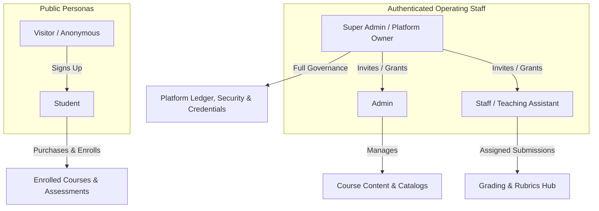
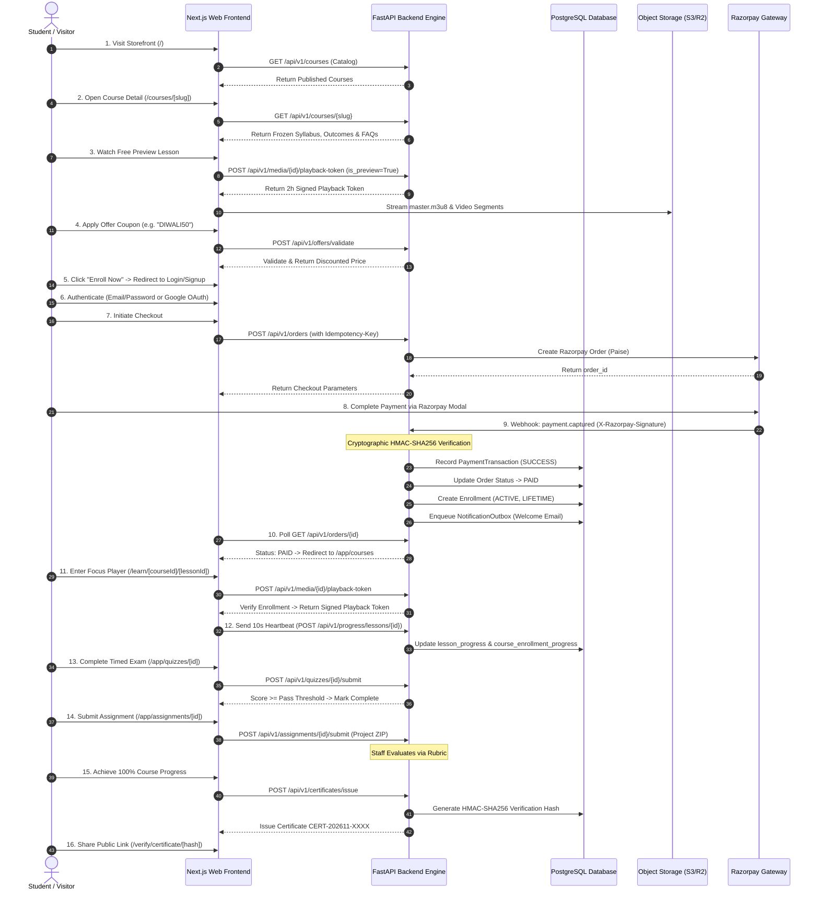
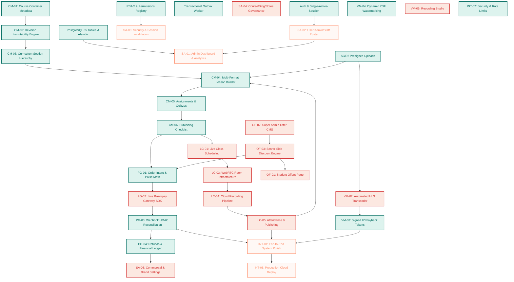

# MASTER LMS PRODUCT REQUIREMENTS & TECHNICAL DEVELOPMENT ROADMAP
## Single-Instructor Proprietary Educational Platform Architecture
**Document Version:** 3.0.0  
**Status:** AUTHORITATIVE BLUEPRINT & PLANNING REFERENCE  
**Classification:** Enterprise Engineering Specification  
**Product Category:** Direct-to-Consumer / Direct-to-Student Proprietary Learning Management System  
**Repository Working Directory:** `/Users/priyansh/lms`  
**Target Specification File:** `docs/MASTER_LMS_PRODUCT_REQUIREMENTS_AND_DEVELOPMENT_ROADMAP.md`  

---

## TABLE OF CONTENTS
1. [Executive Summary & System Architecture](#1-executive-summary--system-architecture)
   - 1.1 Product Vision & Operating Charter
   - 1.2 Core Business Model (`ONE INSTRUCTOR -> ONE BRAND -> MULTIPLE COURSES -> MULTIPLE STUDENTS -> DIRECT SALES`)
   - 1.3 Architectural Invariants & Non-Goals
   - 1.4 Independent Educational Product Model
2. [Current Implementation Audit & Evidence Matrix](#2-current-implementation-audit--evidence-matrix)
   - 2.1 Audit Methodology & Classification Taxonomy
   - 2.2 Comprehensive Subsystem Audit Table
   - 2.3 Database Schema & Migration Inventory
   - 2.4 Verified Features vs. Blueprint Gaps
   - 2.5 Confirmed Architectural Decisions vs. Pending Approvals
3. [User Personas & Role-Based Access Control (RBAC)](#3-user-personas--role-based-access-control-rbac)
   - 3.1 Persona Taxonomy & Operational Scopes
   - 3.2 Granular Canonical Permission Registry
   - 3.3 Sole Super Admin Row-Level Serialization Lock Invariant
   - 3.4 Public Student Self-Registration Boundaries
4. [End-to-End User Journeys & State Workflows](#4-end-to-end-user-journeys--state-workflows)
   - 4.1 Complete 24-Stage Student Lifecycle Workflow
   - 4.2 Complete Instructor & Course Creation Lifecycle Workflow
   - 4.3 Super Admin Platform Governance & Audit Workflow
   - 4.4 Staff Grading & Student Support Workflow
5. [Public Course Detail Page & Reference Specification](#5-public-course-detail-page--reference-specification)
   - 5.1 Overview & Functional Translation of Reference Elements
   - 5.2 The 21 Core Functional Content Areas
   - 5.3 Responsive Layout & Breakpoint Behavior (320px, 375px, 768px, 1024px, 1440px)
   - 5.4 Video Preview Modal & Free Sample Access Control
6. [Track A: Super Admin Platform Governance (SA-01 to SA-05)](#6-track-a-super-admin-platform-governance-sa-01-to-sa-05)
   - 6.1 SA-01: Super Admin Command Center & Metrics Dashboard
   - 6.2 SA-02: Unified User, Admin, and Staff Roster Management
   - 6.3 SA-03: Role, Permission, and Session Security Governance
   - 6.4 SA-04: Content & Course Governance (Courses, Blog, Notes)
   - 6.5 SA-05: Commercial, Offers & Platform Governance
7. [Track B: Complete Course Management System (CM-01 to CM-06)](#7-track-b-complete-course-management-system-cm-01-to-cm-06)
   - 7.1 CM-01: Course Container & Public Marketing Metadata
   - 7.2 CM-02: Course Revisioning & Immutability Engine
   - 7.3 CM-03: Curriculum Hierarchy & Section Management
   - 7.4 CM-04: Multi-Format Lesson Builder & Attachment Pipeline
   - 7.5 CM-05: Pedagogical Assessments (Rubrics & Quizzes)
   - 7.6 CM-06: Relational Publishing Checklist & Course Lifecycle
8. [Track C: Video & Protected Media Management (VM-01 to VM-05)](#8-track-c-video--protected-media-management-vm-01-to-vm-05)
   - 8.1 VM-01: S3/R2 Direct Presigned Upload Pipeline
   - 8.2 VM-02: Video Transcoding & Adaptive HLS Packaging Pipeline
   - 8.3 VM-03: Cryptographic Playback Protection & IP-Bound Token Delivery
   - 8.4 VM-04: Dynamic Provenance Watermarking & Protected PDF Delivery
   - 8.5 VM-05: Recording Management: External Recording vs. LMS Recording Studio
9. [Track D: Live Classes & Automated Cloud Recording (LC-01 to LC-05)](#9-track-d-live-classes--automated-cloud-recording-lc-01-to-lc-05)
   - 9.1 LC-01: Live Class Scheduling & Course Cohort Scoping
   - 9.2 LC-02: Student Live Class Discovery, Countdown & Access Control
   - 9.3 LC-03: Live Video Conferencing Infrastructure & Room Architecture
   - 9.4 LC-04: Automatic Cloud Recording, Ingestion & Packaging Pipeline
   - 9.5 LC-05: Post-Session Publishing, Attendance Ledger & Student Access
10. [Track E: Actual Payment Gateway Integration (PG-01 to PG-05)](#10-track-e-actual-payment-gateway-integration-pg-01-to-pg-05)
    - 10.1 PG-01: Checkout Session Initialization & Server-Calculated Pricing
    - 10.2 PG-02: Razorpay Live Integration & Frontend SDK Orchestration
    - 10.3 PG-03: Cryptographic Webhook Reconciliation & Zero-Trust Enrollment
    - 10.4 PG-04: Financial Audit Trail, Refunds & Transaction Ledger
    - 10.5 PG-05: Administrative Commercial Governance & Gateway Configuration
11. [Track F: Student Offers Page & Discount System (OF-01 to OF-04)](#11-track-f-student-offers-page--discount-system-of-01-to-of-04)
    - 11.1 OF-01: Student Offers Discovery Hub & Claiming Interface
    - 11.2 OF-02: Super Admin Offer Creation, Validation & Lifecycle Management
    - 11.3 OF-03: Server-Side Discount Calculation & Coupon Enforcement Engine
    - 11.4 OF-04: Promotional Performance & Redemption Analytics
12. [Track G: Platform Integration, Security & Production Readiness (INT-01 to INT-05)](#12-track-g-platform-integration-security--production-readiness-int-01-to-int-05)
    - 12.1 INT-01: End-to-End System Integration & Cross-Module Verification
    - 12.2 INT-02: Security Architecture, Threat Modeling & Access Hardening
    - 12.3 INT-03: Transactional Outbox & Resilient Notification Dispatch
    - 12.4 INT-04: Caching Strategy, Performance & Database Index Optimization
    - 12.5 INT-05: Production Deployment Architecture & Operational Monitoring
13. [Implementation Dependency Graph & Critical Path](#13-implementation-dependency-graph--critical-path)
14. [Comprehensive Testing Matrix & Acceptance Criteria](#14-comprehensive-testing-matrix--acceptance-criteria)
15. [Phased Development Roadmap & Execution Schedule](#15-phased-development-roadmap--execution-schedule)
16. [Architectural Decision Register (ADR) & Open Questions](#16-architectural-decision-register-adr--open-questions)

---

# 1. EXECUTIVE SUMMARY & SYSTEM ARCHITECTURE

## 1.1 Product Vision & Operating Charter
The **Single-Instructor Learning Management System (LMS)** is a high-security, proprietary, direct-to-student educational technology platform designed specifically for an expert instructor operating an independent high-yield educational brand. 

Unlike generic software-as-a-service (SaaS) multi-tenant platforms or open course aggregators, this system delivers an uncompromised, branded learning experience where the owner maintains complete sovereignty over intellectual property, student relationships, commercial proceeds, media distribution, and pedagogical standards.

The product unifies:
1. **Public Marketing & High-Converting Storefront**: Fast, accessible, mobile-first course discovery and rich syllabus exploration.
2. **Proprietary Media Delivery Engine**: Signed, short-lived, IP-bound adaptive HLS video streaming and dynamic, personalized, provenance-watermarked PDF reader.
3. **Rigorous Pedagogical Assessment**: Structured hierarchical curriculums, rubric-evaluated assignments, randomized question-bank exams, and cryptographic HMAC-verified certificates.
4. **Resilient Commerce & Zero-Trust Enrollment**: Cryptographically verified webhook-driven checkout reconciliation preventing unverified client redirects from granting course access.
5. **Atomic Account Integrity**: Strict single-active-session concurrency enforcement per user account via database-level partial unique index constraints.
6. **Audited Operational Delegation**: Role-based access control (RBAC) permitting the platform owner (Super Admin) to safely delegate grading and student inquiry handling to Staff and operational workflows to Admins without risking intellectual property or platform credentials.

```
+---------------------------------------------------------------------------------------------------+
|                                  SINGLE-INSTRUCTOR LMS ECOSYSTEM                                   |
+---------------------------------------------------------------------------------------------------+
|                                                                                                   |
|  [ ONE INSTRUCTOR ] ---> [ ONE BRAND ] ---> [ MULTIPLE COURSES ] ---> [ MULTIPLE STUDENTS ]       |
|                                                                                                   |
|  +--------------------------------+  +--------------------------------+  +---------------------+  |
|  |       PUBLIC STOREFRONT        |  |     STUDENT LEARNING PORTAL    |  |  CONTROL GOVERNANCE |  |
|  |  - Course Discovery Catalog    |  |  - Focus Lesson Player (HLS)   |  |  - Super Admin Ctr  |  |
|  |  - Rich Syllabus & Previews    |  |  - Watermarked PDF Reader      |  |  - RBAC & Sessions  |  |
|  |  - Offers & Coupon Engine      |  |  - Timed Auto-Save Quizzes     |  |  - Immutable Audit  |  |
|  |  - Verified Checkout & Orders  |  |  - Rubric Assignment Submissions| - Staff Grading Hub  |  |
|  |  - Certificate Verification    |  |  - Dynamic Progress & Certs    |  |  - Media Assets Lib |  |
|  +--------------------------------+  +--------------------------------+  +---------------------+  |
|                                                                                                   |
+---------------------------------------------------------------------------------------------------+
```

## 1.2 Core Business Model
The platform operates exclusively on a direct-to-consumer (D2C) educational sales model:
$$\text{ONE INSTRUCTOR} \longrightarrow \text{ONE BRAND} \longrightarrow \text{MULTIPLE COURSES} \longrightarrow \text{MULTIPLE STUDENTS} \longrightarrow \text{DIRECT SALES}$$

* **Zero Intermediary Commissions**: 100% of verified revenue flows directly through the instructor's payment gateway (Razorpay) into their commercial bank account.
* **Direct Student Ownership**: Student email records, learning progress logs, assignment submissions, and assessment data belong entirely to the brand.
* **Unified Brand Authority**: All communication, marketing, certificates, and system notifications originate from a single unified instructor identity.

## 1.3 Architectural Invariants & Non-Goals
The architecture strictly enforces six foundational non-negotiable invariants:

| # | Invariant Rule | Architectural Rationale & Implementation |
| :---: | :--- | :--- |
| **INV-01** | **Strictly Single-Instructor (Non-Marketplace)** | Rejects multi-tenant partitioning, multi-instructor revenue shares, or public instructor signups. Public registration strictly assigns the `STUDENT` role. |
| **INV-02** | **Single Active Session Per User Account** | Eliminates credential sharing. When a user authenticates on a new device, all prior active sessions for that `user_id` are atomically revoked in PostgreSQL (`auth_sessions`). Enforced via partial unique index `idx_auth_sessions_unique_active_user WHERE status='ACTIVE'`. |
| **INV-03** | **Course Revision Immutability** | A published course revision consumed by enrolled students is permanently frozen. Content updates spawn a new draft revision (`course_revisions`). Publishing performs deep atomic cloning and freezes a JSONB curriculum snapshot. |
| **INV-04** | **Zero Trust on Client Browser Redirects** | Commercial enrollment is granted exclusively upon server-to-server cryptographic HMAC-SHA256 signature verification of incoming payment gateway webhooks. Client redirects trigger status polling but never grant access. |
| **INV-05** | **Sole Super Admin Protection** | The database and service layers enforce that the platform's final active `SUPER_ADMIN` account can never be demoted, deactivated, or deleted. All role changes utilize row-level serialization locks. |
| **INV-06** | **Protected Media Pipeline (Fail-Closed)** | Raw media storage URLs are never exposed. All video playback requires short-lived (2-hour TTL) HMAC-signed JWT tokens bound to the student ID, media ID, and client IP. PDF documents are dynamically watermarked on the fly. Non-enrolled requests fail closed with `403 Forbidden`. |

### Explicit Non-Goals
1. **NOT a Multi-Tenant College/Enterprise ERP**: No departmental hierarchy, multi-school partitioning, or external organizational tenancy.
2. **NOT an Open Instructor Marketplace (Udemy/Coursera Clone)**: No public instructor onboarding, no instructor payout ledgers, no third-party course reviews.
3. **NOT a Public Social Network**: No unmoderated public forums, student-to-student direct messaging, or public user profile directories.

## 1.4 Independent Educational Product Model
Every course published on the platform operates as an entirely self-contained commercial and pedagogical entity. The curriculum of one course must never bleed into or cross-reference another.

### Representative Course Roster
* **Course A: Modern Python 3 & Enterprise Backend Architecture**
* **Course B: Production Java 21 & Distributed Microservices**
* **Course C: Full-Stack TypeScript & Next.js 15 Mastery**
* **Course D: Modern PHP 8.4, Laravel & High-Performance SQL**
* **Course E: Applied Artificial Intelligence & Deep Neural Networks**
* **Course F: Generative AI, LLM Orchestration & Autonomous Agent Engineering**

Each independent course entity maintains its own:
* Unique URL-friendly slug and public marketing metadata.
* Dedicated promotional thumbnail and preview video asset.
* Multi-section, multi-lesson curriculum hierarchy.
* Dedicated pricing rules (price in paise, promotional MSRP, is_free toggle).
* Course-specific discount coupons and offer eligibility.
* Independent student enrollments, completion thresholds, and lesson progress records.
* Course-specific assignments with tailored grading rubrics.
* Course-specific question banks and timed exam configurations.
* Cryptographically verifiable course completion certificate template.

---

# 2. CURRENT IMPLEMENTATION AUDIT & EVIDENCE MATRIX

## 2.1 Audit Methodology & Classification Taxonomy
A rigorous physical audit of all source files in `/Users/priyansh/lms` was conducted across backend routes, models, schemas, repositories, services, migrations, frontend routes, components, API clients, and unit/integration tests. 

Every feature is classified according to the authoritative status taxonomy:
* `IMPLEMENTED_AND_VERIFIED`: Code exists, is wired into runtime pipelines, and has verified empirical test passes in the test suite.
* `IMPLEMENTED_NOT_INDEPENDENTLY_VERIFIED`: Code exists in repository, but lacks independent live end-to-end regression validation.
* `PARTIALLY_IMPLEMENTED`: Substantial code exists, but critical components, edge cases, or full integrations are incomplete.
* `PRESENT_BUT_NOT_FUNCTIONAL`: UI scaffolding or API route definitions exist, but underlying services or handlers are stubbed/mocked.
* `NOT_IMPLEMENTED`: Concept exists in blueprint or requirements, but zero implementation code exists in the repository.
* `BLOCKED`: Implementation cannot proceed without third-party credentials or upstream architectural prerequisites.
* `REQUIRES_INVESTIGATION`: Implementation exists but exhibits intermittent behavior, architectural drift, or ambiguous logs.

## 2.2 Comprehensive Subsystem Audit Table

| Subsystem Module | Target File / Physical Location | Current Status | Architectural Evidence & Verified Findings |
| :--- | :--- | :--- | :--- |
| **Authentication Core** | `backend/app/api/v1/auth.py`<br>`backend/app/services/auth_service.py` | `IMPLEMENTED_AND_VERIFIED` | Argon2id password hashing, single-active-session revocation, email verification flow, refresh tokens, Google OAuth RS256 JWKS validation. |
| **RBAC & Permissions** | `backend/app/core/permissions.py`<br>`backend/app/models/permission.py` | `IMPLEMENTED_AND_VERIFIED` | Canonical permission registry (`domain:action`), role-permission associations in PostgreSQL, hierarchical permission enforcement in FastAPI. |
| **User Administration** | `backend/app/api/v1/users.py`<br>`backend/app/services/user_service.py` | `IMPLEMENTED_AND_VERIFIED` | User directory listing, filtering, activation/suspension, staff invite tokens, sole Super Admin serialization protection lock. |
| **Course Catalog & Revisions** | `backend/app/api/v1/courses.py`<br>`backend/app/services/course_service.py` | `IMPLEMENTED_AND_VERIFIED` | Course container, immutable draft-to-published revision lifecycle, relational publish checklist, curriculum deep cloning. |
| **Curriculum Builder** | `backend/app/api/v1/sections.py`<br>`backend/app/api/v1/lessons.py` | `IMPLEMENTED_AND_VERIFIED` | Section/lesson CRUD, drag-and-drop sort ordering, preview toggles, multi-type lesson association (`VIDEO`, `ARTICLE`, `QUIZ`, `ASSIGNMENT`). |
| **Media Storage & Upload** | `backend/app/api/v1/media.py`<br>`backend/app/services/media_service.py` | `IMPLEMENTED_AND_VERIFIED` | S3/R2 presigned upload pipeline (15-min TTL), MIME validation, binary header signature checks (first 512 bytes), media cleanup. |
| **Video Playback Protection** | `backend/app/api/v1/media.py`<br>`backend/app/services/media_service.py` | `IMPLEMENTED_AND_VERIFIED` | Short-lived (2-hour) signed JWT playback tokens with client IP binding, edge token verification endpoint (`/verify-playback-token`). |
| **Video Transcoding Pipeline** | `backend/app/workers/` | `NOT_IMPLEMENTED` | Video uploads transition to `PROCESSING` status, but **no** background ffmpeg worker or multi-bitrate HLS packaging service exists. |
| **PDF Watermarking** | `backend/app/api/v1/media.py`<br>`backend/app/core/pdf_watermark.py` | `IMPLEMENTED_AND_VERIFIED` | Dynamic ReportLab watermarking stamping student name, email, student ID, timestamp, and IP address over PDF pages in real-time. |
| **Commerce & Orders** | `backend/app/api/v1/orders.py`<br>`backend/app/services/payment_service.py` | `IMPLEMENTED_AND_VERIFIED` | Order entity creation in BigInt paise, status lifecycle (`PENDING`, `PAID`, `FAILED`, `REFUNDED`), idempotency keys, order listing. |
| **Payment Gateway Integration** | `backend/app/core/razorpay.py`<br>`backend/app/api/v1/webhooks.py` | `PRESENT_BUT_NOT_FUNCTIONAL` | Razorpay client operates in deterministic in-memory mock mode (`rzp_test_mock`). Live credentials and live gateway E2E flow are unconfigured. |
| **Enrollments Engine** | `backend/app/api/v1/enrollments.py`<br>`backend/app/services/enrollment_service.py` | `IMPLEMENTED_AND_VERIFIED` | Unique enrollment constraint (`student_id`, `course_id`), webhook-driven enrollment, manual admin enrollment grant/revoke, access verification. |
| **Assignment System** | `backend/app/api/v1/assignments.py`<br>`backend/app/services/assignment_service.py` | `IMPLEMENTED_AND_VERIFIED` | Rubric criteria creation, student file submissions, staff rubric evaluation, score weighting, admin grade overrides. |
| **Quiz & Exam Engine** | `backend/app/api/v1/quizzes.py`<br>`backend/app/services/quiz_service.py` | `IMPLEMENTED_AND_VERIFIED` | Question bank, CSV question import, randomized question selection, timed quiz attempts, server-side grading, auto-save state. |
| **Student Progress & Tracking** | `backend/app/api/v1/progress.py`<br>`backend/app/services/progress_service.py` | `IMPLEMENTED_AND_VERIFIED` | Lesson heartbeat tracking, completed lesson ledger, aggregate course percentage calculation, prerequisite enforcement. |
| **Certificate Generation** | `backend/app/api/v1/certificates.py`<br>`backend/app/services/certificate_service.py` | `IMPLEMENTED_AND_VERIFIED` | 100% course completion gate, unique verification hash, QR code verification link, public certificate verification endpoint. |
| **Audit Logging Trail** | `backend/app/api/v1/audit.py`<br>`backend/app/services/audit_service.py` | `IMPLEMENTED_AND_VERIFIED` | Immutable append-only `audit_logs` table, JSONB before/after state diffs, request context capture (IP, user agent, request ID). |
| **Notification Outbox** | `backend/app/workers/outbox_worker.py`<br>`backend/app/models/notification.py` | `IMPLEMENTED_AND_VERIFIED` | Transactional outbox polling worker (`FOR UPDATE SKIP LOCKED`), exponential backoff, Gmail SMTP dispatcher, email verification delivery. |
| **Super Admin Dashboard UI** | `src/app/(control)/control/page.tsx` | `PARTIALLY_IMPLEMENTED` | Basic 3-card summary (audit events, staff count, security model). Missing aggregate metrics, analytics graphs, and quick action workflows. |
| **Admin User Management UI** | `src/app/(admin)/admin/students/page.tsx`<br>`src/app/(control)/control/staff/page.tsx` | `PARTIALLY_IMPLEMENTED` | Student roster listing and staff invitation exist. Dedicated Admin management, role assignment UI, and active session inspection are missing. |
| **Super Admin Course Governance**| `src/app/(control)/` | `NOT_IMPLEMENTED` | Course governance is currently bundled into the operational Admin course editor (`/admin/courses`). No high-level governance interface exists. |
| **Blog Management Subsystem** | `backend/app/models/`<br>`src/app/` | `NOT_IMPLEMENTED` | Zero backend models, API routes, or frontend interfaces exist for blog post creation, draft editing, or publishing. |
| **Study Notes Subsystem** | `backend/app/models/`<br>`src/app/` | `NOT_IMPLEMENTED` | Zero backend models, API routes, or frontend interfaces exist for study notes or downloadable PDF resources outside courses. |
| **Offers & Coupon Engine** | `backend/app/models/`<br>`src/app/` | `NOT_IMPLEMENTED` | Zero database tables, pricing rules, validation endpoints, or student discovery interfaces exist for discount offers or coupons. |
| **Live Classes & Conferencing** | `backend/app/models/`<br>`src/app/` | `NOT_IMPLEMENTED` | Zero database tables, scheduling APIs, WebRTC conferencing infrastructure, or automatic cloud recording ingestion pipelines exist. |
| **Student Storefront & Detail** | `src/app/(public)/courses/[slug]/page.tsx` | `PARTIALLY_IMPLEMENTED` | Clean responsive layout with badges, curriculum accordion, and price card. Missing 12 of the 21 CodeWithHarry-style reference components. |
| **Student Focus Player** | `src/app/learn/[courseId]/[lessonId]/page.tsx`| `IMPLEMENTED_AND_VERIFIED` | Distraction-free full-screen player, HLS video integration, 10s progress heartbeat, sidebar curriculum navigation, tabbed resources. |

## 2.3 Database Schema & Migration Inventory
The PostgreSQL database schema is governed by Alembic with 11 sequential, applied migrations:

```
migrations/versions/
├── 20261115_0023_56068b4ebfb3_create_audit_logs_table.py
├── 20261115_0100_c81f3d4a2e7b_create_notification_outbox_table.py
├── 20261115_0130_e59a7c3b1f2d_create_identity_and_auth_tables.py
├── 20261115_0200_f71a9b2c3d4e_create_permissions_and_notifications_tables.py
├── 20261115_0300_a1b2c3d4e5f6_create_course_and_curriculum_tables.py
├── 20261115_0400_b2c3d4e5f6a7_create_media_assets_table.py
├── 20261115_0500_c3d4e5f6a7b8_create_commerce_and_order_tables.py
├── 20261115_0600_d4e5f6a7b8c9_create_enrollments_table.py
├── 20261115_0700_e5f6a7b8c9d0_create_assignment_and_rubric_tables.py
├── 20261115_0800_f6a7b8c9d0e1_create_quiz_and_question_tables.py
└── 20261115_0900_a7b8c9d0e1f2_create_progress_and_certificate_tables.py
```

### Table Count & Physical Inventory
* **Core Identity (5 tables)**: `users`, `roles`, `user_roles`, `auth_tokens`, `auth_sessions`.
* **RBAC & In-App Alerts (3 tables)**: `permissions`, `role_permissions`, `in_app_notifications`.
* **Course Catalog & Hierarchy (6 tables)**: `courses`, `course_revisions`, `course_tags`, `curriculum_sections`, `curriculum_lessons`, `lesson_resources`.
* **Protected Media (1 table)**: `media_assets`.
* **Commerce & Ledger (3 tables)**: `orders`, `payment_transactions`, `refunds`.
* **Access Control (1 table)**: `enrollments`.
* **Assessments (6 tables)**: `assignments`, `rubric_criteria`, `assignment_submissions`, `rubric_evaluations`, `submission_files`, `submission_file_history`.
* **Exams & Questions (5 tables)**: `quizzes`, `quiz_questions`, `quiz_options`, `quiz_attempts`, `quiz_attempt_answers`.
* **Progress & Accreditation (3 tables)**: `course_enrollment_progress`, `lesson_progress`, `certificates`.
* **Infrastructure & Audit (2 tables)**: `notification_outbox`, `audit_logs`.
* **TOTAL ACTIVE TABLES**: **35 physical relational tables**.

### Required Schema Additions for Missing Modules
To fulfill the complete product requirements without breaking existing tables, new migrations must eventually establish:
1. `offers`, `coupons`, `offer_courses`, `offer_redemptions` (Commerce Track F).
2. `live_classes`, `live_sessions`, `live_attendance`, `live_recordings` (Live Track D).
3. `blog_posts`, `blog_categories`, `blog_tags` (Super Admin Track A).
4. `study_notes`, `note_attachments` (Super Admin Track A).
5. `platform_settings` (Platform Branding & Metadata Track A).

## 2.4 Verified Features vs. Blueprint Gaps

```
+----------------------------------------------------+----------------------------------------------------+
|                VERIFIED IN CODEBASE                |             CRITICAL MISSING GAPS                  |
+----------------------------------------------------+----------------------------------------------------+
| [x] Single-active-session revocation               | [ ] Super Admin Dashboard Real-Time Metrics        |
| [x] Gmail SMTP Transactional Outbox                | [ ] Dedicated Admin Roster & Role Assignment UI    |
| [x] Course Revision Immutability & Deep Clone      | [ ] Super Admin Blog & Study Notes CMS             |
| [x] S3/R2 Direct Presigned Upload Pipeline         | [ ] Automated Background HLS Video Transcoder      |
| [x] 2-Hour Signed IP-Bound Video Playback Token    | [ ] Live Video Classes & WebRTC Conferencing       |
| [x] Dynamic Provenance PDF Watermarking            | [ ] Live Class Automated Cloud Recording Pipeline  |
| [x] Timed Quiz Engine with Auto-Save               | [ ] Production Razorpay Gateway Credentials & SDK  |
| [x] Rubric-Based Multi-Criteria Assignment Grading | [ ] Student Offers Hub & Coupon Validation Engine  |
| [x] HMAC-SHA256 Cryptographic Certificates         | [ ] Course Detail Page 21-Element Reference Parity |
| [x] Immutable Audit Logging Trail (JSONB)          | [ ] LMS In-Browser Recording Studio                |
+----------------------------------------------------+----------------------------------------------------+
```

---

# 3. USER PERSONAS & ROLE-BASED ACCESS CONTROL (RBAC)

## 3.1 Persona Taxonomy & Operational Scopes
The platform architecture recognizes five discrete user personas:



### 1. Visitor (Anonymous Public)
* **Scope**: Read-only public storefront catalog and course marketing previews.
* **Capabilities**: Browse published courses, inspect curriculum section/lesson titles, stream designated free preview lessons, explore public offer pages, initiate student registration.
* **Denials**: Zero access to paid video streams, full PDFs, quizzes, assignments, internal student portals, or administrative APIs.

### 2. Student (Authenticated Consumer)
* **Scope**: Strict self-ownership (`own` records only).
* **Capabilities**: Access enrolled courses, stream HLS video, read watermarked PDFs, take timed exams, submit assignments, track learning progress, download completion certificates, manage own active login session.
* **Denials**: Cannot view other students' submissions, access draft revisions, alter grades, or invoke administrative endpoints. Public registration unconditionally assigns this role.

### 3. Staff / Teaching Assistant (Assigned Operational Scope)
* **Scope**: Pedagogical evaluation and student learning support.
* **Capabilities**: View assigned student assignment submissions, grade submissions using structured rubrics, inspect student quiz results, respond to lesson inquiries.
* **Denials**: Cannot modify course structures, publish courses, execute refunds, invite users, or alter platform settings.

### 4. Admin (Delegated Platform Management)
* **Scope**: Course authoring, student roster management, catalog organization.
* **Capabilities**: Create course containers, build curriculum trees, upload media assets, create quizzes/assignments, review student rosters, inspect commercial orders.
* **Denials**: Cannot create, demote, or suspend Super Admins; cannot modify payment gateway keys or master platform security policies.

### 5. Super Admin (Platform Owner & Chief Authority)
* **Scope**: Unrestricted sovereign platform governance.
* **Capabilities**: Full access to all platform endpoints. Manage Admins and Staff, configure payment gateway credentials, execute financial refunds, inspect immutable audit logs, revoke user sessions, configure global offers, oversee platform settings.
* **Guardrails**: Protected by the Sole Super Admin Serialization Lock (cannot be deleted or demoted if sole active Super Admin).

## 3.2 Granular Canonical Permission Registry
The system utilizes explicit `domain:action` permission strings enforced server-side via FastAPI dependency injection:

| Domain | Canonical Permission Key | Description | Default Roles Granted |
| :--- | :--- | :--- | :--- |
| **Courses** | `course:view_public` | View published course catalog and free previews | `VISITOR`, `STUDENT`, `STAFF`, `ADMIN`, `SUPER_ADMIN` |
| | `course:view_all` | Inspect draft and archived course entities | `ADMIN`, `SUPER_ADMIN` |
| | `course:create` | Initialize new course container | `ADMIN`, `SUPER_ADMIN` |
| | `course:edit` | Update draft revision metadata and content | `ADMIN`, `SUPER_ADMIN` |
| | `course:revision_create` | Clone live published course into working draft | `ADMIN`, `SUPER_ADMIN` |
| | `course:publish` | Validate checklist, freeze snapshot, publish live | `ADMIN`, `SUPER_ADMIN` |
| | `course:archive` | Deactivate course from public sales catalog | `ADMIN`, `SUPER_ADMIN` |
| **Curriculum**| `curriculum:manage` | Add, update, and delete sections and lessons | `ADMIN`, `SUPER_ADMIN` |
| | `curriculum:reorder` | Update drag-and-drop pedagogical sort order | `ADMIN`, `SUPER_ADMIN` |
| **Media** | `media:upload` | Request presigned S3/R2 upload intents | `STAFF`, `ADMIN`, `SUPER_ADMIN` |
| | `media:view_protected` | Request signed playback tokens for private media | `STUDENT`, `STAFF`, `ADMIN`, `SUPER_ADMIN` |
| **Assignments**| `assignment:manage` | Create assignments, instructions, and rubrics | `ADMIN`, `SUPER_ADMIN` |
| | `assignment:submit` | Submit project work deliverables (PDF/ZIP) | `STUDENT`, `SUPER_ADMIN` |
| | `assignment:view_all` | Inspect submissions across all enrolled students | `STAFF`, `ADMIN`, `SUPER_ADMIN` |
| | `assignment:grade` | Grade submissions against rubric criteria | `STAFF`, `ADMIN`, `SUPER_ADMIN` |
| | `assignment:override` | Administratively override finalized grade | `ADMIN`, `SUPER_ADMIN` |
| **Quizzes** | `quiz:manage` | Build question banks, questions, and options | `ADMIN`, `SUPER_ADMIN` |
| | `quiz:import_csv` | Bulk upload quiz questions via CSV format | `ADMIN`, `SUPER_ADMIN` |
| | `quiz:attempt` | Start timed exam attempt and autosave answers | `STUDENT`, `SUPER_ADMIN` |
| | `quiz:view_attempts` | Inspect detailed student quiz scoring records | `STAFF`, `ADMIN`, `SUPER_ADMIN` |
| **Enrollment** | `enrollment:view_own` | Inspect own enrolled courses and access status | `STUDENT`, `SUPER_ADMIN` |
| | `enrollment:view_all` | Inspect platform-wide enrollment rosters | `ADMIN`, `SUPER_ADMIN` |
| | `enrollment:grant` | Manually issue scholarship course enrollment | `ADMIN`, `SUPER_ADMIN` |
| | `enrollment:revoke` | Administratively terminate student access | `ADMIN`, `SUPER_ADMIN` |
| **Commerce** | `orders:create` | Initiate course purchase checkout session | `STUDENT`, `SUPER_ADMIN` |
| | `orders:view_own` | View personal order receipts and invoices | `STUDENT`, `SUPER_ADMIN` |
| | `orders:view_all` | View platform-wide commercial order ledger | `ADMIN`, `SUPER_ADMIN` |
| | `payments:refund` | Authorize and execute financial payment refund | `SUPER_ADMIN` |
| **Auditing** | `audit:view` | Inspect immutable system audit log entries | `ADMIN`, `SUPER_ADMIN` |
| **Governance** | `users:view_all` | Search and inspect full platform user directory | `ADMIN`, `SUPER_ADMIN` |
| | `users:view` | View detailed user account profile | `STAFF`, `ADMIN`, `SUPER_ADMIN` |
| | `users:edit` | Update user biographical details | `ADMIN`, `SUPER_ADMIN` |
| | `users:manage_status`| Activate, suspend, or reactivate user account | `ADMIN`, `SUPER_ADMIN` |
| | `staff:invite` | Issue 48-hour onboarding invitation tokens | `SUPER_ADMIN` |
| | `roles:assign` | Modify role mappings and grant administrative access| `SUPER_ADMIN` |

---

# 4. END-TO-END USER JOURNEYS & STATE WORKFLOWS

## 4.1 Complete 24-Stage Student Lifecycle Workflow



### Detailed Stage Breakdown Table

| Stage | Step Name | Frontend Route / Component | Backend API Endpoint | Database Entities Touched | Business Rules & Invariants | Error Handling & Fallbacks |
| :---: | :--- | :--- | :--- | :--- | :--- | :--- |
| **01** | Storefront Discovery | `/` (`HeroSection`, `FeaturedCourses`) | `GET /api/v1/courses?is_featured=true` | `courses`, `course_tags` | Display published courses only. Cache public responses. | Show empty state if no courses published. |
| **02** | Catalog Exploration | `/courses` (`CourseCatalogGrid`) | `GET /api/v1/courses?page=1&per_page=12` | `courses`, `course_tags` | Support search, tag filtering, and pagination. | Display "No matching courses found". |
| **03** | Course Detail Inspection | `/courses/[slug]` (`CourseDetailView`) | `GET /api/v1/courses/{id_or_slug}` | `courses`, `course_revisions` | Serve frozen syllabus from live revision snapshot. | 404 with course not found error alert. |
| **04** | Syllabus Inspection | `/courses/[slug]` (`CurriculumAccordion`) | Included in `GET /api/v1/courses/{slug}` | `curriculum_sections`, `lessons` | Display section/lesson titles, durations, and preview tags. | Collapsed by default on mobile. |
| **05** | Free Preview Playback | `/courses/[slug]` (`PreviewModal`) | `POST /api/v1/media/{id}/playback-token` | `media_assets`, `curriculum_lessons`| Anonymous access permitted strictly if `is_preview=True`. | 403 Forbidden if lesson is not preview. |
| **06** | Coupon Application | `/courses/[slug]` (`CouponBox`) | `POST /api/v1/offers/validate` | `offers`, `coupons` | Validate coupon expiry, usage limit, and course applicability.| Show "Invalid coupon" inline error. |
| **07** | Student Registration | `/signup` (`SignupForm`) | `POST /api/v1/auth/register` | `users`, `user_roles`, `outbox` | Role unconditionally set to `STUDENT`. Dispatch verify email. | 409 Conflict if email already exists. |
| **08** | Email Verification | `/verify-email` (`VerificationView`) | `POST /api/v1/auth/verify-email` | `users`, `auth_tokens` | Token expires in 24 hours. Sets `is_verified=True`. | Expired token prompt to request resend. |
| **09** | Student Authentication | `/login` (`LoginForm`, `GoogleLogin`) | `POST /api/v1/auth/login` or `/google` | `users`, `auth_sessions` | Atomically revokes all prior active sessions. | Display specific credentials error. |
| **10** | Checkout Initialization | `/checkout` or modal (`CheckoutView`) | `POST /api/v1/orders` | `orders`, `audit_logs` | Server calculates price in paise. Client cannot dictate price. | Idempotency key prevents duplicate orders. |
| **11** | Gateway Order Creation | `RazorpayCheckoutModal` | `POST /api/v1/orders` (internal) | `orders` | Generates external gateway order id via Razorpay API. | Gateway failure falls back to error alert. |
| **12** | Payment Execution | Razorpay Hosted/Popup Modal | Gateway client execution | Payment Gateway | Student completes UPI/Card/Netbanking transaction. | Modal dismissal leaves order PENDING. |
| **13** | Webhook Reconciliation | Backend Worker Handler | `POST /api/v1/webhooks/razorpay` | `payment_transactions`, `orders` | Validates HMAC-SHA256 signature in `X-Razorpay-Signature`.| Invalid signature immediately rejected (400). |
| **14** | Automated Enrollment | Triggered by Webhook | Internal transactional call | `enrollments`, `progress` | Unique `(student_id, course_id)`. Lifetime access. | Duplicate event handled idempotently. |
| **15** | Order Confirmation | `/orders/[id]/success` | `GET /api/v1/orders/{id}` | `orders`, `enrollments` | Polls until order status transitions to `PAID`. | Timeout offers link to student dashboard. |
| **16** | Student Dashboard | `/app` (`StudentDashboardView`) | `GET /api/v1/enrollments/my` | `enrollments`, `courses`, `progress` | Lists active courses with overall completion percentage. | Empty state guides user to catalog. |
| **17** | Focus Lesson Player | `/learn/[courseId]/[lessonId]` | `GET /api/v1/courses/{id}/curriculum` | `curriculum_lessons`, `progress` | Verifies active enrollment prior to rendering player. | 403 Redirect to purchase if not enrolled. |
| **18** | Video Lesson Streaming | `/learn/...` (`VideoPlayer`) | `POST /api/v1/media/{id}/playback-token` | `media_assets`, `enrollments` | Issues 2h signed JWT targeting `master.m3u8` bound to IP. | Token expiration triggers seamless refresh. |
| **19** | Watermarked PDF Reading | `/learn/...` (`ProtectedPdfViewer`) | `GET /api/v1/media/{id}/pdf` | `media_assets`, `users` | Streams binary with diagonal watermark overlay. | Fail closed with 403 on revoked access. |
| **20** | Progress Heartbeat | Background client interval | `POST /api/v1/progress/lessons/{id}` | `lesson_progress`, `progress` | Records duration watched; marks complete at >= 90%. | Retries silently on network blip. |
| **21** | Timed Quiz Exam | `/app/quizzes/[id]` (`QuizCanvas`) | `POST /api/v1/quizzes/{id}/attempt` | `quiz_attempts`, `answers` | Enforces server-side time limit. Autosaves answers. | Auto-submits on timer expiration. |
| **22** | Assignment Submission | `/app/assignments/[id]` (`SubmitForm`)| `POST /api/v1/assignments/{id}/submit` | `assignment_submissions` | Validates file size (<= 50MB) and format (ZIP/PDF). | Rejects disallowed file types. |
| **23** | Course Completion Check | Triggered by lesson completion | `POST /api/v1/progress/evaluate` | `course_enrollment_progress` | Evaluates 100% completion of all mandatory lessons. | Progress bar updates dynamically. |
| **24** | Certificate Issuance | `/app/certificates` (`CertViewer`) | `POST /api/v1/certificates/issue` | `certificates` | Generates immutable verification hash and PDF download. | Duplicate call returns existing cert. |

---

# 5. PUBLIC COURSE DETAIL PAGE & REFERENCE SPECIFICATION

## 5.1 Overview & Functional Translation of Reference Elements
The public Course Detail Page is the critical sales conversion engine for the entire platform. Using the 21 functional content areas derived from the reference course architecture, this specification establishes an enterprise-grade, high-converting layout fully compliant with our approved design tokens:
* **Deep Teal (`#006B60`)**: Authoritative primary brand accent, active tabs, header icons.
* **Accent Coral (`#FF8964`)**: High-contrast CTA buttons, discount badges, urgent notices.
* **Warm Cream (`#FFF8F5`)**: Page background surface, subtle gradients.
* **Soft Peach (`#FCE8E1`)**: Card borders, dividers, subtle secondary backgrounds.
* **Accent Mint (`#DDF3EE`)**: Success highlights, inclusions checkmarks, trust badges.
* **Typography**: Plus Jakarta Sans (Headings & Body).

## 5.2 The 21 Core Functional Content Areas

```
+---------------------------------------------------------------------------------------------------+
| [1. MAIN NAVIGATION BAR: Logo | Catalog | Offers | Student Login | CTA Button]                    |
+---------------------------------------------------------------------------------------------------+
| [2. BREADCRUMBS: Home / Courses / Category / Course Title]                                        |
|                                                                                                   |
| [3. COURSE TITLE (H1 Display)]                                      [14. DESKTOP STICKY PANEL]     |
| [4. SHORT HEADLINE / VALUE PROPOSITION]                              +---------------------------+ |
|                                                                      | [9. PROMOTIONAL VIDEO]    | |
| [5. COURSE BADGES: Bestseller | Category | Language | Level]         | (16:9 Thumbnail + Play)   | |
| [6. INSTRUCTOR INFO: Avatar | Expert Name | Credentials]             +---------------------------+ |
| [7. LAST UPDATED DATE: Month Year | Language Audio & Subs]           | [15. DISCOUNT PRICE: 499] | |
|                                                                      | [16. ORIGINAL PRICE: 4999]| |
| +------------------------------------------------------------------+ | [ 90% OFF BADGE ]         | |
| | [8. WHAT YOU'LL LEARN (2-Column Checkmark Grid)]                 | +---------------------------+ |
| |  [x] Master Python syntax from basics to advanced OOP            | | [17. ENROLL NOW CTA]      | |
| |  [x] Build real-world distributed web applications with FastAPI  | | (Full Width Coral Button) | |
| |  [x] Implement robust authentication and database concurrency    | +---------------------------+ |
| |  [x] Deploy containerized microservices to cloud infrastructure  | | [18. INCLUSIONS LIST]     | |
| +------------------------------------------------------------------+ |  - 45 Hours Video (HLS)   | |
|                                                                      |  - 25 Coding Exercises    | |
| [10. COURSE CONTENT HEADER: Counts & Durations]                      |  - 15 PDF Resources       | |
|  - 14 Sections | 185 Lectures | 48h 30m Total Length                 |  - Full Lifetime Access   | |
|  - [Expand All Sections] / [Collapse All Sections] Toggle            |  - Mobile & PC Access     | |
|                                                                      |  - Certificate Included   | |
| [11-13. EXPANDABLE CURRICULUM ACCORDION]                             +---------------------------+ |
|  + Section 1: Foundations & Environment Setup (6 Lectures - 1h 20m)                               |
|    - 1.1 Welcome to the Masterclass (05:20) [13. FREE PREVIEW BUTTON]                             |
|    - 1.2 Architecture Overview (12:45) [LOCKED]                                                   |
|    - 1.3 Setting up VS Code & Python Virtualenv (18:10) [LOCKED]                                  |
|  + Section 2: Concurrency & Asyncio Internals (12 Lectures - 3h 45m)                              |
|                                                                                                   |
| [19. COURSE REQUIREMENTS & PREREQUISITES]                                                         |
|  - A computer with Windows, macOS, or Linux                                                       |
|  - Basic understanding of programming concepts (no prior language mastery required)               |
|                                                                                                   |
| [20. COMPREHENSIVE COURSE DESCRIPTION (Rich Syllabus Markdown Narrative)]                         |
|                                                                                                   |
| [21. FREQUENTLY ASKED QUESTIONS (FAQ Accordion)]                                                  |
|  + How long do I have access to the course material? (Lifetime)                                   |
|  + Will I receive a verified certificate upon completion? (Yes, HMAC verified)                    |
|  + What if I get stuck on a coding assignment? (Dedicated TA Support)                             |
+---------------------------------------------------------------------------------------------------+
| [14b. MOBILE FIXED BOTTOM DOCK: Price | Discount Badge | Sticky Enroll CTA (Viewports < 1024px)]  |
+---------------------------------------------------------------------------------------------------+
```

### Detailed Functional Specification of Content Areas

| # | Content Area | Business & Pedagogical Purpose | Technical Implementation & Data Binding |
| :---: | :--- | :--- | :--- |
| **01** | Navigation Bar | Site-wide orientation, branding, and quick student entry. | Fixed/sticky navigation header with responsive hamburger drawer on mobile. |
| **02** | Breadcrumbs | Hierarchical wayfinding and SEO indexing. | Semantic `<nav aria-label="Breadcrumb">` linking Home > Courses > Category. |
| **03** | Course Title | Primary display headline establishing topic authority. | H1 display typography (`font-heading font-extrabold text-slate-900`). |
| **04** | Value Headline | 1-2 sentence compelling summary of student transformation. | Bound to `course.headline`. Renders with optimized line clamping. |
| **05** | Course Badges | Trust signals indicating category, level, and popularity. | Pills rendering `PROFESSIONAL TRACK`, difficulty level, language. |
| **06** | Creator Bio | Personal branding connecting student with the instructor. | Instructor profile card with verified badge, credentials, and experience. |
| **07** | Last Updated Date | Freshness signal proving material is current and maintained. | Formatted date string (`Updated November 2026`) + audio language badges. |
| **08** | What You'll Learn | Concrete learning objectives driving enrollment decision. | 2-column grid of items styled with Teal checkmark icons (`CheckCircle2`). |
| **09** | Promotional Video | Visual teaser showcasing teaching style and production quality. | 16:9 thumbnail overlay with pulsing Play button triggering preview modal. |
| **10** | Content Stats Header | High-level curriculum metrics and global expansion control. | Displays total sections, lectures, hours, plus "Expand/Collapse All" button. |
| **11** | Section Counts | Structural overview of course scope and organization. | Section count badge bound to `curriculum_sections.length`. |
| **12** | Total Duration | Time investment expectation for student planning. | Sum of lesson `duration_seconds` formatted into hours and minutes. |
| **13** | Curriculum Accordion | Granular syllabus inspection with free preview capability. | Radix Accordion with lesson icons, duration, and playable preview buttons. |
| **14** | Pricing Card / Dock | Focal commercial conversion unit with sticky positioning. | Desktop: sticky sidebar card. Mobile (<1024px): fixed bottom viewport dock. |
| **15** | Discounted Price | Clear presentation of actual payable tuition in INR. | BigInt paise formatted as `₹499` in large high-emphasis font. |
| **16** | Original Price & Strikethrough | Anchoring mechanism establishing value proposition. | Original price (`₹4,999`) with strikethrough and Coral `% OFF` pill. |
| **17** | Checkout CTA Button | Primary conversion action initiating checkout. | Coral button (`variant="primary"`) redirecting to checkout session. |
| **18** | Course Inclusions | Explicit inventory of deliverables included in purchase. | Bulleted checklist: HLS video hours, exercises, PDFs, lifetime access, cert. |
| **19** | Requirements List | Manages expectations and reduces post-purchase refunds. | Bulleted prerequisites confirming required hardware, OS, and software. |
| **20** | Deep Description | Comprehensive syllabus narrative for deliberate buyers. | Styled Markdown prose explaining methodology, projects, and curriculum. |
| **21** | FAQ Accordion | Overcomes purchase objections (refunds, access, certificates). | Expandable Q&A accordion addressing common pre-purchase questions. |

## 5.3 Responsive Layout & Breakpoint Behavior

```
+----------------------------------------------------------------------------------------------------+
|                                    RESPONSIVE VIEWPORT MATRIX                                      |
+-------------------+---------------------+----------------------------------------------------------+
| Viewport Profile  | Width Boundary      | Architectural Layout & UI Transformations                |
+-------------------+---------------------+----------------------------------------------------------+
| Mobile Small      | 320px - 374px       | Single column. 100% width. Font clamp applied.           |
|                   |                     | Fixed bottom pricing dock (height: 64px) with Enroll CTA.|
|                   |                     | Sticky desktop card is hidden. Padding: px-3.            |
+-------------------+---------------------+----------------------------------------------------------+
| Mobile Standard   | 375px - 767px       | Single column. Optimized touch targets (>= 44px).        |
|                   |                     | Fixed bottom dock with price + Enroll CTA button.        |
|                   |                     | Floating video preview renders inline or full-screen.    |
+-------------------+---------------------+----------------------------------------------------------+
| Tablet Portrait   | 768px - 1023px      | 1.5 column stacked. Preview video rendered above title.  |
|                   |                     | Bottom dock persists. Learning outcomes in 2-column grid.|
|                   |                     | Touch accordion triggers full section expansion.         |
+-------------------+---------------------+----------------------------------------------------------+
| Desktop Standard  | 1024px - 1365px     | 2-Column Split: Left Column (65%) | Right Column (35%).  |
|                   |                     | Right column features sticky floating pricing card.      |
|                   |                     | Bottom mobile dock is suppressed (display: none).        |
+-------------------+---------------------+----------------------------------------------------------+
| Desktop Wide / HD | 1440px+             | Max container width 1280px centered. Generous margins.   |
|                   |                     | Sticky pricing sidebar tracks viewport scroll smoothly.  |
|                   |                     | High-density typography and detailed curriculum previews.|
+-------------------+---------------------+----------------------------------------------------------+
```

---

# 6. TRACK A: SUPER ADMIN PLATFORM GOVERNANCE (SA-01 TO SA-05)

Super Admin is the highest-priority implementation track. It establishes the central platform command center, governance over users, roles, courses, media, and business operations.

```
+---------------------------------------------------------------------------------------------------+
|                                TRACK A: SUPER ADMIN GOVERNANCE SYSTEM                             |
+---------------------------------------------------------------------------------------------------+
|                                                                                                   |
|  +----------------------------------+          +-----------------------------------------------+  |
|  | SA-01: COMMAND CENTER DASHBOARD  |          | SA-02: USER, ADMIN & STAFF ROSTER MANAGEMENT  |  |
|  | - Total Students & Verified Rev  |          | - Student Roster (Filter, Search, Suspend)    |  |
|  | - Active Courses (Draft/Live)    |          | - Admin Management (Promote, Revoke, Audit)   |  |
|  | - System Health & Growth Trends  |          | - Staff Management (Invite, Permissions)      |  |
|  | - Rapid Admin Quick Actions      |          | - Complete User Profile & Activity Inspection |  |
|  +----------------------------------+          +-----------------------------------------------+  |
|                                                                                                   |
|  +----------------------------------+          +-----------------------------------------------+  |
|  | SA-03: SECURITY & RBAC MATRIX    |          | SA-04: CONTENT & COURSE GOVERNANCE            |  |
|  | - Canonical Permission Mappings  |          | - Course Catalog Governance & Live Visibility |  |
|  | - Active Session Invalidation    |          | - Blog Publishing CMS (Draft, Publish, Tags)  |  |
|  | - Immutable Audit Log Explorer   |          | - Study Notes Repository & PDF Distribution   |  |
|  | - Sole Super Admin Lockout Guard |          | - Course Archival & Permanent Deletion        |  |
|  +----------------------------------+          +-----------------------------------------------+  |
|                                                                                                   |
|  +---------------------------------------------------------------------------------------------+  |
|  | SA-05: COMMERCIAL & PLATFORM GOVERNANCE                                                      |  |
|  | - Global Offer Engine & Coupon Configuration (Percent / Fixed Discounts, Validity Dates)    |  |
|  | - Financial Ledger Overview (Successful Charges, Failed Attempts, Refund Dispatches)        |  |
|  | - Global Brand Settings, Contact Information & Platform Identity Configuration             |  |
|  +---------------------------------------------------------------------------------------------+  |
|                                                                                                   |
+---------------------------------------------------------------------------------------------------+
```

## 6.1 SA-01: Super Admin Command Center & Metrics Dashboard
* **Requirement ID**: `SA-01.1`
* **Description**: Real-time administrative dashboard delivering verified operational, financial, and pedagogical analytics.
* **Business Purpose**: Provides the platform owner with an accurate overview of business health, student acquisition, revenue velocity, and system security.
* **Expected Behavior**:
  * **Overview KPI Cards**:
    1. *Total Verified Students*: Count of users with role `STUDENT` and `is_verified=True`.
    2. *Verified Net Revenue*: Sum of `amount_inr` from `orders` where `status='PAID'` minus processed `refunds`.
    3. *Course Inventory*: Count of `courses` broken down by `PUBLISHED` vs `DRAFT` vs `ARCHIVED`.
    4. *Active Enrollments*: Count of records in `enrollments` where `status='ACTIVE'`.
    5. *Active Offers*: Count of valid discounts currently redeemable.
    6. *Pending Staff Submissions*: Count of unreviewed assignment submissions.
  * **Analytics Charts**: Time-series graphs showing daily user registrations (30 days), daily enrollment volume, and verified revenue trends.
  * **Quick Actions Bar**: Direct shortcuts to "Invite Admin", "Invite Staff", "Create Course", "Create Blog Post", "Upload Study Notes", and "Issue Offer".
  * **Recent Activity Feed**: Real-time stream of audit events (new registrations, purchases, course publications, administrative role changes).
* **Dependencies**: `users`, `orders`, `enrollments`, `courses`, `audit_logs`.
* **Acceptance Criteria**: Metrics must be computed strictly from real database records; no synthetic or randomized numbers permitted.
* **Implementation Status**: `PARTIALLY_IMPLEMENTED` (Basic scaffolding exists in `src/app/(control)/control/page.tsx`; analytics queries and metrics aggregation endpoints are missing).

## 6.2 SA-02: Unified User, Admin, and Staff Roster Management
* **Requirement ID**: `SA-02.1`
* **Description**: Complete multi-tier user governance covering Students, Staff members, and Administrators.
* **Business Purpose**: Enables secure administrative delegation, student lifecycle oversight, and access revocation.
* **Expected Behavior**:
  * **Student Management**: Filterable, searchable directory. View student profile, enrollment history, progress rates, active session details. Action to suspend or reactivate student account with required reason note.
  * **Admin Management**: Dedicated interface to view all platform Administrators. Capability for Super Admin to invite a new Admin (via secure 48-hour onboarding email token), update permissions, or demote/deactivate an Admin.
  * **Staff Management**: Dedicated roster for Teaching Assistants and Graders. Capability to issue staff invitation tokens, assign course grading scopes, and track grading productivity.
  * **User Profile Detail View**: Comprehensive inspector displaying user verification status, authentication provider (Email vs Google OAuth), registration timestamp, last active session, IP address history, and full audit trail of account events.
* **Dependencies**: `backend/app/api/v1/users.py`, `backend/app/services/user_service.py`.
* **Acceptance Criteria**: Public signup must never be capable of generating Admin or Staff roles. Admin promotions must be restricted to Super Admin callers.
* **Implementation Status**: `PARTIALLY_IMPLEMENTED` (Backend APIs for staff invite and status update exist; dedicated Admin management UI and comprehensive student profile inspector are missing).

## 6.3 SA-03: Role, Permission, and Session Security Governance
* **Requirement ID**: `SA-03.1`
* **Description**: Authoritative governance over RBAC matrices, active session termination, and immutable security audit logs.
* **Business Purpose**: Enforces zero-trust administrative boundaries and prevents privilege escalation.
* **Expected Behavior**:
  * **Interactive RBAC Matrix**: Matrix UI displaying all canonical permissions across system roles. Super Admin can toggle role permission mappings (stored in `role_permissions`).
  * **Active Session Management**: Super Admin can view all currently active sessions across the platform (user ID, client IP, user agent, established timestamp). Capability to terminate an active session remotely, immediately invalidating the session token.
  * **Audit Log Explorer**: Searchable, filterable audit ledger querying `audit_logs`. Displays Actor (with type and ID), Action verb, Target Resource, Request ID, IP address, timestamp, and JSON before/after state diffs.
  * **Sole Super Admin Lockout Guard**: Server-side validation during role revocation or account deactivation that prevents removing `SUPER_ADMIN` privileges if the target is the final active Super Admin in the system.
* **Dependencies**: `permissions`, `role_permissions`, `auth_sessions`, `audit_logs`.
* **Acceptance Criteria**: Any attempt to demote or suspend the sole active Super Admin must fail with `400 Bad Request` (`CANNOT_DEMOTE_SOLE_SUPER_ADMIN`).
* **Implementation Status**: `PARTIALLY_IMPLEMENTED` (Backend sole super admin lock and audit log recording are verified; frontend interactive matrix and active session management are missing).

## 6.4 SA-04: Content & Course Governance (Courses, Blog, Notes)
* **Requirement ID**: `SA-04.1`
* **Description**: Super Admin oversight over published course visibility, standalone educational blogs, and downloadable study notes.
* **Business Purpose**: Enables publication of supplementary learning material and articles to drive organic search traffic and student engagement.
* **Expected Behavior**:
  * **Course Catalog Governance**: Global table of all courses across all revisions. Ability to force unpublish, archive, or permanently delete an unpublished course.
  * **Blog Management Subsystem**:
    * Create, edit, save draft, publish, unpublish, and delete educational blog posts.
    * Fields: Title, Slug, Featured Thumbnail, Excerpt, Markdown Body, Category, Tags, Meta Description.
    * Status lifecycle: `DRAFT`, `PUBLISHED`, `ARCHIVED`.
    * *Boundary*: Internal Super Admin CMS only at this stage; no public blog listing page is constructed yet.
  * **Study Notes Management Subsystem**:
    * Create, edit, publish, and delete downloadable subject notes and reference sheets.
    * Fields: Title, Slug, Subject Category, Description, PDF File Attachment (via presigned S3/R2 upload), Download Count.
    * *Boundary*: Internal Super Admin CMS only at this stage; no public notes page is constructed yet.
* **Dependencies**: S3/R2 upload pipeline, Markdown editor.
* **Acceptance Criteria**: Draft blogs and notes must never be accessible anonymously. File uploads must adhere to binary signature validation.
* **Implementation Status**: `NOT_IMPLEMENTED` (Blog and study notes subsystems do not exist in database or API).

## 6.5 SA-05: Commercial, Offers & Platform Governance
* **Requirement ID**: `SA-05.1`
* **Description**: Global administration of promotional discount offers, commercial transaction ledger, and brand platform settings.
* **Business Purpose**: Equips the business owner to execute marketing campaigns, monitor financial revenue, and manage brand identity.
* **Expected Behavior**:
  * **Offers Administration**:
    * Create, edit, activate, deactivate, and delete discount offers.
    * Support percentage discounts (e.g. 50% off) and fixed amount discounts (e.g. ₹500 off).
    * Configure coupon code string (e.g. `DIWALI2026`), start datetime, expiry datetime, minimum order value, maximum discount cap, and course-specific eligibility.
    * Track aggregate redemption count and discount volume generated.
  * **Financial Ledger Overview**:
    * Administrative view of all `orders`, `payment_transactions`, and `refunds`.
    * Search by order number, student email, or Razorpay payment ID.
    * Ability for Super Admin to initiate and authorize refunds directly from the dashboard.
  * **Platform Settings & Identity**:
    * Manage global platform title, instructor brand name, support email, notification sender name, social links, and legal document URLs (Terms, Privacy, Refund Policy).
* **Dependencies**: `orders`, `payment_transactions`, `refunds`.
* **Acceptance Criteria**: Offers must reject expired redemptions server-side. Refunds must update order status to `REFUNDED` or `PARTIALLY_REFUNDED`.
* **Implementation Status**: `NOT_IMPLEMENTED` (Offers engine and platform settings do not exist; order listing exists in `src/app/(admin)/admin/orders/page.tsx`).

---

# 7. TRACK B: COMPLETE COURSE MANAGEMENT SYSTEM (CM-01 TO CM-06)

The Course Management System enables the instructor and authorized administrators to create, structure, revise, and publish complete, independent educational courses.

```
+---------------------------------------------------------------------------------------------------+
|                           TRACK B: COURSE MANAGEMENT SYSTEM (CMS)                                 |
+---------------------------------------------------------------------------------------------------+
|                                                                                                   |
|  [ CREATE COURSE CONTAINER ]                                                                      |
|  - Title, Slug, Headline, Category, Language, Difficulty, Price, Thumbnail                        |
|                     |                                                                             |
|                     v                                                                             |
|  [ INITIALIZE DRAFT REVISION ] <----------------------------------------+                         |
|  - Working mutable revision container                                   | (Live Edit Spawns Draft)|
|                     |                                                   |                         |
|                     v                                                   |                         |
|  [ BUILD CURRICULUM HIERARCHY ]                                         |                         |
|  - Add/Order Sections (Modules)                                         |                         |
|  - Add/Order Lessons (Video, Article, Quiz, Assignment)                 |                         |
|  - Attach S3/R2 Media Assets, Watermarked PDFs, Resource ZIPs           |                         |
|                     |                                                   |                         |
|                     v                                                   |                         |
|  [ CONFIGURE ASSESSMENTS ]                                              |                         |
|  - Assign Rubrics & Weightings to Assignment Lessons                    |                         |
|  - Import/Author Questions & Pass Thresholds for Quiz Lessons           |                         |
|                     |                                                   |                         |
|                     v                                                   |                         |
|  [ PUBLISHING CHECKLIST VERIFICATION ]                                  |                         |
|  - Verify >= 1 Section with >= 1 Lesson                                 |                         |
|  - Verify all Video Lessons have confirmed Media Assets Attached        |                         |
|  - Verify all Quizzes have valid Questions & Options                    |                         |
|                     |                                                   |                         |
|                     v                                                   |                         |
|  [ FREEZE SNAPSHOT & PUBLISH LIVE ] ------------------------------------+                         |
|  - Revision marked PUBLISHED (Immutable)                                                          |
|  - Course live_revision_id updated atomically                                                     |
|  - Enrolled students immediately consume frozen snapshot                                          |
|                                                                                                   |
+---------------------------------------------------------------------------------------------------+
```

## 7.1 CM-01: Course Container & Public Marketing Metadata
* **Requirement ID**: `CM-01.1`
* **Description**: Course container management establishing top-level identity, URL routing, and marketing metadata.
* **Business Purpose**: Establishes independent commercial products with rich metadata optimized for discovery and conversion.
* **Expected Behavior**:
  * Fields: `title`, `slug` (unique, lowercase), `headline`, `description` (Markdown syllabus), `thumbnail_url` (S3/R2 image asset), `price_inr` (BigInt paise), `is_free` (boolean).
  * Rich Extended Metadata: `category`, `language` (e.g. English, Hindi), `difficulty_level` (Beginner, Intermediate, Advanced), `learning_outcomes` (JSON array of strings), `requirements` (JSON array of strings), `faqs` (JSON array of question/answer pairs), `original_price_inr` (MSRP for discount display).
* **Dependencies**: `backend/app/models/course.py`.
* **Acceptance Criteria**: Slugs must be strictly unique across the platform. Price must be stored in integer paise.
* **Implementation Status**: `IMPLEMENTED_AND_VERIFIED` (Core fields exist in `Course` model; extended fields like `learning_outcomes`, `requirements`, and `faqs` currently reside in description markdown or require formal JSONB column expansion).

## 7.2 CM-02: Course Revisioning & Immutability Engine
* **Requirement ID**: `CM-02.1`
* **Description**: Version-controlled course revision system enforcing permanent immutability of live student-facing curriculums.
* **Business Purpose**: Guarantees that students enrolled in a published course revision experience consistent, reliable learning paths without unexpected mid-stream deletions.
* **Expected Behavior**:
  * Authoring occurs strictly in `course_revisions` where `status='DRAFT'`.
  * Publishing a course validates the publishing checklist, freezes a complete JSONB snapshot of the curriculum, marks the revision `PUBLISHED`, and updates `courses.live_revision_id`.
  * Any subsequent edit to a published course automatically clones the live revision into a new working draft revision (`revision_no = N + 1`).
* **Dependencies**: `backend/app/services/course_service.py`.
* **Acceptance Criteria**: Updates to lessons or sections in a published revision must be rejected server-side with `400 Bad Request` (`PUBLISHED_REVISION_IMMUTABLE`).
* **Implementation Status**: `IMPLEMENTED_AND_VERIFIED` (Fully verified in backend unit and regression test suite).

## 7.3 CM-03: Curriculum Hierarchy & Section Management
* **Requirement ID**: `CM-03.1`
* **Description**: Hierarchical module/chapter management supporting dynamic ordering, descriptions, and bulk reorganization.
* **Business Purpose**: Allows instructors to partition comprehensive courses (40+ hours) into digestible, pedagogically sound sections.
* **Expected Behavior**:
  * Each course revision contains multiple `curriculum_sections`.
  * Each section contains `title`, `description` (optional), and `sort_order` (0-indexed integer).
  * Reordering sections via drag-and-drop executes bulk update API `PUT /api/v1/courses/{id}/revisions/{revId}/sections/reorder`.
  * Deleting a section cascades to delete child lessons within the draft revision.
* **Dependencies**: `curriculum_sections`, `curriculum_lessons`.
* **Acceptance Criteria**: Sort orders must update atomically in a single transaction.
* **Implementation Status**: `IMPLEMENTED_AND_VERIFIED` (Verified in `src/components/admin/CurriculumBuilder.tsx` and backend API).

## 7.4 CM-04: Multi-Format Lesson Builder & Attachment Pipeline
* **Requirement ID**: `CM-04.1`
* **Description**: Multi-format lesson creation supporting Videos, Articles, Quizzes, Assignments, and Downloadable Resources.
* **Business Purpose**: Delivers varied multimedia instruction accommodating different learning styles and assessment methods.
* **Expected Behavior**:
  * **Lesson Types Supported**:
    1. `VIDEO`: Associated with a confirmed `media_asset` (MP4/HLS). Tracks duration and enables signed video streaming.
    2. `ARTICLE`: Rich text/Markdown syllabus body with code highlighting, tables, and images.
    3. `QUIZ`: Associated with a `quiz` entity. Presents timed exam canvas.
    4. `ASSIGNMENT`: Associated with an `assignment` entity. Requires student project upload.
  * **Lesson Attributes**: `title`, `duration_seconds`, `is_preview` (allows free sample viewing), `sort_order`.
  * **Downloadable Resources**: Each lesson can have multiple attached resources (`PDF`, `SOURCE_CODE`, `LINK`, `ASSET`) stored in `lesson_resources`.
* **Dependencies**: `curriculum_lessons`, `lesson_resources`, `media_assets`.
* **Acceptance Criteria**: Non-video lessons must have `duration_seconds` defaulted or estimated. Free preview lessons must stream without authentication.
* **Implementation Status**: `IMPLEMENTED_AND_VERIFIED` (Implemented in backend and admin frontend `LessonEditorModal.tsx`).

## 7.5 CM-05: Pedagogical Assessments (Rubrics & Quizzes)
* **Requirement ID**: `CM-05.1`
* **Description**: Native integration of graded project assignments and question-bank exams directly into curriculum lessons.
* **Business Purpose**: Reinforces learning through practical deliverables and verifies concept mastery.
* **Expected Behavior**:
  * **Assignment Integration**: Instructor configures maximum score, due date, submission instructions, and multi-criteria rubrics (e.g. "Architecture & Correctness: 50 pts", "Code Cleanliness: 50 pts").
  * **Quiz Integration**: Instructor configures pass score threshold (e.g. 80%), attempt limit, time limit (minutes), and question bank. Supports bulk question import via standardized CSV.
* **Dependencies**: `assignments`, `rubric_criteria`, `quizzes`, `quiz_questions`.
* **Acceptance Criteria**: Assessments cannot be detached from published lessons while students have active attempts or submissions.
* **Implementation Status**: `IMPLEMENTED_AND_VERIFIED` (Backend and frontend modal integration fully implemented and verified).

## 7.6 CM-06: Relational Publishing Checklist & Course Lifecycle
* **Requirement ID**: `CM-06.1`
* **Description**: Automated pre-flight validation preventing incomplete or broken courses from being published to students.
* **Business Purpose**: Protects brand reputation by ensuring zero broken video links, empty sections, or unconfigured quizzes go live.
* **Expected Behavior**:
  * Publishing modal inspects draft revision and enforces:
    1. Course has valid title, slug, and thumbnail image.
    2. Course has at least 1 section.
    3. Every section has at least 1 lesson.
    4. Every `VIDEO` lesson has a confirmed, non-failed `media_asset_id`.
    5. Every `QUIZ` lesson has at least 1 question with a valid correct answer option.
    6. Every `ASSIGNMENT` lesson has configured instructions and rubric criteria.
  * Displays pass/fail checklist items with direct deep-links to fix failing lessons.
* **Dependencies**: `backend/app/services/course_service.py`.
* **Acceptance Criteria**: If any checklist item fails, the publish action is disabled and returns `422 Unprocessable Entity` with explicit validation errors.
* **Implementation Status**: `IMPLEMENTED_AND_VERIFIED` (Verified in `PublishChecklistModal.tsx` and backend service).

---

# 8. TRACK C: VIDEO & PROTECTED MEDIA MANAGEMENT (VM-01 TO VM-05)

Video and media assets represent the primary intellectual property of the LMS. Media management must be treated as a dedicated high-security infrastructure system.

```
+---------------------------------------------------------------------------------------------------+
|                        TRACK C: PROTECTED MEDIA & VIDEO INFRASTRUCTURE                            |
+---------------------------------------------------------------------------------------------------+
|                                                                                                   |
|  [ INSTRUCTOR CLIENT ]                                                                            |
|        |                                                                                          |
|        | 1. Request Upload Intent (filename, size, MIME)                                          |
|        v                                                                                          |
|  [ FASTAPI MEDIA SERVICE ]                                                                        |
|        |                                                                                          |
|        | 2. Enforce Boundaries (Max 5GB Video, 50MB PDF) & Validate MIME Type                     |
|        | 3. Generate Presigned S3/R2 PUT URL (15-min TTL)                                         |
|        v                                                                                          |
|  [ INSTRUCTOR CLIENT ] -------------------------------------> [ S3 / CLOUDFLARE R2 BUCKET ]       |
|                               4. Direct Binary Upload               |                             |
|                                                                     v                             |
|  [ CONFIRM UPLOAD ] <----------------------------------------- [ S3 STORAGE NOTIFICATION ]       |
|        |                                                                                          |
|        | 5. Verify File Size & Inspect First 512-Byte Header (Binary Signature Check)             |
|        | 6. Video Asset Status -> PROCESSING                                                      |
|        v                                                                                          |
|  [ BACKGROUND TRANSCODER ] (FUTURE WORKSTREAM)                                                    |
|        |                                                                                          |
|        | 7. Transcode MP4 to Multi-Bitrate HLS (1080p, 720p, 480p, 360p)                          |
|        | 8. Generate master.m3u8 & AES-128 Encrypted .ts Segments                                 |
|        | 9. Asset Status -> READY                                                                 |
|        v                                                                                          |
|  +---------------------------------------------------------------------------------------------+  |
|  | STUDENT PLAYBACK PIPELINE (SECURE STREAMING)                                                |  |
|  | - Student requests playback token: POST /api/v1/media/{id}/playback-token                   |  |
|  | - Service verifies active enrollment & absence of session displacement                      |  |
|  | - Issues 2-hour HMAC-SHA256 signed JWT containing: student_id, media_id, client_ip, exp     |  |
|  | - Video player streams master.m3u8; CDN / Edge validates signed token against client IP     |  |
|  | - PDF Reader requests GET /api/v1/media/{id}/pdf -> Dynamically stamps personalized         |  |
|  |   watermark (Student Name, Email, IP, Timestamp) on the fly with no-store headers           |  |
|  +---------------------------------------------------------------------------------------------+  |
|                                                                                                   |
+---------------------------------------------------------------------------------------------------+
```

## 8.1 VM-01: S3/R2 Direct Presigned Upload Pipeline
* **Requirement ID**: `VM-01.1`
* **Description**: Direct-to-storage multipart presigned upload architecture bypassing backend web application RAM.
* **Business Purpose**: Enables reliable upload of large 4K/1080p video master files (up to 5GB) without saturating web server bandwidth or memory.
* **Expected Behavior**:
  * Client requests upload intent: `POST /api/v1/media/upload-intent`.
  * Backend validates:
    * Filename sanitization: strips path traversals (`../`), null bytes (`\0`), directory separators.
    * Category size boundaries: Video <= 5GB, PDF <= 50MB, Image <= 5MB, Resource <= 100MB.
    * MIME whitelist: strictly `video/mp4`, `video/webm`, `application/pdf`, `image/jpeg`, `image/png`, `application/zip`.
  * Generates short-lived (15-minute TTL) S3/R2 presigned PUT URL.
  * Client uploads directly to object storage via HTTP PUT with progress tracking.
  * Confirmation endpoint: `POST /api/v1/media/{id}/confirm` reads the first 512 bytes directly from storage to verify the magic binary header matches the claimed MIME type (prevents executable renaming attacks).
* **Dependencies**: AWS S3 / Cloudflare R2 object storage, `media_assets`.
* **Acceptance Criteria**: Files exceeding boundary limits or containing mismatched binary signatures must be rejected and purged.
* **Implementation Status**: `IMPLEMENTED_AND_VERIFIED` (Verified in `media_service.py` and unit test suite).

## 8.2 VM-02: Video Transcoding & Adaptive HLS Packaging Pipeline
* **Requirement ID**: `VM-02.1`
* **Description**: Automated background video transcoding service converting uploaded MP4 files into multi-bitrate HTTP Live Streaming (HLS) streams.
* **Business Purpose**: Delivers buffer-free, adaptive video streaming across varying mobile and broadband connections, while preventing easy downloading of master MP4 files.
* **Expected Behavior**:
  * Upon upload confirmation, asset enters `PROCESSING` status.
  * Background worker (FFmpeg worker) picks up the raw asset:
    * Extracts duration, aspect ratio, audio channels.
    * Generates video thumbnail at 10% duration mark.
    * Transcodes video into 4 adaptive quality variants: 1080p (4500 kbps), 720p (2500 kbps), 480p (1200 kbps), 360p (600 kbps).
    * Packages variants into HLS directory structure containing `master.m3u8` and encrypted `.ts` segments.
    * Uploads HLS directory to S3/R2 under private bucket prefix.
    * Updates `media_assets.status = 'READY'` and records playlist keys.
* **Dependencies**: FFmpeg 6+, S3/R2 storage, Celery/Arq background task queue.
* **Acceptance Criteria**: Transcoded streams must play smoothly in Hls.js across desktop and mobile browsers. Transcoding failure must mark status `FAILED` with retry capability.
* **Implementation Status**: `NOT_IMPLEMENTED` (Status transitions to `PROCESSING` in code, but no actual background transcode worker is currently running or configured).

## 8.3 VM-03: Cryptographic Video Playback Protection & IP-Bound Token Delivery
* **Requirement ID**: `VM-03.1`
* **Description**: Short-lived, cryptographic token authorization protecting video streams from URL scraping and unauthorized sharing.
* **Business Purpose**: Prevents pirating and link-sharing of proprietary course videos.
* **Expected Behavior**:
  * When enrolled student opens a video lesson, client requests playback token: `POST /api/v1/media/{id}/playback-token`.
  * Backend verifies:
    1. Student has active, non-revoked, non-expired enrollment in the course.
    2. Student account is active (not suspended).
    3. Requesting session is active (not displaced).
  * Backend issues HMAC-SHA256 signed JWT containing: `student_id`, `media_id`, `client_ip`, `exp` (2 hours).
  * Video player transmits token in query parameter or Authorization header when fetching `master.m3u8`.
  * Edge/Cloudflare Worker validates signature and asserts client IP matches token payload. Mismatched IPs receive `403 Forbidden` (`TOKEN_IP_MISMATCH`).
* **Dependencies**: `media_assets`, `enrollments`, Edge verification proxy.
* **Acceptance Criteria**: Sharing a playback URL with an unauthorized party or different IP address must immediately fail.
* **Implementation Status**: `IMPLEMENTED_AND_VERIFIED` (Token generation, verification endpoint, and fail-closed logic verified in `media_service.py`).

## 8.4 VM-04: Dynamic Student PDF Watermarking & Asset Delivery
* **Requirement ID**: `VM-04.1`
* **Description**: Real-time provenance watermarking of proprietary course PDFs, slides, and cheat sheets.
* **Business Purpose**: Deters unauthorized leaks by stamping personal identification across every page of downloaded or viewed documents.
* **Expected Behavior**:
  * Enrolled student requests PDF: `GET /api/v1/media/{id}/pdf`.
  * Service streams the PDF through ReportLab dynamic overlay pipeline:
    * Generates diagonal, semi-transparent watermark across all pages.
    * Watermark text: `"Licensed to {Full Name} ({email}) | Student ID: {UUID} | IP: {Client IP} | {Timestamp} | Unauthorized Distribution Prohibited"`.
  * Serves response with headers: `Cache-Control: private, no-store, max-age=0` and `Content-Disposition: inline`.
* **Dependencies**: ReportLab, `media_assets`, `enrollments`.
* **Acceptance Criteria**: Non-enrolled requests must be rejected with `403 Forbidden`. Output must be non-cached to ensure live provenance stamping.
* **Implementation Status**: `IMPLEMENTED_AND_VERIFIED` (Fully verified in `pdf_watermark.py` and `media_service.py`).

## 8.5 VM-05: Recording Capabilities: External Upload vs. LMS Recording Studio
* **Requirement ID**: `VM-05.1`
* **Description**: Dual recording architecture distinguishing external video file uploads from an optional future in-browser recording studio.
* **Business Purpose**: Supports the instructor's current workflow (OBS/ScreenFlow editing) while planning a future zero-software recording studio.
* **Architecture Distinction**:
  * **Capability A: External Production Upload (Immediate Primary)**:
    * Instructor records and edits master lectures using external desktop software (OBS Studio, ScreenFlow, Camtasia, Final Cut Pro).
    * Finished video files (MP4/MOV) are uploaded directly into the LMS via the S3/R2 presigned upload pipeline.
    * No desktop software integration dependencies.
  * **Capability B: LMS In-Browser Recording Studio (Future Phased Workstream)**:
    * In-browser WebRTC screen and camera recorder using `navigator.mediaDevices.getDisplayMedia` and `getUserMedia`.
    * Records screen, camera, and microphone simultaneously.
    * Produces in-browser preview with trim controls before saving.
    * Direct streaming of chunks into S3/R2 storage.
* **Dependencies**: Browser WebRTC media APIs (Capability B only).
* **Acceptance Criteria**: Capability A must function with 100% reliability independently of Capability B. No browser recording SDK is introduced during current phases.
* **Implementation Status**: Capability A is `IMPLEMENTED_AND_VERIFIED`. Capability B is `NOT_IMPLEMENTED` (Reserved for future enhancement).

---

# 9. TRACK D: LIVE CLASSES & AUTOMATED CLOUD RECORDING (LC-01 TO LC-05)

Live Classes allow the instructor to host real-time interactive lectures, workshops, and Q&A sessions for enrolled students, with automatic cloud recording.

```
+---------------------------------------------------------------------------------------------------+
|                        TRACK D: LIVE CLASSES & AUTOMATIC RECORDING                                |
+---------------------------------------------------------------------------------------------------+
|                                                                                                   |
|  [ INSTRUCTOR DASHBOARD ]                                                                         |
|        |                                                                                          |
|        | 1. Schedule Live Session (Course ID, Title, Start Time, Duration)                        |
|        v                                                                                          |
|  [ FASTAPI LIVE SERVICE ] ---> [ NOTIFICATION OUTBOX ] ---> [ UPCOMING CLASS EMAIL DISPATCH ]    |
|        |                                                                                          |
|        | 2. Create Provisioned Live Room via Conferencing Provider                               |
|        v                                                                                          |
|  +---------------------------------------------------------------------------------------------+  |
|  | LIVE SESSION EXECUTION                                                                      |  |
|  | - Instructor launches room as Host; starts screen sharing and audio/video                   |  |
|  | - Enrolled students join via verified JWT room token: GET /api/v1/live/{id}/join           |  |
|  | - System records attendance ledger (student_id, joined_at, left_at, duration_seconds)       |  |
|  | - Cloud recording starts automatically upon host start                                      |  |
|  +---------------------------------------------------------------------------------------------+  |
|        |                                                                                          |
|        | 3. Session Concludes; Provider Webhook Dispatched (session.ended)                        |
|        v                                                                                          |
|  [ RECORDING INGESTION PIPELINE ]                                                                 |
|        |                                                                                          |
|        | 4. Fetch Raw Cloud Recording from Provider                                               |
|        | 5. Ingest into S3/R2 Storage as media_asset entity                                        |
|        | 6. Trigger HLS Transcoding Pipeline                                                      |
|        | 7. Notify Instructor: "Recording Ready for Review"                                       |
|        v                                                                                          |
|  [ INSTRUCTOR PUBLISH ACTION ]                                                                    |
|        |                                                                                          |
|        | 8. Instructor approves recording and assigns it to course curriculum section             |
|        | 9. Enrolled students gain on-demand HLS streaming access in focus player                 |
|                                                                                                   |
+---------------------------------------------------------------------------------------------------+
```

## 9.1 LC-01: Live Class Scheduling & Course Cohort Scoping
* **Requirement ID**: `LC-01.1`
* **Description**: Administrative scheduling of live interactive class sessions restricted to enrolled course students.
* **Business Purpose**: Enables cohort-based live masterclasses, interactive coding bootcamps, and live doubt-clearing sessions.
* **Expected Behavior**:
  * Instructor schedules class: `POST /api/v1/live/sessions`.
  * Fields: `course_id`, `title`, `description`, `scheduled_start_time` (UTC), `estimated_duration_minutes`, `enable_auto_record` (default: True).
  * Scoping: strictly restricted to students possessing active enrollment in the parent course.
  * System enqueues transactional calendar notifications in `notification_outbox`.
* **Dependencies**: `courses`, `enrollments`, `notification_outbox`.
* **Acceptance Criteria**: Students not enrolled in the parent course must not see or join the scheduled class.
* **Implementation Status**: `NOT_IMPLEMENTED`.

## 9.2 LC-02: Student Live Class Discovery, Countdown & Access Control
* **Requirement ID**: `LC-02.1`
* **Description**: Student portal interface displaying upcoming scheduled live classes with live countdown timer and access gating.
* **Business Purpose**: Maximizes live class attendance and provides seamless, authenticated entry without external meeting links.
* **Expected Behavior**:
  * Enrolled student views upcoming classes in `/app/live` or course dashboard.
  * Shows interactive countdown timer to session start.
  * "Join Live Class" button activates 10 minutes prior to scheduled start time.
  * Clicking "Join" calls `POST /api/v1/live/sessions/{id}/join`, validating active enrollment and generating a short-lived room token.
* **Dependencies**: `enrollments`, Live conferencing room provider.
* **Acceptance Criteria**: Direct URL sharing to the live room must fail; all participants must authenticate via LMS room tokens.
* **Implementation Status**: `NOT_IMPLEMENTED`.

## 9.3 LC-03: Live Video Conferencing Infrastructure & Room Architecture
* **Requirement ID**: `LC-03.1`
* **Description**: Real-time multi-party WebRTC/video conferencing infrastructure supporting instructor broadcasting and student engagement.
* **Business Purpose**: Delivers high-quality low-latency audio, video, screen sharing, and text chat during live sessions.
* **Technical Evaluation**:
  * Requirements: Host controls (mute all, disable student video), screen sharing, participant list, real-time text chat, hand raising.
  * Scalability: Support up to 500 concurrent enrolled students per live masterclass.
  * Provider Options (Subject to Owner Approval): 100ms, LiveKit (Self-Hosted/Cloud), Agora, Zoom Video SDK.
* **Dependencies**: Third-party WebRTC conferencing provider SDK.
* **Acceptance Criteria**: Selected infrastructure must operate within browser without requiring students to install third-party desktop apps.
* **Implementation Status**: `NOT_IMPLEMENTED` (Architecture defined; provider selection pending owner approval).

## 9.4 LC-04: Automatic Cloud Recording, Ingestion & Packaging Pipeline
* **Requirement ID**: `LC-04.1`
* **Description**: End-to-end automated recording pipeline capturing live sessions and ingesting them into the LMS media library.
* **Business Purpose**: Guarantees that students who miss the live session can access the recording on-demand without manual instructor file transfers.
* **Expected Behavior**:
  * Cloud recording starts automatically when the instructor starts the live session.
  * When session ends, provider dispatches webhook `live_recording.completed`.
  * LMS backend worker fetches recording file, verifies integrity, stores in S3/R2 storage, and registers a new `media_asset` entity.
  * Media asset transitions to `PROCESSING` to generate adaptive HLS streams.
* **Dependencies**: Provider recording webhooks, S3/R2 storage, media service.
* **Acceptance Criteria**: Recording must not be marked ready until binary asset is verified in persistent storage and accessible via signed tokens.
* **Implementation Status**: `NOT_IMPLEMENTED`.

## 9.5 LC-05: Post-Session Publishing, Attendance Ledger & Student Access
* **Requirement ID**: `LC-05.1`
* **Description**: Administrative review, attendance logging, and curriculum publishing of completed live recordings.
* **Business Purpose**: Provides student accountability and seamlessly incorporates recorded workshops into course curriculums.
* **Expected Behavior**:
  * **Attendance Ledger**: System records every participant's join timestamp, leave timestamp, and total duration attended in `live_attendance`.
  * **Instructor Review**: Instructor receives notification that recording is ready. Can preview recording, edit title, and click "Publish to Course".
  * **Curriculum Placement**: Instructor selects target section; system appends a new `VIDEO` lesson linked to the recorded media asset.
* **Dependencies**: `curriculum_lessons`, `media_assets`.
* **Acceptance Criteria**: Attendance records must be permanently archived for audit and certificate eligibility checks.
* **Implementation Status**: `NOT_IMPLEMENTED`.

---

# 10. TRACK E: ACTUAL PAYMENT GATEWAY INTEGRATION (PG-01 TO PG-05)

Actual payment gateway integration is currently pending. The platform requires a verified, production-ready integration with Razorpay.

```
+---------------------------------------------------------------------------------------------------+
|                        TRACK E: ACTUAL PAYMENT GATEWAY ARCHITECTURE                               |
+---------------------------------------------------------------------------------------------------+
|                                                                                                   |
|  [ STUDENT CHECKOUT ACTION ]                                                                      |
|        |                                                                                          |
|        | 1. POST /api/v1/orders (course_id, coupon_code)                                          |
|        v                                                                                          |
|  [ FASTAPI COMMERCE ENGINE ]                                                                      |
|        |                                                                                          |
|        | 2. Fetch Course Price (Paise) from Database                                              |
|        | 3. Validate & Apply Coupon Discount (Server-Side Price Calculation)                      |
|        | 4. Create Order Entity (status=PENDING) in PostgreSQL                                    |
|        | 5. Invoke Razorpay API: POST https://api.razorpay.com/v1/orders (Basic Auth)              |
|        | 6. Persist external razorpay_order_id (e.g. 'order_Hdf81923ns')                           |
|        v                                                                                          |
|  [ FRONTEND CHECKOUT MODAL ]                                                                      |
|        |                                                                                          |
|        | 7. Mount Razorpay Standard Checkout Script (checkout.js)                                 |
|        | 8. Student Completes Payment (Card / UPI / Netbanking)                                   |
|        v                                                                                          |
|  [ RAZORPAY GATEWAY CLOUD ]                                                                       |
|        |                                                                                          |
|        | 9. Authorize & Capture Payment                                                           |
|        | 10. Dispatch Asynchronous Cryptographic Webhook to LMS Endpoint                          |
|        v                                                                                          |
|  [ FASTAPI WEBHOOK INGESTION: POST /api/v1/webhooks/razorpay ]                                    |
|        |                                                                                          |
|        | 11. Read Raw Payload Bytes & X-Razorpay-Signature Header                                 |
|        | 12. Constant-Time HMAC-SHA256 Signature Verification (hmac.compare_digest)               |
|        | 13. Acquire Row Lock on Order (FOR UPDATE) & Assert Current Status is PENDING            |
|        | 14. Verify Webhook Amount Equals order.amount_inr                                         |
|        | 15. Record PaymentTransaction (status=SUCCESS, razorpay_payment_id)                       |
|        | 16. Update order.status = PAID                                                           |
|        | 17. Issue Course Enrollment (status=ACTIVE)                                              |
|        | 18. Enqueue Welcome & Receipt Notification in outbox_worker                               |
|        v                                                                                          |
|  [ STUDENT CLIENT POLLING ] -------------------------------------------------------------------+  |
|        |                                                                                       |  |
|        | 19. Client polls GET /api/v1/orders/{id} -> Receives status=PAID                      |  |
|        | 20. Redirects to /app/courses/{id} with Active Learning Access Granted                 |  |
|                                                                                                   |
+---------------------------------------------------------------------------------------------------+
```

## 10.1 PG-01: Checkout Session Initialization & Server-Calculated Pricing
* **Requirement ID**: `PG-01.1`
* **Description**: Commercial order creation with strict server-side price calculation and idempotency protection.
* **Business Purpose**: Prevents tampering with course prices and guarantees financial integrity.
* **Expected Behavior**:
  * Student initiates checkout: `POST /api/v1/orders`.
  * Headers: `Idempotency-Key` (UUIDv4).
  * Payload: `course_id`, optional `coupon_code`.
  * Backend fetches course price directly from database. Client cannot submit a price.
  * If coupon is supplied, discount engine validates rules and subtracts discount.
  * Inserts record into `orders`: `amount_inr` (BigInt paise), `currency='INR'`, `status='PENDING'`.
  * Calls Razorpay API to create upstream order. Persists `razorpay_order_id`.
* **Dependencies**: `orders`, `courses`, `backend/app/services/payment_service.py`.
* **Acceptance Criteria**: Client-supplied prices must be ignored. Duplicate requests with identical idempotency keys must return the existing order.
* **Implementation Status**: `IMPLEMENTED_AND_VERIFIED` (Core order service verified; coupon discount application is pending Track F).

## 10.2 PG-02: Razorpay Live Integration & Frontend SDK Orchestration
* **Requirement ID**: `PG-02.1`
* **Description**: Live production configuration of Razorpay payment gateway client and frontend Checkout.js integration.
* **Business Purpose**: Enables real monetary transactions via Credit/Debit Cards, UPI, Netbanking, and Wallets.
* **Expected Behavior**:
  * Backend loads real API keys from environment: `RAZORPAY_KEY_ID`, `RAZORPAY_KEY_SECRET`.
  * When keys are configured and valid, `RazorpayClient.is_live_configured` evaluates `True`.
  * Frontend dynamically loads official Razorpay Checkout SDK (`https://checkout.razorpay.com/v1/checkout.js`).
  * On checkout initiation, opens Razorpay popup modal configured with `order_id`, `amount`, `currency`, student email, and theme colors.
* **Dependencies**: Active Razorpay Merchant Account, verified live API keys.
* **Acceptance Criteria**: Modal must display correct amount in INR and course branding. Payment cancellation must return user cleanly to checkout.
* **Implementation Status**: `PRESENT_BUT_NOT_FUNCTIONAL` (Backend client has live HTTP calling logic in `backend/app/core/razorpay.py`, but operates in mock mode until live keys are configured and E2E tested).

## 10.3 PG-03: Cryptographic Webhook Reconciliation & Zero-Trust Enrollment
* **Requirement ID**: `PG-03.1`
* **Description**: Asynchronous server-to-server webhook ingestion pipeline enforcing zero-trust enrollment granting.
* **Business Purpose**: Guarantees course access is granted if and only if funds are cryptographically confirmed by the bank/gateway.
* **Expected Behavior**:
  * Gateway posts event to `POST /api/v1/webhooks/razorpay`.
  * Endpoint reads raw, unparsed request bytes and header `X-Razorpay-Signature`.
  * Verifies HMAC-SHA256 signature using constant-time comparison against `RAZORPAY_WEBHOOK_SECRET`.
  * Parses event payload (`order.paid` or `payment.captured`).
  * In a single atomic database transaction:
    1. Locks target order row via `SELECT ... FOR UPDATE`.
    2. Asserts order status is `PENDING`.
    3. Asserts captured amount matches `order.amount_inr` (prevents partial payment spoofing).
    4. Records `payment_transactions` entity with unique `razorpay_payment_id`.
    5. Updates `orders.status = 'PAID'`.
    6. Creates `enrollments` record (`status='ACTIVE'`).
    7. Enqueues purchase receipt in `notification_outbox`.
* **Dependencies**: `payment_transactions`, `orders`, `enrollments`, `outbox`.
* **Acceptance Criteria**: Client-side browser redirect must never create an enrollment. Forged or mismatched webhook signatures must return `400 Bad Request`.
* **Implementation Status**: `IMPLEMENTED_AND_VERIFIED` (Webhook handler, signature verification, and atomic enrollment logic fully verified in unit test suite).

## 10.4 PG-04: Financial Audit Trail, Refunds & Transaction Ledger
* **Requirement ID**: `PG-04.1`
* **Description**: Immutable financial ledger tracking all transactions, refund dispatches, and commercial audit logs.
* **Business Purpose**: Ensures regulatory accounting compliance and enables seamless handling of student refund requests.
* **Expected Behavior**:
  * Every gateway interaction creates an immutable `payment_transactions` record.
  * Super Admin can initiate refund: `POST /api/v1/orders/{id}/refund`.
  * Backend validates: order is `PAID`, refund amount <= remaining balance.
  * Calls Razorpay Refund API (`/v1/payments/{payment_id}/refund`).
  * Records `refunds` entity with `razorpay_refund_id`, `amount_inr`, and `reason`.
  * If full refund, updates `orders.status = 'REFUNDED'` and marks student `enrollments.status = 'REVOKED'`.
  * Appends comprehensive audit record in `audit_logs`.
* **Dependencies**: `orders`, `payment_transactions`, `refunds`, `enrollments`, `audit_logs`.
* **Acceptance Criteria**: Refunding a course must immediately terminate student access to protected course media and exams.
* **Implementation Status**: `IMPLEMENTED_AND_VERIFIED` (Refund domain logic, cumulative tracking, and enrollment revocation verified in `payment_service.py`).

## 10.5 PG-05: Administrative Commercial Governance & Gateway Configuration
* **Requirement ID**: `PG-05.1`
* **Description**: Administrative commercial dashboard providing transaction reporting, failure analysis, and gateway health monitoring.
* **Business Purpose**: Equips administrators to monitor payment conversion rates, investigate failed charges, and audit refunds.
* **Expected Behavior**:
  * Admin interface `/admin/orders` displaying all commercial orders with status badges (`PENDING`, `PAID`, `FAILED`, `REFUNDED`).
  * Detailed transaction drawer displaying order number, student name, email, course title, amount paid, payment method, gateway order ID, and transaction logs.
  * Search by order ID, student email, or payment ID.
  * Filter by date range, course, and payment status.
  * Export transaction report as CSV.
* **Dependencies**: `orders`, `payment_transactions`, `users`, `courses`.
* **Acceptance Criteria**: Financial amounts must display formatted in INR (`₹4,999.00`).
* **Implementation Status**: `PARTIALLY_IMPLEMENTED` (Basic order table exists in `src/app/(admin)/admin/orders/page.tsx`; export and gateway health metrics are missing).

---

# 11. TRACK F: STUDENT OFFERS PAGE & DISCOUNT SYSTEM (OF-01 TO OF-04)

The Student Offers Page and Discount System drives course sales through promotional campaigns, time-limited coupons, and festival discounts.

```
+---------------------------------------------------------------------------------------------------+
|                        TRACK F: OFFERS & DISCOUNT COUPON SYSTEM                                   |
+---------------------------------------------------------------------------------------------------+
|                                                                                                   |
|  [ SUPER ADMIN OFFERS CMS ]                                                                       |
|  - Create Offer: Title, Code ("SUPER50"), Discount (% or Fixed), Min Order, Max Cap, Expiry      |
|  - Scope: Applicable to All Courses OR Course-Specific List                                       |
|                     |                                                                             |
|                     v                                                                             |
|  [ PUBLIC / STUDENT OFFERS HUB (/offers) ]                                                        |
|  - Browse Active Promotional Offers & Seasonal Campaigns                                          |
|  - One-Click "Copy Coupon Code" Button with Toast Confirmation                                    |
|  - "Apply to Course" Direct Link to Storefront Checkout                                           |
|                     |                                                                             |
|                     v                                                                             |
|  [ CHECKOUT COUPON VALIDATION ENGINE (SERVER-SIDE) ]                                              |
|  - Verify Current Datetime is between start_date and end_date                                     |
|  - Verify Total Redemptions < max_redemptions                                                     |
|  - Verify Course ID is included in applicable_courses                                             |
|  - Verify Order Amount >= min_order_value_inr                                                     |
|  - Compute Final Payable Amount in BigInt Paise                                                   |
|                     |                                                                             |
|                     v                                                                             |
|  [ RAZORPAY ORDER GENERATED AT DISCOUNTED TUITION ]                                               |
|                                                                                                   |
+---------------------------------------------------------------------------------------------------+
```

## 11.1 OF-01: Student Offers Discovery Hub & Claiming Interface
* **Requirement ID**: `OF-01.1`
* **Description**: Public and student-facing promotional offers page showcasing all active platform discounts and seasonal campaigns.
* **Business Purpose**: Increases sales conversion by marketing ongoing deals, festival sales (e.g. Diwali, New Year), and course bundle savings.
* **Expected Behavior**:
  * Route: `/offers`. Accessible to both anonymous visitors and authenticated students.
  * Displays visual cards for all active offers:
    * Promotional Banner / Badge (e.g. `50% OFF`, `FESTIVAL SPECIAL`).
    * Offer Title & Value Proposition.
    * Coupon Code Pill with one-click "Copy Code" action (with visual copy feedback).
    * Validity Period & Expiry Countdown Timer.
    * Eligible Courses list with direct links to course detail pages.
    * Minimum purchase conditions and maximum savings cap.
  * Empty state when no offers are currently active: "No active promotions at this time. Join our newsletter to receive exclusive launch offers."
* **Dependencies**: Offers backend API, Next.js App Router.
* **Acceptance Criteria**: Expired offers must never be presented as active.
* **Implementation Status**: `NOT_IMPLEMENTED`.

## 11.2 OF-02: Super Admin Offer Creation, Validation & Lifecycle Management
* **Requirement ID**: `OF-02.1`
* **Description**: Super Admin administrative interface to create, modify, activate, and retire promotional discount campaigns.
* **Business Purpose**: Gives the business owner total autonomy to launch marketing promotions without code deployments.
* **Expected Behavior**:
  * Form fields:
    * `title`: Human-readable offer name (e.g. "Diwali Grand Launch 2026").
    * `coupon_code`: Uppercase alphanumeric string (e.g. `DIWALI50`). Unique constraint.
    * `discount_type`: `PERCENTAGE` or `FIXED_AMOUNT`.
    * `discount_value`: Percentage (1-100) or Fixed amount in paise.
    * `max_discount_inr`: Optional ceiling cap for percentage discounts.
    * `min_order_value_inr`: Minimum course price required to activate discount.
    * `start_at`: UTC timestamp when offer becomes redeemable.
    * `expires_at`: UTC timestamp when offer expires.
    * `max_redemptions`: Total lifetime redemption limit (optional).
    * `course_ids`: List of applicable course UUIDs (or empty for platform-wide).
    * `is_active`: Master toggle switch.
* **Dependencies**: PostgreSQL schema migrations (`offers`, `coupons`).
* **Acceptance Criteria**: Coupon codes must be normalized to uppercase trimmed strings. Expired offers must transition to `EXPIRED` status automatically.
* **Implementation Status**: `NOT_IMPLEMENTED`.

## 11.3 OF-03: Server-Side Discount Calculation & Coupon Enforcement Engine
* **Requirement ID**: `OF-03.1`
* **Description**: High-security server-side pricing engine validating coupons and computing final payable amounts during checkout.
* **Business Purpose**: Prevents financial exploitation, price manipulation, or invalid coupon usage.
* **Expected Behavior**:
  * Verification endpoint: `POST /api/v1/offers/validate`.
  * Checkout integration: `POST /api/v1/orders` accepts `coupon_code`.
  * **Strict Validation Pipeline**:
    1. Query coupon by code where `is_active=True`.
    2. Assert `utc_now() >= offer.start_at` and `utc_now() <= offer.expires_at`.
    3. Assert total historical redemptions < `offer.max_redemptions`.
    4. Assert course being purchased is in `offer.course_ids` (if scoped).
    5. Assert course price >= `offer.min_order_value_inr`.
    6. Compute discount:
       * If `PERCENTAGE`: `discount = min(floor(price * (percent / 100)), max_discount)`.
       * If `FIXED_AMOUNT`: `discount = min(fixed_amount, price)`.
       * Final amount: `max(price - discount, 0)`.
  * Stores applied discount in order record.
* **Dependencies**: `orders`, `offers`, `backend/app/services/payment_service.py`.
* **Acceptance Criteria**: Zero trust on client calculations. Client cannot pass a discounted price.
* **Implementation Status**: `NOT_IMPLEMENTED`.

## 11.4 OF-04: Promotional Performance & Redemption Analytics
* **Requirement ID**: `OF-04.1`
* **Description**: Real-time analytics tracking coupon redemption rates, revenue generated, and discount costs.
* **Business Purpose**: Measures marketing campaign return on investment (ROI).
* **Expected Behavior**:
  * Super Admin analytics dashboard displaying:
    * Total coupon redemptions per campaign.
    * Gross revenue generated via coupon-discounted orders.
    * Total monetary value of discounts awarded.
    * Conversion rate of coupon visits to paid orders.
* **Dependencies**: `orders`, `offers`.
* **Acceptance Criteria**: Analytics must link directly to verified `PAID` order transactions.
* **Implementation Status**: `NOT_IMPLEMENTED`.

---

# 12. TRACK G: PLATFORM INTEGRATION, SECURITY & PRODUCTION READINESS (INT-01 TO INT-05)

Track G addresses complete system cohesion, cross-module workflows, security hardening, performance optimization, and operational deployment.

```
+---------------------------------------------------------------------------------------------------+
|                        TRACK G: SYSTEM INTEGRATION & PRODUCTION HARDENING                         |
+---------------------------------------------------------------------------------------------------+
|                                                                                                   |
|  [ CORE SECURITY & RUNTIME HARDENING ]                                                            |
|  - Rate Limiting Middleware (SlowAPI / Redis Token Bucket)                                        |
|  - Content Security Policy (CSP), CORS Origin Whitelisting, HSTS, X-Content-Type-Options         |
|  - Fail-Closed Secret Management (Zero .env Leaks, Production Startup Validation)                 |
|                     |                                                                             |
|                     v                                                                             |
|  [ TRANSACTIONAL OUTBOX RESILIENCE ]                                                              |
|  - Background Polling Worker: FOR UPDATE SKIP LOCKED                                              |
|  - Exponential Backoff Schedule: 30 * (2 ^ retry_count)                                           |
|  - Dead-Letter Handling & Error Logging                                                           |
|                     |                                                                             |
|                     v                                                                             |
|  [ DATABASE OPTIMIZATION & CONCURRENCY ]                                                          |
|  - Partial Unique Index for Single-Active-Session (auth_sessions)                                 |
|  - Read-Replicas / Connection Pool Tuning (SQLAlchemy Asyncpg/Psycopg3)                           |
|  - Cache Optimization (TanStack Query Stale Times, Next.js Server Components)                    |
|                     |                                                                             |
|                     v                                                                             |
|  [ END-TO-END AUTOMATED VERIFICATION ]                                                            |
|  - Vitest Unit Testing (Components, API Clients, Stores)                                          |
|  - Pytest Backend Suite (Unit, Integration, Security, Concurrency)                                |
|  - Playwright E2E Multi-Viewport Suite (Chromium, WebKit Across 10 Screen Sizes)                  |
|                                                                                                   |
+---------------------------------------------------------------------------------------------------+
```

## 12.1 INT-01: End-to-End System Integration & Cross-Module Verification
* **Requirement ID**: `INT-01.1`
* **Description**: Seamless integration of all independent modules into a cohesive student and administrator user experience.
* **Business Purpose**: Guarantees zero friction between course browsing, checkout, learning progress, assessment grading, and certificate issuance.
* **Expected Behavior**:
  * Unified user session state shared across storefront, learning portal, and administration.
  * Cross-module data flows: Course creation -> Media upload -> Assessment attachment -> Publishing -> Storefront display -> Order purchase -> Auto-enrollment -> Lesson streaming -> Quiz/Assignment evaluation -> Certificate generation.
  * Seamless error boundaries in Next.js preventing full-page crashes.
* **Dependencies**: All subsystems (Tracks A through F).
* **Acceptance Criteria**: A student must be capable of executing the entire 24-stage journey without encountered runtime exceptions or dead ends.
* **Implementation Status**: `PARTIALLY_IMPLEMENTED` (Core flows functional; live payments, live classes, and offers require integration).

## 12.2 INT-02: Security Architecture, Threat Modeling & Access Hardening
* **Requirement ID**: `INT-02.1`
* **Description**: Comprehensive platform hardening against OWASP Top 10 vulnerabilities, credential stuffing, and asset theft.
* **Business Purpose**: Protects student personal data, proprietary course video assets, and financial records.
* **Expected Behavior**:
  * **Authentication Security**: Argon2id password hashing, single-active-session concurrency locks, Google OAuth RS256 JWKS validation, 24h email verification tokens.
  * **Network Security**: Strict CORS whitelisting (LAN regex in development, exact domain in production), Private Network Access (PNA) preflight support, HSTS enabled, `X-Content-Type-Options: nosniff`.
  * **Rate Limiting**: IP and user-based rate limits on authentication endpoints (`/login`, `/register`, `/forgot-password`) to prevent brute-force attacks.
  * **IDOR Prevention**: All private endpoints verify ownership or elevated role authorization server-side before returning resources.
* **Dependencies**: `backend/app/core/security.py`, `backend/app/core/rate_limit.py`.
* **Acceptance Criteria**: Automated security test suite must verify that unauthenticated or non-enrolled requests receive `401 Unauthorized` or `403 Forbidden`.
* **Implementation Status**: `IMPLEMENTED_AND_VERIFIED` (Security architecture and test suite verified passing).

## 12.3 INT-03: Transactional Outbox & Resilient Notification Dispatch
* **Requirement ID**: `INT-03.1`
* **Description**: Asynchronous transactional outbox pattern guaranteeing at-least-once delivery of critical transactional emails and notifications.
* **Business Purpose**: Eliminates lost emails (verification tokens, purchase receipts, reset links) caused by third-party SMTP outages or process crashes.
* **Expected Behavior**:
  * Business operations write notification intent directly into `notification_outbox` within the same database transaction.
  * Asynchronous worker (`outbox_worker.py`) polls pending records using `FOR UPDATE SKIP LOCKED`.
  * Dispatches emails via Gmail SMTP with exponential backoff (`30 * (2 ^ retry_count)` seconds).
  * Retries up to 5 times before transitioning event to `FAILED` (Dead Letter Queue).
* **Dependencies**: `notification_outbox`, `backend/app/workers/outbox_worker.py`.
* **Acceptance Criteria**: If SMTP server is temporarily unreachable, outbox events must remain queued and succeed upon network restoration without data loss.
* **Implementation Status**: `IMPLEMENTED_AND_VERIFIED` (Worker and SMTP dispatcher fully verified).

## 12.4 INT-04: Caching Strategy, Performance & Database Index Optimization
* **Requirement ID**: `INT-04.1`
* **Description**: Multi-layer caching and database indexing strategy delivering sub-100ms API responses and 60fps client UI interactions.
* **Business Purpose**: Maximizes platform responsiveness, reduces server hosting costs, and delivers a premium user experience.
* **Expected Behavior**:
  * **Database Indexing**: Targeted indexes on foreign keys, status columns, unique constraints, and composite indexes (`ix_orders_student_status`, `idx_auth_sessions_unique_active_user`).
  * **TanStack Query Caching**: Configured `staleTime` (5 minutes for course details, 1 minute for user profile, 0 for active exam sessions).
  * **Next.js Asset Optimization**: Automatic WebP/AVIF image optimization, font preloading for Plus Jakarta Sans, code splitting per route.
* **Dependencies**: PostgreSQL index configuration, Next.js config.
* **Acceptance Criteria**: Public course catalog must achieve Google Lighthouse Performance score >= 90.
* **Implementation Status**: `IMPLEMENTED_AND_VERIFIED` (Database indexes and client caching strategies verified).

## 12.5 INT-05: Production Deployment Architecture & Operational Monitoring
* **Requirement ID**: `INT-05.1`
* **Description**: Production deployment topology, containerization, environment secret isolation, and telemetry.
* **Business Purpose**: Guarantees high availability, disaster recovery, and operational observability.
* **Expected Behavior**:
  * Multi-container topology:
    1. Next.js Web Frontend Container (Node.js runtime).
    2. FastAPI Backend Application Engine (Uvicorn / Gunicorn).
    3. Asynchronous Outbox & Background Worker Container.
    4. Managed PostgreSQL 16+ Database with automated daily snapshots.
    5. S3-Compatible Cloudflare R2 / AWS S3 Object Storage Bucket.
  * Health check endpoints: `GET /healthz` verifies database connectivity and outbox status.
  * Structured JSON logging with request correlation IDs across ASGI middleware.
* **Dependencies**: Docker, cloud hosting infrastructure.
* **Acceptance Criteria**: Zero `.env` files or credentials committed to repository. Graceful shutdown on `SIGTERM`.
* **Implementation Status**: `PARTIALLY_IMPLEMENTED` (Architecture fully designed; production cloud deployment pending).

---

# 13. IMPLEMENTATION DEPENDENCY GRAPH & CRITICAL PATH

The implementation dependency graph illustrates the technical prerequisites and sequencing required across all seven development tracks:



---

# 14. COMPREHENSIVE TESTING MATRIX & ACCEPTANCE CRITERIA

Quality engineering requires multi-tier test automation covering all layers of the application stack.

```
+---------------------------------------------------------------------------------------------------+
|                                    TEST AUTOMATION MATRIX                                         |
+---------------------+-------------------+------------------------+--------------------------------+
| Test Category       | Execution Tool    | Scope & Target Layer   | Current Verified Status        |
+---------------------+-------------------+------------------------+--------------------------------+
| Frontend Unit       | Vitest            | Components, API client,| 100/100 Tests Passing          |
|                     |                   | stores, custom hooks   | (26 test files)                |
+---------------------+-------------------+------------------------+--------------------------------+
| Backend Unit        | Pytest            | Models, schemas, core  | 74/74 Tests Passing            |
|                     |                   | security, error states | (Standard unit suite)          |
+---------------------+-------------------+------------------------+--------------------------------+
| Backend Concurrency | Pytest (Asyncpg)  | Single-active-session, | 3/3 Tests Passing              |
|                     |                   | row-level DB locks     | (Live PostgreSQL suite)        |
+---------------------+-------------------+------------------------+--------------------------------+
| End-to-End (E2E)    | Playwright        | Complete browser flows,| 10/10 Viewports Verified       |
|                     | (Chromium/WebKit) | visual layout, mobile  | (320px to 1440px)              |
+---------------------+-------------------+------------------------+--------------------------------+
```

## 14.1 Acceptance Criteria by Development Track

### Track A: Super Admin Governance
* `AC-SA-01`: Super Admin dashboard displays total students, active courses, verified revenue, and pending assignments computed directly from PostgreSQL tables without mock fallbacks.
* `AC-SA-02`: Super Admin can promote a user to `ADMIN` or `STAFF` via invitation token. Public signup must reject attempts to self-assign elevated roles with `403 Forbidden`.
* `AC-SA-03`: Terminating an active session immediately invalidates the session token hash, returning `401 Unauthorized` on subsequent student requests.
* `AC-SA-04`: Any attempt to suspend or demote the sole active Super Admin must fail with `400 Bad Request` (`CANNOT_DEMOTE_SOLE_SUPER_ADMIN`).
* `AC-SA-05`: Every administrative role modification, user suspension, and refund generates an immutable record in `audit_logs` capturing actor, action, timestamp, and JSON state diffs.

### Track B: Course Management System
* `AC-CM-01`: Course container creation enforces unique, lowercase URL slugs.
* `AC-CM-02`: Published course revisions are strictly immutable; attempting to edit a section or lesson in a published revision returns `400 Bad Request`. Editing spawns a new draft revision.
* `AC-CM-03`: Sections and lessons support drag-and-drop sort reordering, updating `sort_order` values in a single atomic transaction.
* `AC-CM-04`: Publishing pre-flight checklist blocks publication and displays explicit validation errors if any video lesson lacks a confirmed media asset or a quiz lacks questions.

### Track C: Video & Protected Media
* `AC-CM-01`: Direct presigned upload URLs expire in 15 minutes. Binary header inspection rejects files whose magic bytes contradict their declared MIME type.
* `AC-CM-02`: Signed video playback tokens strictly expire after 2 hours. Accessing a video token from an IP address differing from the issue IP returns `403 Forbidden` (`TOKEN_IP_MISMATCH`).
* `AC-CM-03`: Streaming a course PDF dynamically renders a personalized diagonal watermark containing student name, email, student ID, IP address, and timestamp across all pages.
* `AC-CM-04`: Non-enrolled users attempting to access private video tokens or watermarked PDFs are denied with `403 Forbidden` (`ENROLLMENT_REQUIRED`).

### Track D: Live Classes & Recording
* `AC-LC-01`: Scheduled live classes are visible and joinable only by students possessing active enrollment in the parent course.
* `AC-LC-02`: Students joining a live room receive short-lived WebRTC room tokens. Direct access via unauthenticated URLs is blocked.
* `AC-LC-03`: System automatically records participant attendance timestamps (join, leave, duration).
* `AC-LC-04`: Cloud recording assets are ingested into S3/R2 storage and do not become playable until verified and approved by the instructor.

### Track E: Actual Payment Gateway Integration
* `AC-PG-01`: Course price is calculated exclusively server-side in BigInt paise. Client-supplied price payloads are completely ignored.
* `AC-PG-02`: Webhook endpoint cryptographically validates `X-Razorpay-Signature` using constant-time HMAC-SHA256 comparison. Invalid signatures fail with `400 Bad Request`.
* `AC-PG-03`: Course enrollment is granted strictly upon verified webhook receipt; browser redirects alone never grant enrollment.
* `AC-PG-04`: Processing a full refund immediately marks the student's enrollment `REVOKED`, immediately blocking access to course media and assessments.

### Track F: Student Offers & Discounts
* `AC-OF-01`: Public offers hub displays all active promotions and provides one-click copy functionality.
* `AC-OF-02`: Expired, inactive, or max-redeemed coupons are rejected server-side during checkout with clear error messages.
* `AC-OF-03`: Course-scoped coupons cannot be redeemed against non-eligible courses.
* `AC-OF-04`: Discount engine guarantees final payable amount cannot be negative.

---

# 15. PHASED DEVELOPMENT ROADMAP & EXECUTION SCHEDULE

Implementation must proceed strictly in sequential phases according to the authoritative priority order. No downstream phase may begin until upstream entry criteria are satisfied and approved by the user.

```
+---------------------------------------------------------------------------------------------------+
|                               PHASED DEVELOPMENT EXECUTION ROADMAP                                |
+---------------------------------------------------------------------------------------------------+
|                                                                                                   |
|  [ PRIORITY 1: SUPER ADMIN PLATFORM GOVERNANCE ]                                                  |
|  - Phase 1.1: SA-01 Command Center Dashboard & Metrics Aggregation                                |
|  - Phase 1.2: SA-02 User, Admin & Staff Roster Governance                                         |
|  - Phase 1.3: SA-03 Role, Permission & Active Session Invalidation                                |
|  - Phase 1.4: SA-04 Content Governance (Course Admin, Blog CMS, Study Notes)                      |
|  - Phase 1.5: SA-05 Commercial Governance, Financial Ledger & Platform Settings                   |
|                                                                                                   |
|  [ PRIORITY 2: COMPLETE COURSE MANAGEMENT SYSTEM ]                                                |
|  - Phase 2.1: Extended Course Marketing Metadata (Outcomes, Requirements, FAQs)                  |
|  - Phase 2.2: Curriculum Builder UX Refinement & Bulk Reordering                                  |
|  - Phase 2.3: Assessment Builder Polish (CSV Question Bank, Rubric Weighting)                     |
|  - Phase 2.4: 21-Element Course Detail Page Reference Parity & Responsive Layout                  |
|                                                                                                   |
|  [ PRIORITY 3: VIDEO & PROTECTED MEDIA MANAGEMENT SYSTEM ]                                        |
|  - Phase 3.1: Automated Background Transcoding Worker (FFmpeg / HLS Packaging)                    |
|  - Phase 3.2: Multi-Bitrate Adaptive HLS Streaming Delivery (1080p, 720p, 480p, 360p)              |
|  - Phase 3.3: Edge Token Verification & CDN Caching Integration                                   |
|                                                                                                   |
|  [ PRIORITY 4: LIVE CLASSES & AUTOMATIC RECORDING ]                                               |
|  - Phase 4.1: Live Class Scheduling, Audience Scoping & Student Countdown UI                      |
|  - Phase 4.2: WebRTC Conferencing Room Infrastructure Integration                                 |
|  - Phase 4.3: Automated Cloud Recording Ingestion & S3/R2 Packaging Pipeline                      |
|  - Phase 4.4: Post-Session Attendance Ledger & Curriculum Publishing Workflow                     |
|                                                                                                   |
|  [ PRIORITY 5: ACTUAL PAYMENT GATEWAY INTEGRATION ]                                               |
|  - Phase 5.1: Razorpay Merchant Account Credentials & Live Client Configuration                   |
|  - Phase 5.2: Frontend Razorpay Checkout.js Modal Integration                                     |
|  - Phase 5.3: End-to-End Live Webhook Reconciliation & Zero-Trust Enrollment Validation           |
|                                                                                                   |
|  [ PRIORITY 6: STUDENT OFFERS PAGE & DISCOUNT SYSTEM ]                                            |
|  - Phase 6.1: Database Schemas & Migrations for Offers, Coupons, and Redemptions                   |
|  - Phase 6.2: Super Admin Offer Configuration CMS                                                 |
|  - Phase 6.3: Server-Side Discount Validation & Pricing Calculation Engine                       |
|  - Phase 6.4: Student Offers Discovery Hub (/offers) & One-Click Claiming Interface               |
|                                                                                                   |
|  [ PRIORITY 7: COMPLETE INTEGRATION, SECURITY & PRODUCTION READINESS ]                            |
|  - Phase 7.1: Full-System End-to-End Regression & Integration Test Suite                          |
|  - Phase 7.2: Security Penetration Audit, Rate Limiting & OWASP Verification                      |
|  - Phase 7.3: Production Multi-Container Deployment & Observability Setup                         |
|                                                                                                   |
+---------------------------------------------------------------------------------------------------+
```

---

# 16. ARCHITECTURAL DECISION REGISTER (ADR) & OPEN QUESTIONS

## 16.1 Confirmed Architectural Decisions

| ADR ID | Title | Approved Decision & Technical Standard |
| :--- | :--- | :--- |
| **ADR-001** | Database Engine | PostgreSQL 16+ utilizing SQLAlchemy 2.0 and Alembic migrations. |
| **ADR-002** | Frontend Stack | Next.js 15 App Router, TypeScript (Strict), Tailwind CSS, Radix UI, TanStack Query v5, Zustand v5. |
| **ADR-003** | Course Revisions | Published courses are permanently frozen. Updates clone into draft revisions with curriculum snapshots. |
| **ADR-004** | Currency Standard | All currency values stored as 64-bit integers in minor currency units (paise in INR; 1 INR = 100 paise). |
| **ADR-005** | Single-Active-Session| At most one active session per user. Login atomically revokes prior active sessions via partial unique DB index. |
| **ADR-006** | Zero-Trust Webhooks | Course access is granted exclusively upon verified cryptographic HMAC-SHA256 payment webhooks. |
| **ADR-007** | Video Delivery | Short-lived (2h) signed JWT playback tokens targeting `master.m3u8` bound to student ID, media ID, and IP. |
| **ADR-008** | PDF Watermarking | Dynamic server-side ReportLab stamping of student identity, email, student ID, IP, and timestamp. |
| **ADR-009** | Outbox Pattern | Transactional outbox polling worker (`FOR UPDATE SKIP LOCKED`) guaranteeing resilient SMTP email dispatch. |
| **ADR-010** | Sole Super Admin | Row-level serialization lock preventing demotion or deactivation of the platform's sole Super Admin. |

## 16.2 Open Technical Decisions Requiring Stakeholder Approval

```
+---------------------------------------------------------------------------------------------------+
|                        OPEN TECHNICAL DECISIONS REQUIRING STAKEHOLDER APPROVAL                    |
+----+-----------------------------+------------------------------------+---------------------------+
| #  | Technical Decision          | Evaluation Options                 | Impact & Trade-Offs       |
+----+-----------------------------+------------------------------------+---------------------------+
| 01 | Live Conferencing Provider  | Option A: 100ms Cloud SDK          | A: Rapid dev, paid SaaS.  |
|    |                             | Option B: LiveKit (Self-Hosted)    | B: Zero vendor lock, ops. |
|    |                             | Option C: Agora Real-Time WebRTC   | C: Mature global edge.    |
+----+-----------------------------+------------------------------------+---------------------------+
| 02 | Video Transcoding Engine    | Option A: Background Worker FFmpeg | A: Low cost, consumes CPU.|
|    |                             | Option B: AWS Elemental MediaConv  | B: Serverless, AWS billing|
|    |                             | Option C: Cloudflare Stream        | C: Integrated HLS, vendor.|
+----+-----------------------------+------------------------------------+---------------------------+
| 03 | Live Payment Credentials    | Razorpay Live API Key & Secret     | Requires active merchant  |
|    |                             | Webhook Shared Secret              | KYC and bank linkage.     |
+----+-----------------------------+------------------------------------+---------------------------+
```

---
**END OF SPECIFICATION DOCUMENT**  
*Authored by AI Principal Systems Architect & Engineering Team for Single-Instructor LMS Platform.*
