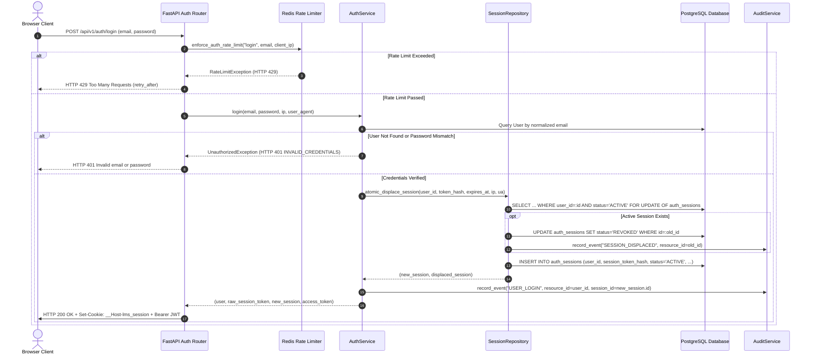
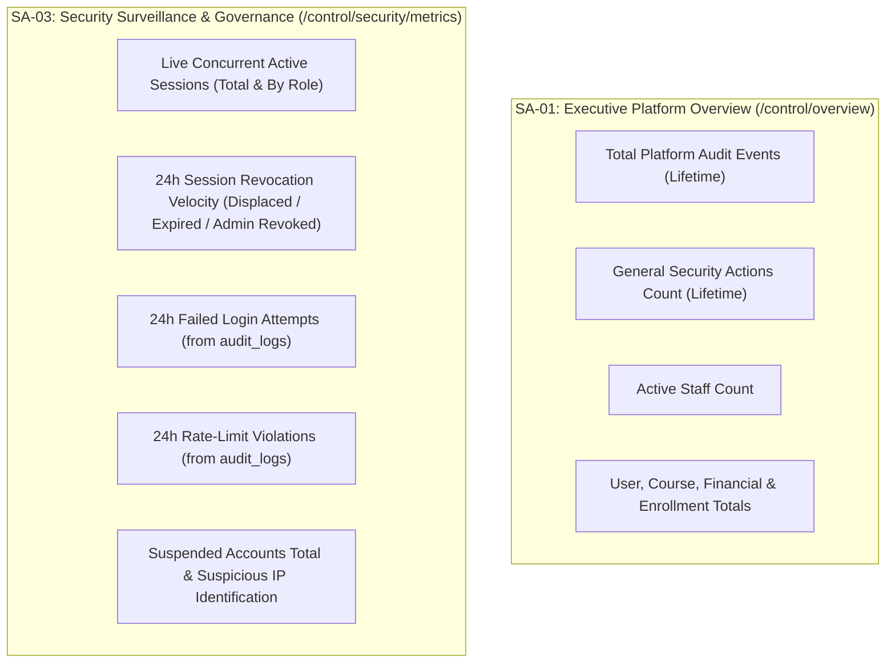
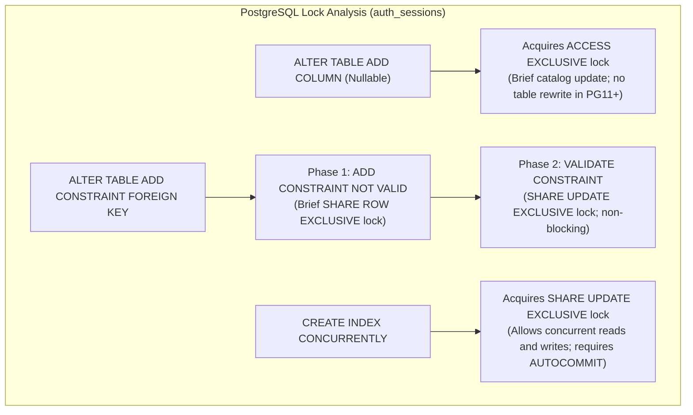

# SA-03: Security Governance & Session Management — Architecture Specification

- **Module**: SA-03 — Security Governance & Session Management
- **Platform**: Single-Instructor Learning Management System (LMS)
- **Lifecycle Phase**: Super Admin Platform Governance
- **Document Version**: 2.1.0
- **Status**: FINAL SPECIFICATION — AWAITING PROJECT OWNER SIGN-OFF
- **Author**: Principal Application Security Architect, Senior Backend Engineer, Frontend Architect, Database Security Engineer, and Security QA Specialist
- **Specification Source**: `Single_Instructor_LMS_Blueprint_v2_Detailed_Specification(1).pdf` [Blueprint v2.0, Pages 1–16]
- **Target Audience**: Platform Owner / Super Admin, Engineering Team, Security Auditors

---

## 1. Executive Summary

### 1.1 Mission & Scope
The Single-Instructor LMS is a proprietary educational platform operating under the commercial model:
$$\text{ONE INSTRUCTOR} \longrightarrow \text{ONE BRAND} \longrightarrow \text{MULTIPLE COURSES} \longrightarrow \text{MULTIPLE STUDENTS} \longrightarrow \text{DIRECT SALES}$$

As the platform scales to support concurrent students, teaching assistants, administrators, and the primary instructor, security governance becomes the critical operational backbone. The Super Admin requires centralized surveillance, containment, and auditing capabilities to protect intellectual property (course videos, proprietary curriculum, student data), financial transactions, and credential integrity.

**SA-03: Security Governance & Session Management** defines the complete architectural blueprint to empower the Super Admin with:
1. **Live Session Surveillance & Governance**: Real-time visibility into all active, revoked, and expired sessions across students, staff, and administrators.
2. **Targeted & Emergency Session Containment**: Instant programmatic revocation of individual sessions, all sessions for a specific user, or emergency revocation of all other active sessions during suspected security incidents.
3. **Security Incident & Threat Metrics**: Authoritative real-time metrics tracking active concurrent sessions, displaced sessions, failed authentication attempts, rate-limit triggers, and account suspensions with zero data fabrication.
4. **Hardened Audit Trail Querying & Correlation**: Enhanced inspection and forensic attribution across immutable audit logs, linking client IP addresses, user agents, request identifiers, and session tokens.
5. **Fail-Closed RBAC & Privilege Safeguards**: Strict enforcement ensuring session surveillance and revocation capabilities are restricted by default strictly to the Super Admin (`ROLE_SUPER_ADMIN`), with zero unauthorized exposure of student IP addresses or user-agent details to operational administrators.

### 1.2 Operating Principles
* **Single-Active-Session Invariant**: At most one active session is permitted per user account across all devices. A new login atomically displaces and revokes any prior active session [Blueprint v2.0, Page 8].
* **Zero Fabricated Claims or Mock Data**: All metrics, session states, and audit trails must be computed from verified database records.
* **Deny-Overrides-Allow & Fail-Closed**: Inactive, suspended, or revoked credentials immediately reject requests before resource logic executes.
* **Cryptographic & Append-Only Non-Repudiation**: Audit logs are permanently protected against UPDATE, DELETE, and TRUNCATE operations by PostgreSQL database triggers.
* **Zero New Unapproved Dependencies**: SA-03 leverages existing approved backend (FastAPI, SQLAlchemy 2.0, PostgreSQL 18, Alembic, Redis RESP) and frontend (Next.js 15, TanStack Query v5, Tailwind CSS, Lucide) dependencies.

---

## 2. Existing Security Architecture

### 2.1 Cryptographic Standards & Credential Management
* **Password Hashing**: Implemented in [`backend/app/core/security.py`](file:///Users/priyansh/lms/backend/app/core/security.py#L40-L75) via `argon2-cffi` (Argon2id profile: 64MB memory cost, 3 iterations, 4 parallelism threads). Plaintext passwords are never persisted, logged, or returned in API responses.
* **Token Hashing**: All sensitive session identifiers, email verification tokens, password reset tokens, and staff onboarding tokens are hashed via SHA-256 before database persistence. Only cryptographic hex digests (`VARCHAR(64)`) are stored in `auth_sessions.session_token_hash` and `auth_tokens.token_hash`.
* **Random Token Generation**: Secure tokens are generated using Python's `secrets.token_urlsafe(32)`, providing 256 bits of entropy.

### 2.2 Transport Security & Cookie Architecture
* **Dual-Token Model**:
  1. **Primary Session Cookie**: Issued as RFC 6265bis compliant cookie:
     * Name: `__Host-lms_session` (in production/HTTPS) or `lms_session` (configured via `SESSION_COOKIE_NAME`).
     * Flags: `HttpOnly=True`, `Secure=True` (strictly enforced for `__Host-` prefixes), `SameSite=Lax`, `Path=/`, `Max-Age=604800` (7 days).
     * Accessible exclusively to the browser HTTP network layer; completely inaccessible to client JavaScript (XSS mitigation).
  2. **Short-Lived Access Token**: Issued as a signed HS256 JWT:
     * Lifetime: 900 seconds (15 minutes).
     * Claims: `sub` (User UUID), `roles` (list of assigned role IDs), `email`, `session_id` (AuthSession UUID).
     * Bound to Database Session: As verified in [`backend/app/api/deps.py`](file:///Users/priyansh/lms/backend/app/api/deps.py#L88-L126), incoming Bearer tokens are validated against `auth_sessions` in the database to verify the session remains `ACTIVE` and has not been revoked or expired.

### 2.3 Access Control & RBAC
* **5 Canonical System Roles**: Defined in [`backend/app/models/user.py`](file:///Users/priyansh/lms/backend/app/models/user.py#L22-L28):
  * `VISITOR`: Public guest or lead browsing public course previews.
  * `STUDENT`: Paying student enrolled in courses.
  * `STAFF`: Operations staff / teaching assistant (grading, QA).
  * `ADMIN`: Platform administrator (courses, media, users).
  * `SUPER_ADMIN`: Primary Instructor / Platform Owner (full authority).
* **Role Mappings & Multi-Role Union**: User roles are maintained in junction table `user_roles`. Permissions are aggregated across all assigned roles.
* **Deny-Overrides-Allow Invariant**: If `user.is_active is False`, [`backend/app/api/deps.py`](file:///Users/priyansh/lms/backend/app/api/deps.py#L134-L138) raises HTTP 403 `ACCOUNT_SUSPENDED` prior to evaluating any role permissions.
* **Sole Super Admin Protection Invariant**: The system prohibits demoting or suspending the sole active Super Admin, guarded by row-level locking in [`backend/app/services/user_service.py`](file:///Users/priyansh/lms/backend/app/services/user_service.py#L608-L620).

### 2.4 Abuse Prevention & Rate Limiting
* **Redis Fixed-Window Limiter**: Implemented in [`backend/app/core/rate_limit.py`](file:///Users/priyansh/lms/backend/app/core/rate_limit.py#L38-L128) using direct Redis RESP protocol and atomic Lua script execution.
* **Rate Limit Policies**:
  * `login`: 5 attempts / 15 min per identifier (email); 20 attempts / 15 min per client IP.
  * `register`: 3 attempts / 1 hour per identifier; 10 attempts / 1 hour per client IP.
  * `password_reset`: 3 attempts / 1 hour per identifier; 10 attempts / 1 hour per client IP.
  * `email_verify`: 10 attempts / 15 min per identifier; 30 attempts / 15 min per client IP.
  * `resend_verification`: 1 attempt / 3 min per identifier; 10 attempts / 1 hour per client IP.

---

## 3. Authentication Lifecycle

The following sequence details how credentials transition into authenticated sessions across all entry points:



### 3.1 Authentication Workflows
1. **Local Password Login**: Handled by [`AuthService.login`](file:///Users/priyansh/lms/backend/app/services/auth_service.py#L182-L280). Validates Argon2id hash, executes `atomic_displace_session`, records `SESSION_DISPLACED` (if applicable), records `USER_LOGIN`, sets session cookie and returns access token.
2. **Google OAuth / OIDC Login**: Handled by [`AuthService.google_oauth_authenticate`](file:///Users/priyansh/lms/backend/app/services/auth_service.py#L626-L732). Verifies JWT signature against Google JWKS (`https://www.googleapis.com/oauth2/v3/certs`), validates audience and issuer, matches or provisions user with `STUDENT` role, executes atomic displacement, and records `USER_OAUTH_LOGIN`.
3. **Staff Onboarding Claim**: Handled by [`UserService.claim_staff_onboarding`](file:///Users/priyansh/lms/backend/app/services/user_service.py#L521-L586). Validates 48-hour onboarding token, sets user password, consumes token, executes atomic displacement, and records `STAFF_ONBOARDED`.
4. **Password Reset Confirmation**: Handled by [`AuthService.confirm_password_reset`](file:///Users/priyansh/lms/backend/app/services/auth_service.py#L509-L570). Consumes token, updates password hash, revokes **ALL** active sessions for the user (`session_repo.revoke_all_user_sessions`), and records `PASSWORD_RESET_COMPLETED`.
5. **Logout**: Handled by [`AuthService.logout`](file:///Users/priyansh/lms/backend/app/services/auth_service.py#L282-L342). Hashes incoming raw session token, marks session status `REVOKED`, records `USER_LOGOUT`, and clears cookie.

---

## 4. Session Lifecycle, Revocation Metadata & Role Invalidation

### 4.1 Single-Active-Session Invariant
The platform enforces a strict single-active-session invariant [Blueprint v2.0, Page 8]:
$$\forall u \in \text{Users}, \quad \left| \{ s \in \text{AuthSessions} \mid s.\text{user\_id} = u.\text{id} \land s.\text{status} = \text{'ACTIVE'} \} \right| \le 1$$

### 4.2 Tripartite Defense Mechanism
This invariant is enforced at three distinct layers:
1. **Application-Level Row Lock**: In [`SessionRepository.atomic_displace_session`](file:///Users/priyansh/lms/backend/app/repositories/session_repo.py#L104-L115), existing active sessions are locked using `SELECT ... WHERE user_id = :uid AND status = 'ACTIVE' FOR UPDATE OF auth_sessions` with `noload(AuthSession.user)` to avoid outer join locking limitations.
2. **Transaction Serialization**: The existing active session is updated to `status = 'REVOKED'` and flushed to the transaction before the new session is inserted.
3. **PostgreSQL Partial Unique Index**: Enforced in [`backend/migrations/versions/20261115_0130_e59a7c3b1f2d_create_identity_and_auth_tables.py`](file:///Users/priyansh/lms/backend/migrations/versions/20261115_0130_e59a7c3b1f2d_create_identity_and_auth_tables.py#L203-L209):
   ```sql
   CREATE UNIQUE INDEX idx_auth_sessions_unique_active_user
   ON auth_sessions (user_id)
   WHERE status = 'ACTIVE';
   ```
   Any concurrent transaction attempting to insert a second active session fails immediately with a PostgreSQL `IntegrityError`.

### 4.3 Session Revocation Metadata Specification
To provide complete forensic visibility into why and by whom a session was terminated, table `auth_sessions` is extended with three explicit metadata columns:
1. `revoked_at` (`TIMESTAMPTZ`, NULLABLE): UTC timestamp when revocation occurred.
2. `revoked_by` (`UUID`, NULLABLE, FK `users.id` ON DELETE SET NULL): Actor UUID who authorized or triggered the revocation. Supports `NULL` for system-triggered or anonymous revocations.
3. `revocation_reason` (`VARCHAR(255)`, NULLABLE): Canonical structured reason code and optional justification string.

#### Scenario Population Matrix

| Revocation Trigger | `status` | `revoked_at` | `revoked_by` | `revocation_reason` |
| :--- | :--- | :--- | :--- | :--- |
| **User Voluntary Logout** | `REVOKED` | `utc_now()` | `auth_session.user_id` | `"USER_LOGOUT"` |
| **Login Displacement** | `REVOKED` | `utc_now()` | `user_id` | `"LOGIN_DISPLACEMENT"` |
| **Account Suspension** | `REVOKED` | `utc_now()` | `actor_id` (Admin UUID) | `"ACCOUNT_SUSPENDED: " + (reason or "Administrative suspension")` |
| **Password Reset** | `REVOKED` | `utc_now()` | `user_id` | `"PASSWORD_RESET_COMPLETED"` |
| **Super Admin Manual Revocation** | `REVOKED` | `utc_now()` | `current_user.id` | `"ADMIN_REVOKED: " + payload.reason` |
| **Emergency Revocation (All Others)** | `REVOKED` | `utc_now()` | `current_user.id` | `"EMERGENCY_GLOBAL_REVOCATION: " + payload.reason` |
| **Administrative Role Demotion** | `REVOKED` | `utc_now()` | `actor_id` (Admin UUID) | `"PRIVILEGE_DEMOTION: " + role_id + "_REVOKED"` |
| **TTL Expiration (Automated)** | `EXPIRED` | `NULL` | `NULL` | `NULL` (Status is `EXPIRED`, not `REVOKED`) |

#### Terminal-State & Idempotency Rules
* **Terminal Invariant**: `REVOKED` and `EXPIRED` are terminal states. Once a session enters either state, it can never transition back to `ACTIVE` or be overwritten.
* **Idempotency Guard**: All database updates modifying session status to `REVOKED` MUST include the predicate:
  ```sql
  WHERE status = 'ACTIVE'
  ```
  If an operation targets a session that is already `REVOKED` or `EXPIRED`, zero rows are modified, preserving original `revoked_at`, `revoked_by`, and `revocation_reason` values without silent corruption or timestamp overwriting.

### 4.4 Role Change Session Invalidation Rules
In [`UserService.manage_user_role()`](file:///Users/priyansh/lms/backend/app/services/user_service.py#L646-L712), changing user roles alters the privilege boundary. Because [`backend/app/api/deps.py`](file:///Users/priyansh/lms/backend/app/api/deps.py#L128) dynamically re-fetches the user and their assigned roles from the database on every authenticated request, the session invalidation strategy is strictly differentiated:

1. **Privilege-Increasing Role Assignment (Elevation)**:
   * *Example*: Student granted `STAFF` or `ADMIN`.
   * *Session Behavior*: Existing active sessions are **PRESERVED** (`status` remains `ACTIVE`).
   * *Rationale*: The next incoming request will immediately evaluate the newly assigned permissions. Terminating the session would abruptly disrupt legitimate administrative onboarding or active student learning without a security benefit.
2. **Privilege-Reducing Role Demotion (Demotion)**:
   * *Example*: Revoking `ADMIN`, `STAFF`, or `SUPER_ADMIN` roles from an account.
   * *Session Behavior*: Atomically **REVOKE ALL ACTIVE SESSIONS** for the target user via `SessionRepository.revoke_all_user_sessions()`.
   * *Metadata*: `revoked_at = utc_now()`, `revoked_by = actor_id`, `revocation_reason = f"PRIVILEGE_DEMOTION: {role_id}_REVOKED"`.
   * *Rationale*: Prevents privilege residue, session fixation, and continued access to sensitive management endpoints via cached client-side SPA state. The demoted user must re-authenticate under their lower privilege level.
3. **Non-Administrative Role Adjustments**:
   * *Example*: Adjusting student progress flags or visitor roles.
   * *Session Behavior*: Existing active sessions are **PRESERVED**.
4. **Preserved Invariants During Role Management**:
   * Sole Super Admin protection (cannot demote the sole active Super Admin).
   * Single-active-session invariant maintained across all role transitions.
   * Atomic transaction boundary: role removal, session revocation, and audit logging commit together or roll back on error.

### 4.5 Activity Throttling
To prevent write-amplification on database IO during frequent page navigation, [`SessionRepository.touch_last_active`](file:///Users/priyansh/lms/backend/app/repositories/session_repo.py#L241-L270) throttles `last_active_at` updates. The timestamp is only updated if at least 300 seconds (5 minutes) have elapsed since the prior recorded activity.

---

## 5. Audit Architecture & Session-Level Audit Correlation

### 5.1 Append-Only Immutability Guarantees
Audit logging is established in table `audit_logs` created by [`backend/migrations/versions/20261115_0023_56068b4ebfb3_create_audit_logs_table.py`](file:///Users/priyansh/lms/backend/migrations/versions/20261115_0023_56068b4ebfb3_create_audit_logs_table.py#L38-L142).

To guarantee non-repudiation and prevent tampering by any compromised application process, PostgreSQL triggers strictly prohibit modifications:
```sql
CREATE OR REPLACE FUNCTION trg_audit_logs_prevent_mutation()
RETURNS TRIGGER AS $$
BEGIN
    RAISE EXCEPTION 'Security Policy Violation: audit_logs records are strictly immutable. % operations are prohibited.', TG_OP
        USING ERRCODE = 'integrity_constraint_violation';
END;
$$ LANGUAGE plpgsql;

CREATE TRIGGER trg_audit_logs_prevent_update
BEFORE UPDATE ON audit_logs
FOR EACH ROW EXECUTE FUNCTION trg_audit_logs_prevent_mutation();

CREATE TRIGGER trg_audit_logs_prevent_delete
BEFORE DELETE ON audit_logs
FOR EACH ROW EXECUTE FUNCTION trg_audit_logs_prevent_mutation();

CREATE TRIGGER trg_audit_logs_prevent_truncate
BEFORE TRUNCATE ON audit_logs
FOR EACH STATEMENT EXECUTE FUNCTION trg_audit_logs_prevent_mutation();
```

### 5.2 Session-Level Audit Correlation Strategy
An architectural audit of existing records in `audit_logs` reveals that generic domain actions (such as course revisions, lesson updates, grading submissions, and order placements) record `actor_id` (User UUID), `request_id`, `ip_address`, and `user_agent`, but **do not possess a dedicated `session_id` foreign key column**.

Only explicit authentication events reliably store session identifiers:
* `USER_LOGIN`: stores `metadata={"session_id": str(new_session.id)}`.
* `SESSION_DISPLACED`: stores `resource_type="auth_session"`, `resource_id=str(displaced.id)`, and `metadata={"displaced_by_session_id": str(new_session.id)}`.
* `USER_LOGOUT`: stores `resource_type="auth_session"`, `resource_id=str(session.id)`.
* Proposed `ADMIN_SESSION_REVOKED`: stores `resource_type="auth_session"`, `resource_id=str(session.id)`.

#### Correlation Hierarchy for Session Investigation
When investigating a session in the Super Admin console, the system applies a reliable 3-tier correlation query:
1. **Tier 1 (Direct Entity Match)**: Audit records where `resource_type = 'auth_session'` AND `resource_id = str(session_id)`.
2. **Tier 2 (Metadata Match)**: Audit records where `metadata->>'session_id' = str(session_id)`.
3. **Tier 3 (Forensic Time-Window Match)**: Audit records where `actor_id = session.user_id` AND `created_at` falls within the session active interval:
   $$\text{created\_at} \in [\text{session.created\_at}, \; \text{COALESCE}(\text{session.revoked\_at}, \, \text{session.expires\_at})]$$

*Honest Architectural Constraint*: Generic application audit events are correlated to a session via the Tier 3 time-window and client IP/UA match. Full relational foreign-key session attribution across all platform logs would require adding a nullable `session_id` column to `audit_logs`, which is deferred to preserve audit table trigger stability.

---

## 6. Existing API Inventory (Security, Auth, Audit & Control)

The following table details all existing endpoints related to authentication, user governance, audit trail, and platform control:

| Method | Path | Authentication / Permissions | Request Body | Response Model / Status | Audit Action Logged |
| :--- | :--- | :--- | :--- | :--- | :--- |
| `POST` | `/api/v1/auth/register` | Public (Rate Limited) | `UserRegisterRequest` | `MessageResponse` (201) | `USER_REGISTERED` |
| `POST` | `/api/v1/auth/login` | Public (Rate Limited) | `UserLoginRequest` | `LoginResponse` (200) + Cookie | `USER_LOGIN`, `SESSION_DISPLACED` |
| `POST` | `/api/v1/auth/logout` | Session Cookie | None | `MessageResponse` (200) | `USER_LOGOUT` |
| `GET` | `/api/v1/auth/me` | Authenticated | None | `UserResponse` (200) | None |
| `POST` | `/api/v1/auth/verify-email` | Public (Rate Limited) | `VerifyEmailRequest` | `MessageResponse` (200) | `EMAIL_VERIFIED` |
| `POST` | `/api/v1/auth/resend-verification` | Public (Rate Limited) | `ResendVerificationRequest` | `MessageResponse` (200) | None |
| `POST` | `/api/v1/auth/password-reset/request` | Public (Rate Limited) | `PasswordResetRequest` | `MessageResponse` (200) | `PASSWORD_RESET_REQUESTED` |
| `POST` | `/api/v1/auth/password-reset/confirm` | Public (Rate Limited) | `PasswordResetConfirmRequest` | `MessageResponse` (200) | `PASSWORD_RESET_COMPLETED` |
| `POST` | `/api/v1/auth/oauth/google` | Public | `GoogleOAuthRequest` | `LoginResponse` (200) + Cookie | `USER_OAUTH_LOGIN`, `SESSION_DISPLACED` |
| `POST` | `/api/v1/auth/onboarding/claim` | Public | `StaffOnboardingClaimRequest` | `LoginResponse` (200) + Cookie | `STAFF_ONBOARDED`, `SESSION_DISPLACED` |
| `GET` | `/api/v1/users` | `users:view_all` | Query Params | `UserDirectoryResponse` (200) | None |
| `GET` | `/api/v1/users/{id}` | Self or `users:view` | None | `UserProfileResponse` (200) | None |
| `PATCH` | `/api/v1/users/{id}/status` | `users:manage_status` | `UserStatusUpdateRequest` | `UserProfileResponse` (200) | `USER_STATUS_UPDATED` |
| `PATCH` | `/api/v1/users/{id}/roles` | `roles:assign` | `UserRoleUpdateRequest` | `UserProfileResponse` (200) | `ROLE_ASSIGNED` / `ROLE_REVOKED` |
| `POST` | `/api/v1/users/staff/invite` | `staff:invite` | `StaffInviteRequest` | `dict` (201) | `STAFF_INVITED` / `STAFF_ROLE_ASSIGNED` |
| `GET` | `/api/v1/audit-logs` | `audit:view` | Query Params | `AuditLogListResponse` (200) | None (Read-only) |
| `GET` | `/api/v1/control/overview` | `ROLE_SUPER_ADMIN` | None | `ControlOverviewResponse` (200) | None (Read-only) |

---

## 7. Existing Database Schema Inventory

### 7.1 Table: `auth_sessions`
Defined in [`backend/app/models/auth_session.py`](file:///Users/priyansh/lms/backend/app/models/auth_session.py) & migration `20261115_0130_e59a7c3b1f2d`:
* `id` (`UUID`, PK, `gen_random_uuid()`)
* `user_id` (`UUID`, FK `users.id` ON DELETE CASCADE, NOT NULL)
* `session_token_hash` (`VARCHAR(64)`, UNIQUE, NOT NULL) — SHA-256 hex digest
* `ip_address` (`VARCHAR(45)`, NULLABLE) — IPv4 or IPv6 string
* `user_agent` (`VARCHAR(512)`, NULLABLE) — Client browser header
* `status` (`VARCHAR(16)`, NOT NULL, DEFAULT `'ACTIVE'`) — Constraints: `'ACTIVE'`, `'REVOKED'`, `'EXPIRED'`
* `last_active_at` (`TIMESTAMPTZ`, NOT NULL, DEFAULT `now()`) — Throttled activity timestamp
* `expires_at` (`TIMESTAMPTZ`, NOT NULL) — Hard expiration timestamp
* `created_at` (`TIMESTAMPTZ`, NOT NULL, DEFAULT `now()`)
* **Existing Indexes**:
  * `pk_auth_sessions` PRIMARY KEY (`id`)
  * `ix_auth_sessions_session_token_hash` UNIQUE (`session_token_hash`)
  * `ix_auth_sessions_user_id` (`user_id`)
  * `ix_auth_sessions_user_status` (`user_id`, `status`)
  * `ix_auth_sessions_expires_at` (`expires_at`)
  * `idx_auth_sessions_unique_active_user` UNIQUE (`user_id`) WHERE `status = 'ACTIVE'`

### 7.2 Table: `auth_tokens`
Defined in [`backend/app/models/auth_token.py`](file:///Users/priyansh/lms/backend/app/models/auth_token.py) & migration `20261115_0130_e59a7c3b1f2d`:
* `id` (`UUID`, PK, `gen_random_uuid()`)
* `user_id` (`UUID`, FK `users.id` ON DELETE CASCADE, NOT NULL)
* `token_hash` (`VARCHAR(64)`, UNIQUE, NOT NULL) — SHA-256 hex digest
* `token_type` (`VARCHAR(32)`, NOT NULL) — `'EMAIL_VERIFICATION'`, `'PASSWORD_RESET'`, `'STAFF_ONBOARDING'`
* `is_used` (`BOOLEAN`, NOT NULL, DEFAULT `FALSE`)
* `expires_at` (`TIMESTAMPTZ`, NOT NULL)
* `created_at` (`TIMESTAMPTZ`, NOT NULL, DEFAULT `now()`)
* **Existing Indexes**:
  * `ix_auth_tokens_token_hash` UNIQUE (`token_hash`)
  * `ix_auth_tokens_user_id` (`user_id`)
  * `ix_auth_tokens_hash_type_used` (`token_hash`, `token_type`, `is_used`)
  * `ix_auth_tokens_user_type` (`user_id`, `token_type`)
  * `ix_auth_tokens_expires_at` (`expires_at`)

### 7.3 Table: `audit_logs`
Defined in [`backend/app/models/audit_log.py`](file:///Users/priyansh/lms/backend/app/models/audit_log.py) & migration `20261115_0023_56068b4ebfb3`:
* `id` (`UUID`, PK, `gen_random_uuid()`)
* `actor_id` (`UUID`, FK `users.id` ON DELETE SET NULL, NULLABLE)
* `actor_type` (`VARCHAR(32)`, NOT NULL, DEFAULT `'SYSTEM'`) — `'STUDENT'`, `'STAFF'`, `'ADMIN'`, `'SUPER_ADMIN'`, `'SYSTEM'`
* `action` (`VARCHAR(64)`, NOT NULL) — Standard verb e.g. `USER_LOGIN`, `USER_STATUS_UPDATED`
* `resource_type` (`VARCHAR(64)`, NOT NULL) — Target e.g. `'user'`, `'auth_session'`, `'course'`
* `resource_id` (`VARCHAR(64)`, NULLABLE)
* `before_state` (`JSONB`, NULLABLE)
* `after_state` (`JSONB`, NULLABLE)
* `metadata` (`JSONB`, NOT NULL, DEFAULT `'{}'`)
* `request_id` (`VARCHAR(64)`, NULLABLE)
* `ip_address` (`VARCHAR(45)`, NULLABLE)
* `user_agent` (`VARCHAR(512)`, NULLABLE)
* `created_at` (`TIMESTAMPTZ`, NOT NULL, DEFAULT `now()`)
* **Existing Indexes**:
  * `pk_audit_logs` PRIMARY KEY (`id`)
  * `ix_audit_logs_actor_id_created_at` (`actor_id`, `created_at DESC`)
  * `ix_audit_logs_resource_created_at` (`resource_type`, `resource_id`, `created_at DESC`)
  * `ix_audit_logs_action_created_at` (`action`, `created_at DESC`)
  * `ix_audit_logs_request_id` (`request_id`)
  * `ix_audit_logs_created_at` (`created_at DESC`)

---

## 8. Security Metrics Demarcation: SA-01 Overview vs SA-03 Surveillance

To avoid duplicated or contradictory calculations, a clear architectural line of demarcation separates SA-01 platform overview metrics from SA-03 technical security surveillance metrics:



### 8.1 Metric Definitions & Query Matrix

| Metric Identifier | Endpoint Owner | Time Window | Source & Query Logic | Handling of Incomplete / Empty Data |
| :--- | :--- | :--- | :--- | :--- |
| `total_audit_events` | SA-01 | Lifetime | `COUNT(audit_logs.id)` | Returns `0` if empty |
| `security_events_count` | SA-01 | Lifetime | `COUNT(audit_logs.id) WHERE action IN (SECURITY_ACTIONS)` | Returns `0` if empty |
| `active_staff_count` | SA-01 | Real-time | `COUNT(users.id) JOIN user_roles WHERE role='STAFF' AND is_active=true` | Returns `0` if empty |
| `active_sessions_total` | **SA-03** | Real-time | `COUNT(id) FROM auth_sessions WHERE status='ACTIVE' AND expires_at > NOW()` | Returns `0` if empty |
| `active_sessions_by_role` | **SA-03** | Real-time | `COUNT(s.id) FROM auth_sessions s JOIN user_roles ur ON ur.user_id=s.user_id WHERE s.status='ACTIVE' GROUP BY ur.role_id` | Returns map with `0` for missing roles |
| `sessions_revoked_24h` | **SA-03** | Rolling 24h | `COUNT(id) FROM auth_sessions WHERE status='REVOKED' AND revoked_at >= NOW() - INTERVAL '24 HOURS'` | Returns `0` if empty |
| `sessions_displaced_24h`| **SA-03** | Rolling 24h | `COUNT(id) FROM audit_logs WHERE action='SESSION_DISPLACED' AND created_at >= NOW() - INTERVAL '24 HOURS'` | Returns `0` if empty |
| `sessions_expired_24h` | **SA-03** | Rolling 24h | `COUNT(id) FROM auth_sessions WHERE status='EXPIRED' AND expires_at >= NOW() - INTERVAL '24 HOURS'` | Returns `0` if empty |
| `failed_logins_24h` | **SA-03** | Rolling 24h | `COUNT(id) FROM audit_logs WHERE action='AUTH_LOGIN_FAILED' AND created_at >= NOW() - INTERVAL '24 HOURS'` | Returns `0` if no failures recorded |
| `rate_limit_breaches_24h`| **SA-03** | Rolling 24h | `COUNT(id) FROM audit_logs WHERE action='AUTH_RATE_LIMIT_EXCEEDED' AND created_at >= NOW() - INTERVAL '24 HOURS'` | Returns `0` if no breaches recorded |
| `suspended_accounts_total`| **SA-03** | Real-time | `COUNT(id) FROM users WHERE is_active = FALSE` | Returns `0` if none |

---

## 9. Identified Architecture & Functional Gaps

### Gap 1: Failed Logins Are Not Audited
* **Location**: [`backend/app/services/auth_service.py`](file:///Users/priyansh/lms/backend/app/services/auth_service.py#L198-L215)
* **Root Cause**: `auth_service.login` raises `UnauthorizedException(INVALID_CREDENTIALS)` immediately on password mismatch or missing email. Zero audit records are created.
* **Risk**: Super Admin cannot detect brute force password guessing or distributed credential stuffing.

### Gap 2: Rate-Limit Rejections Are Not Audited
* **Location**: [`backend/app/core/rate_limit.py`](file:///Users/priyansh/lms/backend/app/core/rate_limit.py#L127-L128)
* **Root Cause**: Redis limiter raises `RateLimitException` directly without persisting an audit record.
* **Risk**: Super Admin has no historical forensic evidence of automated scraping or brute force attacks after transient Redis keys expire.

### Gap 3: Missing Admin Session Query API
* **Location**: `backend/app/api/v1/control.py`, `backend/app/repositories/session_repo.py`
* **Root Cause**: `SessionRepository` lacks `list_sessions()` with pagination, user search, and status filtering. No endpoint exists under `/api/v1/control/sessions`.

### Gap 4: Missing Admin Session Revocation Endpoints
* **Location**: `backend/app/api/v1/control.py`, `backend/app/services/auth_service.py`
* **Root Cause**: No administrative endpoint allows a Super Admin to terminate an individual session, all sessions for a specific user, or all other active sessions during an incident.

### Gap 5: Absence of Revocation Metadata in `auth_sessions`
* **Location**: `backend/app/models/auth_session.py`
* **Root Cause**: Table `auth_sessions` lacks `revoked_at`, `revoked_by`, and `revocation_reason` columns.

### Gap 6: Missing IP Address Filter in Audit Log API
* **Location**: [`backend/app/repositories/audit_repo.py`](file:///Users/priyansh/lms/backend/app/repositories/audit_repo.py#L85-L155), [`backend/app/api/v1/audit.py`](file:///Users/priyansh/lms/backend/app/api/v1/audit.py#L45-L75)
* **Root Cause**: Table `audit_logs` contains `ip_address VARCHAR(45)`, but `AuditRepository.list_logs` and endpoint `GET /api/v1/audit-logs` do not accept an `ip_address` filter parameter.

### Gap 7: Missing Single Audit Log Lookup Endpoint
* **Location**: `backend/app/api/v1/audit.py`
* **Root Cause**: `AuditRepository.get_by_id` exists in source code, but is not exposed via `GET /api/v1/audit-logs/{id}`.

### Gap 8: Frontend Audit Filter Exact Match Flaw
* **Location**: [`src/app/(control)/control/audit/page.tsx`](file:///Users/priyansh/lms/src/app/(control)/control/audit/page.tsx#L28-L36)
* **Root Cause**: The filter passes input directly to `action` without case normalization or partial matching, returning zero records when typing lowercase "login".

### Gap 9: Missing Security & Session Governance UI
* **Location**: `src/app/(control)/control/`
* **Root Cause**: No `/control/sessions` route exists in the frontend, and no navigation link exists in `StaffAdminSidebar.tsx`.

---

## 10. Threat and Risk Assessment

| Threat Vector | Severity | Likelihood | Threat Description | Architectural Mitigation (SA-03) |
| :--- | :--- | :--- | :--- | :--- |
| **Credential Stuffing & Brute Force** | CRITICAL | HIGH | Automated botnets spray known email/password combinations against `/api/v1/auth/login`. | Redis dual-rate limiting (identifier + IP) + unified Redis-suppressed `AUTH_LOGIN_FAILED` audit logging. |
| **Session Hijacking & Cookie Theft** | HIGH | MEDIUM | Attacker steals active session token via network interception, malware, or client compromise. | `__Host-` cookie prefixes, `HttpOnly`, `SameSite=Lax`, single-active-session displacement, throttled activity timestamps, and Super Admin instant session revocation. |
| **Privilege Escalation via Stale Admin Sessions** | CRITICAL | LOW | Demoted or removed administrator retains an active session to access restricted student/financial records. | Automatic atomic revocation of all active sessions upon administrative role demotion (`manage_user_role`). |
| **Audit Trail Tampering (Insider Threat)** | CRITICAL | LOW | Malicious administrator or compromised process attempts to delete logs of unauthorized exports or grade tampering. | PostgreSQL database triggers (`BEFORE UPDATE/DELETE/TRUNCATE`) strictly prevent modification, regardless of database permissions. |
| **Audit Log Storage Exhaustion / DoS** | MEDIUM | MEDIUM | Attacker intentionally generates millions of failed login attempts to fill PostgreSQL disk space with audit log records. | Redis-backed audit suppression: max 1 audit write per (email, IP) pair per 60s; subsequent attempts tracked in Redis counters. |
| **Sole Super Admin Lockout** | CRITICAL | LOW | Super Admin accidentally revokes own session during emergency platform containment. | Explicit "Revoke All Other Sessions" operation preserving caller session; row-level locked invariant guarding the sole active Super Admin. |

---

## 11. Submodule Breakdown (SA-03.1 through SA-03.8)

### SA-03.1: Security & Session Domain Schema Evolution
* **Objective**: Enhance `auth_sessions` and database indexes to natively capture revocation provenance without breaking existing single-active-session invariants.
* **Components**:
  * Alembic migration adding `revoked_at` (`TIMESTAMPTZ`, NULLABLE), `revoked_by` (`UUID`, NULLABLE, FK `users.id` ON DELETE SET NULL), and `revocation_reason` (`VARCHAR(255)`, NULLABLE) to `auth_sessions`.
  * Index `ix_auth_sessions_status_created_at` on `(status, created_at DESC)`.
  * Index `ix_auth_sessions_ip_address` on `(ip_address)` WHERE `ip_address IS NOT NULL`.
  * Index `ix_audit_logs_ip_address` on `(ip_address)` WHERE `ip_address IS NOT NULL`.
  * Update SQLAlchemy model `AuthSession` in [`backend/app/models/auth_session.py`](file:///Users/priyansh/lms/backend/app/models/auth_session.py).

### SA-03.2: Session Repository & Query Services
* **Objective**: Implement administrative query capabilities for active, revoked, and expired sessions.
* **Components**:
  * Extend `SessionRepository` with `list_sessions(session, status, user_id, role, ip_address, search, date_from, date_to, sort_by, sort_order, page, per_page)`.
  * Implement `get_session_by_id(session, session_id)` joining user details and assigned roles.
  * Pydantic schemas: `SessionItemResponse`, `SessionListResponse`, `SessionDetailResponse`.

### SA-03.3: Super Admin Session Revocation Engine
* **Objective**: Build atomic, audit-tracked revocation services for individual, user-level, and emergency global sessions.
* **Components**:
  * `revoke_session_admin(session, session_id, reason, actor_id, ip, ua)`: Revokes target session with idempotency check (`WHERE status = 'ACTIVE'`).
  * `revoke_user_sessions_admin(session, target_user_id, reason, actor_id, ip, ua)`: Revokes all active sessions for a specific user.
  * `revoke_other_active_sessions_admin(session, reason, caller_session_id, caller_id, ip, ua)`: Emergency containment revoking all other active sessions while strictly preserving the verified server-authenticated caller session.
  * Integrate automatic session revocation into `UserService.manage_user_role()` on administrative privilege demotion.

### SA-03.4: Security Metrics & Surveillance Service
* **Objective**: Aggregate authoritative, verified real-time platform security metrics.
* **Components**:
  * Implement `SecurityGovernanceService.get_security_metrics(session)` delivering exact metrics defined in Section 8.
  * Expose `GET /api/v1/control/security/metrics` strictly to `ROLE_SUPER_ADMIN`.

### SA-03.5: Failed Authentication & Abuse Auditing (Privacy-Safe Redis Policy & Counter Lifecycle)
* **Objective**: Record failed login attempts and rate-limit violations in `audit_logs` with protective anti-flooding guardrails and strict identifier privacy.
* **Separation of Concerns**:
  * **Authentication Rate Limiting**: Enforced independently in [`backend/app/core/rate_limit.py`](file:///Users/priyansh/lms/backend/app/core/rate_limit.py) (5 attempts/15m per email; 20 attempts/15m per IP). Returns HTTP 429.
  * **Audit Event Suppression**: Governs database write frequency to PostgreSQL `audit_logs` during repeated failed attempts.

#### Privacy-Safe Identifier Derivation & Secret Management
To prevent exposing plaintext personal emails or static IP addresses in Redis key dumps:
1. **Email Normalization**: Normalize before derivation (`email.strip().lower()`).
2. **Secret Management**: Reuses existing `settings.SECRET_KEY` (Pydantic `SecretStr`) from [`backend/app/core/config.py`](file:///Users/priyansh/lms/backend/app/core/config.py#L60-L63). **No new configuration variables or external dependencies are introduced.**
   $$\text{secret\_bytes} = \text{settings.SECRET\_KEY.get\_secret\_value().encode('utf-8')}$$
3. **Keyed HMAC for Identifiers**:
   $$\text{email\_hmac} = \text{hmac.new}(\text{secret\_bytes}, \text{f'email:\{normalized\_email\}'}.encode('utf-8'), \text{sha256}).hexdigest()$$
   $$\text{ip\_hmac} = \text{hmac.new}(\text{secret\_bytes}, \text{f'ip:\{client\_ip\}'}.encode('utf-8'), \text{sha256}).hexdigest()$$
   *Security Rationale*: Keyed HMAC prevents attackers from generating rainbow tables to de-anonymize victim email addresses or client IP addresses from intercepted Redis memory keys.
4. **HMAC Secret Unavailability Behavior**:
   * If `SECRET_KEY` is missing, empty, or default in production, Pydantic settings validation halts application startup.
   * If an unexpected runtime failure occurs when reading the secret key, fail closed in production by raising `RateLimitBackendUnavailable(503)` rather than proceeding unauthenticated; log a critical error without leaking secret state.
5. **Absolute Privacy Invariant**: **ZERO passwords, partial credentials, authorization headers, or raw session tokens are EVER placed in Redis keys or PostgreSQL metadata.**

#### Complete Suppression & Counter Lifecycle

```mermaid
sequenceDiagram
    autonumber
    actor Attacker
    participant Auth as AuthService.login
    participant Redis as Redis Limiter
    participant DB as PostgreSQL audit_logs

    Note over Attacker,DB: Step 1: Initial Failure (T = 0s)
    Attacker->>Auth: POST /login (Invalid Password)
    Auth->>Redis: Check suppression key lms:audit:suppression:{email_hmac}:{ip_hmac}
    Redis-->>Auth: Key does NOT exist
    Auth->>DB: INSERT INTO audit_logs (action='AUTH_LOGIN_FAILED', metadata={suppressed: 0})
    Auth->>Redis: SET suppression_key TTL=60s; SET counter_key=1 TTL=300s
    Auth-->>Attacker: HTTP 401 Invalid Credentials

    Note over Attacker,DB: Step 2: Repeated Bursts within Window (T = 5s .. 55s)
    loop 8 subsequent failed attempts
        Attacker->>Auth: POST /login (Invalid Password)
        Auth->>Redis: Check suppression key
        Redis-->>Auth: Key EXISTS (TTL > 0)
        Auth->>Redis: INCR counter_key (Counter becomes 9); EXPIRE 300s
        Note over Auth,DB: PostgreSQL write is SKIPPED (Zero DB disk thrashing)
        Auth-->>Attacker: HTTP 401 Invalid Credentials
    end

    Note over Attacker,DB: Step 3: Next Attempt after Window Lapse (T = 65s)
    Attacker->>Auth: POST /login (Invalid Password)
    Auth->>Redis: Check suppression key
    Redis-->>Auth: Key EXPIRED (Does not exist)
    Auth->>Redis: GET counter_key (Returns 9)
    Auth->>DB: INSERT INTO audit_logs (action='AUTH_LOGIN_FAILED', metadata={suppressed_failures_in_window: 8})
    Auth->>Redis: SET suppression_key TTL=60s; SET counter_key=1 TTL=300s
    Auth-->>Attacker: HTTP 401 Invalid Credentials
```

1. **Suppression Window & TTL Specifications**:
   * **Suppression Key**: `lms:audit:suppression:login_failed:{email_hmac}:{ip_hmac}` (TTL = 60 seconds).
   * **Counter Key**: `lms:audit:counter:login_failed:{email_hmac}:{ip_hmac}` (TTL = 300 seconds). Counter TTL intentionally exceeds window TTL ($5 \times W$) to guarantee persistence across window boundaries until explicitly flushed.
2. **Atomic Increments & Flushing**:
   * Evaluated via atomic Redis Lua script.
   * When suppression key is absent: writes 1 row to PostgreSQL `audit_logs`, reads and flushes any prior counter value $C$, resets counter to 1, and initializes suppression key with 60s TTL.
   * When suppression key is present: skips PostgreSQL write; atomically increments counter key (`INCR`) and refreshes TTL to 300s.
3. **Handling Quiescent State (No Subsequent Attempt Occurs)**:
   * *Scenario*: Attacker attempts 10 failed logins within 20 seconds and terminates the attack permanently.
   * *Behavior*: The initial failure at $T=0$ was recorded in PostgreSQL. The subsequent 9 failures were counted in Redis. Because no request arrives after $T=60$, the counter in Redis is not flushed to PostgreSQL and expires naturally after 300 seconds.
   * *Accuracy Limitation*: Direct SQL counts `COUNT(id) WHERE action='AUTH_LOGIN_FAILED'` reflect discrete attack triggers. Estimated total volume `SUM(1 + COALESCE((metadata->>'suppressed_failures_in_window')::int, 0))` represents a reliable lower bound of total attack volume. Trailing bursts with no subsequent trigger expire in Redis to guarantee bounded database storage.
4. **Redis Outage Behavior**:
   * If Redis connectivity fails (`OSError`, timeout): in development, log warning and bypass suppression; in production, emit structured error to stderr and bypass the database write without blocking, crashing, or altering the HTTP 401 response.

### SA-03.6: Audit Trail Query Enhancements (Reusing Existing Repository Methods)
* **Objective**: Address search and filtering gaps in the audit log API while strictly reusing existing repository implementations.
* **Components**:
  * **Audit Repository Reuse**: In [`backend/app/repositories/audit_repo.py`](file:///Users/priyansh/lms/backend/app/repositories/audit_repo.py#L63-L84), `AuditRepository.get_by_id()` is already implemented. The new endpoint `GET /api/v1/audit-logs/{id}` **MUST DIRECTLY REUSE** this existing method without introducing any duplicate repository functions.
  * Add `ip_address` query parameter to `AuditRepository.list_logs()`.
  * Expose `GET /api/v1/audit-logs/{id}` endpoint to retrieve full before/after states and metadata.

### SA-03.7: Super Admin Security Governance UI
* **Objective**: Provide an intuitive, responsive Super Admin console for session surveillance and security governance.
* **Components**:
  * Route `/control/sessions`:
    * Metric summary cards: Active Sessions, Revoked Today, Displaced Today, Suspended Accounts.
    * Live Session Table with status badges, parsed browser/OS, masked client IP, last active timer, user badge.
    * Revocation action modal with required justification input.
  * Add "Security & Sessions" link to [`StaffAdminSidebar.tsx`](file:///Users/priyansh/lms/src/components/navigation/StaffAdminSidebar.tsx).
  * Update `/control/audit` with case-insensitive action search and IP address filter.

### SA-03.8: Concurrency, Regression & Security Testing
* **Objective**: Verify all security invariants, concurrent race conditions, and API boundaries under automated test suites.
* **Components**:
  * Concurrency tests for concurrent admin revocation vs user request validation.
  * Unit tests for all new endpoints, error states, and permissions.
  * Integration tests against live PostgreSQL verifying database trigger immutability and partial unique index preservation.
  * Vitest component tests for frontend security cards, session table, and revocation dialogs.

---

## 12. Implementation Dependencies

### 12.1 Approved Existing Stack
* **Python 3.11+ / FastAPI**: Framework and routing.
* **SQLAlchemy 2.0**: Async and sync ORM, row-level locking (`with_for_update()`).
* **PostgreSQL 18.3**: Relational engine, partial unique indexes, plpgsql immutability triggers.
* **Alembic**: Database migrations.
* **Redis RESP Protocol**: Shared rate-limiting and audit suppression state.
* **Argon2id (`argon2-cffi`)**: Cryptographic password hashing.
* **Next.js 15 (App Router)** & **TypeScript 5+**: Type-safe frontend client.
* **Tailwind CSS & Radix UI**: UI styling and accessible primitives.
* **TanStack Query v5**: Server-state synchronization, cache invalidation.

### 12.2 Strict Invariant
**ZERO new external dependencies** are required.

---

## 13. Comprehensive API Specifications

### 13.1 Session Management Endpoints

#### Endpoint 1: List Sessions (Admin Surveillance)
* **Method**: `GET`
* **Path**: `/api/v1/control/sessions`
* **Permission**: `ROLE_SUPER_ADMIN` strictly
* **Query Parameters**:
  * `status`: Optional[str] (`"ACTIVE"`, `"REVOKED"`, `"EXPIRED"`)
  * `user_id`: Optional[UUID]
  * `role`: Optional[str] (`"STUDENT"`, `"STAFF"`, `"ADMIN"`, `"SUPER_ADMIN"`)
  * `ip_address`: Optional[str]
  * `search`: Optional[str] (matches user email or full name)
  * `date_from`: Optional[datetime]
  * `date_to`: Optional[datetime]
  * `sort_by`: Optional[str] (`"created_at"`, `"last_active_at"`, `"expires_at"`, default `"created_at"`)
  * `sort_order`: Optional[str] (`"asc"`, `"desc"`, default `"desc"`)
  * `page`: int (ge=1, default 1)
  * `per_page`: int (ge=1, le=100, default 20)
* **Response Status**: `200 OK`
* **Response Model**: `SessionListResponse`

#### Endpoint 2: Get Single Session Details
* **Method**: `GET`
* **Path**: `/api/v1/control/sessions/{id}`
* **Permission**: `ROLE_SUPER_ADMIN` strictly
* **Response Status**: `200 OK` / `404 Not Found`
* **Response Model**: `SessionDetailResponse` (includes user profile, assigned roles, revocation metadata, and correlated auth audit events)

#### Endpoint 3: Revoke Specific Session
* **Method**: `POST`
* **Path**: `/api/v1/control/sessions/{id}/revoke`
* **Permission**: `ROLE_SUPER_ADMIN` strictly
* **Request Body**:
  ```json
  {
    "reason": "Suspected credential leakage reported by student."
  }
  ```
* **Validation**: `reason` string must be non-empty (minimum 5 characters, maximum 255 characters).
* **Response Status**: `200 OK`
* **Response Model**: `SessionDetailResponse`
* **Audit Action**: `ADMIN_SESSION_REVOKED`

#### Endpoint 4: Revoke All Sessions for User
* **Method**: `POST`
* **Path**: `/api/v1/control/users/{id}/revoke-sessions`
* **Permission**: `ROLE_SUPER_ADMIN` strictly
* **Request Body**:
  ```json
  {
    "reason": "Account password compromised or device stolen."
  }
  ```
* **Validation**: `reason` string must be non-empty (minimum 5 characters, maximum 255 characters).
* **Response Status**: `200 OK`
* **Response Model**:
  ```json
  {
    "user_id": "9b1deb4d-3b7d-4bad-9bdd-2b0d7b3dcb6d",
    "revoked_sessions_count": 1,
    "message": "All active sessions for user revoked successfully."
  }
  ```
* **Audit Action**: `USER_SESSIONS_REVOKED`

#### Endpoint 5: Emergency Revocation of All Other Active Sessions
* **Method**: `POST`
* **Path**: `/api/v1/control/sessions/revoke-others`
* **Permission**: `ROLE_SUPER_ADMIN` strictly (requires Super Admin role, cannot be delegated)
* **Request Body**:
  ```json
  {
    "reason": "Emergency platform containment: Instructor credential rotation."
  }
  ```
* **Strict Security Contracts**:
  1. **Zero Client Session Manipulation**: The client **cannot supply an arbitrary session ID to preserve**, and the request body contains **NO** `preserve_caller_session` flag.
  2. **Server Context Extraction**: The caller's active session is identified **strictly and exclusively from the verified server-side authentication dependency** (`auth_session.id` extracted in `get_current_user_and_session`).
  3. **Mandatory Preservation**: The authenticated Super Admin's calling session is preserved by design to prevent administrative lockout during critical incident containment.
* **Server Execution**:
  ```sql
  UPDATE auth_sessions
  SET status = 'REVOKED',
      revoked_at = NOW(),
      revoked_by = :caller_id,
      revocation_reason = 'EMERGENCY_GLOBAL_REVOCATION: ' || :reason
  WHERE status = 'ACTIVE'
    AND id != :caller_session_id;
  ```
* **Response Status**: `200 OK`
* **Response Model**:
  ```json
  {
    "revoked_sessions_count": 482,
    "caller_session_id": "3fa85f64-5717-4562-b3fc-2c963f66afa6",
    "caller_session_preserved": true,
    "message": "All other active sessions have been revoked successfully."
  }
  ```
* **Audit Action**: `EMERGENCY_GLOBAL_SESSIONS_REVOKED` (Critical Alert severity)

### 13.2 Security Governance Metrics Endpoints

#### Endpoint 6: Detailed Security Metrics
* **Method**: `GET`
* **Path**: `/api/v1/control/security/metrics`
* **Permission**: `ROLE_SUPER_ADMIN` strictly
* **Response Status**: `200 OK`
* **Response Model**: `DetailedSecurityMetricsResponse` (exact fields defined in Section 8)

### 13.3 Enhanced Audit Trail Endpoints

#### Endpoint 7: Get Single Audit Log Entry
* **Method**: `GET`
* **Path**: `/api/v1/audit-logs/{id}`
* **Permission**: `audit:view` (or `ROLE_SUPER_ADMIN`)
* **Implementation Note**: Directly invokes existing `AuditRepository.get_by_id(session, id)`.
* **Response Status**: `200 OK` / `404 Not Found`
* **Response Model**: `AuditLogResponse` (includes full `before_state`, `after_state`, and `metadata`)

---

## 14. Database Impact Assessment & Migration Safety Analysis

### 14.1 PostgreSQL Schema Evolution & Lock Safety Analysis



#### Realistic Locking & Execution Constraints
Unconditional claims that migrations "cannot acquire exclusive locks or block writes" are technically inaccurate under PostgreSQL concurrency mechanics:
1. **`ALTER TABLE auth_sessions ADD COLUMN`**:
   * *Lock Acquired*: `ACCESS EXCLUSIVE`.
   * *Heap Impact*: In modern PostgreSQL (11+), adding nullable columns without a non-constant default does not rewrite the table heap.
   * *Concurrency Risk*: The `ACCESS EXCLUSIVE` lock briefly blocks all concurrent reads and writes while catalog metadata updates. If a long-running transaction holds a lock on `auth_sessions`, the `ALTER TABLE` statement will queue behind it, and all subsequent application queries will queue behind the DDL, risking connection pool saturation.
   * *Mitigation*: The migration script must set a strict lock timeout:
     ```sql
     SET lock_timeout = '2s';
     ```
     If the lock cannot be acquired within 2 seconds, the migration immediately aborts and rolls back rather than starving application traffic.
2. **Foreign Key Constraint Creation (`revoked_by`)**:
   * *Lock Acquired*: Standard `ADD CONSTRAINT ... FOREIGN KEY` acquires `SHARE ROW EXCLUSIVE` on `auth_sessions` and `ROW SHARE` on `users`, scanning all rows to validate referential integrity.
   * *Production Safe Pattern*:
     ```sql
     -- Step 1: Add constraint without immediate full validation
     ALTER TABLE auth_sessions ADD CONSTRAINT fk_auth_sessions_revoked_by
     FOREIGN KEY (revoked_by) REFERENCES users(id) ON DELETE SET NULL NOT VALID;

     -- Step 2: Validate constraint concurrently without blocking writes
     ALTER TABLE auth_sessions VALIDATE CONSTRAINT fk_auth_sessions_revoked_by;
     ```
3. **Normal vs Concurrent Index Creation**:
   * *Normal `CREATE INDEX`*: Acquires a `SHARE` lock on the table, blocking all concurrent `INSERT`, `UPDATE`, and `DELETE` operations until index construction finishes. On production tables with high write traffic, this causes immediate application write freezes.
   * *Concurrent `CREATE INDEX CONCURRENTLY`*: Acquires only `SHARE UPDATE EXCLUSIVE` lock, allowing normal concurrent reads and writes throughout index builds.
   * *Alembic Transaction Implications*: PostgreSQL strictly prohibits `CREATE INDEX CONCURRENTLY` inside an active transaction block. In Alembic, concurrent index operations must execute with transaction autocommit enabled:
     ```python
     with op.get_context().autocommit_block():
         op.create_index(
             "ix_auth_sessions_status_created_at",
             "auth_sessions",
             ["status", sa.text("created_at DESC")],
             postgresql_concurrently=True,
         )
     ```
4. **Rollback Strategy**:
   * The migration `downgrade()` function must safely reverse all additions in reverse dependency order:
     ```python
     with op.get_context().autocommit_block():
         op.drop_index("ix_auth_sessions_status_created_at", table_name="auth_sessions", postgresql_concurrently=True)
         op.drop_index("ix_auth_sessions_ip_address", table_name="auth_sessions", postgresql_concurrently=True)
         op.drop_index("ix_audit_logs_ip_address", table_name="audit_logs", postgresql_concurrently=True)

     op.drop_constraint("fk_auth_sessions_revoked_by", table_name="auth_sessions", type_="foreignkey")
     op.drop_column("auth_sessions", "revocation_reason")
     op.drop_column("auth_sessions", "revoked_by")
     op.drop_column("auth_sessions", "revoked_at")
     ```
5. **Engine Compatibility**: Verified against PostgreSQL 14+ / 18.3. Zero-downtime execution is subject to empirical staging verification.

### 14.2 Detailed Index Evaluation & Justification

| Proposed Index | Target Table | Target Query Pattern | Existing Indexes Inspected | Operational Justification |
| :--- | :--- | :--- | :--- | :--- |
| `ix_auth_sessions_status_created_at` on `(status, created_at DESC)` | `auth_sessions` | `SELECT * FROM auth_sessions WHERE status = 'ACTIVE' ORDER BY created_at DESC LIMIT 20 OFFSET 0` | `ix_auth_sessions_user_status` on `(user_id, status)`, `ix_auth_sessions_expires_at`, partial unique `idx_auth_sessions_unique_active_user` | **Justified & Recommended**: Existing indexes require `user_id` as the leading column. Without this index, listing active sessions across all users requires a sequential scan and sort across all historical sessions. Low write overhead. |
| `ix_auth_sessions_ip_address` on `(ip_address)` WHERE `ip_address IS NOT NULL` | `auth_sessions` | `SELECT * FROM auth_sessions WHERE ip_address = :ip ORDER BY created_at DESC` | None on `ip_address` | **Justified & Recommended**: Filtered partial index ignoring nulls. Eliminates full table scans when Super Admin searches sessions originating from a suspicious IP during incident investigation. |
| `ix_audit_logs_ip_address` on `(ip_address)` WHERE `ip_address IS NOT NULL` | `audit_logs` | `SELECT * FROM audit_logs WHERE ip_address = :ip ORDER BY created_at DESC LIMIT 50` | Composite indexes on `actor_id`, `resource`, `action`, `request_id`, `created_at`. Zero index on `ip_address`. | **Justified & Recommended**: Table `audit_logs` is append-only and grows monotonically. Querying logs by IP address without an index forces an expensive sequential scan across all historical audit records. |

---

## 15. RBAC Requirements & ADMIN Surveillance Decision

### 15.1 Baseline Decision: Default to SUPER_ADMIN Only
For this architecture specification revision, **session surveillance and revocation capabilities are recommended strictly for `ROLE_SUPER_ADMIN` as the default**.

* **Business Justification**:
  * Product Model: `ONE INSTRUCTOR -> ONE BRAND -> MULTIPLE COURSES -> DIRECT SALES`.
  * The platform owner (Instructor) is the Super Admin. Operational administrators (`ADMIN`) assist with course and student content management.
  * Granting operational administrators access to student IP addresses, browser user agents, and live login sessions introduces significant privacy and compliance risks.
* **Deferred Future Decision**: Granting `ADMIN` surveillance access (`sessions:view_all`) is kept as an optional future configuration requiring explicit project-owner authorization. Standard `ADMIN` accounts are **NOT** granted session surveillance in SA-03 baseline.

### 15.2 Permissions Matrix

| Permission Key | Description | `VISITOR` | `STUDENT` | `STAFF` | `ADMIN` | `SUPER_ADMIN` |
| :--- | :--- | :---: | :---: | :---: | :---: | :---: |
| `sessions:view_all` | Inspect live sessions, IP addresses, and user-agent details | ❌ | ❌ | ❌ | ❌ *(Deferred)* | ✅ |
| `sessions:revoke` | Revoke specific or user-level sessions | ❌ | ❌ | ❌ | ❌ | ✅ |
| `security:metrics_view` | Inspect technical security surveillance metrics | ❌ | ❌ | ❌ | ❌ *(Deferred)* | ✅ |
| `control:revoke_others` | Emergency platform-wide revocation of other sessions | ❌ | ❌ | ❌ | ❌ | ✅ |

---

## 16. Testing & Quality Assurance Strategy

### 16.1 Automated Test Matrix

| Test Suite | Location | Target Verification |
| :--- | :--- | :--- |
| **Session Model & Migration** | `backend/tests/unit/test_session_model.py` | Schema columns, defaults, status constraints, UUID generation. |
| **Session Repository Queries** | `backend/tests/unit/test_session_repo.py` | Pagination, status filtering, user join, activity touch throttling. |
| **Session Revocation Service** | `backend/tests/unit/test_session_revocation.py` | Targeted revocation, idempotency check, audit event generation, reason recording. |
| **Session API & RBAC** | `backend/tests/unit/test_session_api.py` | 200/401/403/404 responses, Super Admin boundaries, invalid payload handling. |
| **PostgreSQL Concurrency** | `backend/tests/integration/test_session_concurrency.py` | Multi-threaded simultaneous logins and admin revocations; verification of `IntegrityError` rejection on duplicate active sessions. |
| **Audit Immutability** | `backend/tests/integration/test_audit_triggers.py` | Trigger protection against UPDATE/DELETE/TRUNCATE on new security audit entries. |
| **Frontend Surveillance UI** | `frontend/tests/control/sessions.test.tsx` | Vitest testing of session table, status filter, search input, revocation modal. |

---

## 17. Comprehensive Acceptance Criteria (Definition of Done)

### Backend & Database Acceptance
- [ ] Database migration successfully adds `revoked_at`, `revoked_by`, and `revocation_reason` columns and composite indexes to `auth_sessions` using lock timeouts and concurrent index construction.
- [ ] `SessionRepository.list_sessions` supports filtering by `status`, `user_id`, `role`, `ip_address`, `search`, and pagination.
- [ ] `POST /api/v1/control/sessions/{id}/revoke` atomically transitions target session to `REVOKED`, sets metadata, and writes immutable `ADMIN_SESSION_REVOKED` audit log. Idempotent on already revoked sessions.
- [ ] `POST /api/v1/control/users/{id}/revoke-sessions` revokes all active sessions for target user and writes `USER_SESSIONS_REVOKED` audit log.
- [ ] `POST /api/v1/control/sessions/revoke-others` is restricted strictly to `ROLE_SUPER_ADMIN`, revokes all other active sessions platform-wide, binds caller session to verified server authentication context, and logs `EMERGENCY_GLOBAL_SESSIONS_REVOKED`.
- [ ] `GET /api/v1/control/security/metrics` returns 100% verified, non-fabricated metrics.
- [ ] Failed login attempts are safely audited as `AUTH_LOGIN_FAILED` under the unified privacy-safe Redis suppression policy with keyed HMAC identifiers.
- [ ] `GET /api/v1/audit-logs` supports case-insensitive action search and `ip_address` filter.
- [ ] `GET /api/v1/audit-logs/{id}` retrieves individual audit log entry by UUID reusing existing `AuditRepository.get_by_id()`.
- [ ] All 759+ existing backend unit/integration tests continue to pass with zero regressions.

### Frontend Acceptance
- [ ] **Loading, Error & Empty States**: Clean skeleton states during data fetch; error banner with retry; descriptive empty state when no sessions match active filters.
- [ ] **Server-Side Pagination**: Implemented using `page` and `per_page: 20` with total count, current page indicator, and Previous/Next controls.
- [ ] **Search & Filter Behavior**: Debounced text search (300ms) across name and email; dropdown filters for role and session status.
- [ ] **Responsive Validation**: Fully responsive and usable from 320px (mobile) to 1440px (desktop), avoiding horizontal overflow or clipped text.
- [ ] **Sensitive Information Masking**: IP addresses masked by default (e.g. `192.168.***.***` or `2001:db8:***`) with a click-to-reveal toggle for authorized Super Admin.
- [ ] **Browser / Device Identification**: Rely strictly on standard User-Agent parser strings; never claim hardware identifiers that do not exist.
- [ ] **Explicit Revocation Justification**: Revocation confirmation dialog requires explicit non-empty justification (minimum 5 characters) before action is enabled.
- [ ] **Confirmation & Error Handling**: Toast notifications via Sonner for success and clear error messages on failure.
- [ ] **Server-Side Authorization**: Enforces Super Admin restriction; non-super-admin users receive 403 Forbidden.
- [ ] **Design System Compliance**: Preserves existing Tailwind classes, Slate/Teal color palette, and Radix UI dialog primitives.
- [ ] Next.js production build passes with 0 TypeScript and ESLint errors.

---

## 18. Remaining Architectural Decisions for Project Owner Approval

The following items remain for formal project-owner sign-off:

### Decision 1: ADMIN Session Surveillance Access (Deferred)
* **Status**: Baseline configured for `ROLE_SUPER_ADMIN` only.
* **Question**: Should operational `ADMIN` users be granted read-only session surveillance (`sessions:view_all`) in the future, or should session IP/UA data remain permanently restricted to the primary instructor (`SUPER_ADMIN`)?
* **Recommendation**: Maintain Super Admin exclusivity to uphold student privacy and data protection principles.

### Decision 2: Production Migration Execution Window
* **Status**: Specified with `SET lock_timeout = '2s'` and `CREATE INDEX CONCURRENTLY`.
* **Question**: Is the migration execution authorized for the standard maintenance deployment window?
* **Recommendation**: Execute during normal low-traffic maintenance window; verify concurrent index construction on staging replica first.

---

## 19. Updated Implementation Sequence (Stage 2 Execution Roadmap)

When authorized to proceed with implementation, the execution should follow this strict sequence:

1. **Step 1: Database Migration & Schema Updates (SA-03.1)**
   * Create Alembic migration with `lock_timeout`, nullable columns, two-phase foreign key constraint, and `autocommit_block()` concurrent indexes.
   * Update SQLAlchemy `AuthSession` model.
   * Verify schema and lock acquisition behavior against PostgreSQL test database.
2. **Step 2: Core Session Repository & Admin Query Methods (SA-03.2)**
   * Implement `list_sessions()` and `get_session_by_id()` in `SessionRepository`.
   * Unit test pagination, status filtering, and query performance.
3. **Step 3: Session Revocation Engine & Permissions (SA-03.3)**
   * Add permissions `sessions:view_all`, `sessions:revoke`, `security:metrics_view` (mapped strictly to `SUPER_ADMIN`).
   * Implement targeted revocation, user-level revocation, and `revoke_other_active_sessions`.
   * Integrate demotion revocation in `UserService.manage_user_role()`.
   * Implement API endpoints under `/api/v1/control/sessions`.
4. **Step 4: Security Governance Metrics Service (SA-03.4)**
   * Implement `SecurityGovernanceService.get_security_metrics()`.
   * Expose `GET /api/v1/control/security/metrics`.
5. **Step 5: Failed Authentication & Abuse Auditing (SA-03.5)**
   * Add privacy-safe keyed-HMAC Redis-suppressed `AUTH_LOGIN_FAILED` audit logging in `AuthService.login`.
   * Add audit logging for rate-limit breaches.
6. **Step 6: Enhanced Audit Trail Queries (SA-03.6)**
   * Add `ip_address` filter to `AuditRepository.list_logs`.
   * Add `GET /api/v1/audit-logs/{id}` endpoint reusing existing `AuditRepository.get_by_id()`.
7. **Step 7: Super Admin Frontend Security & Session Console (SA-03.7)**
   * Build `/control/sessions` page, responsive session table, metric cards, and revocation dialogs.
   * Update sidebar navigation and audit filter.
8. **Step 8: Comprehensive Verification & Acceptance Testing (SA-03.8)**
   * Execute full test suite (backend unit, integration, frontend vitest, e2e).
   * Verify against live PostgreSQL database.
