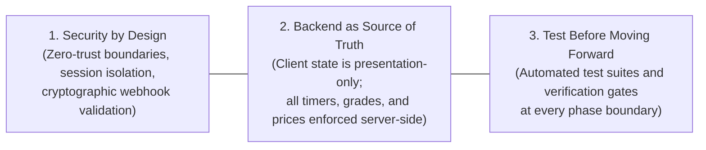

# 00 — Backend Architecture Overview

## 1. Executive Summary & Mission Charter

The **Single-Instructor Learning Management System (LMS)** backend is a high-security, high-reliability educational application engine engineered exclusively for an expert instructor.

The backend infrastructure is built around a non-negotiable direct-to-student business formula:
$$\text{ONE INSTRUCTOR} \longrightarrow \text{ONE BRAND} \longrightarrow \text{MULTIPLE COURSES} \longrightarrow \text{MULTIPLE STUDENTS} \longrightarrow \text{DIRECT SALES}$$

### Explicit Non-Goals & Boundaries
* **NOT a Multi-Institute ERP**: Contains no complex tenant routing, multi-campus partitioning, or independent organizational departments.
* **NOT an Open Marketplace**: No third-party instructor registration, marketplace storefronts, vendor commission splits, or cross-instructor search algorithms.
* **NOT a Generic SaaS**: Built strictly for direct course commercialization, IP protection, pedagogical assessment, and audited governance under a single master brand authority.

---

## 2. Core Architectural Pillars

The entire backend design adheres to three core architectural principles [Source: `phase.md`, Lines 269–273]:

### Critical Architectural Invariants [Source: LMS Blueprint v2.0, Pages 2, 5, 8, 14]:
1. **Single-Active-Session Invariant**: A user account may possess at most one active session. A newly authenticated login atomically revokes prior active sessions on the server, rendering displaced devices unauthorized (`401 SESSION_REVOKED`).
2. **Immutable Course Revisions**: Published course snapshots cannot be modified in place. Live curriculum updates branch into draft revisions (`revision_no = N + 1`), preserving historical continuity for enrolled learners.
3. **Zero Trust on Browser Redirect**: Paid course access is **NEVER** granted based on client-side checkout callbacks. Access is granted strictly upon verified cryptographic payment webhook execution (`POST /api/v1/webhooks/razorpay`).
4. **Append-Only Auditing**: Security, financial, role modification, and grade override operations are immutably recorded in a non-deletable audit log.
5. **Mandatory Email Verification**: Unverified user accounts are completely barred from accessing protected learning resources, quizzes, and assignment submissions.

---

## 3. Current Project Lifecycle & Implementation Status

> **CRITICAL ARCHITECTURAL BASELINE**:
> * **Current Phase**: **Phase 1 — Backend Development**
> * **Current Stage**: **Architecture Design & Technical Documentation**
> * **Implementation Reality**: **NOT STARTED (0% Implemented)**
> * All domain application code (Authentication, OAuth, Sessions, Users, Courses, Payments, Assignments, Quizzes, Progress, Media, Notifications, Audit Logs) is strictly **PENDING ARCHITECTURAL APPROVAL**. No domain implementation may begin until this architecture specification is formally approved by the Project Owner.

---

## 4. Master Documentation Map (`docs/backend/`)

This directory houses the complete 24-document backend architecture specification:

| Document ID | Title | Key Architectural Focus |
| :--- | :--- | :--- |
| [00-BACKEND-OVERVIEW.md](file:///Users/priyansh/lms/docs/backend/00-BACKEND-OVERVIEW.md) | Backend Architecture Overview | Executive summary, core pillars, lifecycle state, document index. |
| [01-SYSTEM-ARCHITECTURE.md](file:///Users/priyansh/lms/docs/backend/01-SYSTEM-ARCHITECTURE.md) | Multi-Tier System Topology | Layered architecture, network boundaries, gateways, data flow. |
| [02-TECHNOLOGY-STACK.md](file:///Users/priyansh/lms/docs/backend/02-TECHNOLOGY-STACK.md) | Technology Stack Specifications | 14 technical evaluations (Framework, ORM, DB, Cache, etc.). |
| [03-BACKEND-FOLDER-STRUCTURE.md](file:///Users/priyansh/lms/docs/backend/03-BACKEND-FOLDER-STRUCTURE.md) | Production Directory Structure | Modular package layout, responsibilities of every folder. |
| [04-DATABASE-ARCHITECTURE.md](file:///Users/priyansh/lms/docs/backend/04-DATABASE-ARCHITECTURE.md) | Relational Database Architecture | 35 entity specifications, types, constraints, cascade rules. |
| [05-DATABASE-ER-DIAGRAM.md](file:///Users/priyansh/lms/docs/backend/05-DATABASE-ER-DIAGRAM.md) | Complete Entity-Relationship Model | Comprehensive Mermaid ER diagram covering all relations. |
| [06-API-ARCHITECTURE.md](file:///Users/priyansh/lms/docs/backend/06-API-ARCHITECTURE.md) | REST API Standards & Contracts | Base `/api/v1/`, error envelopes, status codes, idempotency. |
| [07-AUTHENTICATION-ARCHITECTURE.md](file:///Users/priyansh/lms/docs/backend/07-AUTHENTICATION-ARCHITECTURE.md) | Authentication & Identity | Signup, login, Argon2id, Google OIDC, email verification. |
| [08-SESSION-MANAGEMENT.md](file:///Users/priyansh/lms/docs/backend/08-SESSION-MANAGEMENT.md) | Session & Concurrent Login Engine | Atomic single-session revocation, row locks, partial unique index. |
| [09-RBAC-PERMISSION-ARCHITECTURE.md](file:///Users/priyansh/lms/docs/backend/09-RBAC-PERMISSION-ARCHITECTURE.md) | RBAC & Permission Evaluation | 5 roles, granular keys, deny-overrides-allow, record scopes. |
| [10-USER-MANAGEMENT.md](file:///Users/priyansh/lms/docs/backend/10-USER-MANAGEMENT.md) | User Lifecycle & Staff Invites | Onboarding tokens, staff delegations, account recovery playbooks. |
| [11-COURSE-MANAGEMENT.md](file:///Users/priyansh/lms/docs/backend/11-COURSE-MANAGEMENT.md) | Course Builder & Reorder | Revisions, sections, lessons, optimistic atomic reorder, publish checklist. |
| [12-ENROLLMENT-PAYMENT-ARCHITECTURE.md](file:///Users/priyansh/lms/docs/backend/12-ENROLLMENT-PAYMENT-ARCHITECTURE.md) | Commerce, Orders & Webhooks | Razorpay, HMAC verification, minor currency paise, audited refunds. |
| [13-ASSIGNMENT-QUIZ-ARCHITECTURE.md](file:///Users/priyansh/lms/docs/backend/13-ASSIGNMENT-QUIZ-ARCHITECTURE.md) | Assessments, Rubrics & Quizzes | Rubric snapshots, grade overrides, server timers, question banks. |
| [14-STUDENT-PROGRESS-ARCHITECTURE.md](file:///Users/priyansh/lms/docs/backend/14-STUDENT-PROGRESS-ARCHITECTURE.md) | Learning Progress & Completion | Video progress tracking, completion thresholds, certificates. |
| [15-FILE-MEDIA-ARCHITECTURE.md](file:///Users/priyansh/lms/docs/backend/15-FILE-MEDIA-ARCHITECTURE.md) | Protected Video & PDF Pipeline | Presigned upload intents, async transcoding, short-lived signed tokens. |
| [16-NOTIFICATION-ARCHITECTURE.md](file:///Users/priyansh/lms/docs/backend/16-NOTIFICATION-ARCHITECTURE.md) | Transactional Outbox Engine | Deduplicated notification workers, email templates, exponential backoff. |
| [17-AUDIT-LOG-ARCHITECTURE.md](file:///Users/priyansh/lms/docs/backend/17-AUDIT-LOG-ARCHITECTURE.md) | Immutable Audit Logging | Append-only database constraints, before/after JSONB snapshots. |
| [18-SECURITY-ARCHITECTURE.md](file:///Users/priyansh/lms/docs/backend/18-SECURITY-ARCHITECTURE.md) | Defense-in-Depth Security | OWASP mitigations (XSS, CSRF, IDOR, SQLi), secret management. |
| [19-ERROR-HANDLING-STANDARDS.md](file:///Users/priyansh/lms/docs/backend/19-ERROR-HANDLING-STANDARDS.md) | Centralized Error Architecture | Error envelope schemas, standard error codes, log redaction. |
| [20-TESTING-STRATEGY.md](file:///Users/priyansh/lms/docs/backend/20-TESTING-STRATEGY.md) | Automated QA & Verification Matrix | Test pyramid, parallel session stress tests, webhook idempotency suites. |
| [21-DEPLOYMENT-ARCHITECTURE.md](file:///Users/priyansh/lms/docs/backend/21-DEPLOYMENT-ARCHITECTURE.md) | Infrastructure & Deployment | Container topology, reverse proxy, production hardening, runbooks. |
| [22-BACKEND-DEVELOPMENT-ROADMAP.md](file:///Users/priyansh/lms/docs/backend/22-BACKEND-DEVELOPMENT-ROADMAP.md) | 10-Part Implementation Roadmap | Detailed Part 0 to Part 9 task breakdown with dependencies. |
| [23-ARCHITECTURAL-DECISIONS.md](file:///Users/priyansh/lms/docs/backend/23-ARCHITECTURAL-DECISIONS.md) | Architecture Decision Records | Formal ADRs (ADR-001 to ADR-014) evaluating all trade-offs. |
