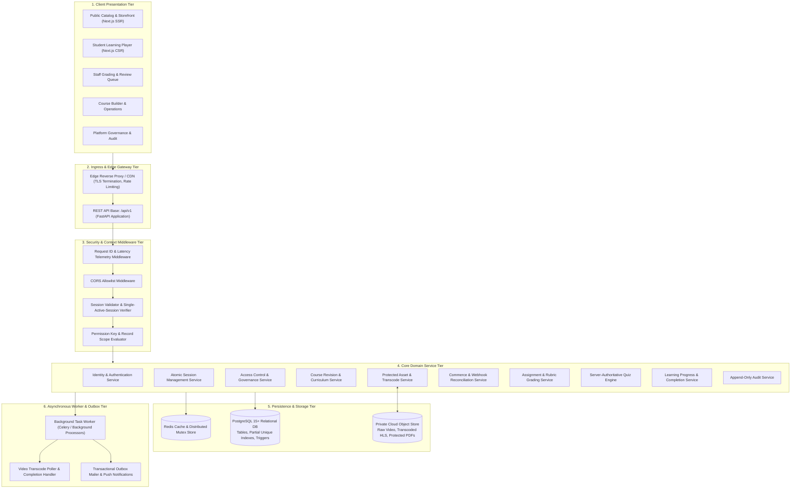
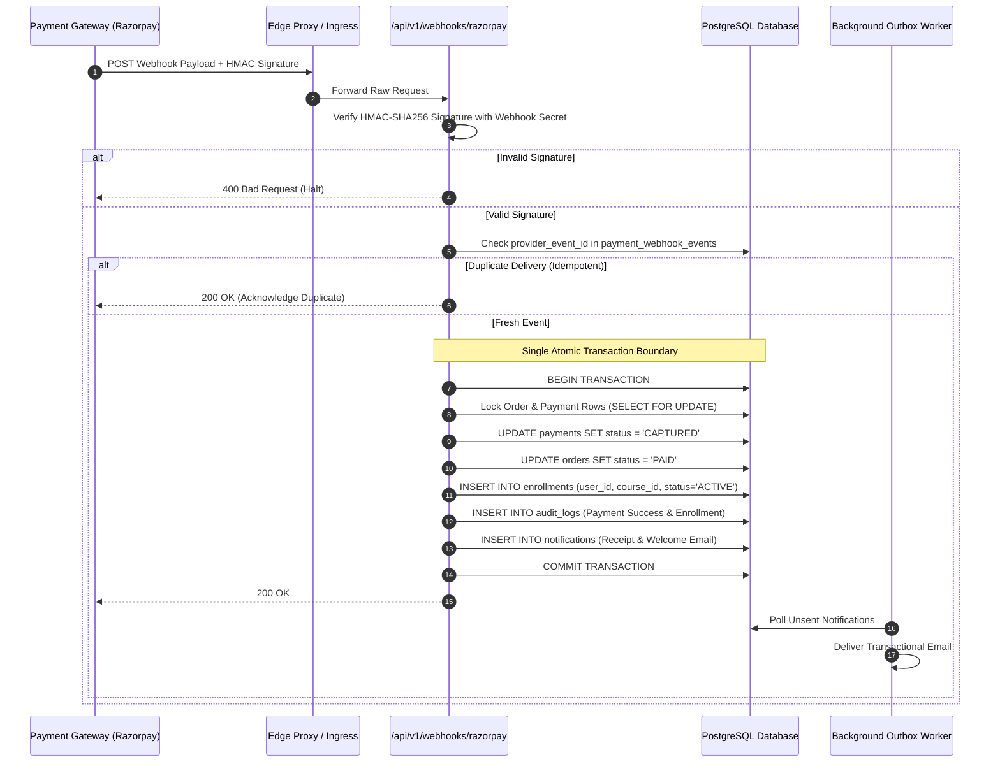
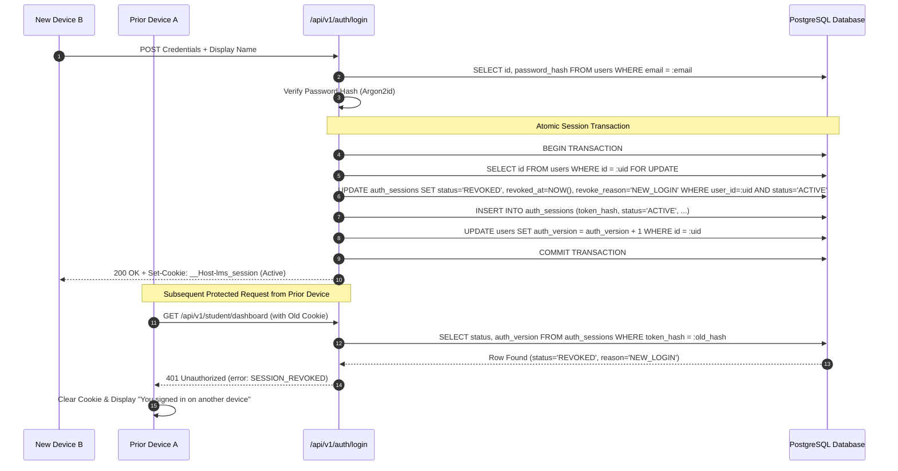

# 01 — System Architecture & Multi-Tier Topology

## 1. Multi-Tier Layered Architecture

The Single-Instructor LMS backend is designed following a **Clean Layered Architecture** pattern with strict boundary separation between HTTP transport, domain business logic, data persistence, and external third-party integrations.

---

## 2. Layer Responsibilities & Isolation Boundaries

### Layer 1: Ingress & Edge Gateway
* **TLS Termination & Security Headers**: Enforces HTTPS, `Strict-Transport-Security`, `X-Content-Type-Options: nosniff`, and `X-Frame-Options: DENY`.
* **Rate Limiting**: Throttles unauthenticated endpoints (`POST /auth/login`, `POST /auth/signup`, `POST /checkout/orders`) to mitigate brute force attacks and credential stuffing.
* **Routing**: Maps external requests to `/api/v1/` prefix.

### Layer 2: Security & Context Middleware
* **Request Correlation**: Attaches a unique, trace-friendly `X-Request-ID` to request state and response headers.
* **Session & Token Verification**: Extracts `__Host-lms_session` cookie, hashes token via SHA-256, validates active state in `auth_sessions`, and checks `auth_version`.
* **RBAC & Scope Enforcement**: Evaluates required permission keys against user's granted roles and resource ownership (`own`, `assigned`, `all`).

### Layer 3: Domain Service Layer (Pure Business Logic)
* Encapsulates all domain invariants: course revision immutability, rubric score totals, server quiz countdown timers, and atomic single-active-session revocation.
* **Stateless Operation**: Services maintain no in-memory state, ensuring horizontal scalability.

### Layer 4: Data Persistence Layer (PostgreSQL)
* PostgreSQL 15+ operates as the single source of relational truth.
* Strict referential constraints (`ON DELETE RESTRICT`) guard financial, submission, and audit history.
* Partial unique indexes enforce critical single-active-session invariants.

### Layer 5: Asynchronous Worker & Outbox Tier
* **Transactional Outbox Pattern**: Decouples external network calls (sending emails, webhook retries) from database transactions. Side effects are saved to `notifications` in the same transaction as business events and flushed asynchronously.

---

## 3. Data Flow Architecture

### Flow A: Payment Webhook to Course Enrollment (Zero Trust Redirect)

### Flow B: Concurrent Login & Atomic Session Revocation

---

## 4. Scalability, Resilience & Disaster Recovery

1. **Stateless API Replicas**: The application container carries zero persistent file state, allowing seamless scaling behind a round-robin load balancer.
2. **Database Connection Pooling**: SQLAlchemy connection pools maintain bounded concurrency (`pool_size=10`, `max_overflow=20`), preventing PostgreSQL socket starvation.
3. **Graceful Degradation**: If external payment webhooks or email providers experience downtime, incoming events queue safely, retrying with exponential backoff and dead-letter queueing.
