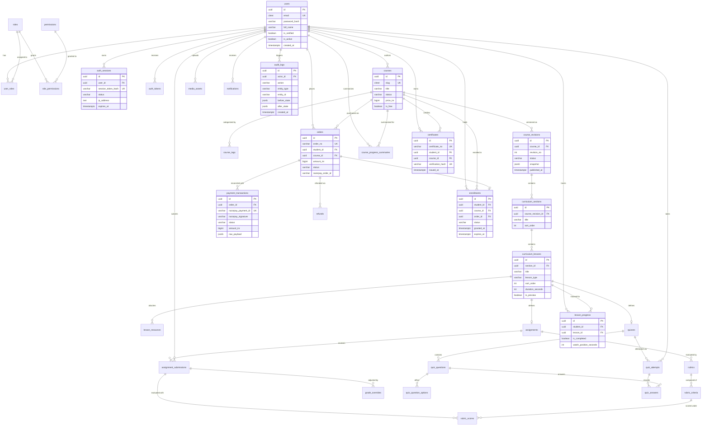

# Database Entity-Relationship Diagram Specification

## 1. Relational Entity-Relationship Diagram

The following Mermaid ER diagram documents the entities, attributes, and foreign key relationships across the 35 tables in the Single-Instructor LMS database.

---

## 2. Relational Cardinalities and Domain Invariants

### 2.1 Identity & Session Boundary
* **`users` to `auth_sessions` (1 to Many historical, 1 to 1 Active)**:
  - While one user record can link to many historical sessions (`REVOKED` or `EXPIRED`), PostgreSQL partial unique indexing enforces that a user has at most **one** session in `status = 'ACTIVE'`.
* **`users` to `roles` (Many to Many via `user_roles`)**:
  - Allows an instructor to test the student experience using secondary assigned roles while maintaining primary administrative access.

### 2.2 Course Revision Boundary
* **`courses` to `course_revisions` (1 to Many)**:
  - A course maintains an audit trail of immutable revisions.
  - Active student enrollments reference the live published revision, while unpublished drafts exist in isolation.
* **`course_revisions` to `curriculum_sections` (1 to Many)**:
  - Sections belong to a specific revision. Modifying the curriculum structure creates a new revision draft without affecting the currently active revision.

### 2.3 Financial & Enrollment Integrity
* **`orders` to `payment_transactions` (1 to Many)**:
  - An order may encounter multiple failed transaction attempts, but exactly one successful transaction marks the order as `PAID`.
* **`orders` to `enrollments` (1 to 1 for Direct Sales)**:
  - An enrollment record is created upon verified webhook execution. An enrollment's `order_id` is foreign-keyed to the paid order. Manual instructor grants set `order_id` to `NULL` and log an administrative audit record.
* **`enrollments` Unique Constraint**:
  - A student can have at most one active enrollment record per course (`UNIQUE (student_id, course_id)`).

### 2.4 Integrity Policies (Foreign Key Deletion Rules)
1. **`ON DELETE RESTRICT` (Business-Critical Tables)**:
   - `courses`, `course_revisions`, `orders`, `enrollments`, `assignment_submissions`, `certificates`.
   - Protects educational records, student financial transactions, and certificates from being deleted if parent entities are modified.
2. **`ON DELETE CASCADE` (Tightly-Coupled Composition Tables)**:
   - `curriculum_sections` $\rightarrow$ `curriculum_lessons` $\rightarrow$ `lesson_resources`.
   - `quizzes` $\rightarrow$ `quiz_questions` $\rightarrow$ `quiz_question_options`.
   - `rubrics` $\rightarrow$ `rubric_criteria`.
   - If a draft section or quiz question is deleted prior to publication, associated child options and resources are cleaned up automatically.
3. **`ON DELETE SET NULL`**:
   - `audit_logs.actor_id`: If a user account is deleted, audit logs are preserved with `actor_id = NULL` to maintain system audit continuity.
