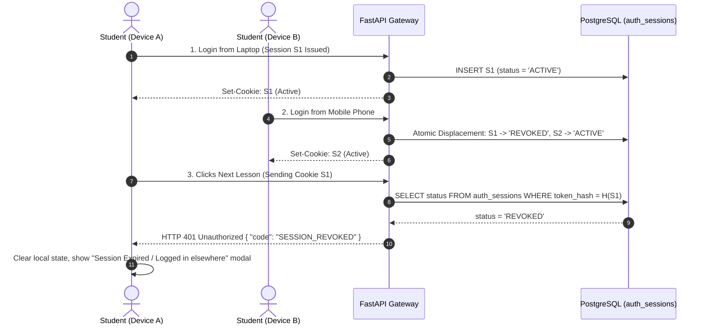

# Session Management & Single-Active-Session Specification

## 1. The Single-Active-Session Invariant

In accordance with the LMS Blueprint v2.0 (Page 8), the platform enforces a strict single-active-session policy:
$$\forall u \in \text{Users}, \quad \big| \{ s \in \text{auth\_sessions} \mid s.\text{user\_id} = u \land s.\text{status} = \text{'ACTIVE'} \} \big| \le 1$$

When an authenticated identity logs into the platform from a new browser or device, any pre-existing active session for that account is **atomically revoked**. The displaced session receives an immediate `401 SESSION_REVOKED` response upon its next network request.

---

## 2. Concurrency Control & Database Enforcement

To eliminate race conditions during concurrent logins across distributed nodes, enforcement relies on two interlocking mechanisms:
1. **Row-Level Locking (`FOR UPDATE`)** in the transaction boundary.
2. **PostgreSQL Partial Unique Index** acting as the ultimate integrity guarantee.

### 2.1 Atomic Session Displacement Transaction

```sql
BEGIN;

-- 1. Acquire exclusive row lock on existing active session(s) for the user
SELECT id, user_id, status 
FROM auth_sessions 
WHERE user_id = :user_id AND status = 'ACTIVE' 
FOR UPDATE;

-- 2. Transition prior active session to REVOKED status
UPDATE auth_sessions 
SET status = 'REVOKED' 
WHERE user_id = :user_id AND status = 'ACTIVE';

-- 3. Insert the newly issued session as ACTIVE
INSERT INTO auth_sessions (
    id,
    user_id,
    session_token_hash,
    status,
    ip_address,
    user_agent,
    last_active_at,
    expires_at,
    created_at
) VALUES (
    gen_random_uuid(),
    :user_id,
    :new_session_token_hash,
    'ACTIVE',
    :client_ip,
    :user_agent,
    NOW(),
    NOW() + INTERVAL '7 days',
    NOW()
);

-- 4. Record security audit event
INSERT INTO audit_logs (
    id, actor_id, action, entity_type, entity_id, before_state, after_state, ip_address, user_agent, created_at
) VALUES (
    gen_random_uuid(),
    :user_id,
    'SESSION_DISPLACED',
    'auth_session',
    :user_id::text,
    jsonb_build_object('displaced_sessions', 'ACTIVE'),
    jsonb_build_object('new_session', 'ACTIVE', 'ip', :client_ip::text),
    :client_ip,
    :user_agent,
    NOW()
);

COMMIT;
```

### 2.2 Partial Unique Index Specification
```sql
CREATE UNIQUE INDEX idx_auth_sessions_unique_active_user 
ON auth_sessions (user_id) 
WHERE status = 'ACTIVE';
```
If two concurrent transactions attempt to execute simultaneously, PostgreSQL's MVCC lock serialization guarantees that one commits while the other encounters an index collision and rolls back safely.

---

## 3. Displaced Session Handling Flow



---

## 4. Secure Cookie Specification (`__Host-` Prefix)

Session tokens are delivered to the browser exclusively through hardened HTTP cookies conforming to OWASP secure cookie specifications.

```http
Set-Cookie: __Host-lms_session=eyJhbGciOi...; 
            Path=/; 
            Secure; 
            HttpOnly; 
            SameSite=Lax; 
            Max-Age=604800
```

### 4.1 Attribute Breakdown
* **`__Host-` Prefix**:
  - Enforces that the cookie can only be set by HTTPS.
  - Must NOT include a `Domain` attribute (binds strictly to the exact host, preventing subdomain hijacking).
  - Must have `Path=/`.
* **`HttpOnly`**:
  - Prevents client-side JavaScript (`document.cookie`) from reading the cookie, neutralizing Cross-Site Scripting (XSS) token theft.
* **`Secure`**:
  - Transmitted exclusively over TLS/HTTPS connections.
* **`SameSite=Lax`**:
  - Mitigates Cross-Site Request Forgery (CSRF). Top-level GET navigations send the cookie, while cross-origin POST requests omit it.
* **`Max-Age=604800`**:
  - Sets an absolute expiration of 7 days (604,800 seconds).

---

## 5. Session Expiration & Activity Throttling

### 5.1 Lifecycles
* **Idle Timeout**: 48 hours. If `NOW() - last_active_at > 48 hours`, session transitions to `EXPIRED`.
* **Absolute Max Lifespan**: 7 days. Even with continuous activity, sessions expire after 7 days, requiring re-authentication.

### 5.2 Throttling Database Updates
To prevent database write amplification on every high-frequency HTTP request:
* The session verification dependency checks `last_active_at`.
* A database update query (`UPDATE auth_sessions SET last_active_at = NOW()`) is executed **only if** `NOW() - last_active_at > 5 minutes`.
* In multi-node production setups, this activity timestamp is cached in Redis with a 5-minute write-back buffer.
