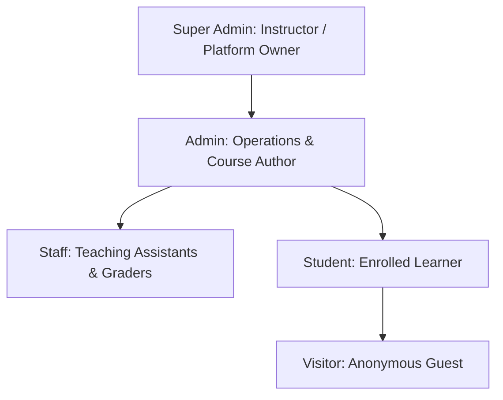
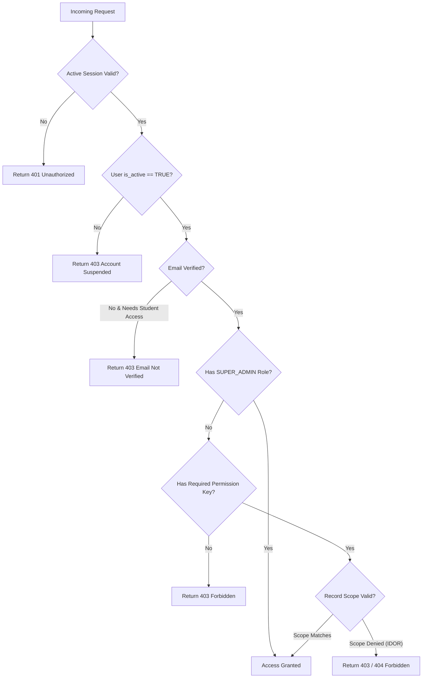

# Role-Based Access Control (RBAC) & Permission Architecture

## 1. Role Hierarchy & Principles

The Single-Instructor LMS implements an enterprise-grade Role-Based Access Control (RBAC) engine that balances ease of management with least-privilege security.

### 1.1 The 5 Defined Roles



1. **`VISITOR` (Anonymous)**:
   * Public course catalog browsing.
   * Viewing designated preview lessons (`is_preview = TRUE`).
   * Registration, login, and public certificate verification.
2. **`STUDENT` (Verified Learner)**:
   * Access to enrolled course content (videos, articles, resources).
   * Project assignment submissions and rubric score viewing.
   * Quiz attempts, autosave updates, and score reviews.
   * Real-time progress tracking and certificate downloads.
3. **`STAFF` (Teaching Assistant / Grader)**:
   * Viewing student assignment submissions across assigned courses.
   * Grading submissions against rubric criteria and entering qualitative feedback.
   * Accessing quiz attempt statistics and answer distribution.
   * *Strict Boundary*: Zero access to payment gateways, order records, refund tools, course publishing, or user role assignment.
4. **`ADMIN` (Course Creator & Operations)**:
   * Full course authoring, section/lesson management, and drag-and-drop reordering.
   * Assignment and quiz creation, bulk CSV question import.
   * Media asset management and presigned upload generation.
   * Student directory viewing, manual enrollment grants, and order management.
   * Staff onboarding invitations.
5. **`SUPER_ADMIN` (Sole Instructor & Platform Owner)**:
   * Absolute platform authority.
   * Course publishing and archiving permissions.
   * Financial refund authorization and payment reconciliation.
   * Read-only immutable system audit log inspection (`audit_logs`).
   * Role assignment, permission overrides, and administrative user account suspension.

---

## 2. Granular Permission Key Registry

Permissions are defined as standardized hierarchical strings (`domain:action`).

| Module | Permission Key | Description | Roles Possessing Key |
| :--- | :--- | :--- | :--- |
| **Courses** | `course:view_public` | View published course catalog | Visitor, Student, Staff, Admin, Super Admin |
| | `course:view_all` | View drafts and archived courses | Admin, Super Admin |
| | `course:create` | Create new course containers | Admin, Super Admin |
| | `course:edit` | Edit course draft content/metadata | Admin, Super Admin |
| | `course:revision_create` | Spawn new revision from live course | Admin, Super Admin |
| | `course:publish` | Freeze snapshot and set live revision | Super Admin |
| | `course:archive` | Archive course from active sales | Super Admin |
| **Curriculum**| `curriculum:manage` | Add/edit sections and lessons | Admin, Super Admin |
| | `curriculum:reorder` | Update drag-and-drop sort orders | Admin, Super Admin |
| **Media** | `media:upload` | Request presigned upload intents | Admin, Super Admin |
| | `media:view_protected` | Request playback tokens for videos | Enrolled Student, Staff, Admin, Super Admin |
| **Assignments**| `assignment:manage` | Create assignments and rubrics | Admin, Super Admin |
| | `assignment:submit` | Submit student assignment work | Enrolled Student |
| | `assignment:view_all`| View submissions from all students | Staff, Admin, Super Admin |
| | `assignment:grade` | Grade submissions via rubric criteria | Staff, Admin, Super Admin |
| | `assignment:override`| Override previously graded scores | Super Admin |
| **Quizzes** | `quiz:manage` | Create quizzes and author questions | Admin, Super Admin |
| | `quiz:import_csv` | Bulk upload questions via CSV | Admin, Super Admin |
| | `quiz:attempt` | Start and submit quiz attempts | Enrolled Student |
| | `quiz:view_attempts`| Inspect all student attempt scores | Staff, Admin, Super Admin |
| **Enrollments**| `enrollment:view_own` | View own active course enrollments | Enrolled Student |
| | `enrollment:view_all` | View all platform enrollments | Admin, Super Admin |
| | `enrollment:grant` | Manually grant student enrollment | Admin, Super Admin |
| | `enrollment:revoke` | Revoke or expire student enrollment | Super Admin |
| **Commerce** | `orders:create` | Initiate checkout order | Verified Student |
| | `orders:view_own` | View own payment receipts | Verified Student |
| | `orders:view_all` | Inspect all commercial orders | Admin, Super Admin |
| | `payments:refund` | Authorize and execute Razorpay refund | Super Admin |
| **Auditing** | `audit:view` | Inspect append-only audit trail | Super Admin |
| **Users** | `users:view_all` | Search and inspect user records | Admin, Super Admin |
| | `users:manage_status`| Suspend or restore user accounts | Super Admin |
| | `staff:invite` | Send onboarding invitation token | Admin, Super Admin |
| | `roles:assign` | Assign roles to existing users | Super Admin |

---

## 3. Evaluation Algorithm: Deny-Overrides-Allow

The authorization engine evaluates access using a deterministic pipeline:



### 3.1 Record-Level Scope Resolution (Anti-IDOR)
Even if a user possesses `assignment:submit` or `enrollment:view_own`, the permission evaluator verifies **record-level ownership**:
* **`own` Scope**: Verifies `target_record.student_id == current_user.id`.
* **`assigned` Scope**: For staff members, verifies whether staff is assigned to the course section or student cohort.
* **`all` Scope**: Admins and Super Admins bypass record ownership checks.

### 3.2 FastAPI Dependency Implementation Pattern
```python
from fastapi import Depends, HTTPException, status
from app.api.deps import get_current_user
from app.models.user import User

def require_permissions(*required_keys: str):
    """
    FastAPI route dependency enforcing granular permission keys with deny-overrides-allow.
    """
    async def permission_checker(current_user: User = Depends(get_current_user)) -> User:
        if not current_user.is_active:
            raise HTTPException(
                status_code=status.HTTP_403_FORBIDDEN,
                detail={"code": "ACCOUNT_SUSPENDED", "message": "Account has been suspended."}
            )
        
        user_permissions = current_user.get_aggregated_permissions()
        
        # Super Admin bypasses individual permission checks
        if "SUPER_ADMIN" in current_user.role_ids:
            return current_user
            
        for key in required_keys:
            if key not in user_permissions:
                raise HTTPException(
                    status_code=status.HTTP_403_FORBIDDEN,
                    detail={"code": "PERMISSION_DENIED", "required_permission": key}
                )
        return current_user

    return permission_checker
```
