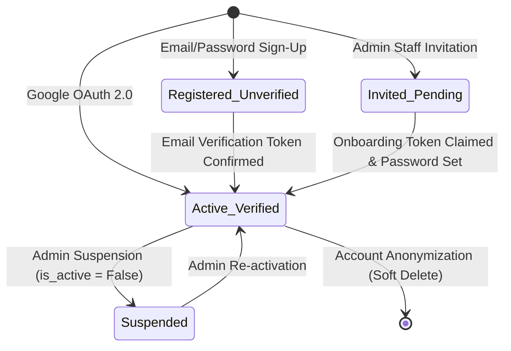

# User Management & Lifecycle Architecture

## 1. User Lifecycle Overview

The Single-Instructor LMS manages four distinct user onboarding pipelines: Self-Registered Students, Google OAuth Students, Invited Staff Members, and the Primary Instructor/Owner.

---

## 2. Staff Onboarding & Invitation Pipeline

Staff members (teaching assistants, graders) cannot register through public sign-up. They are invited securely by administrators.

### 2.1 Invitation Sequence
1. **Initiation (`POST /api/v1/users/staff/invite`)**:
   - Authorized by `staff:invite` permission.
   - Accepts `email`, `full_name`, and assigned role (`STAFF` or `ADMIN`).
   - Checks if user exists. If account already exists, assigns role directly.
   - If user does not exist:
     - Creates `users` record with `is_verified = TRUE`, `is_active = TRUE`, `password_hash = NULL`.
     - Assigns role in `user_roles`.
     - Generates 32-byte cryptographic onboarding token (`secrets.token_urlsafe(32)`).
     - Inserts into `auth_tokens` (`token_type = 'STAFF_ONBOARDING'`, `expires_at = NOW() + INTERVAL '48 hours'`).
     - Inserts email invitation job into `notification_outbox`.
2. **Acceptance (`POST /api/v1/auth/onboarding/claim`)**:
   - Staff member clicks link in email (`https://lms.instructor.com/onboard?token=...`).
   - Submits chosen password.
   - Backend validates token hash, verifies `expires_at > NOW()` and `is_used = FALSE`.
   - Hashes password using Argon2id, marks token `is_used = TRUE`.
   - Issues active session cookie and redirects to Staff Dashboard.

---

## 3. Profile Management & Email Updates

### 3.1 Self-Service Profile Updates (`PATCH /api/v1/users/me`)
* Students and staff may update `full_name` and `avatar_url`.
* Inputs are sanitized against XSS (HTML escaping and URL scheme validation for avatars).

### 3.2 Two-Step Secure Email Change Workflow
Changing an email address presents an account takeover risk. To mitigate this:
1. User requests change: `POST /api/v1/users/me/email-change-request { "new_email": "new@domain.com" }`.
2. Backend checks if `new_email` is already in use (`users.email` CITEXT unique check).
3. Backend generates two distinct tokens:
   - A confirmation link sent to the **new email address**.
   - A security alert notification sent to the **current email address** with a cancellation link.
4. When the confirmation token is submitted from the new address:
   - `users.email` is updated.
   - `users.is_verified` is set to `TRUE`.
   - All active sessions are revoked to force re-authentication.
   - Event is permanently logged in `audit_logs`.

---

## 4. Administrative Account Controls

### 4.1 Account Suspension (`PATCH /api/v1/users/{id}/status`)
Super Admins can immediately terminate platform access for any student or staff account:
* Atomically sets `users.is_active = FALSE`.
* Updates all active sessions in `auth_sessions` to `REVOKED`.
* Displaced user encounters `403 ACCOUNT_SUSPENDED` on their next request.

### 4.2 Account Recovery Playbook
* **Lost Email Verification**:
  - Student uses `POST /api/v1/auth/resend-verification`.
  - Rate-limited to at most 1 email every 3 minutes per user.
* **Super Admin Manual Verification Override**:
  - If a student cannot receive transactional verification emails due to strict corporate firewall filters, a Super Admin can manually set `is_verified = TRUE` via `PATCH /api/v1/users/{id}/verify-override`.
  - Generates a mandatory `audit_logs` record detailing admin actor ID, student user ID, and administrative justification note.

---

## 5. Data Privacy & Account Deletion (GDPR/Compliance)

In educational and financial systems, hard database deletions (`DELETE FROM users WHERE id = ...`) break referential integrity for orders, invoices, and certificates.

### 5.1 Anonymization Policy
When an account deletion is requested:
1. Check for active enrollments and financial transaction history.
2. If payments or certificates exist, perform **Cryptographic Anonymization**:
   - `users.email` $\rightarrow$ `anonymized_<UUID>@deleted.local`
   - `users.full_name` $\rightarrow$ `Deleted User`
   - `users.password_hash` $\rightarrow$ `NULL`
   - `users.avatar_url` $\rightarrow$ `NULL`
   - `users.is_active` $\rightarrow$ `FALSE`
   - Revoke all `auth_sessions` and `auth_tokens`.
3. Financial records (`orders`, `payment_transactions`, `refunds`) remain intact with minor currency units and timestamps for tax compliance.
4. Issued certificates remain verifiable by hash, but display name reflects anonymized status.
