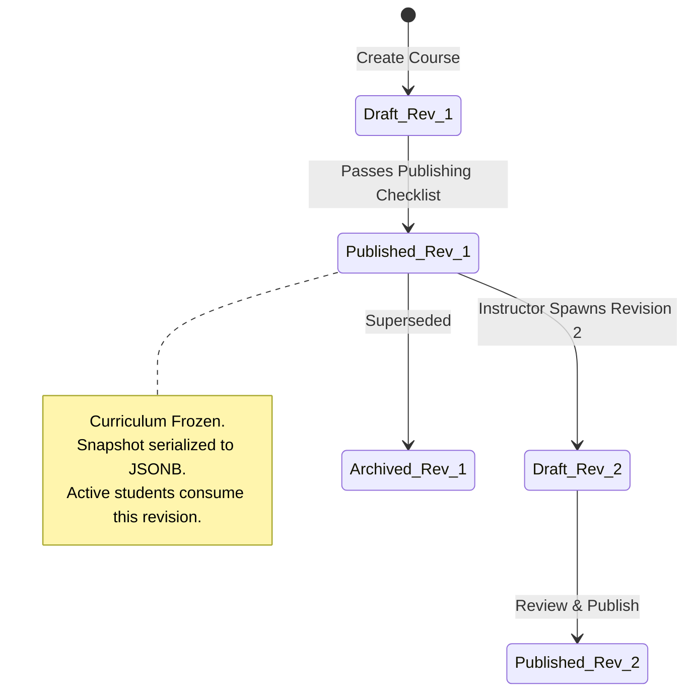

# Course Management & Revision Architecture

## 1. Course Lifecycle & Immutability Directives

In accordance with the LMS Blueprint v2.0 (Page 5), the platform enforces strict immutability for published course curricula:
1. **Zero In-Place Mutation of Live Courses**: Once a course revision is marked as `PUBLISHED`, its curriculum hierarchy (sections, lessons, resources, quizzes, assignments) is permanently frozen.
2. **Draft Revision Spawning**: Any subsequent authoring, lesson additions, reordering, or content modifications require spawning a new draft revision record (`revision_no = N + 1`).
3. **Student Disruption Isolation**: Active enrolled students consume the immutable published revision snapshot without disruption while the instructor prepares updates in the draft revision.



---

## 2. Revision Cloning & Data Isolation

When an instructor requests to edit a published course (`POST /api/v1/courses/{id}/revisions`):
1. **Find Current Live Revision**: Fetch `course_revisions` where `course_id = :id AND status = 'PUBLISHED'`.
2. **Determine New Revision Number**: Calculate `new_revision_no = max(revision_no) + 1`.
3. **Deep Copy Hierarchy (Single Atomic Transaction)**:
   - Insert new `course_revisions` row with `status = 'DRAFT'`, `revision_no = new_revision_no`.
   - Copy all `curriculum_sections` belonging to the prior revision, linking to the new revision ID.
   - Copy all `curriculum_lessons` for each copied section, preserving `lesson_type`, `sort_order`, `duration_seconds`, `is_preview`, and content JSON.
   - Copy all `lesson_resources` attached to copied lessons.
   - Replicate assignment configurations and rubric criteria templates.
   - Replicate quiz parameters and question option sets.
4. **Draft Isolation**: Any edits, drag-and-drop sequencing, or deletions in the new revision affect only the draft records.

---

## 3. Pre-Flight Publishing Checklist

Before a draft revision can be published, the backend runs a comprehensive validation checklist via `GET /api/v1/courses/{id}/publish-checklist`.

### 3.1 Checklist Validation Rules

| Rule ID | Check Name | Failure Condition | Severity |
| :--- | :--- | :--- | :--- |
| `CHK-01` | Course Metadata | Empty `title`, `headline`, or `slug` | Blocker |
| `CHK-02` | Commercial Pricing | `price_inr <= 0` and `is_free == FALSE` | Blocker |
| `CHK-03` | Non-Empty Sections | Revision has 0 sections | Blocker |
| `CHK-04` | Non-Empty Lessons | Any section contains 0 lessons | Blocker |
| `CHK-05` | Media Asset Readiness | Any video lesson has `media_assets.status != 'READY'` | Blocker |
| `CHK-06` | Quiz Validity | Any quiz has 0 questions or missing correct options | Blocker |
| `CHK-07` | Assignment Validity| Any assignment has `max_score <= 0` or missing rubric | Blocker |
| `CHK-08` | Thumbnail Asset | Course thumbnail URL is missing | Warning |

### 3.2 Pre-Flight Response Structure
```json
{
  "can_publish": false,
  "blockers": [
    {
      "code": "MEDIA_NOT_READY",
      "lesson_id": "9b1deb4d-3b7d-4bad-9bdd-2b0d7b3dcb6d",
      "message": "Lesson 'Advanced Async I/O' video is still processing in transcoding pipeline."
    }
  ],
  "warnings": [
    {
      "code": "MISSING_THUMBNAIL",
      "message": "Course thumbnail image is not set; default fallback will be used."
    }
  ]
}
```

---

## 4. Atomic Publication Execution

Publication occurs via `POST /api/v1/courses/{id}/revisions/{rev_id}/publish`.

```sql
BEGIN;

-- 1. Acquire exclusive lock on course and revision
SELECT id, status FROM courses WHERE id = :course_id FOR UPDATE;
SELECT id, status FROM course_revisions WHERE id = :rev_id AND course_id = :course_id FOR UPDATE;

-- 2. Verify all pre-flight checklist conditions pass

-- 3. Serialize full frozen curriculum tree into JSONB snapshot
-- Includes all sections, lessons, resources, assignments, rubrics, quizzes, questions
WITH full_curriculum AS (
    SELECT jsonb_build_object(
        'course_id', :course_id,
        'revision_id', :rev_id,
        'sections', (
            SELECT jsonb_agg(
                jsonb_build_object(
                    'id', s.id,
                    'title', s.title,
                    'sort_order', s.sort_order,
                    'lessons', (
                        SELECT jsonb_agg(
                            jsonb_build_object(
                                'id', l.id,
                                'title', l.title,
                                'lesson_type', l.lesson_type,
                                'sort_order', l.sort_order,
                                'duration_seconds', l.duration_seconds,
                                'is_preview', l.is_preview
                            ) ORDER BY l.sort_order ASC
                        )
                        FROM curriculum_lessons l WHERE l.section_id = s.id
                    )
                ) ORDER BY s.sort_order ASC
            )
            FROM curriculum_sections s WHERE s.course_revision_id = :rev_id
        )
    ) AS snapshot_data
)
UPDATE course_revisions 
SET status = 'PUBLISHED',
    published_at = NOW(),
    snapshot = (SELECT snapshot_data FROM full_curriculum)
WHERE id = :rev_id;

-- 4. Mark prior published revision as ARCHIVED
UPDATE course_revisions
SET status = 'ARCHIVED'
WHERE course_id = :course_id AND status = 'PUBLISHED' AND id != :rev_id;

-- 5. Update parent course live pointer and status
UPDATE courses
SET live_revision_id = :rev_id,
    status = 'PUBLISHED',
    updated_at = NOW()
WHERE id = :course_id;

-- 6. Insert audit log record
INSERT INTO audit_logs (id, actor_id, action, entity_type, entity_id, after_state, created_at)
VALUES (gen_random_uuid(), :actor_id, 'COURSE_PUBLISHED', 'course', :course_id::text, jsonb_build_object('revision_id', :rev_id), NOW());

COMMIT;
```

---

## 5. Curriculum Drag-and-Drop Reordering with Optimistic Concurrency

To support smooth frontend drag-and-drop curriculum builders without race conditions:
1. **Section Reordering Endpoint**: `PUT /api/v1/courses/{id}/revisions/{rev_id}/sections/reorder`
   - Payload: `{"section_ids": ["uuid_s1", "uuid_s2", "uuid_s3"], "version_timestamp": "2026-11-13T21:30:00Z"}`
2. **Optimistic Locking Guard**:
   - Backend checks if `course_revisions.updated_at > version_timestamp`.
   - If someone else updated the revision concurrently, returns `HTTP 409 Conflict` with `code: CONCURRENT_EDIT_CONFLICT`.
3. **Atomic Rank Update**:
   - Updates `curriculum_sections.sort_order` matching the order of the incoming array.
   - Updates `course_revisions.updated_at = NOW()`.
