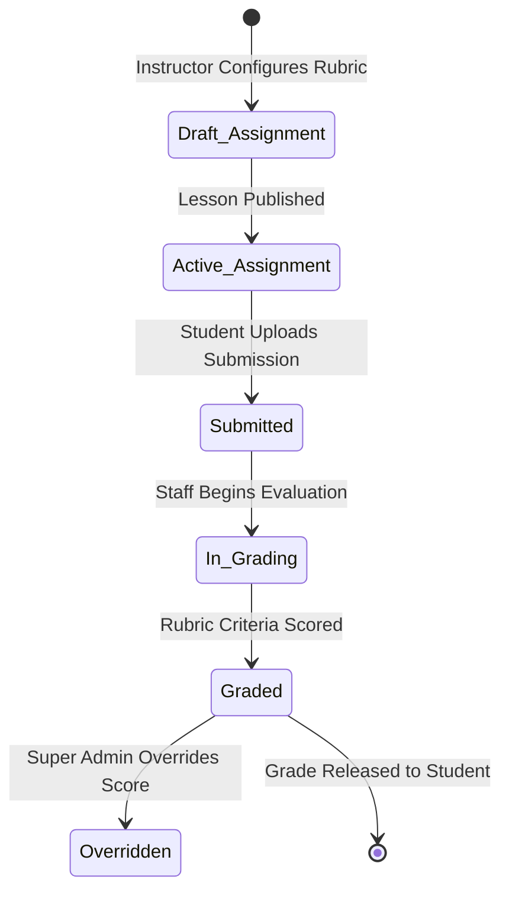
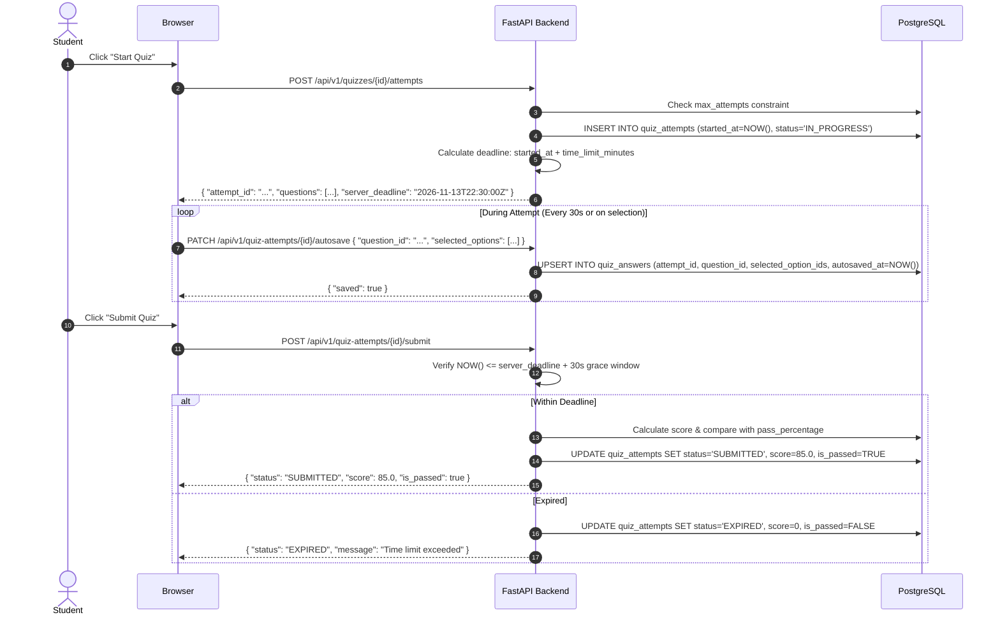

# Assignments & Quizzes Architecture Specification

## 1. Assignment Management & Rubric Grading

Assignments allow students to submit project work (PDF portfolios, code archives, design assets) evaluated against structured rubrics.



### 1.1 Rubric Criteria & Weighting Model
A rubric is composed of multiple evaluation criteria:
$$\text{Final Score} = \sum_{i=1}^{k} \big( \text{points\_awarded}_i \times \text{weight}_i \big)$$

* **Criteria Immutability**: Once any student submission has been evaluated against a rubric, that rubric version is permanently frozen (`is_active = FALSE` for future edits). Modifying the rubric spawns a new version (`version = V + 1`).
* **Evaluation Workflow**: Staff and Admins review the submission file, award points per criterion in `rubric_scores`, and provide qualitative commentary.
* **Super Admin Grade Overrides**: If an instructor adjusts a grade following a student appeal, the change is recorded in `grade_overrides` with the original score, new score, timestamp, and mandatory justification note.

---

## 2. Quizzes & Question Banks

Quizzes provide automated, objective assessment of learner comprehension with server-authoritative timers and randomized delivery.

### 2.1 Question Formats
1. `MCQ_SINGLE`: Single-choice multiple question with exactly one correct option.
2. `MCQ_MULTI`: Multi-select question (partial credit or all-or-nothing evaluation).
3. `TRUE_FALSE`: Binary truth evaluation.
4. `TEXT_SHORT`: Case-insensitive exact match or regex evaluation for short keywords.

### 2.2 Bulk CSV Question Import Specification
Instructors can upload question banks via CSV (`POST /api/v1/quizzes/{id}/questions/bulk-csv`):

```csv
question_type,prompt,points,explanation,option_1,option_2,option_3,option_4,correct_options
MCQ_SINGLE,"What does ACID stand for?",1.0,"ACID is Atomicity, Consistency, Isolation, Durability","Atomicity Consistency Isolation Durability","All Cats In Denmark","Async Code In Django","Access Control Identity Domain","1"
MCQ_MULTI,"Which are valid HTTP status codes?",2.0,"200 and 404 are valid codes","200 OK","404 Not Found","999 Custom","701 Test","1,2"
TRUE_FALSE,"PostgreSQL partial indexes improve write performance.",1.0,"Partial indexes index only a subset of rows, reducing index size.","True","False","","","1"
```

---

## 3. Server-Authoritative Quiz Timer & Autosave Engine

Client-side clocks cannot be trusted for timed assessments. The backend enforces an immutable server timer.



### 3.1 Network Latency Grace Window
A 30-second server grace period (`grace_window = 30 seconds`) is added to `time_limit_minutes` to account for client network jitter without penalizing students. Submissions received after `started_at + time_limit_minutes + 30s` are marked `EXPIRED`.
