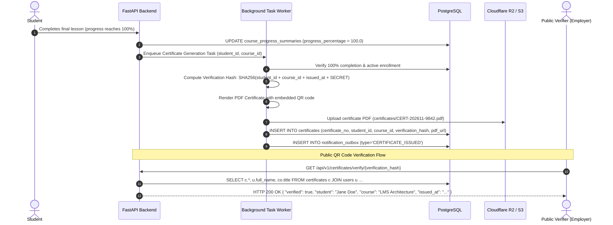

# Student Progress & Certification Architecture Specification

## 1. Progress Tracking Engine

Learner progress is tracked at the granular lesson level and aggregated into materialized summaries for instantaneous dashboard rendering.

### 1.1 Granular Completion Criteria by Lesson Type

| Lesson Type | Completion Criterion | Verification Mechanism |
| :--- | :--- | :--- |
| **Video** | $\ge 90\%$ playback watched | Verified via heartbeats: `watch_position_seconds >= 0.90 * duration_seconds` |
| **Article** | Manual confirmation / Read threshold | Learner toggles "Mark as Completed" button |
| **Quiz** | Passing score achieved | Automatically updated when `quiz_attempts.is_passed == TRUE` |
| **Assignment** | Valid submission accepted | Updated when `assignment_submissions.status IN ('SUBMITTED', 'GRADED')` |

### 1.2 Heartbeat Throttling & Progress API
* **Endpoint**: `POST /api/v1/progress/lessons/{lesson_id}`
* **Throttling**: The video player dispatches heartbeats at most once every 10 seconds.
* **Idempotent UPSERT**:
  ```sql
  INSERT INTO lesson_progress (
      id, student_id, lesson_id, is_completed, watch_position_seconds, updated_at
  ) VALUES (
      gen_random_uuid(), :student_id, :lesson_id, :is_completed, :position, NOW()
  )
  ON CONFLICT (student_id, lesson_id) DO UPDATE SET
      watch_position_seconds = GREATEST(lesson_progress.watch_position_seconds, EXCLUDED.watch_position_seconds),
      is_completed = lesson_progress.is_completed OR EXCLUDED.is_completed,
      completed_at = CASE 
          WHEN NOT lesson_progress.is_completed AND EXCLUDED.is_completed THEN NOW() 
          ELSE lesson_progress.completed_at 
      END,
      updated_at = NOW();
  ```

---

## 2. Course Progress Aggregation & Materialized Summaries

Querying dozens of individual lesson records across multiple courses on every dashboard load creates severe database bottlenecks. To eliminate this overhead, the system maintains `course_progress_summaries`:

$$\text{Progress \%} = \left( \frac{\text{completed\_lessons\_count}}{\text{total\_lessons\_count}} \right) \times 100.0$$

Whenever a lesson transitions from incomplete to complete:
1. Increment `completed_lessons_count` by 1.
2. Recalculate `progress_percentage`.
3. If `progress_percentage == 100.00`, trigger the automated **Certificate Generation Pipeline**.

---

## 3. Automated Certificate Generation & Public Verification



### 3.1 Verification Hash Generation
The cryptographic hash guarantees that certificate metadata cannot be forged or tampered with:
$$\text{Hash} = \text{HMAC-SHA256}\Big(\text{SECRET\_KEY}, \, \text{student\_id} \,\|\, \text{course\_id} \,\|\, \text{certificate\_no} \,\|\, \text{issued\_at}\Big)$$

### 3.2 Public QR Verification Route
* Public endpoint: `GET /api/v1/certificates/verify/{verification_hash}`.
* Bypasses authentication; publicly cacheable via CDN edge caching (TTL 24 hours).
* Displays instructor signature, course syllabus, completion date, and verification status.
