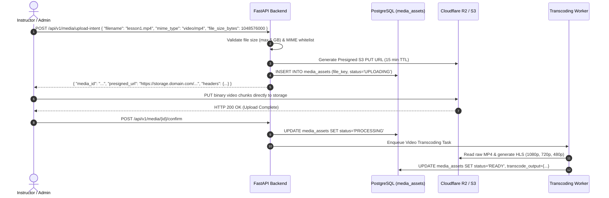

# File & Media Asset Architecture Specification

## 1. Storage Architecture & Presigned Upload Pipeline

To protect the application server from memory exhaustion and network saturation during multi-gigabyte video uploads, the platform utilizes direct client-to-storage **presigned uploads** to Cloudflare R2 / AWS S3.



---

## 2. MIME Whitelist & Strict Size Limits

The backend enforces strict file validation at upload intent generation:

| Category | Permitted MIME Types | Max File Size | Destination Bucket / Prefix |
| :--- | :--- | :--- | :--- |
| **Video Assets** | `video/mp4`, `video/quicktime`, `video/webm` | 5,242,880,000 bytes (5 GB) | `raw-videos/` |
| **Protected PDFs** | `application/pdf` | 52,428,800 bytes (50 MB) | `protected-docs/` |
| **Images (Thumbnails/Avatars)** | `image/png`, `image/jpeg`, `image/webp` | 5,242,880 bytes (5 MB) | `public-images/` |
| **Downloadable Code/Assets** | `application/zip`, `application/x-tar` | 104,857,600 bytes (100 MB) | `lesson-resources/` |

---

## 3. Video Protection & Signed Playback Delivery

Raw video files are never made publicly accessible. Streaming occurs via HLS with short-lived cryptographic tokens.

### 3.1 Secure Playback Token Issuance (`POST /api/v1/media/{id}/playback-token`)
1. Client requests playback access for a lesson video.
2. Backend verifies that the caller has an active, non-revoked enrollment in the course.
3. Backend issues an HMAC-SHA256 signed playback URL or signed cookie:
   * **TTL**: 2 hours (120 minutes).
   * **Payload**: Includes student ID, media ID, client IP, and expiration timestamp.
   * **URL Format**: `https://stream.instructor.com/hls/{media_id}/master.m3u8?token={signed_jwt}`.
4. CDN edge verifies the token before delivering HLS video chunks (`.ts` / `.m4s`).

---

## 4. Protected PDF Viewer & Dynamic Watermarking

For sensitive course reading materials and proprietary slides:
1. **Endpoint**: `GET /api/v1/media/{id}/protected-pdf`.
2. **Access Verification**: Caller must have active enrollment.
3. **Dynamic Watermarking**:
   - The backend streams the PDF while dynamically overlaying a semi-transparent, diagonal watermark on every page:
     ```
     CONFIDENTIAL - LICENSED TO: John Doe (john.doe@example.com)
     ENROLLMENT ID: ENR-8192 - DO NOT DISTRIBUTE
     ```
   - Headers:
     * `Content-Disposition: inline; filename="document.pdf"`
     * `X-Content-Type-Options: nosniff`
     * `Cache-Control: private, no-store, max-age=0`
   - Deters unauthorized redistribution and leaks.
