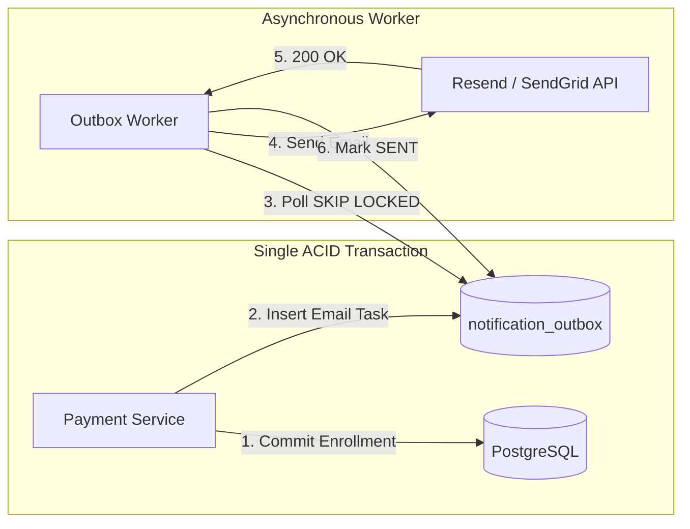

# Notification & Transactional Outbox Architecture Specification

## 1. Multi-Channel Notification Model

The Single-Instructor LMS delivers critical event notifications through two coordinated channels:
1. **Transactional Email**: Account verification, password reset, payment receipts, grade announcements, and certificates.
2. **In-App Notification Feed**: Real-time alerts, assignment feedback notifications, and course updates displayed within the platform navbar.

---

## 2. The Transactional Outbox Pattern

To prevent dual-write hazards (where a database transaction commits but an external email API call fails, or an email is sent but the DB rolls back), all asynchronous notifications follow the **Transactional Outbox Pattern**:



### 2.1 Outbox Table Schema & Fields
* `id` (UUID PK)
* `channel` (`EMAIL`, `IN_APP`)
* `recipient` (Email string or user UUID)
* `subject` (Email subject line)
* `payload` (JSONB containing template ID and substitution variables)
* `dedupe_key` (VARCHAR(128) UNIQUE — guards against duplicate dispatches)
* `status` (`PENDING`, `SENT`, `FAILED`)
* `retry_count` (INT, default 0)
* `next_retry_at` (TIMESTAMPTZ)
* `created_at` (TIMESTAMPTZ)

---

## 3. Worker Polling with Row-Level Locking (`SKIP LOCKED`)

To enable multi-node horizontal scaling without contention or duplicate sends, the background worker polls using PostgreSQL's `FOR UPDATE SKIP LOCKED`:

```sql
SELECT id, channel, recipient, subject, payload, retry_count
FROM notification_outbox
WHERE status = 'PENDING' 
  AND next_retry_at <= NOW()
ORDER BY created_at ASC
LIMIT 50
FOR UPDATE SKIP LOCKED;
```

### 3.1 Exponential Backoff & Dead-Letter Handling
If the external email delivery provider returns a network error or HTTP 5xx:
* Increment `retry_count += 1`.
* Calculate next attempt:
  $$\text{next\_retry\_at} = \text{NOW}() + \left( 30 \times 2^{\text{retry\_count}} \right) \text{ seconds}$$
* If `retry_count >= 5`:
  - Transition `status = 'FAILED'`.
  - Alert administrator via internal error logging (Dead-Letter Alert).

---

## 4. Supported Event Types & Templates

| Event Type | Channel | Trigger | Template Payload Variables |
| :--- | :--- | :--- | :--- |
| `AUTH_VERIFY_EMAIL` | Email | Self-registration | `first_name`, `verification_url`, `expires_in` |
| `AUTH_RESET_PASSWORD` | Email | Password reset request | `first_name`, `reset_url`, `expires_in` |
| `STAFF_INVITATION` | Email | Admin invites staff member | `inviter_name`, `role`, `claim_url` |
| `ENROLLMENT_RECEIPT` | Email + In-App | Payment webhook verified | `course_title`, `amount_inr`, `invoice_url` |
| `GRADE_RELEASED` | Email + In-App | Staff finishes rubric evaluation | `assignment_title`, `score`, `feedback_url` |
| `CERTIFICATE_ISSUED` | Email + In-App | 100% course completion | `course_title`, `certificate_url`, `verify_url` |
| `SECURITY_LOGIN_ALERT` | Email | New login from new IP address | `login_time`, `ip_address`, `user_agent` |
