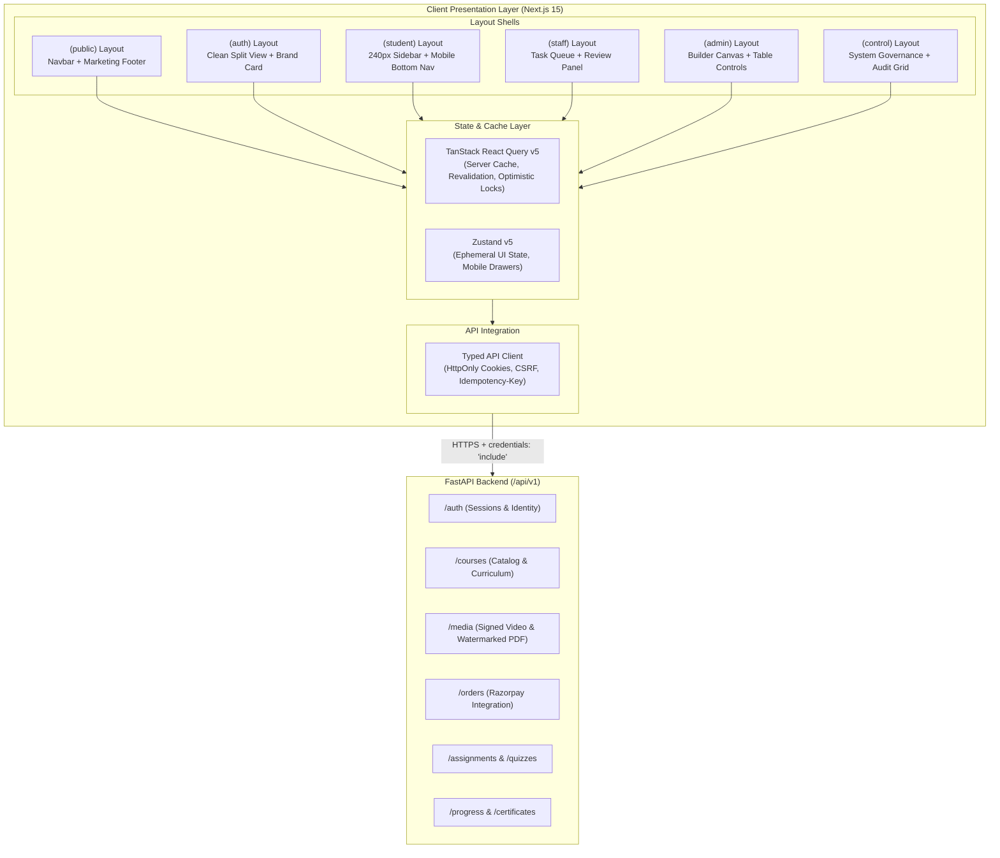
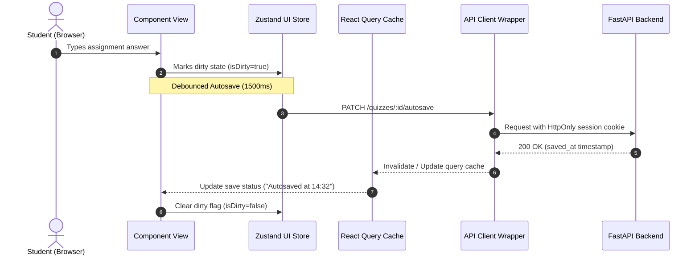
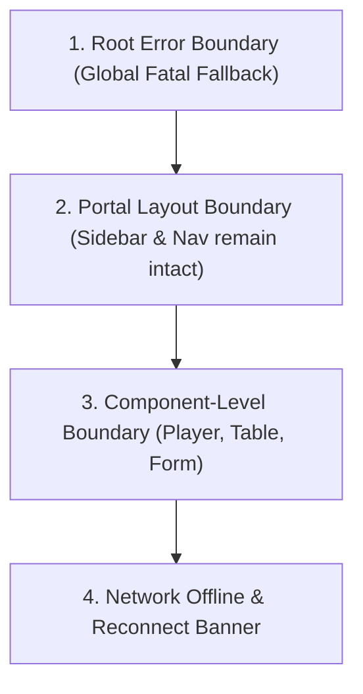

# Frontend Architecture Blueprint (FRONTEND_ARCHITECTURE_BLUEPRINT)

**Project**: Single-Instructor Learning Management System (LMS)  
**Lifecycle Phase**: Phase 2 — Frontend Development  
**Document Type**: Architectural Specification & Component Blueprint  
**Date**: 2026-11-15  
**Authority Reference**: `Single_Instructor_LMS_Blueprint_v2_Detailed_Specification(1).pdf` [Source: LMS Blueprint v2.0, Pages 1–16]; `.ai/RULES/FRONTEND_RULES.md`; `.ai/RULES/UI_UX_RULES.md`  

---

## 1. System Overview & Architectural Model

The frontend application operates as the presentation and interaction tier of the Single-Instructor LMS. It communicates with the backend solely via versioned REST APIs (`/api/v1/`) and WebSocket/SSE channels (or polling) for real-time notifications.

---

## 2. Layout Shell Hierarchy & Portal Boundaries

To ensure strict separation of concerns, the frontend is divided into **6 distinct layout shells** using Next.js App Router route groups:

### 2.1 Public Marketing Shell (`/src/app/(public)/layout.tsx`)
* **Target Views**: `/`, `/courses`, `/courses/:slug`.
* **Visual Theme**: 60% Warm Cream (`#FFF8F5`), 25% Primary Deep Teal (`#006B60`), 10% Accent Coral Orange (`#FF8964`), 5% Mint (`#DDF3EE`).
* **Header**: Floating brand logo, desktop navigation links (Catalog, About Instructor, Testimonials), and primary CTA button (*"Explore Courses"* / *"Student Login"*).
* **Mobile Behavior**: Collapses into a clean slide-out menu with touch targets $\ge 44 \times 44$px.
* **Footer**: Platform copyright, legal disclaimers, terms of service, refund policy, and instructor social links.

### 2.2 Authentication Shell (`/src/app/(auth)/layout.tsx`)
* **Target Views**: `/login`, `/signup`, `/forgot-password`, `/reset-password`, `/verify-email`, `/onboarding/claim`.
* **Layout Design**: Two-column split on desktop ($\ge 1024$px); centered single card on mobile.
  * **Left Column (50%)**: Brand presentation, instructor quote, feature highlights, and warm organic illustration on `Warm Cream` background.
  * **Right Column (50%)**: Focused white card surface (`#FFFFFF`) with generous padding (`32px` to `48px`), containing form fields, password visibility toggles, and Google OAuth button.
* **Guardrail**: If an active session exists, immediately redirects authenticated students to `/app` or staff/admins to `/admin`.

### 2.3 Student Learning Portal Shell (`/src/app/(student)/layout.tsx`)
* **Target Views**: `/app`, `/app/courses`, `/app/courses/:id`, `/app/assignments`, `/app/quizzes`, `/app/certificates`, `/app/orders`, `/app/profile`.
* **Desktop ($\ge 1024$px)**:
  * Fixed 240px left sidebar with brand logo, nav links with active teal pill indicators, and student mini-profile.
  * Persistent top bar with breadcrumbs, in-app notification bell (with unread badge), and user avatar dropdown.
  * Scrollable main canvas (`Warm Cream` background).
* **Mobile ($< 768$px)**:
  * Top bar displays brand icon, active page title, and notification bell.
  * Fixed bottom navigation bar with 4 high-frequency destinations: **Overview** (`/app`), **Courses** (`/app/courses`), **Tasks** (`/app/assignments`), and **Profile** (`/app/profile`).
  * Meets $\ge 44 \times 44$px touch targets and safe area insets (`env(safe-area-inset-bottom)`).

### 2.4 Focus Player Shell (`/src/app/learn/[courseId]/[lessonId]/layout.tsx`)
* **Target Views**: Distraction-free course playback canvas.
* **Desktop ($\ge 1024$px)**:
  * 70% left canvas: HLS video player or protected PDF canvas, lesson title, resources, and notes.
  * 30% right sidebar: Collapsible curriculum hierarchy (sections, lessons, checkmarks, duration badges, auto-scroll to active lesson).
* **Mobile ($< 768$px)**:
  * Top: 16:9 responsive video container (sticky during scroll).
  * Bottom: Tabbed panel switching between **Curriculum Drawer**, **Lesson Notes**, and **Attachments**.

### 2.5 Staff Portal Shell (`/src/app/(staff)/layout.tsx`)
* **Target Views**: `/staff`, `/staff/reviews`, `/staff/reviews/:id`, `/staff/tickets/:id`.
* **Layout**: Left-hand navigation sidebar focused on queue management: Unassigned Submissions, Pending Reviews, Completed Grades. Split-pane review interface with student submission on left and interactive rubric scoring slider on right.

### 2.6 Admin & Super Admin Shell (`/src/app/(admin)/layout.tsx`, `(control)`)
* **Target Views**: `/admin/*`, `/control/*`.
* **Layout**: Comprehensive management dashboard with collapsible sidebar, high-density data tables, search/filter bars, and batch action toolbars.
* **Header**: Indicates administrative scope, switch-portal shortcut, and Super Admin badge.

---

## 3. Data Flow Architecture & Server Authority

### Invariant: Server Authority Principle
Under no circumstances may the client assume authority over:
1. **Security & Permissions**: Route guards on the client are purely for UX redirection. The backend authorizes every request via RBAC and returns `401` or `403` on violation.
2. **Prices & Discounts**: Course prices are never calculated or discounted client-side; order creation requests send `{course_id}`; backend computes the binding price.
3. **Exam Countdown Timers**: The quiz countdown timer is anchored to the server's `attempt.expires_at` timestamp. Client clock manipulation has zero effect on server evaluation.
4. **Completion Percentages**: Course progress and certificate issuance are calculated strictly server-side upon verifying lesson watch seconds and assessment pass thresholds.

---

## 4. Error Boundary Hierarchy & Recovery Protocols

To prevent complete application crashes when a component encounters a rendering defect, the frontend implements a 4-tier error boundary architecture:

### Error Recovery Behaviors:
1. **Single-Active-Session Displacement (`401 SESSION_REVOKED`)**:
   * Intercepted globally by `apiClient`.
   * Triggers a non-dismissible modal: *"You signed in on another device"*.
   * Clears query cache and redirects to `/login`.
2. **Network Disconnection**:
   * Listens to `window.addEventListener('offline')`.
   * Displays persistent, non-blocking amber toast: *"You are offline. Inputs are saved locally."*
   * Form inputs are retained in React Hook Form state and local drafts.
3. **Validation Errors (`400/422`)**:
   * Form remains fully populated (Input Preservation protocol).
   * Red inline error messages appear directly below invalid fields.

---

## 5. Hydration & Progressive Enhancement Strategy

* **Zero Hydration Mismatch**: Dynamic browser values (e.g., local timestamps, client window dimensions) are rendered inside an `isMounted` gate or formatters that default to UTC during SSR.
* **Skeleton Pre-Rendering**: High-frequency dashboard views (`/app`, `/app/courses`) render structural skeletons on initial HTML delivery, eliminating Cumulative Layout Shift (CLS < 0.1).
* **Progressive Loading**: Course video player lazy-loads HLS chunks only after user interaction or when entering the viewport.
