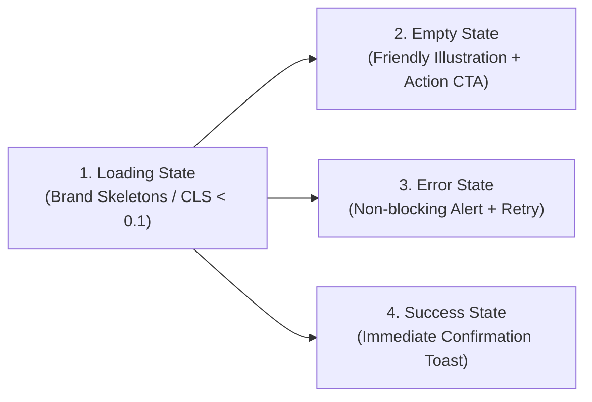

# Design System Implementation Plan (FRONTEND_DESIGN_SYSTEM_IMPLEMENTATION_PLAN)

**Project**: Single-Instructor Learning Management System (LMS)  
**Lifecycle Phase**: Phase 2 — Frontend Development  
**Document Type**: Component System & Design Token Architecture  
**Date**: 2026-11-15  
**Aesthetic Baseline**: Modern Playful Minimalist (`.ai/RULES/UI_UX_RULES.md`)  
**Design Autonomy**: ZERO — 100% Strict Adherence to Approved Tokens  

---

## 1. Official Design Tokens & Tailwind CSS Mapping

In accordance with `UI_UX_RULES.md` Section 3, every color, font size, border radius, and shadow is defined as an immutable CSS variable and Tailwind theme token:

```css
:root {
  /* Official Brand Color Tokens */
  --color-primary-teal: #006B60;       /* Primary brand, CTA buttons, active states */
  --color-accent-coral: #FF8964;       /* Secondary CTAs, attention highlights, tags */
  --color-warm-cream: #FFF8F5;         /* Dominant app background canvas */
  --color-soft-peach: #FCE8E1;         /* Card surfaces, soft borders, featured tags */
  --color-mint: #DDF3EE;               /* Progress indicators, success badges */
  --color-pure-white: #FFFFFF;         /* Card surfaces, modal canvas, contrast text */
  --color-text-primary: #191B24;       /* High-contrast headings and body copy */
  --color-text-secondary: #66666B;     /* Sub-descriptions, timestamps, metadata */
  --color-text-muted: #929292;         /* Placeholders, disabled states, borders */

  /* Semantic Feedback Colors */
  --color-success: #00875A;            /* Passing grade, verified badge */
  --color-warning: #FFAB00;            /* Approaching deadline, pending review */
  --color-error: #DE350B;              /* Form error, rejected submission */

  /* Border Radii */
  --radius-sm: 6px;                    /* Small badges, pills */
  --radius-md: 10px;                   /* Buttons, input fields */
  --radius-lg: 14px;                   /* Standard cards, popovers */
  --radius-xl: 20px;                   /* Large modal containers, hero containers */

  /* Soft Diffuse Box Shadows */
  --shadow-subtle: 0 2px 8px rgba(0, 0, 0, 0.03);
  --shadow-card: 0 4px 20px rgba(0, 0, 0, 0.04);
  --shadow-elevated: 0 12px 32px rgba(0, 0, 0, 0.06);
}
```

### The 60-25-10-5 Visual Ratio Enforcement
Page templates must mathematically respect the approved color distribution:
* **60% Canvas**: `Warm Cream` (`#FFF8F5`) + `Pure White` (`#FFFFFF`) — Dominant breathing room.
* **25% Brand Anchoring**: `Primary Deep Teal` (`#006B60`) — Sidebars, primary headers, active cards.
* **10% Action Focal Points**: `Accent Coral Orange` (`#FF8964`) — High-conversion buttons, urgent badges.
* **5% Gentle Accents**: `Mint` (`#DDF3EE`) + `Soft Peach` (`#FCE8E1`) — Progress meters, background doodles.

---

## 2. Official Typography System

* **Primary Font**: **Plus Jakarta Sans**, sans-serif.
* **Fallback Stack**: `-apple-system, BlinkMacSystemFont, "Segoe UI", Roboto, Helvetica, Arial, sans-serif`.

| Typographic Level | Font Size | Weight | Line Height | Letter Spacing | Semantic Usage |
| :--- | :---: | :---: | :---: | :---: | :--- |
| **Hero Heading** | `52px – 60px` | `800` (Extra Bold)| `1.15` | `-0.02em` | Flagship landing page hero headlines. |
| **Section Heading**| `36px – 42px` | `700` (Bold) | `1.2` | `-0.01em` | Portal section headings, modal titles. |
| **Card Heading** | `18px – 20px` | `700` (Bold) | `1.3` | `0` | Course card titles, lesson titles. |
| **Body Large** | `16px` | `500` (Medium) | `1.5` | `0` | Mobile inputs (prevents iOS zoom), lead text. |
| **Body Regular** | `14px – 16px` | `400` (Regular) | `1.5` | `0` | Standard paragraph text, instructions. |
| **Navigation** | `14px` | `500` (Medium) | `1.4` | `0` | Top bar links, sidebar navigation, tab labels. |
| **Small / Badge** | `12px` | `600` (Semi Bold)| `1.4` | `+0.02em` | Duration badges, status chips, breadcrumbs. |

---

## 3. Core Component Library Specifications

### 3.1 Button Component (`Button.tsx`)
* **Primary Variant**:
  * Background: `Primary Deep Teal` (`#006B60`).
  * Text: `Pure White` (`#FFFFFF`), `14px`, weight `600`.
  * Height: `44px` (touch-friendly); padding: `12px 24px`; border radius: `10px`.
  * Hover / Focus: Darkens teal by 8%; `transform: translateY(-1px)`; spring transition.
* **Secondary / Action Variant**:
  * Background: `Accent Coral Orange` (`#FF8964`).
  * Text: `Pure White` (`#FFFFFF`), `14px`, weight `600`.
  * Height: `44px`; padding: `12px 24px`.
* **Outline Variant**:
  * Background: Transparent; Border: 1.5px solid `Primary Deep Teal` (`#006B60`); Text: `#006B60`.
* **Ghost Variant**:
  * Background: Transparent; Text: `Primary Text` (`#191B24`); Hover: `Soft Peach` (`#FCE8E1`).
* **Loading State**: Displays inline spinner in brand mint/white; retains button dimensions; `disabled=true`.

### 3.2 Form Controls & Inputs (`Input.tsx`, `Textarea.tsx`)
* **Height**: `44px` minimum for touch compliance.
* **Surface**: `Pure White` (`#FFFFFF`) with 1px border in `#E5E5E5`.
* **Focus State**: 2px outline in `Primary Deep Teal` (`#006B60`) with `outline-offset: 2px`.
* **Error State**: 1.5px border in `#DE350B`; error message displayed directly underneath.
* **Input Preservation**: Uncontrolled or controlled state preserves all user draft input on server error.

### 3.3 Card Component (`Card.tsx`)
* **Surface**: `Pure White` (`#FFFFFF`) or `Soft Peach` (`#FCE8E1`).
* **Border Radius**: `14px` or `16px`.
* **Border & Shadow**: 1px subtle border (`#FCE8E1`); diffuse box shadow (`0 4px 20px rgba(0, 0, 0, 0.04)`).
* **Active / Highlighted**: Inverted surface in `Primary Deep Teal` (`#006B60`) with `Pure White` text.

### 3.4 Modal Dialog & Bottom Sheet (`Modal.tsx`)
* **Desktop**: Centered floating dialog (`Pure White` surface, `max-w-lg`, `rounded-2xl`, diffuse shadow).
* **Mobile**: Smooth slide-up bottom sheet (`rounded-t-2xl`, drag dismiss handle, thumb-accessible actions).
* **Accessibility**: Radix Dialog primitive with focus trap, `Esc` key dismiss, and `aria-labelledby`.

---

## 4. Mandatory 4-State Coverage Protocol

Every interactive view, table, and data-driven card must explicitly implement all 4 states:



1. **Loading State**:
   * Uses structural skeleton loaders (`Skeleton.tsx`) matching exact card dimensions.
   * Shimmer animation tuned with CSS linear gradient using `#FCE8E1` and `#FFF8F5`.
2. **Empty State**:
   * Clean brand illustration with an encouraging headline (e.g., *"No assignments submitted yet"*).
   * Primary call-to-action button directing the student to the active course syllabus.
3. **Error State**:
   * Non-blocking alert banner with clean brand styling (`Soft Peach` background, red accent border).
   * Unwraps `error.message` from backend envelope with a *"Try Again"* retry button.
4. **Success State**:
   * Subtle toast notification (`Sonner`) anchored at the top-right (desktop) or top-center (mobile).
   * Reassuring confirmation message (*"Assignment submitted successfully"*, *"Draft saved"*).

---

## 5. Micro-Interactions & Animation Guidelines

Adhering to the installed **Emil Kowalski Animation Skills** (`review-animations`, `spring`, `gestures`):
* **Curve & Timing**: Fast entrances ($150$ms to $250$ms) using `ease-out`; exits slightly faster ($120$ms to $180$ms).
* **Spring Transitions**: Damped springs for dropdowns and dialogs (`stiffness: 400`, `damping: 30`) without artificial bounce.
* **Composite Only**: Animate exclusively `transform` and `opacity`. Never animate `width`, `height`, or `top`/`left`.
* **Reduced Motion**: Respects `@media (prefers-reduced-motion: reduce)` by disabling spring animations and falling back to immediate opacity crossfades.
