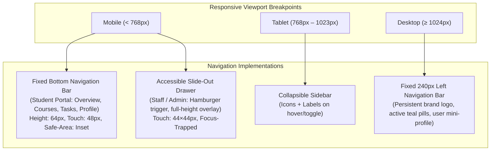

# Mobile-First Responsive Engineering Strategy (FRONTEND_RESPONSIVE_STRATEGY)

**Project**: Single-Instructor Learning Management System (LMS)  
**Lifecycle Phase**: Phase 2 — Frontend Development  
**Document Type**: Responsive Design & Mobile Ergonomics Specification  
**Date**: 2026-11-15  
**Mandate**: Non-Negotiable Project Owner Directive — 100% Mobile-First Implementation  
**Compliance Standard**: WCAG 2.1 Level AA Accessibility  

---

## 1. Responsive Philosophy & Non-Negotiable Directives

> [!IMPORTANT]
> **Mobile-First Invariant**: Every interface, portal, table, and form must be authored, styled, and tested **mobile-first** (`sm:`, `md:`, `lg:`, `xl:` progressive enhancements). Desktop-only implementations are strictly prohibited. 

### Mandatory Quality Invariants:
1. **Zero Horizontal Overflow**: `overflow-x: hidden` enforced on layout shells; horizontal body scrolling constitutes a blocking defect.
2. **Zero Element Overlap or Clipping**: Dynamic content wrapping, flex/grid auto-flows, and text truncation (`truncate`, `line-clamp-2`) with accessible tooltips.
3. **Touch Targets $\ge 44 \times 44$px**: Every button, navigation tab, menu item, and checkbox must satisfy a minimum touch bounding box of $44 \times 44$px [WCAG 2.1 Success Criterion 2.5.5].
4. **Thumb-Zone Navigation**: High-frequency actions in mobile views placed in the bottom 40% of the screen.
5. **No Mobile Input Zoom**: Form inputs must specify a base font-size of at least `16px` on mobile viewports to prevent iOS Safari auto-zoom bugs.

---

## 2. Mandatory Viewport Testing Matrix (10 Breakpoints)

Every page and component must be rigorously validated across all 10 target viewports:

| Viewport Width | Device Category / Archetype | Screen Dimensions (W × H) | Pixel Ratio | Critical Validation Focus |
| :---: | :--- | :---: | :---: | :--- |
| **320px** | Small Mobile (iPhone SE 1st Gen) | 320 × 568 | 2.0x | Minimum supported screen width. No card text truncation overflow; compact padding (`12px`); single-column forms. |
| **375px** | Standard Mobile (iPhone SE 3rd Gen) | 375 × 667 | 2.0x | Primary mobile baseline. Bottom navigation bar fit; touch target accessibility; hero text scale. |
| **390px** | Modern Mobile (iPhone 13 / 14 / 15) | 390 × 844 | 3.0x | High-density OLED rendering; safe area insets (`env(safe-area-inset-bottom)`); bottom sheet drawers. |
| **430px** | Large Mobile (iPhone 15 Pro Max, Plus)| 430 × 932 | 3.0x | Large mobile screen. Optimal reading line length; full-width CTA buttons; modal sheets. |
| **768px** | Small Tablet (iPad Mini, Portrait) | 768 × 1024 | 2.0x | Tablet portrait breakpoint (`md:`). Sidebar converts to collapsible slide-out drawer; 2-column course catalog. |
| **820px** | Standard Tablet (iPad Air / 10th Gen) | 820 × 1180 | 2.0x | Tablet split view. Two-column form layouts; course player side drawer toggle. |
| **1024px** | Large Tablet / Small Laptop | 1024 × 768 / 1366 | 2.0x | Desktop threshold (`lg:`). Fixed 240px left sidebar docks; 3-column course grid; split-pane course player. |
| **1280px** | Standard Laptop (MacBook Air 13") | 1280 × 800 | 2.0x | Balanced layout. Generous whitespace; high-density tables with inline actions. |
| **1366px** | Standard HD Laptop | 1366 × 768 | 1.0x | Wide HD rendering. Optimal reading widths (`max-w-7xl`); multi-pane review queue. |
| **1440px** | High-Res Desktop / Display | 1440 × 900 | 2.0x | Max container boundaries; centered content breathing room; zero stretched text. |

---

## 3. Responsive Navigation Architecture

In strict accordance with `FRONTEND_RULES.md` Section 7:



---

## 4. Portal-by-Portal Responsive Behavior Matrix

| Portal / Module | Mobile (< 768px) | Tablet (768px – 1023px) | Desktop (≥ 1024px) |
| :--- | :--- | :--- | :--- |
| **Public Storefront (`/`, `/courses`)** | • 60/40 Split Hero stacks to single column.<br>• Brand photograph displays beneath headline.<br>• 1-column course catalog grid.<br>• Sticky bottom *"Enroll Now"* bar on `/courses/:slug`. | • Hero stacks with side-by-side secondary elements.<br>• 2-column course catalog grid.<br>• Horizontal filter pill bar with overflow scroll. | • Official 60% Cream / 40% Deep Teal split hero.<br>• 3-column course catalog grid.<br>• Sticky left category filter sidebar. |
| **Authentication (`/login`, `/signup`)** | • Centered single card surface (`100%` width).<br>• Stacked social login and password fields.<br>• Full-width touch buttons ($48$px height). | • Centered card with `max-w-md` container.<br>• Generous padding (`32px`). | • Split-screen layout (50% brand quote / 50% card surface).<br>• Decorative organic background doodles. |
| **Student Dashboard (`/app`)** | • Top bar with notification bell & avatar.<br>• Fixed bottom navigation bar (4 tabs).<br>• Horizontal scrolling carousel for enrolled courses.<br>• Single-column upcoming tasks list. | • Collapsible left sidebar.<br>• 2-column dashboard grid (Progress on left, tasks on right). | • Fixed 240px left sidebar.<br>• Top utility bar with breadcrumbs.<br>• 3-column metric cards and expanded progress graphs. |
| **Course Player (`/learn/:cId/:lId`)** | • Sticky 16:9 responsive video player at top.<br>• Tabbed bottom sheet for Curriculum and Notes.<br>• Lesson checkmarks and auto-scroll in drawer. | • Side-by-side player with collapsible right drawer.<br>• Video maintains 16:9 aspect ratio. | • 70% left video/PDF canvas.<br>• 30% persistent right curriculum sidebar with section accordions. |
| **Assignments (`/app/assignments/:id`)** | • Vertical stepper (Instructions → Rubric → Submit).<br>• Rubric criteria render as collapsible cards.<br>• Drag-and-drop file upload with mobile file picker. | • 2-column view (Instructions & rubric on left, submission form on right). | • Wide split view with sticky rubric criteria preview and rich markdown text editor. |
| **Quiz Interface (`/app/quizzes/:id`)** | • Sticky top bar with server timer countdown.<br>• 1 question per screen with large touch options.<br>• Bottom question navigation drawer (pills 1–20). | • 1 question per screen with sticky side navigation palette.<br>• Instant autosave feedback indicator. | • Full-screen distraction-free exam canvas with side question navigator, timer, and flagged question review. |
| **Staff Reviews (`/staff/reviews/:id`)** | • Stacked layout: Student submission viewer on top, rubric evaluation form below with bottom action bar. | • Split view with resizable pane divider.<br>• Rubric criteria score chips. | • True side-by-side dual canvas: Student PDF/code on left (55%), interactive rubric scoring on right (45%). |
| **Admin Builder (`/admin/courses/:id/edit`)** | • Vertical section accordion list.<br>• Reordering via up/down touch buttons.<br>• Lesson settings render in full-screen modal sheets. | • Drag-and-drop section list with touch handles.<br>• 2-column lesson editor drawer. | • High-productivity tree hierarchy.<br>• Drag-and-drop section/lesson reordering with optimistic conflict recovery.<br>• Media dropzone. |
| **Data Tables (Orders, Users, Logs)** | • Responsive card view (`border rounded-xl p-4`).<br>• Primary fields visible; secondary fields expandable.<br>• Swipeable action row. | • Horizontal scrolling table container with sticky leftmost column.<br>• Pagination controls. | • Full multi-column data grid with column sorting, batch selection checkboxes, and inline action menus. |
| **Dialogs & Modals** | • Full-screen slide-up drawer (`bottom-0 rounded-t-2xl`).<br>• Dismiss handle on top; thumb-accessible actions. | • Centered modal dialog (`max-w-lg`).<br>• Backdrop blur (`backdrop-blur-sm`). | • Centered modal dialog with keyboard `Esc` dismiss and focus trap. |

---

## 5. Responsive Typography Scale & Fluid Spacing

Tailwind CSS configuration integrates responsive typographic scales matching `UI_UX_RULES.md`:

```css
/* Responsive Fluid Typography */
.text-hero {
  font-size: clamp(2.25rem, 5vw + 1rem, 3.75rem); /* 36px on mobile → 60px on desktop */
  line-height: 1.15;
  font-weight: 800;
}

.text-section-heading {
  font-size: clamp(1.5rem, 3vw + 0.75rem, 2.5rem); /* 24px on mobile → 40px on desktop */
  line-height: 1.2;
  font-weight: 700;
}

.text-card-heading {
  font-size: clamp(1.125rem, 1.5vw + 0.5rem, 1.25rem); /* 18px → 20px */
  line-height: 1.3;
  font-weight: 700;
}

.text-body {
  font-size: 1rem; /* 16px - Prevents iOS Safari input zoom */
  line-height: 1.5;
  font-weight: 400;
}
```

---

## 6. Accessibility & Touch Ergonomics Standard

* **Minimum Touch Bounding Box**: $44 \times 44$px for all clickable surfaces.
* **Touch Target Spacing**: Minimum $8$px margin between adjacent interactive touch targets.
* **Focus Indicator**: High-contrast 2px outline in `Primary Deep Teal` (`#006B60`) or `Accent Coral` (`#FF8964`) with `outline-offset-2`.
* **Screen Reader Support**: All icons accompanied by `aria-hidden="true"` and enclosed in accessible `<button aria-label="Descriptive Action">`.
