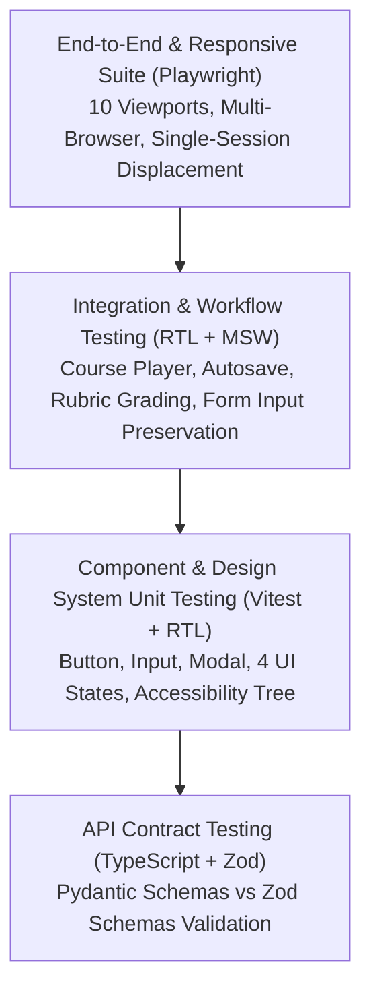

# Comprehensive Frontend Testing Strategy (FRONTEND_TESTING_STRATEGY)

**Project**: Single-Instructor Learning Management System (LMS)  
**Lifecycle Phase**: Phase 2 — Frontend Development  
**Document Type**: Quality Assurance & Automated Testing Architecture  
**Date**: 2026-11-15  
**Compliance Standard**: WCAG 2.1 Level AA Accessibility & 100% Mobile-First Responsive Verification  

---

## 1. Testing Pyramid & Tooling Architecture

The frontend quality assurance pipeline adopts a multi-layer testing pyramid combining lightning-fast unit/component execution with rigorous multi-browser, multi-viewport end-to-end verification.



| Layer | Primary Framework | Test Scope & Execution Target | Target Coverage | Speed / Execution SLA |
| :--- | :--- | :--- | :---: | :---: |
| **Unit & Component** | Vitest + React Testing Library (RTL) | Isolated UI components, design tokens, hooks, utility functions, 4 UI states. | $\ge 85\%$ lines | $< 15$ seconds |
| **Integration** | RTL + Mock Service Worker (MSW) | Complex workflows: quiz autosave, debounced search, form error preservation, rubric grading calculations. | $\ge 80\%$ paths | $< 45$ seconds |
| **API Contract** | TypeScript + Zod | Validates that client Zod schemas reject payloads that violate backend Pydantic models. | $100\%$ endpoints | Instant (build time) |
| **Accessibility (a11y)**| `@axe-core/playwright` + `jest-axe` | Automated WCAG 2.1 AA audits: color contrast 4.5:1, keyboard tab stops, ARIA labels, focus rings. | Zero violations | Included in E2E |
| **End-to-End (E2E)** | Playwright (Chromium, Firefox, WebKit)| Complete user journeys: checkout to enrollment, quiz timer countdown, single-session displacement. | Critical paths | $< 3$ minutes |
| **Responsive Visual**| Playwright Device Emulation | Pixel-perfect validation across all 10 mandatory viewports (320px to 1440px). | 10 viewports | $< 2$ minutes |

---

## 2. Specialized Test Suites & Verification Protocols

### 2.1 Authentication & Session Integrity Suite
1. **Single-Active-Session Displacement**:
   * Simulate Device A logged in with session cookie.
   * Simulate Device B login displacing Device A.
   * Verify Device A receives `401 SESSION_REVOKED` and displays the non-dismissible *"You signed in on another device"* modal.
   * Verify query cache is purged immediately so no private student records linger in memory.
2. **HttpOnly Cookie Handling**:
   * Verify client never attempts to read or write authentication tokens into `localStorage` or `sessionStorage`.
   * Verify `credentials: "include"` is present on all API requests.
3. **Session Refresh Flow**:
   * Verify that 401 token expiry triggers a background call to `POST /api/v1/auth/refresh` using the active session cookie before failing.

### 2.2 Form Input Preservation on Error Protocol
1. **Validation Failure (400 / 422)**:
   * Populate a multi-field form (e.g., student profile, course section creation, assignment submission text).
   * Submit invalid data triggering a backend `422 Unprocessable Entity`.
   * **Assertion**: Verify that all user-typed inputs remain 100% intact in form fields; verify red error labels appear under specific invalid inputs; verify form does NOT clear or reset.
2. **Network Interruption**:
   * Simulate offline network disconnect during form editing.
   * Verify offline warning banner appears; verify user inputs are safely retained in memory.

### 2.3 Quiz Engine & Autosave Verification
1. **Server-Authoritative Countdown Timer**:
   * Start quiz attempt via `POST /api/v1/quizzes/:id/attempts`.
   * Verify client timer calculates remaining seconds from `attempt.expires_at - server_time`.
   * Simulate client system clock alteration; verify timer does not grant extra time.
2. **Incremental Autosave**:
   * User selects option for Question 3.
   * Verify debounced `PATCH /api/v1/quiz-attempts/:id/autosave` is dispatched within 1500ms.
   * Verify *"Autosaved at [time]"* indicator renders cleanly.
3. **Automatic Submission upon Expiry**:
   * Fast-forward timer to 0 seconds.
   * Verify client automatically triggers `POST /api/v1/quiz-attempts/:id/submit`.

### 2.4 Course Player & Media Delivery Verification
1. **Signed HLS Video Token Acquisition**:
   * Verify player requests token via `POST /api/v1/media/:id/playback-token`.
   * Verify video source URL is populated with signed token.
2. **Watch Duration Progress Heartbeat**:
   * Simulate 60 seconds of video playback.
   * Verify periodic `POST /api/v1/progress/lessons/:id` heartbeat carries accurate `watch_seconds`.
   * When watch percentage reaches $\ge 90\%$, verify lesson progress automatically reflects completed status.
3. **Protected PDF Canvas**:
   * Verify PDF canvas renders without exposing direct download links.
   * Verify right-click context menu is suppressed on the viewer canvas.

---

## 3. Mandatory Responsive Viewport Test Matrix (Playwright)

Automated Playwright configuration registers 10 device emulation profiles matching the required testing viewports:

```typescript
// playwright.config.ts (Responsive Viewport Suite)
export const viewports = [
  { name: "Mobile-320px", width: 320, height: 568 },   // iPhone SE 1st Gen
  { name: "Mobile-375px", width: 375, height: 667 },   // iPhone SE 3rd Gen
  { name: "Mobile-390px", width: 390, height: 844 },   // iPhone 14 / 15
  { name: "Mobile-430px", width: 430, height: 932 },   // iPhone 15 Pro Max
  { name: "Tablet-768px", width: 768, height: 1024 },  // iPad Mini Portrait
  { name: "Tablet-820px", width: 820, height: 1180 },  // iPad Air Portrait
  { name: "Desktop-1024px", width: 1024, height: 768 },// Small Laptop
  { name: "Desktop-1280px", width: 1280, height: 800 },// MacBook Air 13"
  { name: "Desktop-1366px", width: 1366, height: 768 },// HD Laptop
  { name: "Desktop-1440px", width: 1440, height: 900 },// High-Res Monitor
];
```

### Automated Viewport Assertions:
1. `document.documentElement.scrollWidth <= window.innerWidth` (Strict zero horizontal overflow check).
2. All interactive touch targets measure at least $44 \times 44$px bounding box.
3. Bottom navigation bar renders at $< 768$px; 240px sidebar renders at $\ge 1024$px.

---

## 4. Accessibility Testing Standards (WCAG 2.1 AA)

Automated a11y testing is executed via `@axe-core/playwright`:
```typescript
test("Student portal passes WCAG 2.1 AA audits", async ({ page }) => {
  await page.goto("/app");
  const accessibilityScanResults = await new AxeBuilder({ page })
    .withTags(["wcag2a", "wcag2aa"])
    .analyze();
  expect(accessibilityScanResults.violations).toEqual([]);
});
```

### Key Verification Checks:
* Text-to-background contrast ratio $\ge 4.5:1$ for normal text, $\ge 3:1$ for large text.
* Visible focus rings on all interactive elements using `Primary Deep Teal` (`#006B60`).
* Valid `aria-label` attributes on all icon-only buttons.
* Status badges convey state with both text and color (never color alone).

---

## 5. Measurable Quality Acceptance Criteria

Prior to merging any frontend feature or promoting code to staging, the following gates must pass:
1. **Unit & Component Tests**: 100% pass rate; $\ge 85\%$ line coverage.
2. **E2E Critical Paths**: 100% pass rate across Chromium, Firefox, WebKit.
3. **Responsive Check**: Zero horizontal scroll violations across all 10 viewports.
4. **Accessibility Check**: Zero WCAG 2.1 AA violations flagged by axe-core.
5. **Production Build**: `next build` compiles with zero TypeScript errors and zero lint warnings.
