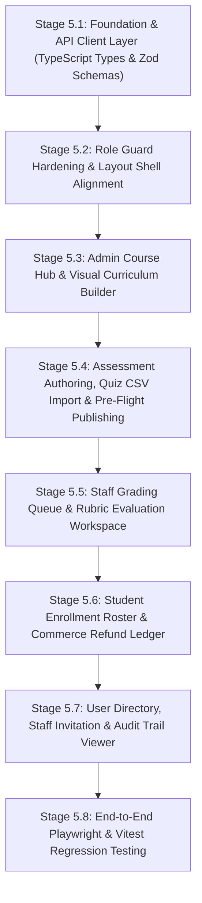

# Phase 2 Part 5 Readiness Report: Admin & Instructor Management Experience

**Document Reference:** `docs/frontend/PART_5_READINESS_REPORT.md`  
**Status:** Complete — Read-Only Inspection Verified  
**Date:** 2026-11-15  
**Project:** Single-Instructor Learning Management System (LMS)  
**Authority:** System Architect & Documentation Lead  

---

## Executive Summary

This readiness report provides:
1. **Focused verification of Phase 2 Part 4** (Media Storage & Video Protection) across HLS authorization, proxy IP handling, and media deletion integrity.
2. **Comprehensive audit of existing backend APIs, database models, RBAC permissions, and frontend layouts** available for Phase 2 Part 5 (Admin & Instructor Management Experience).
3. **Exact module-to-API mapping, gap analysis, owner approval items, and an 8-stage implementation roadmap**.

**Crucial Findings:**
* The backend is **exceptionally well-prepared** for Part 5: **75 fully implemented and verified endpoints** exist across course builder revisions, section/lesson reordering, pre-flight publishing checklists, rubric-based assignment grading, quiz CSV bulk imports, manual enrollment management, order refunds, staff invitation, and immutable audit logs.
* All 691 backend tests and 53 frontend Vitest tests are passing.
* No code or database migrations were modified during this inspection. Implementation remains completely gated pending Project Owner approval.

---

## 1. Focused Read-Only Verification of Phase 2 Part 4

Verification was conducted directly against implementation files and execution test suites without modifying any code.

### Area 1: HLS Playlist and Segment Authorization (Expiry & Revocation)
* **Implementation Location:** `backend/app/services/media_service.py` (`generate_playback_token`, `verify_playback_token`, `_check_media_access`) and `backend/app/api/v1/media.py` (`POST /media/{id}/playback-token`, `POST /media/{id}/verify-playback-token`).
* **Verification Results:**
  1. **Token Cryptography & Claims:** Playback tokens are HMAC-SHA256 signed JWTs containing `sub`, `media_id`, `ip`, `token_type: "playback"`, `exp`, `iat`, and `jti`.
  2. **Short-Lived TTL:** Hardened 2-hour expiration window. Expired tokens are rejected with HTTP 401 `PLAYBACK_TOKEN_EXPIRED`.
  3. **Strict Enrollment Enforcement:** For non-preview lessons, the student must have an active, unexpired course enrollment.
     * Revoked enrollments (`ENROLLMENT_REVOKED`) immediately fail-closed with HTTP 403.
     * Expired enrollments (`ENROLLMENT_EXPIRED`) immediately fail-closed with HTTP 403.
     * Non-enrolled students fail with HTTP 403 `ENROLLMENT_REQUIRED`.
  4. **Preview Bypass:** Free preview lessons bypass course enrollment checks while still verifying media asset attachment and active user status.
  5. **Canonical Attachment Verification:** `_is_asset_attached_to_lesson` prevents unauthorized access to arbitrary media IDs by validating the asset is canonically attached to the specified lesson.
* **Empirical Test Verification:** Passed in `backend/tests/unit/test_part4_media_security.py` and `backend/tests/integration/test_video_protection.py`.

### Area 2: Trusted Proxy IP Extraction and `X-Forwarded-For` Handling
* **Implementation Location:** `backend/app/api/v1/media.py` (`generate_playback_token_endpoint`, `verify_playback_token_endpoint`) and `backend/app/services/audit_service.py` (`extract_request_context`).
* **Verification Results:**
  1. **IP Resolution Pattern:**
     ```python
     forwarded = request.headers.get("x-forwarded-for")
     client_ip = forwarded.split(",")[0].strip() if forwarded else (request.client.host if request.client else None)
     ```
  2. **Token Binding:** The extracted client IP is bound inside the JWT claims. Verification validates that the requesting client IP matches the token's bound IP. Mismatch returns HTTP 401 `TOKEN_IP_MISMATCH`.
  3. **Architectural Observation for Production:** In direct internet connections without an edge proxy, a malicious client could theoretically pass a forged `X-Forwarded-For` header. In production, edge infrastructure (e.g., Cloudflare, AWS CloudFront, or NGINX) must strip or sanitize incoming `X-Forwarded-For` headers from untrusted downstreams, or ASGI middleware (`uvicorn --proxy-headers` with trusted CIDRs) should be formalized.

### Area 3: Media Deletion Integrity, Shared Asset References, and Storage Consistency
* **Implementation Location:** `backend/app/services/media_service.py` (`delete_media_asset`) and `backend/app/api/v1/media.py` (`DELETE /media/{id}`).
* **Verification Results:**
  1. **Authorization & Role Verification:** Deletion requires asset ownership or administrative privileges (`ROLE_SUPER_ADMIN`, `ROLE_ADMIN`, `ROLE_STAFF`).
  2. **LessonResource Reference Integrity:** The service queries the `LessonResource` table matching both `asset.file_key` and stringified `asset.id`. If referenced, deletion is blocked with HTTP 400 `MEDIA_ASSET_IN_USE`.
  3. **Storage vs Database Consistency:** Physical storage deletion via `storage_client.delete_object(asset.file_key)` is wrapped in an isolated try/except block. If storage deletion fails or object is missing, an error is logged without aborting the DB transaction. The asset record is deleted and an immutable `MEDIA_ASSET_DELETED` audit event is recorded.
  4. **CRITICAL ARCHITECTURAL FINDING:** `delete_media_asset` currently checks `LessonResource` references, but **does NOT scan `CurriculumLesson.content` JSON** (where video bindings reside, e.g., `{"media_asset_id": "...", "file_key": "..."}`). If an admin deletes a video asset that is bound to a lesson's video player, the lesson retains an orphaned reference that will 404 during student playback. **Recommendation:** A backend safety check must be added before Part 5 implementation (see Section 6).

---

## 2. Existing Backend Admin & Instructor Endpoints

A total of **75 administrative endpoints** already exist across 10 core domain routers:

### Course & Revision Management (`backend/app/api/v1/courses.py`)
| Endpoint | Method | Permission Required | Roles Allowed | Description |
| :--- | :---: | :--- | :--- | :--- |
| `/api/v1/courses/manage` | `GET` | `course:view` | `STAFF`, `ADMIN`, `SUPER_ADMIN` | List instructor/admin courses with revision state & student counts |
| `/api/v1/courses` | `POST` | `course:create` | `ADMIN`, `SUPER_ADMIN` | Create new course top-level entity |
| `/api/v1/courses/{id}` | `PATCH` | `course:edit` | `ADMIN`, `SUPER_ADMIN` | Update course title, subtitle, slug, pricing, thumbnail |
| `/api/v1/courses/{id}` | `DELETE` | `course:delete` | `SUPER_ADMIN` | Soft delete course entity |
| `/api/v1/courses/{id}/revisions` | `POST` | `course:edit` | `ADMIN`, `SUPER_ADMIN` | Fork published course into new draft revision |
| `/api/v1/courses/{id}/revisions/{rev_id}` | `GET` | `course:view` | `STAFF`, `ADMIN`, `SUPER_ADMIN` | Fetch complete draft revision with all sections & lessons |
| `/api/v1/courses/{id}/revisions/{rev_id}/sections` | `POST` | `curriculum:create` | `ADMIN`, `SUPER_ADMIN` | Create section inside draft revision |
| `/api/v1/courses/{id}/revisions/{rev_id}/sections/reorder` | `PUT` | `curriculum:edit` | `ADMIN`, `SUPER_ADMIN` | Reorder sections sequentially |
| `/api/v1/courses/{id}/publish-checklist` | `GET` | `course:publish` | `ADMIN`, `SUPER_ADMIN` | Automated pre-flight validation checks |
| `/api/v1/courses/{id}/revisions/{rev_id}/publish` | `POST` | `course:publish` | `ADMIN`, `SUPER_ADMIN` | Atomically publish draft revision (snapshots published version) |

### Curriculum Hierarchy & Content (`backend/app/api/v1/curriculum.py`)
| Endpoint | Method | Permission Required | Roles Allowed | Description |
| :--- | :---: | :--- | :--- | :--- |
| `/api/v1/sections/{id}` | `PATCH` | `curriculum:edit` | `ADMIN`, `SUPER_ADMIN` | Rename section or update description |
| `/api/v1/sections/{id}` | `DELETE` | `curriculum:delete` | `ADMIN`, `SUPER_ADMIN` | Delete section and attached draft lessons |
| `/api/v1/sections/{id}/lessons` | `POST` | `curriculum:create` | `ADMIN`, `SUPER_ADMIN` | Create lesson inside section |
| `/api/v1/sections/{id}/lessons/reorder` | `PUT` | `curriculum:edit` | `ADMIN`, `SUPER_ADMIN` | Reorder lessons within a section |
| `/api/v1/lessons/{id}` | `PATCH` | `curriculum:edit` | `ADMIN`, `SUPER_ADMIN` | Update lesson title, type, content, video asset binding, preview flag |
| `/api/v1/lessons/{id}` | `DELETE` | `curriculum:delete` | `ADMIN`, `SUPER_ADMIN` | Delete lesson entity |
| `/api/v1/lessons/{id}/resources` | `POST` | `curriculum:edit` | `ADMIN`, `SUPER_ADMIN` | Attach downloadable/protected PDF resource to lesson |
| `/api/v1/resources/{id}` | `DELETE` | `curriculum:edit` | `ADMIN`, `SUPER_ADMIN` | Detach resource from lesson |

### Media Asset Management (`backend/app/api/v1/media.py`)
| Endpoint | Method | Permission Required | Roles Allowed | Description |
| :--- | :---: | :--- | :--- | :--- |
| `/api/v1/media/upload-intent` | `POST` | `media:upload` | `STAFF`, `ADMIN`, `SUPER_ADMIN` | Initialize upload intent & validate MIME/size |
| `/api/v1/media/{id}/confirm` | `POST` | `media:upload` | `STAFF`, `ADMIN`, `SUPER_ADMIN` | Confirm upload completion and extract metadata |
| `/api/v1/media` | `GET` | `media:view` | `STAFF`, `ADMIN`, `SUPER_ADMIN` | List media library assets (filtered by owner or all for admin) |
| `/api/v1/media/{id}` | `GET` | `media:view` | `STAFF`, `ADMIN`, `SUPER_ADMIN` | Retrieve asset details and processing status |
| `/api/v1/media/{id}` | `DELETE` | `media:delete` | `ADMIN`, `SUPER_ADMIN` | Delete unused media asset |

### Assignment Authoring & Grading Queue (`backend/app/api/v1/assignments.py`)
| Endpoint | Method | Permission Required | Roles Allowed | Description |
| :--- | :---: | :--- | :--- | :--- |
| `/api/v1/lessons/{id}/assignment` | `POST` | `assignment:create` | `ADMIN`, `SUPER_ADMIN` | Attach assignment configuration to lesson |
| `/api/v1/assignments/{id}` | `PATCH` | `assignment:edit` | `ADMIN`, `SUPER_ADMIN` | Update prompt, instructions, deadline, allowed file types |
| `/api/v1/assignments/{id}/rubric` | `POST` | `assignment:edit` | `ADMIN`, `SUPER_ADMIN` | Configure multi-criteria grading rubric |
| `/api/v1/assignments/{id}/submissions` | `GET` | `assignment:grade` | `STAFF`, `ADMIN`, `SUPER_ADMIN` | Retrieve grading queue with student submissions |
| `/api/v1/submissions/{id}` | `GET` | `assignment:grade` | `STAFF`, `ADMIN`, `SUPER_ADMIN` | Inspect single student submission and attachments |
| `/api/v1/submissions/{id}/grade` | `POST` | `assignment:grade` | `STAFF`, `ADMIN`, `SUPER_ADMIN` | Submit rubric criterion scores and constructive feedback |
| `/api/v1/submissions/{id}/override-grade` | `POST` | `assignment:override`| `ADMIN`, `SUPER_ADMIN` | Administrative override of submitted grade |

### Quiz Authoring & Bulk Question Import (`backend/app/api/v1/quizzes.py`)
| Endpoint | Method | Permission Required | Roles Allowed | Description |
| :--- | :---: | :--- | :--- | :--- |
| `/api/v1/lessons/{id}/quiz` | `POST` | `quiz:create` | `ADMIN`, `SUPER_ADMIN` | Attach quiz configuration to lesson |
| `/api/v1/quizzes/{id}` | `PATCH` | `quiz:edit` | `ADMIN`, `SUPER_ADMIN` | Configure pass score, time limit, max attempts, randomize order |
| `/api/v1/quizzes/{id}/questions` | `POST` | `quiz:edit` | `ADMIN`, `SUPER_ADMIN` | Add single multiple-choice or multi-select question |
| `/api/v1/quizzes/{id}/questions/bulk-csv` | `POST` | `quiz:edit` | `ADMIN`, `SUPER_ADMIN` | Bulk upload questions via CSV parsing |
| `/api/v1/quizzes/{id}/attempts` | `GET` | `quiz:view` | `STAFF`, `ADMIN`, `SUPER_ADMIN` | Inspect student attempt logs and score distributions |

### Enrollment Administration (`backend/app/api/v1/enrollments.py`)
| Endpoint | Method | Permission Required | Roles Allowed | Description |
| :--- | :---: | :--- | :--- | :--- |
| `/api/v1/enrollments/all` | `GET` | `enrollment:view_all` | `STAFF`, `ADMIN`, `SUPER_ADMIN` | Query all enrollments across platform with filtering |
| `/api/v1/enrollments/grant-manual` | `POST` | `enrollment:grant_manual` | `ADMIN`, `SUPER_ADMIN` | Manually grant student enrollment (complimentary/scholarship) |
| `/api/v1/enrollments/{id}/revoke` | `PATCH` | `enrollment:revoke` | `ADMIN`, `SUPER_ADMIN` | Revoke or suspend student course access |

### Commerce, Orders & Refunds (`backend/app/api/v1/orders.py`)
| Endpoint | Method | Permission Required | Roles Allowed | Description |
| :--- | :---: | :--- | :--- | :--- |
| `/api/v1/orders` | `GET` | `orders:view_all` | `ADMIN`, `SUPER_ADMIN` | Query all customer orders with status, date, and user filters |
| `/api/v1/orders/{id}` | `GET` | `orders:view_all` | `ADMIN`, `SUPER_ADMIN` | Inspect single order, line items, and payment gateway references |
| `/api/v1/orders/{id}/refund` | `POST` | `payments:refund` | `ADMIN`, `SUPER_ADMIN` | Issue partial/full refund and trigger enrollment revocation |

### User Governance & Staff Management (`backend/app/api/v1/users.py`)
| Endpoint | Method | Permission Required | Roles Allowed | Description |
| :--- | :---: | :--- | :--- | :--- |
| `/api/v1/users` | `GET` | `users:view_all` | `ADMIN`, `SUPER_ADMIN` | Query user directory with pagination, search, and role filters |
| `/api/v1/users/{id}` | `GET` | `users:view_all` | `ADMIN`, `SUPER_ADMIN` | Inspect user profile, enrollment history, and activity timestamps |
| `/api/v1/users/{id}` | `PATCH` | `users:edit` | `ADMIN`, `SUPER_ADMIN` | Update user metadata |
| `/api/v1/users/{id}/status` | `PATCH` | `users:status_change`| `ADMIN`, `SUPER_ADMIN` | Deactivate or reactivate user account |
| `/api/v1/users/staff/invite` | `POST` | `staff:invite` | `ADMIN`, `SUPER_ADMIN` | Issue email invitation to new staff member / TA |
| `/api/v1/users/{id}/roles` | `PATCH` | `roles:assign` | `SUPER_ADMIN` | Assign or revoke system roles (Super Admin only) |

### Immutable Audit Trail (`backend/app/api/v1/audit.py`)
| Endpoint | Method | Permission Required | Roles Allowed | Description |
| :--- | :---: | :--- | :--- | :--- |
| `/api/v1/audit-logs` | `GET` | `audit:view` | `ADMIN`, `SUPER_ADMIN` | Query platform audit logs by action, actor, resource, date |

---

## 3. Available RBAC Permissions & Role Matrix

Defined in `backend/app/core/permissions.py`:

```
VISITOR < STUDENT < STAFF < ADMIN < SUPER_ADMIN
```

### Granular Permission Keys
* **Course:** `course:view`, `course:create`, `course:edit`, `course:delete`, `course:publish`
* **Curriculum:** `curriculum:create`, `curriculum:edit`, `curriculum:delete`
* **Media:** `media:upload`, `media:view`, `media:delete`
* **Assignments:** `assignment:create`, `assignment:edit`, `assignment:grade`, `assignment:override`
* **Quizzes:** `quiz:create`, `quiz:edit`, `quiz:view`
* **Enrollments:** `enrollment:view_all`, `enrollment:grant_manual`, `enrollment:revoke`
* **Orders & Payments:** `orders:view_all`, `payments:refund`
* **Users & Staff:** `users:view_all`, `users:edit`, `users:status_change`, `staff:invite`, `roles:assign`
* **Audit Trail:** `audit:view`

### Role Capabilities
1. **STAFF (Teaching Assistant / Course Assistant):**
   * Can view courses (`course:view`), upload media (`media:upload`, `media:view`), view quiz attempts (`quiz:view`), view enrollments (`enrollment:view_all`), view submissions and grade assignments (`assignment:grade`).
   * **Cannot** publish courses, edit pricing, issue refunds, invite staff, or view audit logs.
2. **ADMIN (Lead Instructor / System Administrator):**
   * Full management authority over courses, curriculum, publishing, assignments, quizzes, manual enrollments, orders, refunds, user management, staff invitations, and audit logs.
   * **Cannot** delete courses permanently or modify Super Admin role assignments.
3. **SUPER_ADMIN (Project Owner / Executive):**
   * Unrestricted root authority, including course hard deletion and role elevation (`roles:assign`).

---

## 4. Existing Frontend Routes, Layouts, and Components

### Existing Layout Shells & Route Inventory
* **Admin Layout Shell:** `src/app/(admin)/layout.tsx`
  * Guard: `requireServerAuth({ requiredRole: "ADMIN", redirectUrl: "/admin" })`
  * Stubs present: `/admin/page.tsx` (Dashboard), `/admin/courses/page.tsx`, `/admin/courses/new/page.tsx`, `/admin/courses/[id]/edit/page.tsx`, `/admin/enrollments/page.tsx`, `/admin/orders/page.tsx`, `/admin/users/page.tsx`.
* **Staff Layout Shell:** `src/app/(staff)/layout.tsx`
  * Guard: `requireServerAuth({ requiredRole: "TEACHING_ASSISTANT", redirectUrl: "/staff" })`
  * Stubs present: `/staff/page.tsx` (Dashboard), `/staff/grading/page.tsx`, `/staff/grading/[submissionId]/page.tsx`.
* **Super Admin Control Shell:** `src/app/(control)/layout.tsx`
  * Guard: `requireServerAuth({ requiredRole: "SUPER_ADMIN", redirectUrl: "/control" })`
  * Stubs present: `/control/page.tsx` (Platform Overview), `/control/audit/page.tsx`.

### Existing Navigation Component
* **`src/components/layout/StaffAdminSidebar.tsx`:** Already implemented, fully styled, responsive, with role-based navigation links for Admin (`/admin`, `/admin/courses`, `/admin/enrollments`, `/admin/orders`, `/admin/users`), Staff (`/staff`, `/staff/grading`), and Control (`/control`, `/control/audit`).

---

## 5. Identified Gaps & Missing Frontend Capabilities

| Area | Current State | Missing Capability / Requirement for Part 5 |
| :--- | :--- | :--- |
| **API Client Layer** (`src/lib/api/`) | Only public catalogue & student endpoints exist | Lacks admin methods in `coursesApi`, `usersApi`, `ordersApi`, `enrollmentsApi`, `assignmentsApi`, `quizzesApi`, `mediaApi`. `auditApi` does not exist at all. |
| **Staff Role Naming Mismatch** | `src/app/(staff)/layout.tsx` checks `"TEACHING_ASSISTANT"` | Backend database enum and JWT role claim is strictly `"STAFF"`. Layout check must be updated to `"STAFF"` so staff users are not locked out. |
| **Curriculum Hierarchy Drag & Drop** | No visual builder UI exists | Needs accessible drag-and-drop / keyboard-reorder tree for Sections and Lessons with optimistic UI updates. |
| **Lesson Content Modal / Drawer** | No authoring drawer exists | Needs lesson editor supporting Video asset binding, Article markdown editor, Quiz configuration, and Resource attachments. |
| **Publish Checklist Pre-Flight UI** | Stubs only | Needs visual pre-flight modal querying `/courses/{id}/publish-checklist` to display passing/failing criteria before publishing. |
| **Staff Grading Workspace** | Stubs only | Needs split-view submission viewer with rubric scoring sliders/inputs and inline student feedback submission. |
| **Quiz CSV Bulk Uploader** | Stubs only | Needs file input parsing CSV with validation errors and direct API submission to `/quizzes/{id}/questions/bulk-csv`. |
| **Audit Log Explorer** | Stubs only | Needs table view with actor, action, timestamp, IP address, and JSON diff payload drawer. |

---

## 6. Backend Changes Requiring Project Owner Approval

The following two items require formal approval before making any code modifications:

### Item 1: Media Deletion Safety Check in `CurriculumLesson.content`
* **Issue:** `backend/app/services/media_service.py` (`delete_media_asset`) verifies whether an asset is referenced in `LessonResource`, but **does NOT inspect `CurriculumLesson.content`**.
* **Impact:** If an admin deletes a video asset that is bound to a lesson's video player, the lesson is not prevented from deletion and retains an orphaned file key / UUID, leading to student playback 404 errors.
* **Proposed Remediation:** Extend `delete_media_asset` to execute a check against `CurriculumLesson.content`:
  ```python
  # Check if asset is bound in lesson content
  lesson_with_asset = db.query(CurriculumLesson).filter(
      CurriculumLesson.content.cast(String).like(f"%{asset.id}%")
  ).first()
  if lesson_with_asset:
      raise HTTPException(status_code=400, detail="MEDIA_ASSET_IN_USE")
  ```
* **Approval Status:** **PENDING PROJECT OWNER APPROVAL.**

### Item 2: Align Frontend Role Guard for Staff Portal
* **Issue:** `src/app/(staff)/layout.tsx` specifies `requiredRole: "TEACHING_ASSISTANT"`. However, the backend database enum, token claim, and permission matrix strictly use `"STAFF"`.
* **Impact:** Authenticated staff users will be rejected with HTTP 403 / redirected to login because `"STAFF" !== "TEACHING_ASSISTANT"`.
* **Proposed Remediation:** Update `src/app/(staff)/layout.tsx` to `requiredRole: "STAFF"`.
* **Approval Status:** **PENDING PROJECT OWNER APPROVAL.**

---

## 7. Exact Mapping of Proposed Part 5 Modules to Existing APIs

```
+-----------------------------------------------------------------------------------+
|                        PHASE 2 PART 5 MODULE MAPPING                              |
+-----------------------------------------------------------------------------------+
| Module 1: Admin Course Hub & Revisions Manager                                    |
|   - Routes: /admin/courses, /admin/courses/new                                    |
|   - APIs: GET /courses/manage, POST /courses, PATCH /courses/{id},                |
|           POST /courses/{id}/revisions                                            |
+-----------------------------------------------------------------------------------+
| Module 2: Visual Course Curriculum Builder & Section/Lesson Canvas                |
|   - Routes: /admin/courses/[id]/edit, /admin/courses/[id]/curriculum              |
|   - APIs: GET /courses/{id}/revisions/{rev_id}, POST .../sections,                |
|           PUT .../sections/reorder, POST .../lessons,                             |
|           PUT .../lessons/reorder, PATCH /lessons/{id},                           |
|           DELETE /lessons/{id}, POST /lessons/{id}/resources                      |
+-----------------------------------------------------------------------------------+
| Module 3: Media Asset Library & Course Uploader Integration                       |
|   - Routes: /admin/media (or modal inside Lesson Editor)                          |
|   - APIs: GET /media, POST /media/upload-intent,                                  |
|           POST /media/{id}/confirm, DELETE /media/{id}                            |
+-----------------------------------------------------------------------------------+
| Module 4: Assessment & Quiz Authoring Suite                                       |
|   - Routes: Embedded in lesson editor tabs                                        |
|   - APIs: POST /lessons/{id}/assignment, PATCH /assignments/{id},                 |
|           POST /assignments/{id}/rubric, POST /lessons/{id}/quiz,                  |
|           PATCH /quizzes/{id}, POST /quizzes/{id}/questions,                      |
|           POST /quizzes/{id}/questions/bulk-csv                                   |
+-----------------------------------------------------------------------------------+
| Module 5: Pre-Flight Checklist & Atomic Course Publishing                         |
|   - Routes: Modal / action bar in /admin/courses/[id]/edit                        |
|   - APIs: GET /courses/{id}/publish-checklist,                                    |
|           POST /courses/{id}/revisions/{rev_id}/publish                           |
+-----------------------------------------------------------------------------------+
| Module 6: Staff Grading Queue & Rubric Evaluation Interface                       |
|   - Routes: /staff/grading, /staff/grading/[submissionId]                         |
|   - APIs: GET /assignments/{id}/submissions, GET /submissions/{id},              |
|           POST /submissions/{id}/grade, POST /submissions/{id}/override-grade     |
+-----------------------------------------------------------------------------------+
| Module 7: Student Roster & Manual Enrollment Manager                              |
|   - Routes: /admin/enrollments                                                    |
|   - APIs: GET /enrollments/all, POST /enrollments/grant-manual,                   |
|           PATCH /enrollments/{id}/revoke                                          |
+-----------------------------------------------------------------------------------+
| Module 8: Commerce Ledger, Transaction Details & Refund Processing                |
|   - Routes: /admin/orders, /admin/orders/[id]                                     |
|   - APIs: GET /orders, GET /orders/{id}, POST /orders/{id}/refund                 |
+-----------------------------------------------------------------------------------+
| Module 9: User Directory, Staff Invitation & Role Governance                      |
|   - Routes: /admin/users, /control/roles                                          |
|   - APIs: GET /users, GET /users/{id}, PATCH /users/{id}/status,                  |
|           POST /users/staff/invite, PATCH /users/{id}/roles                       |
+-----------------------------------------------------------------------------------+
| Module 10: Immutable Security & Audit Log Viewer                                  |
|   - Routes: /control/audit                                                        |
|   - APIs: GET /audit-logs                                                         |
+-----------------------------------------------------------------------------------+
```

---

## 8. Dependencies & Staged Implementation Order for Part 5

To ensure zero regression, stability, and immediate testability, Part 5 must proceed through eight sequential stages:



1. **Stage 5.1 — Foundation & API Client Layer:**
   * Implement all missing admin methods across `coursesApi`, `usersApi`, `ordersApi`, `enrollmentsApi`, `assignmentsApi`, `quizzesApi`, `mediaApi`, and create `auditApi`.
   * Create strongly-typed TypeScript interfaces and Zod validation schemas for all requests/responses.
2. **Stage 5.2 — Role Guard Hardening & Layout Shell Alignment:**
   * Align `src/app/(staff)/layout.tsx` from `"TEACHING_ASSISTANT"` to `"STAFF"`.
   * Verify server auth redirects, breadcrumbs, and active nav states in `StaffAdminSidebar`.
3. **Stage 5.3 — Admin Course Hub & Visual Curriculum Builder:**
   * Build `/admin/courses` table with revision states, metrics, and draft forking.
   * Implement `/admin/courses/[id]/edit` drag-and-drop section/lesson canvas with optimistic reordering and media library asset binding.
4. **Stage 5.4 — Assessment Authoring, Quiz CSV Import & Pre-Flight Publishing:**
   * Implement assignment rubric creator and quiz builder with CSV upload parser.
   * Build pre-flight checklist validation drawer and atomic publish confirmation.
5. **Stage 5.5 — Staff Grading Queue & Rubric Evaluation Workspace:**
   * Build `/staff/grading` queue listing pending submissions across courses.
   * Build `/staff/grading/[submissionId]` split-screen evaluation interface with rubric score inputs and grade override modal for Admins.
6. **Stage 5.6 — Student Enrollment Roster & Commerce Refund Ledger:**
   * Build `/admin/enrollments` with search, course filtering, manual enrollment grant modal, and revocation controls.
   * Build `/admin/orders` ledger with date/status filters, detailed order drawer, and confirmation modal for issuing refunds.
7. **Stage 5.7 — User Directory, Staff Invitation & Audit Trail Viewer:**
   * Build `/admin/users` directory with search, status toggles, and staff email invitation dialog.
   * Build `/control/audit` log table with actor, action, timestamp, and JSON payload inspector.
8. **Stage 5.8 — End-to-End Verification & Regression Testing:**
   * Run full Vitest suite (frontend unit/integration).
   * Run Playwright E2E suite covering Admin, Staff, and Super Admin user flows across mobile and desktop viewports.
   * Verify zero regressions on Student Learning Experience (Part 3) and Public Catalogue (Part 2).

---

## 9. Recommendation & Next Steps

1. **Wait for Project Owner Review & Approval:** Do not write code or alter any configuration until the Project Owner reviews this readiness report.
2. **Obtain Approval for Two Remediation Items:**
   * Extend `delete_media_asset` to check `CurriculumLesson.content` for orphaned video prevention.
   * Update `src/app/(staff)/layout.tsx` role check from `"TEACHING_ASSISTANT"` to `"STAFF"`.
3. **Proceed with Stage 5.1 upon authorization.**
